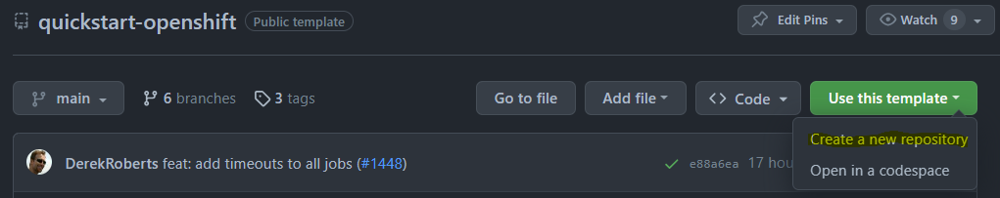
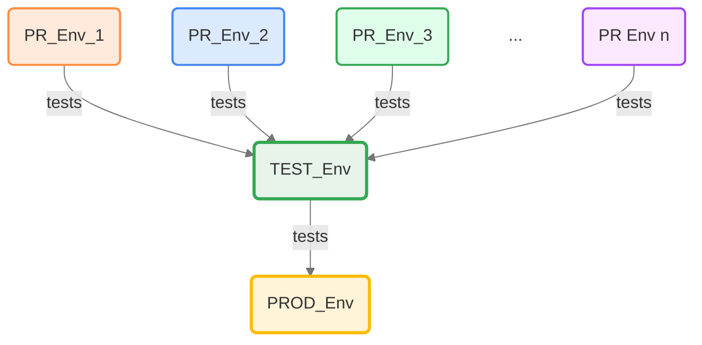
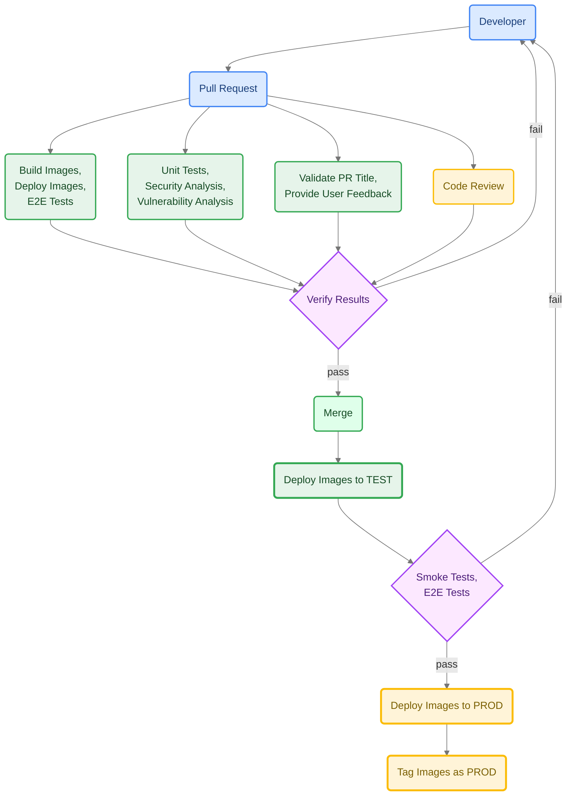
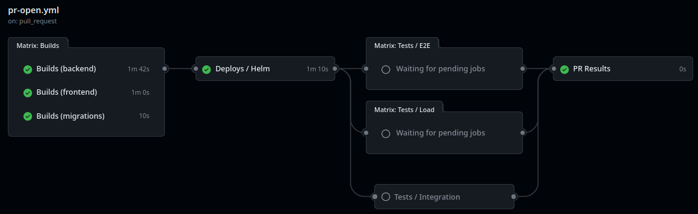
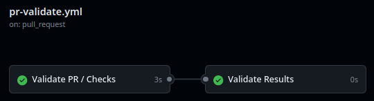
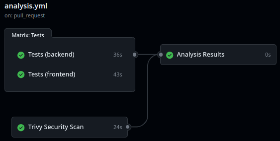
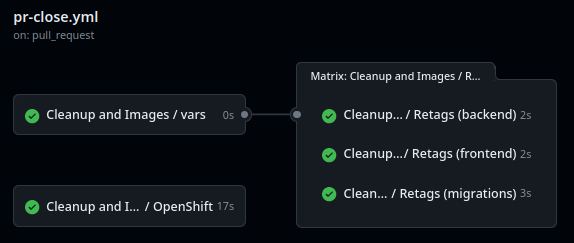
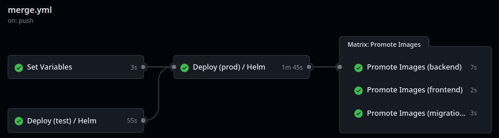
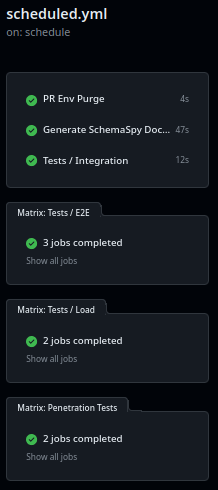

# Developer Guide

## Pull Request-Based Workflows with Sample Stack

This repository deploys the SDG portal, a modern web application stack, to OpenShift using GitHub Actions, incorporating best practices for CI/CD, security, and observability. It is based on [bcgov/quickstart-openshift](https://github.com/bcgov/quickstart-openshift) and includes built‑in **Maintenance Mode Automation**, which allows an app to go on autopilot for security and dependency updates. This limits developer involvement to critical issues only, drastically reducing labor costs and freeing up resources for higher priority work.

**Includes:**

- Pull Request-based pipeline
- Sandboxed development environments: a full, throwaway stack per pull request
- Gated/controlled production deployments (optional)
- Container publishing (ghcr.io) of four images: `portal-web`, `portal-api`, `portal-database` and `edge`
- Helm charts (`charts/`) with an `sdg` umbrella chart, deployed with Helm from GitHub Actions
- Secrets from Vault, injected by the Vault Agent sidecar; database and cache credentials generated in-cluster
- Security, vulnerability, infrastructure, and container scan tools
- Out-of-the-box alignment with **OWASP ASVS** Level 1 & 2 controls (see [SECURITY.md](./SECURITY.md#owasp-asvs-alignment))
- Inline Coraza WAF at the edge and NetworkPolicies between tiers
- Automatic dependency patching via [bcgov/renovate-config](https://github.com/bcgov/renovate-config)
- Maintenance Mode Automation (hands‑off updates, low‑dev mode) via the same Renovate config
- Enforced code reviews and workflow jobs (pass|fail)
- Prometheus metrics export from portal-api and the edge
- Rolling updates with zero downtime in PROD
- Database migrations with Drizzle, run as an initContainer before portal-api starts
- Pod disruption budgets for high availability
- Self-healing through probes/checks (startup, readiness, liveness)
- Helm chart lint, unit tests and schema validation; workflow lint (actionlint)
- k6 load tests against TEST, weekly
- Local stack with compose behind Caddy and the WAF at `https://sdg.localhost`
- **Sample application stack** (pnpm + Turborepo monorepo):
  - Database: PostgreSQL 17 + PostGIS 3.5 (Crunchy PGO), Drizzle; also the express-session store (encrypted at rest)
  - Frontend: `portal-web`, React + Vite with TanStack Router, served by Caddy
  - Edge: Caddy with Coraza WAF, routing `/api*` to portal-api and everything else to portal-web
  - Backend: `portal-api`, a NestJS backend-for-frontend with Keycloak (OIDC) sign-in
  - Shared packages: `design-system`, the `<sdg-header>` web component, `auth`, `portal-database`

# Setup

Setup takes an hour or less. Scripts in [`scripts/`](./scripts/) do the GitHub and OpenShift parts. Each one previews its changes by default, makes them only with `--apply`, and is safe to re-run: it changes only what differs and leaves everything else alone. Running any of them without `--apply` verifies the setup: it ends with `All set: nothing to change.`, or exits non-zero with the number of things to change. It confirms secrets exist but can't verify their values. Run them yourself, with your own logins.

## Checklist

1. **Accounts** (by hand): [GitHub accounts](https://github.com/signup) for the team. For BC Government, also IDIR accounts and membership in the bcgov GitHub organization ([instructions](https://developer.gov.bc.ca/docs/default/component/bc-developer-guide/use-github-in-bcgov/bc-government-organizations-in-github/#directions-to-sign-up-and-link-your-account-for-bcgov)).
2. **OpenShift namespaces** (by hand): request a project set (DEV, TEST and PROD) from Platform Services at the [registry](https://registry.developer.gov.bc.ca). You get a licence plate, e.g. `abc123`, and namespaces `abc123-dev`, `abc123-test`, `abc123-prod` and `abc123-tools`. Each namespace needs the Crunchy Postgres operator (PGO v5) watching it, which BC Gov platforms provide.
3. **Create the repository** (by hand): use this repository as a template.

   

4. **Log in** (by hand): `gh auth login`, then in the OpenShift console select your name (top right) > `Copy login command` and paste it into a shell (`oc login --token=... --server=...`). You need admin rights on the repo and edit rights in all three namespaces.
   Then run steps 5 to 7 with one command, which previews by default and exits non-zero if anything needs changing; add `--apply` to make the changes:
   ```bash
   scripts/setup.sh --plate abc123 --reviewers alice,bcgov/my-team   # preview, then add --apply
   ```
5. **OpenShift deploy account**: creates the `github-actions` service account, `edit` role binding and `github-actions-token` Secret in each namespace.
   ```bash
   scripts/setup-openshift.sh --plate abc123          # preview, then add --apply
   ```
6. **GitHub environments, secrets and variables**: creates the `test` and `prod` environments (PROD with required reviewers if you name them; without `--reviewers` it reports the current ones), and sets the `OC_NAMESPACE` variable and `OC_TOKEN` secret for pull requests (repository level), TEST and PROD, plus the `OC_SERVER` variable. It also checks the `KEYCLOAK_ISSUER_URL` and `KEYCLOAK_CLIENT_ID` variables for each and prints the `gh variable set` command for any that are missing; it never invents them. Without `--plate` it reads the plate from existing `OC_NAMESPACE` variables. Secrets that are already set are never overwritten. Secret values are piped from `oc` straight into `gh secret set`; they're never printed or written to disk, and previews show only the secret's name.
   ```bash
   scripts/setup-environments.sh --plate abc123 --reviewers alice,bcgov/my-team   # preview, then add --apply
   ```
7. **GitHub repository settings**: the `main` ruleset, pull request settings and private vulnerability reporting (see [Repository Configuration](#repository-configuration)).
   ```bash
   scripts/setup-github.sh                              # preview, then add --apply
   ```
8. **Vault secrets** (by hand): write `SESSION_SECRET` and `KEYCLOAK_CLIENT_SECRET` to Vault at `<plate>-nonprod/portal-api` (pull requests and TEST) and `<plate>-prod/portal-api` (PROD). See [Vault](#vault).
9. **Keycloak clients** (by hand): add `https://<release>.apps.<cluster>.devops.gov.bc.ca/api/auth/callback` and `https://<release>.apps.<cluster>.devops.gov.bc.ca/` as valid redirect URIs. Wildcards are allowed on the pull request and TEST clients, so `https://<repo>-*.apps.<cluster>.devops.gov.bc.ca/*` covers every pull request. They are not allowed in PROD: list the exact `https://<repo>-prod.apps.<cluster>.devops.gov.bc.ca` URIs (and the vanity URL's, if you set [`ROUTE_HOST`](#optional-values)).
10. **First pull request**: open one to run the pipeline, then make the packages public (see [Packages](#packages)).
11. **Optional** (by hand): [SonarCloud](#code-quality-with-sonarcloud), [Renovate](#renovate), Sysdig, a vanity URL with TLS, PROD deployment rules and team members, all described below.

## Secrets, Variables and Environments

Configuration lives in three places:

- **GitHub** holds what the workflows need to reach the cluster and render the chart. Repository-level values are used by pull request deploys; `test` and `prod` environment values override them for those deploys. Checklist steps 5 and 6 set the required ones.
- **OpenShift** holds credentials that are created in the cluster and never leave it.
- **Vault** holds the application secrets that people choose. The Vault Agent sidecar renders them into portal-api's pod at startup.

### GitHub

| Environment | Name                                                  | Description                                                                            |
| ----------- | ----------------------------------------------------- | -------------------------------------------------------------------------------------- |
| none        | `vars.OC_SERVER`                                      | OpenShift API server, `https://api.<cluster>.devops.gov.bc.ca:6443` (repository-level) |
| none        | `vars.OC_NAMESPACE`                                   | PR namespace, `<plate>-dev`                                                            |
| none        | `secrets.OC_TOKEN`                                    | PR service token (from the `github-actions-token` Secret in `<plate>-dev`)             |
| none        | `vars.KEYCLOAK_ISSUER_URL`, `vars.KEYCLOAK_CLIENT_ID` | PR portal-api Keycloak client                                                          |
| test        | `vars.OC_NAMESPACE`                                   | TEST namespace, `<plate>-test`                                                         |
| test        | `secrets.OC_TOKEN`                                    | TEST service token (from `<plate>-test`)                                               |
| test        | `vars.KEYCLOAK_ISSUER_URL`, `vars.KEYCLOAK_CLIENT_ID` | TEST portal-api Keycloak client                                                        |
| prod        | `vars.OC_NAMESPACE`                                   | PROD namespace, `<plate>-prod`                                                         |
| prod        | `secrets.OC_TOKEN`                                    | PROD service token (from `<plate>-prod`)                                               |
| prod        | `vars.KEYCLOAK_ISSUER_URL`, `vars.KEYCLOAK_CLIENT_ID` | PROD portal-api Keycloak client                                                        |
| any (opt)   | `vars.VAULT_SECRET_PATH`                              | Vault KV path; default `<plate>-nonprod/portal-api` (PROD: `<plate>-prod/portal-api`)  |
| prod (opt)  | `vars.ROUTE_HOST`                                     | Vanity URL hostname (repository or environment)                                        |
| prod (opt)  | `secrets.TLS_CERTIFICATE`                             | Leaf certificate PEM for vanity URL                                                    |
| prod (opt)  | `secrets.TLS_PRIVATE_KEY`                             | Private key PEM for vanity URL                                                         |
| prod (opt)  | `secrets.TLS_CA_CERTIFICATE`                          | Issuing CA PEM for vanity URL                                                          |
| none (opt)  | `secrets.SONAR_TOKEN`                                 | See [SonarCloud](#code-quality-with-sonarcloud)                                        |
| none (opt)  | `secrets.SYSDIG_API_TOKEN`                            | PROD alert sync                                                                        |

Deploys install the `charts/sdg` Helm chart as release `<repo>-<target>` (`sdg-12`, `sdg-test`, `sdg-prod`) at `https://<release>.apps.<cluster>.devops.gov.bc.ca`. [`scripts/deploy-values.sh`](./scripts/deploy-values.sh) derives the host, images and Vault settings (role `<plate>-nonprod`/`<plate>-prod`, service account `<plate>-vault`, auth path `auth/k8s-<cluster>`) from these values; sizes per environment live in `charts/sdg/values-{pr,test,prod}.yaml`. The Keycloak issuer URL and client id reach portal-api through a ConfigMap; they are not secrets.

**Copied the template before `OC_NAMESPACE` became a variable?** Move it: `gh variable set OC_NAMESPACE --body <plate>-dev`, and the same with `--env test` / `--env prod` (or run `scripts/setup-environments.sh --apply`). The old secret is unused and can be deleted. `DB_PASSWORD` is no longer used either (see [OpenShift](#openshift)).

### OpenShift

Nobody sets these by hand; they are created in the namespace and read there.

| Secret                             | Namespace(s)            | Holds                        | Created by                                                                      |
| ---------------------------------- | ----------------------- | ---------------------------- | ------------------------------------------------------------------------------- |
| `github-actions-token`             | `<plate>-dev/test/prod` | Deploy service account token | `scripts/setup-openshift.sh`; copied to GitHub `OC_TOKEN` by checklist step 6   |
| `<release>-postgres-pguser-portal` | the release's namespace | `DATABASE_URL` (key `uri`)   | The Crunchy operator, from the chart's `PostgresCluster`                        |
| Sysdig team Secret                 | `<plate>-tools`         | Sysdig API token             | Platform Services, from your `SysdigTeam` CR; copy to GitHub `SYSDIG_API_TOKEN` |

On first install portal-api pods wait (`CreateContainerConfigError`) until the operator has created the database user Secret; the migrator then retries until the database accepts connections.

### Vault

portal-api reads two secrets from a Vault KV v2 secret. Deploys use the role `<plate>-nonprod` (pull requests and TEST) or `<plate>-prod` (PROD) with the `<plate>-vault` service account; the path defaults to `<role>/portal-api` and can be changed with `VAULT_SECRET_PATH`.

| Key                      | Description                                                                                                                                       |
| ------------------------ | ------------------------------------------------------------------------------------------------------------------------------------------------- |
| `SESSION_SECRET`         | Session cookie signing and stored-session encryption key, at least 32 characters (e.g. `openssl rand -base64 48`); rotating it signs everyone out |
| `KEYCLOAK_CLIENT_SECRET` | Secret of the Keycloak confidential client named by `KEYCLOAK_CLIENT_ID`                                                                          |

Values must not contain `'` or newlines. The Vault Agent writes them to `/vault/secrets/portal-api.env`, which portal-api loads with `node --env-file`. See [`charts/README.md`](./charts/README.md) for where every other value lives and how to deploy without Vault.

### Optional Values

Set these by hand with `gh secret set` / `gh variable set` when you need them.

**`SYSDIG_API_TOKEN`**

Sysdig API token used to sync the PROD email-alert set on every merge. Sourced from the in-cluster Secret materialized by your `SysdigTeam` CR (BC Gov platform-services provisions this in your `*-tools` namespace). Optional — if unset, the `monitor-prod` step no-ops with a warning, so the deploy still succeeds.

- Reference: `${{ secrets.SYSDIG_API_TOKEN }}`
- Alert templates live in [`monitoring/alerts/`](./monitoring/alerts/) and cover `portal-web`, `portal-api` and `edge`. Add or remove files to customize the alert set per app — see [`bcgov/actions-openshift` (sysdig-monitor)](https://github.com/bcgov/actions-openshift) for the template schema and placeholder vocabulary.

**`TLS_CERTIFICATE`, `TLS_PRIVATE_KEY`, `TLS_CA_CERTIFICATE`**

PEM-formatted certificates and private key for custom vanity URL TLS on the PROD edge OpenShift Route. Optional — required only when `vars.ROUTE_HOST` is configured.

- References: `${{ secrets.TLS_CERTIFICATE }}`, `${{ secrets.TLS_PRIVATE_KEY }}`, `${{ secrets.TLS_CA_CERTIFICATE }}`
- Validated and applied on-demand via the standalone [`.github/workflows/route-tls.yml`](./.github/workflows/route-tls.yml) workflow using [`bcgov/actions-openshift/route-tls`](https://github.com/bcgov/actions-openshift/tree/main/route-tls), which checks key matching, CA chain, expiration, and archives previous certificates to an OpenShift secret.
- Store these as `prod` environment secrets (not repository secrets), and configure the `prod` environment's deployment branches and tags to restrict access (e.g. to `main` or release tags); environment scoping alone does not prevent a pull-request job from requesting these secrets.
- Do not pass PEMs or private keys as `workflow_dispatch` inputs—dispatch inputs are recorded in plaintext in workflow run logs. Rotation is handled by updating the `prod` secrets and triggering the `Route TLS` workflow with `dry_run=true` to validate, then `dry_run=false` to apply.

When receiving a certificate package from Entrust, map the files to GitHub secrets as follows:

| Secret               | File in package                       | Notes                                                             |
| -------------------- | ------------------------------------- | ----------------------------------------------------------------- |
| `TLS_CERTIFICATE`    | `<host>.pem`                          | Leaf certificate only (CN/SAN matches hostname).                  |
| `TLS_PRIVATE_KEY`    | `<host>.key`                          | Unencrypted private key (`BEGIN PRIVATE KEY`). Never commit this. |
| `TLS_CA_CERTIFICATE` | `Entrust OV TLS Issuing RSA CA 2.pem` | Issuing intermediate CA only (one PEM).                           |

Leave out root certificates (e.g. `Sectigo Public Server Authentication Root R46.pem` or `USERTrust RSA Certification Authority.pem`) because clients already have them in their trust stores. Omit `<host>.csr` (the signing request is finished).

Upload these secrets to the `prod` environment via GitHub CLI:

```bash
CERT_HOST='myapp.gov.bc.ca' # Replace with the certificate filename prefix
gh secret set TLS_CERTIFICATE --env prod < "${CERT_HOST}.pem"
gh secret set TLS_PRIVATE_KEY --env prod < "${CERT_HOST}.key"
gh secret set TLS_CA_CERTIFICATE --env prod < 'Entrust OV TLS Issuing RSA CA 2.pem'
```

**`ROUTE_HOST`**

Vanity URL hostname for the application (e.g., `myapp.gov.bc.ca` — hostname only, no scheme). Optional — can be set as a repository variable or environment variable on `prod`. When set, the standalone `Route TLS` workflow (`.github/workflows/route-tls.yml`) configures an OpenShift Route with custom TLS for the edge service (`<repo>-prod-edge`).

- Reference: `${{ vars.ROUTE_HOST }}`
- Set as a repository variable: `gh variable set ROUTE_HOST --body 'myapp.gov.bc.ca'` (or `Settings > Secrets and variables > Actions > Variables`). The `Cert Expiry` check reads only the repository variable.
- Add `https://<ROUTE_HOST>/api/auth/callback` and `https://<ROUTE_HOST>/` to the PROD Keycloak client's redirect URIs.

Two standalone workflows use it:

- `Route TLS` ([`route-tls.yml`](./.github/workflows/route-tls.yml)) validates (`dry_run=true`) or applies (`dry_run=false`) the PROD vanity Route certificate. Manual only.
- `Cert Expiry` ([`cert-expiry.yml`](./.github/workflows/cert-expiry.yml)) checks the `ROUTE_HOST` certificate and notifies CODEOWNERS if it expires within 30 days or can't be read. Runs weekly (Monday) or by hand, only when `ROUTE_HOST` is set.

Run either by hand from `Actions > <workflow> > Run workflow`, or:

```bash
gh workflow run route-tls.yml -f dry_run=true
gh workflow run cert-expiry.yml
```

### PROD Deployment Branches and Tags (optional)

By default, an environment allows deployments from any branch or tag ("No restriction"). To ensure pull requests and untrusted branches cannot access production secrets without adding human approval gates, configure deployment restrictions:

1. Select `Settings > Environments > prod`
2. Under **Deployment branches and tags**, change the dropdown to **Selected branches and tags**
3. Click **Add deployment branch or tag rule**:
   - To gate by branch: select **Branch** and enter `main` (or your protected release branch).
   - To gate by release tag: select **Tag** and enter a pattern like `v*.*.*` or `v*` so only release tags can trigger deployment.

## Releases (optional)

Two workflows can deploy PROD, and both are active by default:

- `merge.yml` deploys every merge to TEST, runs the tests, then deploys PROD by PR number.
- `release.yml` deploys a published [GitHub release](https://docs.github.com/en/repositories/releasing-projects-on-github/managing-releases-in-a-repository) to PROD. It finds the PR that the release's commit came from and deploys that PR's images, the same ones `merge.yml` deployed. Nothing is rebuilt.

To make PROD release-only, comment out the `deploy-prod`, `monitor-prod` and `promote` jobs in `merge.yml`. Merges then go to TEST and stop, and PROD changes only when you publish a release.

Notes:

- Publish releases from a commit on `main` that was merged from a PR. Commits pushed straight to `main` have no PR images to deploy.
- If the `prod` environment limits deployment branches and tags, add a tag rule for your release tags (e.g. `v*`), or releases can't deploy.
- Both workflows share a concurrency group, so they never deploy PROD at the same time.

## Updating Dependencies

Dependabot and Mend Renovate can both provide dependency updates using pull requests. Dependabot is simpler to configure, while Renovate is much more configurable and lighter on resources.

### Renovate

A configuration file (`renovate.json`) is included with this template that sources configuration from our [renovate repository](https://github.com/bcgov/renovate-config).

> [!TIP]
> Once Renovate is set up, you can enable **Maintenance Mode Automation** by following the checklist in the [Maintenance Mode Automation](#maintenance-mode-automation) section of this guide. This will let Renovate auto‑merge safe updates after all CI checks pass.

BC Government employees can request having the Renovate and Renovate Approve GitHub Apps installed on their repository through the [CITZ Service Desk](https://citz-do.atlassian.net/servicedesk/customer/portal/2/group/9/create/10). Most others can add their repositories directly from the [Renovate](https://github.com/apps/renovate) and [Renovate Approve](https://github.com/apps/renovate-approve) GitHub Apps.

### Dependabot

Dependabot is no longer recommended as an alternative to Renovate for generating security, vulnerability and dependency pull requests. It can still be used to generate warnings under the GitHub Security tab, which is only viewable by repository administrators.

## Code Quality with SonarCloud

SonarCloud performs static code analysis, test coverage tracking, and quality gate checks via the `bcgov/action-test-and-analyse` action in [`.github/workflows/analysis.yml`](./.github/workflows/analysis.yml). SonarCloud integration is optional—the test suites and CI pipeline run successfully without it.

BC Government employees can request SonarCloud projects via [devops-requests](https://github.com/bcgov/devops-requests/issues/new/choose) (select **Request for import GitHub repository on SonarCloud**) or directly through the [CITZ Service Desk](https://citz-do.atlassian.net/servicedesk/customer/portal/2/group/9/create/594).

### Onboarding Steps

Before submitting the request, ensure the designated project administrator has logged in to the [SonarCloud console under bcgov-sonarcloud](https://sonarcloud.io/organizations/bcgov-sonarcloud/projects) using their GitHub account.

Fill out the intake form using the following selections:

| Field                   | Selection                         | Notes                                                                                         |
| ----------------------- | --------------------------------- | --------------------------------------------------------------------------------------------- |
| **GitHub username**     | `<admin-username>`                | Must be the user who logged into SonarCloud above; will be assigned project administrator.    |
| **GitHub Repo URL**     | `https://github.com/bcgov/<repo>` | Full repository URL.                                                                          |
| **New Code Definition** | **Previous version**              | Quality gates evaluate changes relative to previous releases rather than a rolling day count. |
| **Setup as a monorepo** | **No**                            | One project covers the pnpm workspace (`apps/`, `packages/`, `tooling/`).                     |

### Post-Provisioning Configuration

Once the platform team provisions the project:

1. Generate an analysis token in SonarCloud and save it as the repository secret `SONAR_TOKEN`. Without it the `Tests` job skips the Sonar scan.
2. Check `-Dsonar.projectKey` in [`.github/workflows/analysis.yml`](./.github/workflows/analysis.yml) (default: the repository name) against the key SonarCloud assigned.

## Dependency Scanning with Knip

This repository uses [Knip](https://knip.dev/) for dependency scanning to identify unused dependencies and exports. Knip runs automatically as part of the Analysis workflow via the `bcgov/action-test-and-analyse` action.

**Note:** As a template repository, Knip runs in **warning mode** (non-blocking) to allow teams to customize dependencies without build failures. Teams can optionally change `dep_scan: warn` to `dep_scan: error` in their forks to enforce dependency scanning as a blocking check.

### Handling Unused Dependencies

When Knip identifies unused dependencies, you have two options:

1. **Remove the dependency** - If it's truly unused, remove it from `package.json`
2. **Report as false positive** - If the dependency is used but not detected by static analysis

### Reporting False Positives

**Do not create team-specific `knip.config.ts` files.** All Knip configuration is managed centrally in the upstream action repository.

If you encounter a false positive (a dependency that is used but flagged as unused), report it upstream:

1. **Verify it's a false positive** by checking:
   - Is it exported from a utility file (e.g., `test-utils.tsx`)?
   - Is it used via dynamic imports?
   - Is it required by build tools or other dependencies?
   - Is it used in configuration files that Knip doesn't analyze?

2. **Open a PR to the upstream repository:**
   - Repository: [`bcgov/action-test-and-analyse`](https://github.com/bcgov/action-test-and-analyse)
   - File: `.knip.json`
   - Add the dependency to the `ignoreDependencies` array

3. **Include justification** in your PR:
   - Why it's a false positive
   - How the dependency is used
   - Example: "Exported from test-utils files for use in tests but may not be directly imported yet. Common pattern in testing utilities."

### Example: Reporting a False Positive

If `@testing-library/user-event` is flagged but exported from `test-utils.tsx`:

**Upstream PR to `bcgov/action-test-and-analyse/.knip.json`:**

```json
{
  "ignoreDependencies": [
    "swagger-ui-express",
    "rimraf",
    "@types/node",
    "@types/react",
    "@types/react-dom",
    "@testing-library/user-event"
  ],
  "ignoreBinaries": ["rimraf"]
}
```

**PR Description:**

> Add `@testing-library/user-event` to ignoreDependencies
>
> This dependency is exported from test-utils files for use in tests but may not be directly imported yet. This is a common pattern in testing utilities where dependencies are re-exported for convenience.

### Common False Positive Patterns

- **Exported APIs**: Dependencies exported from utility files (like `test-utils.tsx`) that are intended for use but may not be directly imported yet
- **Indirect usage**: Dependencies used by build tools, scripts, or other dependencies that static analysis can't detect
- **Dynamic imports**: Dependencies loaded via dynamic imports or string-based requires
- **Configuration files**: Dependencies used in config files that aren't detected by static analysis
- **Type-only imports**: TypeScript type-only imports that are stripped at runtime

## Repository Configuration

`scripts/setup-github.sh` (checklist step 7) sets:

- **Ruleset `main`** on the default branch: blocks deletion and force pushes; requires a pull request with 1 approval and resolved conversations, merged by squash only; requires CodeQL code scanning results with no alerts at high or higher; and requires these status checks, which must be up to date with `main`:
  - `PR Results` (PR workflow)
  - `Analysis Results` (Analysis workflow)
  - `Validate Results` (PR Validate workflow)

  Each is the summary job of a workflow that runs on every pull request. The jobs they summarize (builds, deploys, tests, scans) are left out because they're skipped when their paths don't change, which would block merges. Repository admins may bypass the ruleset only by merging a pull request. Trivy results are still reported to the Security tab, but Trivy is deliberately not a merge gate because it fails often. Other rules already in the ruleset (e.g. Copilot code review) are kept.

- **Pull requests**: squash merging only, defaulting to the pull request title; suggest updating branches; allow auto-merge; delete head branches after merge.
- **Private vulnerability reporting**, which [SECURITY.md](./SECURITY.md) points reporters to.

### Packages

Packages are available from your repository (link on right). All four (`portal-web`, `portal-api`, `portal-database`, `edge`) should have visibility set to public for the workflows to run successfully.

E.g. `https://github.com/<owner>/<repo>/packages`

### Adding Team Members

Don't forget to add your team members!

1.  Select Settings (gear, top right) *> Collaborators and teams (under `Access`)
2.  Click `Add people` or `Add teams`
3.  Use the search box to find people or teams
4.  Choose a role (read, triage, write, maintain, admin)
5.  Click Add

## Security & OWASP ASVS Alignment

This repository is architected and hardened out-of-the-box to align with Levels 1 and 2 of the **OWASP Application Security Verification Standard (ASVS) v4.0.3**. A detailed security mapping matrix is documented in [SECURITY.md](./SECURITY.md#owasp-asvs-alignment), detailing our implementation of:

- **Active WAF Defense:** Inline Coraza WAF running inside the Caddy reverse proxy (the edge).
- **Tiered Isolation:** NetworkPolicies enforcing network boundaries between the edge, portal-web, portal-api and database tiers.
- **Platform/Container Hardening:** Read-only root filesystems, non-root execution, privilege escalation blocks, default seccomp profiles, and drop capabilities.
- **Secret Management:** Application secrets from Vault; database and cache credentials generated in-cluster and never stored in GitHub.
- **Build-Time & Dynamic Testing:** Automated static analysis (Trivy, CodeQL), dependency auditing (Renovate, Knip), and weekly dynamic vulnerability scans (**OWASP ZAP**).

## Container Hardening & Writable Paths

Out of the box, the Helm charts in this repository enforce strict container-level security contexts (defined once in `charts/common`):

- **Read-Only Root Filesystems:** Containers cannot write to the root filesystem at runtime (`readOnlyRootFilesystem: true`).
- **Non-Root Execution:** Containers are blocked from executing as the root user (`runAsNonRoot: true`).
- **Privilege Escalation Blocked:** Containers cannot gain more privileges than their parent process (`allowPrivilegeEscalation: false`).
- **Capabilities Dropped:** Every capability is dropped (`capabilities.drop: [ALL]`), and the images carry no file capabilities. `scripts/images-smoke.sh` checks this.

### Handling Dynamic Writes

If your application requires writing files at runtime (e.g., temporary caches, uploaded attachments, config logs):

1. **Do not disable the security context.**
2. Mount an `emptyDir` volume on the writable path in the chart's `templates/deployment.yaml` (portal-api and the edge already mount `/tmp` this way; portal-web and the edge mount Caddy's `/config` and `/data`). For a memory-backed (`tmpfs`) volume:
   ```yaml
             volumeMounts:
               - mountPath: /tmp
                 name: tmp
         volumes:
           - name: tmp
             emptyDir:
               medium: Memory
               sizeLimit: 256Mi
   ```
3. **Always specify a `sizeLimit`.** Running memory-backed volumes without a size limit allows a runaway container to exhaust the host node's RAM, triggering an out-of-memory (OOM) storm that will terminate other pods.

Run `pnpm test:charts` after changing a chart.

# Local Stack

`compose.yaml` runs the whole portal with its dev commands behind Caddy and the Coraza WAF at **https://sdg.localhost**:

| Service      | Runs                                                                                     | Reachable from the host            |
| ------------ | ---------------------------------------------------------------------------------------- | ---------------------------------- |
| `caddy`      | `apps/portal-web/caddy/Caddyfile.dev` (TLS from Caddy's local CA, WAF, security headers) | `https://sdg.localhost` (port 443) |
| `portal-web` | `vite` with HMR                                                                          | only through Caddy                 |
| `portal-api` | `nest start --watch`                                                                     | only through Caddy (`/api`)        |
| `migrate`    | `drizzle-kit migrate`; portal-api starts only after it succeeds                          | —                                  |
| `deps`       | `pnpm install` into Linux-only `node_modules` volumes                                    | —                                  |
| `postgis`    | database                                                                                 | `localhost:5432`                   |

## First run

1. Copy `apps/portal-api/.env.example` to `apps/portal-api/.env` and set `SESSION_SECRET` and the `KEYCLOAK_*` values. compose overrides the URLs (`APP_URL`, `DATABASE_URL`, `TRUST_PROXY`), so the file's `localhost` values can stay for host-run development.
2. On the Keycloak client, add `https://sdg.localhost/api/auth/callback` and `https://sdg.localhost/` as valid redirect URIs.
3. Start the stack. The first run installs dependencies and takes a few minutes:
   ```sh
   podman compose up -d --build   # or: docker compose up -d --build
   ```
4. Trust Caddy's local root certificate once (it is kept in the `caddy-data` volume, so this survives restarts; rerun if that volume is deleted):
   ```sh
   pnpm stack:trust   # macOS System keychain or the Linux CA store; prompts for sudo, no-op if already trusted
   ```
   Firefox keeps its own store: import the certificate there, or set `security.enterprise_roots.enabled` to `true` in `about:config`.
5. Check the stack end to end with `scripts/compose-smoke.sh --no-up` (TLS, headers, WAF, API proxy, port isolation, migrations).

## Troubleshooting

- **`rootlessport cannot expose privileged port 443`**: allow rootless Podman to bind 443 with `podman machine ssh "echo net.ipv4.ip_unprivileged_port_start=443 | sudo tee /etc/sysctl.d/99-unprivileged-ports.conf && sudo sysctl --system"`.
- **`sdg.localhost` does not resolve** (some Safari versions): add `127.0.0.1 sdg.localhost` to `/etc/hosts`.
- **`permission denied` under `/data` or `/config` in the caddy logs**: the volumes were created when the edge image ran as root. Remove them with `podman compose down && podman volume rm portal_caddy-data portal_caddy-config`, start the stack, and rerun `pnpm stack:trust` (a new local CA is generated).
- **After changing `Dockerfile.dev` or `apps/portal-web/caddy/Dockerfile`**: podman-compose does not recreate containers for a rebuilt image, so run `podman compose down && podman compose up -d --build`. Caddyfile edits only need `podman compose restart caddy`.
- **Adding a workspace package**: add its `node_modules` volume to `x-workspace` and `volumes:` in `compose.yaml`.
- **WAF**: rules using `block` (1001, 1002, 1005, 1007, 1008) follow Coraza's default action (`pass`) and only log a `Coraza: Warning`. Rules using `deny` (1003, 1004) return 403.

# Production Images

Multi-stage Dockerfiles for OpenShift. The app images build from the repository root:

| Image             | Build                                                   | Runs                                                                               |
| ----------------- | ------------------------------------------------------- | ---------------------------------------------------------------------------------- |
| `portal-web`      | `podman build -f apps/portal-web/Dockerfile .`          | Caddy serving the built SPA on `:8080` (cluster-internal)                          |
| `portal-api`      | `podman build -f apps/portal-api/Dockerfile .`          | `node dist/main.js` on `:3000` (cluster-internal)                                  |
| `portal-database` | `podman build -f packages/portal-database/Dockerfile .` | `node dist/migrate.js` as portal-api's initContainer (needs `DATABASE_URL`)        |
| edge              | `podman build apps/portal-web/caddy`                    | Caddy + Coraza WAF on `:3000`: `/api*` → `PORTAL_API_URL`, `/*` → `PORTAL_WEB_URL` |

All run on Alpine without a package manager, as an arbitrary UID in group 0 with every capability dropped. `scripts/images-smoke.sh` builds them and checks them that way against the compose `postgis` (migrations, health, SPA routing and caching, edge headers, WAF).

# Workflows

These workflows and actions enforce a pull request based flow.



Here's a more detailed view showing a single pull request.



## Pull Request

Runs on pull request submission.

- Provides safe, sandboxed deployment environments
- Build action pushes to GitHub Container Registry (ghcr.io)
- Build triggers select new builds vs reusing builds
- Deploy only when changes are made
- Builds `portal-web`, `portal-api`, `portal-database` and `edge`; deploys the `charts/sdg` Helm release `<repo>-<pr>` to `<plate>-dev`
- Smoke checks through the edge and Playwright E2E (chromium) when changes are made
- Posts sticky comment with deployment links when deployments occur
- Other checks and updates as required



> Screenshot out of date: shows the original quickstart jobs; see [`pr-open.yml`](.github/workflows/pr-open.yml).

## Validation

Runs on pull request submission.

- Enforces conventional commits in PR title



## Analysis

Runs on pull request submission or merge to the default branch.

- Lint, format, typecheck and unit tests with coverage (pnpm/turbo), optional SonarCloud
- Helm chart lint, unit tests and kubeconform (`pnpm test:charts`); workflow lint (`actionlint`)
- k6 load script checks (`tests/load/load.test.sh`, no traffic)
- CodeQL/GitHub security reporting (now handled as GitHub default!)
- Trivy password, vulnerability and security scanning



> Screenshot out of date: shows the original quickstart jobs; see [`analysis.yml`](.github/workflows/analysis.yml).

## Pull Request Closed

Runs on pull request close or merge.

- Uninstalls the PR's Helm release (`helm uninstall <repo>-<pr>`)
- Merge retags successful build images as `latest`



> Screenshot out of date: shows the original quickstart jobs; see [`pr-close.yml`](.github/workflows/pr-close.yml).

## Merge

Runs on merge to main branch.

- Zero-downtime* TEST deployment
- Smoke checks and Playwright E2E on TEST
- Zero-downtime* PROD deployment
- Labels successful deployment images as PROD
- Sysdig email alerts synced to PROD (no-op if `SYSDIG_API_TOKEN` is unset)

\* excludes database changes



> Screenshot out of date: shows the original quickstart jobs; see [`merge.yml`](.github/workflows/merge.yml).

## Scheduled

Runs on scheduled job (cronjob) or workflow dispatch.

- PR environment purge (Helm releases not updated for 3 days)
- ZAP scan of the TEST deployment
- k6 load tests on TEST after ZAP (see [Load tests](#load-tests)); a breached threshold fails the job
- Stale branch/PR cleanup



> Screenshot out of date: shows the original quickstart jobs; see [`scheduled.yml`](.github/workflows/scheduled.yml).

## Load tests

[k6](https://grafana.com/docs/k6/latest/) scripts in [`tests/load/`](./tests/load/) load the deployed stack through the edge: `portal-web.ts` (the index and the JS/CSS it links) and `portal-api.ts` (`/api/auth/me` signed out, so no session or Postgres lookup). Both share profiles and thresholds from `tests/load/lib/config.ts`: failed requests under 1%, p95 under 500 ms, checks over 99%. The Scheduled workflow runs them weekly against TEST with the `ramp` profile (50 VUs over 5 minutes) and uploads an HTML report per script.

```bash
brew install k6                                                     # once
BASE_URL=https://sdg-test.apps.gold.devops.gov.bc.ca pnpm test:load  # both scripts, ramp profile
BASE_URL=https://sdg.localhost LOAD_PROFILE=smoke pnpm test:load portal-api
tests/load/load.test.sh                                             # checks the scripts' options, no traffic
```

Never point `pnpm test:load` at PROD. The compose stack serves portal-web from the Vite dev server, which has no built `/assets/`, so run `portal-web` against a deployment or `vite preview --host 127.0.0.1` of a build.

# Maintenance Mode Automation

This repository supports operating downstream projects in a low-maintenance, sustainment-only mode. When configured, dependency updates can be completely automated with zero manual intervention required for minor and patch updates, and optional hands-off major version bumps.

## How It Works

1. **Automated Dependency Updates**: The repository includes a `renovate.json` file configured to extend [`bcgov/renovate-config`](https://github.com/bcgov/renovate-config). This allows Mend Renovate to scan for updates, group related package updates together, and prepare automated Pull Requests.
2. **Branch Protection & Gated Merging**: The `main` ruleset ensures that no PR is merged without verifying that the application remains functional.
3. **CI/CD Validation**: The `PR` workflow builds, deploys, and runs tests against sandboxed preview environments; `PR Validate` enforces PR title/description conventions.
4. **(Optional) Automerging**: If Renovate automerge is enabled and all required checks pass, Renovate can merge updates back to the `main` branch, triggering an automated rolling deployment.

## Maintenance Mode Readiness Checklist

Before transitioning an application utilizing this template to full maintenance mode, downstream teams should verify and meet the following criteria:

- [ ] **Robust Automated Test Coverage**: A high test coverage threshold (e.g., 70% or higher for both statements and branches) should be enforced. Unit, integration, and end-to-end tests must be capable of catching regressions automatically.
- [ ] **PR Preview Environments**: Ensure sandboxed preview environments deploy reliably to OpenShift for all pull requests.
- [ ] **Automated Smoke Tests / Probes**: The application must implement runtime health checks that verify connectivity to database instances and external downstream services (e.g., S3, Keycloak, or mail services).
- [ ] **Automerge Policies**: Verify that the Mend Renovate GitHub app is integrated and allowed to manage automerges for passing builds.

## Runtime Health Checks & Smoke Testing

To safely automate dependency updates, runtime health checks are mandatory to catch runtime connectivity failures before an update is merged.

### QuickStart Health Check Implementation

This repository provides out-of-the-box support for self-healing and verification through container probes:

- **portal-api (NestJS)**: Implements `/healthz/live` (process up; startup and liveness probes) and `/healthz/ready` (readiness probe) using NestJS Terminus. Readiness checks PostgreSQL (which also holds sessions) and Keycloak and returns `503 Service Unavailable` when any is down. Both sit outside `/api`, so the edge doesn't expose them.
- **portal-web (Caddy)**: readiness/liveness probes check `/` to confirm the web server is responsive and serving assets.
- **edge (Caddy + Coraza)**: readiness/liveness probes are TCP checks, so the edge's health doesn't depend on its upstreams.
- **Smoke checks**: after every deploy, `reusable-tests.yml` requests `/` (portal-web, expects 200) and `/api/auth/me` (portal-api through the edge, signed out, so no session lookup; expects 401) before running Playwright E2E.

_Tip: For a fully mature maintenance mode setup, extend the readiness checks to query any further external APIs portal-api comes to depend on. If a dependency goes down, the health check should return `503 Service Unavailable`, blocking the automated merge._

## Automerge Expectations

### When Automerge Occurs

- Renovate creates PRs for dependency updates (npm packages, GitHub Actions, Docker base images).
- All status checks pass successfully:
  - Linting and unit tests complete.
  - Preview environment successfully deploys to OpenShift.
  - Automated smoke tests verify the preview environment is fully functional.
- No merge conflicts are detected.

### When Manual Intervention is Needed

- A dependency upgrade causes compile, build, lint, or test failures.
- A smoke test or deep health check fails post-deployment.
- A security vulnerability scanner (e.g., Trivy or CodeQL) flags a new vulnerability.
