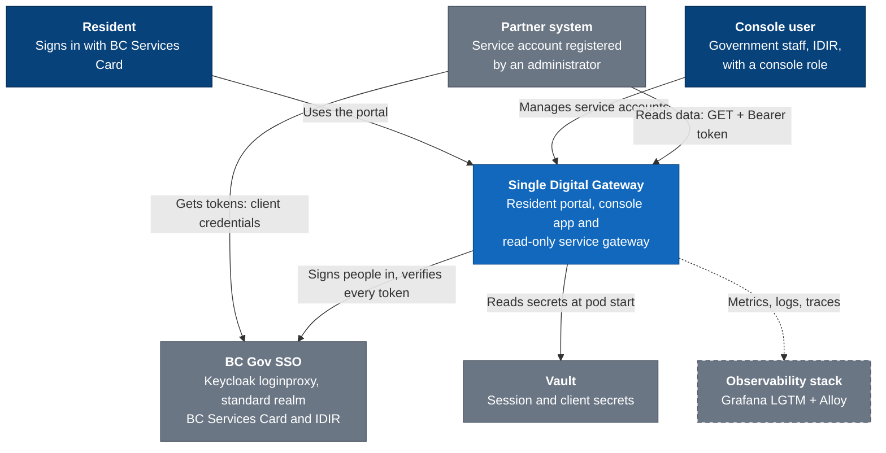
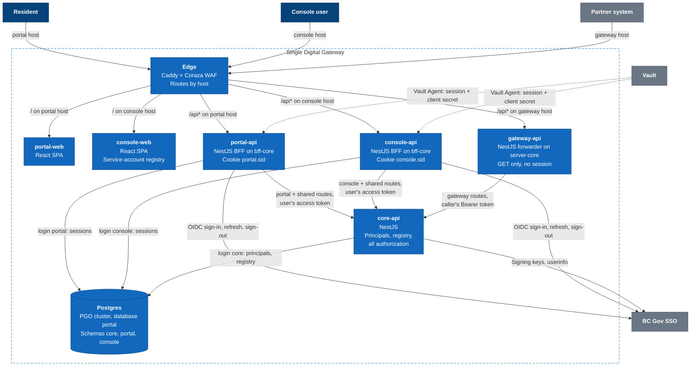
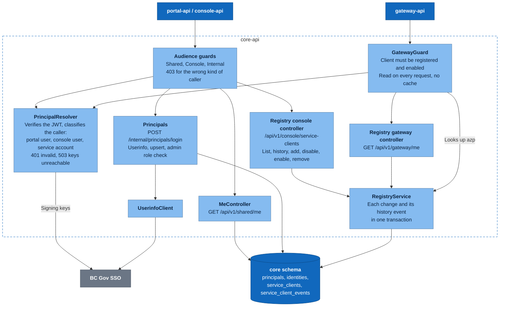
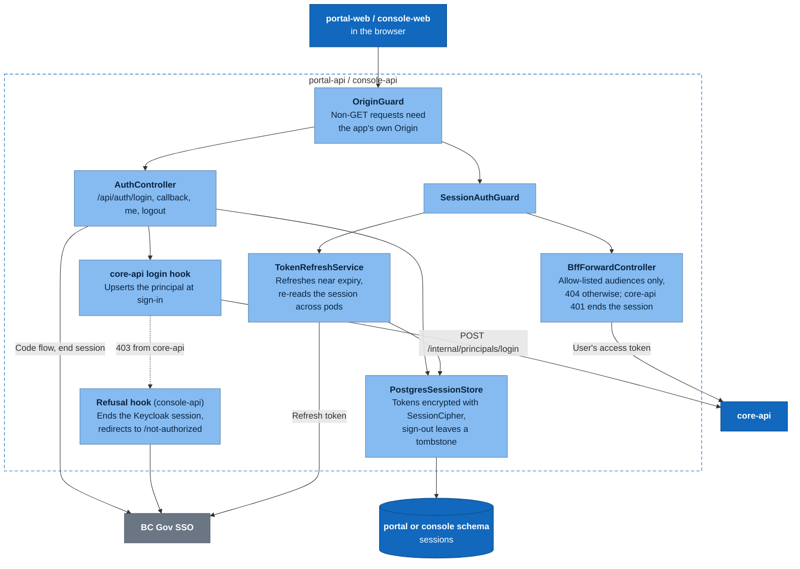
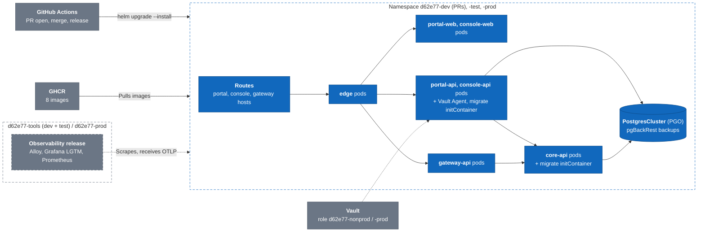

# Architecture

C4 diagrams of the Single Digital Gateway: system context, containers, the components of core-api and of the two BFFs, and the OpenShift deployment. Update them when a service, route group or dependency changes.

Colors: dark blue is a person, blue is part of SDG, light blue is a component inside a service, grey is an external system, and a dashed border means optional (off unless configured).

## Level 1: System context

Who uses SDG and which outside systems it depends on.

- Residents and console users are always different people: the portal client uses BC Services Card and the console client uses IDIR.
- Partners never sign in. Their token is accepted only while their client is registered and enabled in SDG.

## Level 2: Containers

Six services plus the database. Hosts are `sdg-N`, `sdg-N-console` and `sdg-N-gateway` for pull request N, and `sdg-test…` and `sdg-prod…` for TEST and PROD.

- Routes have the shape `/api/v1/<audience>/…`. Each forwarder passes on only its own audiences and answers 404 to the rest without calling core-api.
- gateway-api checks only the request's shape: 401 without a Bearer token, 405 for anything but GET, 404 outside `/api/v1/gateway/*`.
- Each service has its own Postgres login and schema and can't read the others'. pg_cron prunes expired sessions. gateway-api has no database.
- On the gateway host the edge answers 404 to anything outside `/api*`. A host whose upstream isn't deployed answers 503.

## Level 3: core-api components

core-api trusts no forwarder. It verifies every token itself, then authorizes by audience.

- A person token is accepted only from the portal or console client. Service-account tokens are recognized by their `client_id` claim or `service-account-` username, and the registry is matched on `azp`.
- `/internal/*` is never forwarded. Only the BFFs call it, at sign-in. A refused console user gets 403 there, and console-api turns that into a sign-out.
- The portal audience has no routes yet. Residents use only the shared `/me` route so far.

## Level 3: BFF components

portal-api and console-api are the same `@repo/bff-core` module with different settings (cookie, client, schema, audiences). Only console-api adds the refusal hook.

- The browser never sees a token, only the session cookie. The BFF attaches the access token when it forwards.
- A failed sign-in redirects to the app with `?authError=` (`unavailable`, `login_failed`, `access_denied`, `invalid_state`) and keeps any existing session.

## Deployment: OpenShift

GitHub Actions deploys the `charts/sdg` Helm umbrella as one release per environment, with images from GHCR.

- Every PR gets the full stack, sized down, as release `sdg-N` in the dev namespace. TEST and PROD are `sdg-test` and `sdg-prod`.
- Ingress NetworkPolicies separate the tiers: the edge accepts only the OpenShift router, the web apps and forwarders accept only the edge, core-api accepts only the three forwarders, and Postgres accepts only core-api and the two BFFs.
- The release rolls back as a whole: if one service fails to start, none of the new versions stay.
- Observability is wired only when `OBSERVABILITY=true`. Otherwise nothing is scraped or sent.
