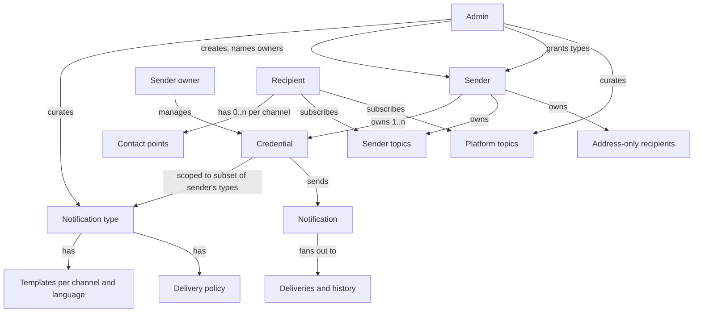
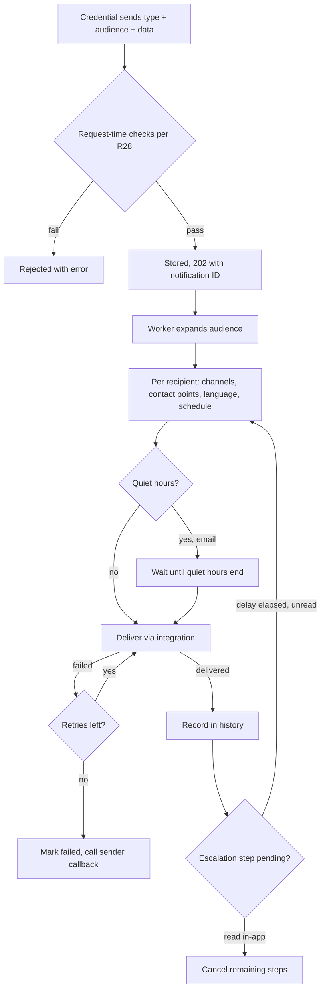
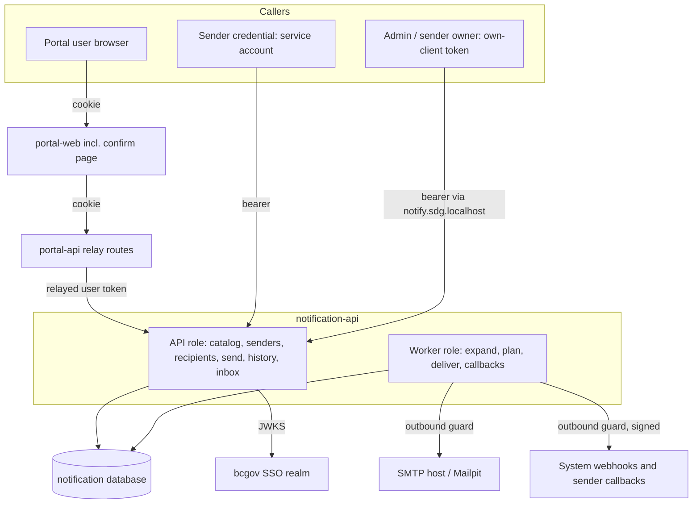
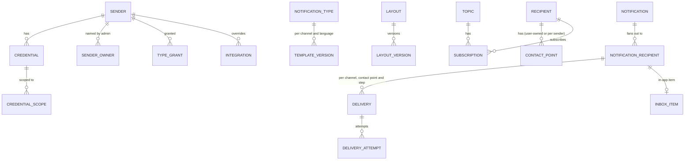
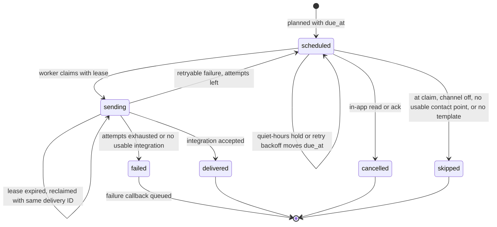
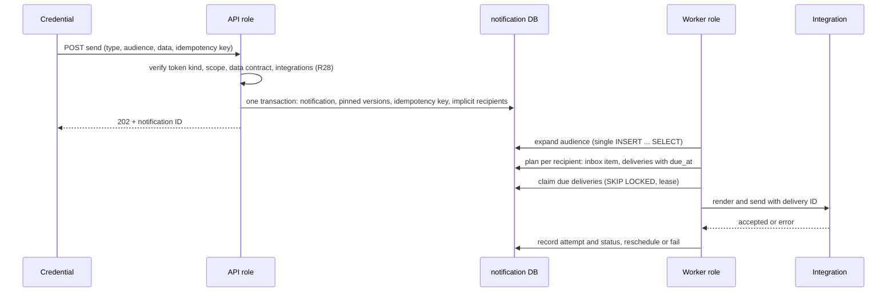
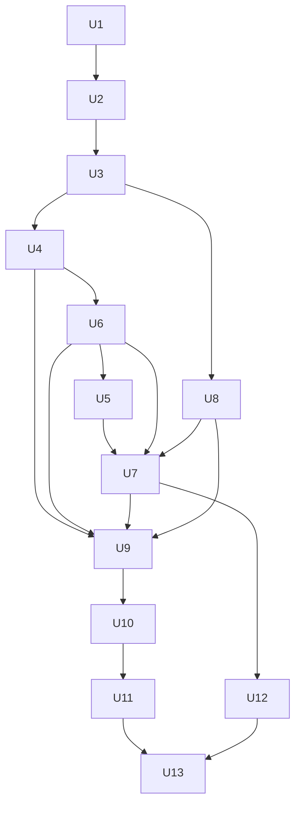

# Notification API - Plan

## Goal Capsule

- **Objective:** Any authorized system on the platform can notify users, people who have not logged in yet, members of the public, and other systems through one shared service. What can be sent is controlled by an admin-curated catalog, delivery respects each recipient's language and quiet hours, and every communication can be found again afterwards.
- **Means:** A spike of a new `notification-api` app in this monorepo, run locally, that proves the domain model end to end over the in-app, email and webhook channels, plus the portal-api relay routes and portal-web confirm page it needs (R56).
- **Authority:** The Product Contract wins on behavior; Key Technical Decisions (KTD1–KTD17) win on mechanism within it; units override neither. Items under Scope Boundaries are not active scope.
- **Execution profile:** Thirteen units (U1–U13) on work branches merged locally into `spike/notification-api` (R5), verified by the Verification Contract and the end-to-end run in U13.
- **Stop conditions:** Stop and ask when a real SSO token contradicts the Assumptions (U3), when a unit would need to change a Product Contract requirement, or when anything would push to a remote or deploy.
- **Open blockers:** None. The spike-exit question waits until the spike is done.

---

## Product Contract

### Summary

Build `notification-api`, a NestJS app with an API role and a worker role over a Postgres-backed queue.

An admin defines Notification types: a data contract, Liquid templates (MJML for email HTML) per channel and language, and a delivery policy. The admin then grants those types to senders. A sender's credentials send types to recipients, topics or the sender's whole audience. Workers deliver through pluggable channel integrations and record every rendered delivery as history.

### Problem Frame

The portal is about to need to tell its users things, and later systems owned by other teams will too, some of them outside this repo. Today nothing on the platform sends notifications.

If each system builds its own sending, the platform ends up with several inboxes, several email setups, and no shared record of what was said to whom. Nobody controls what gets sent, and a member of the public who gave an email address on a form has no communication history anyone can look up.

Delivery needs also vary. Some messages should escalate from in-app to email when they are ignored. Some recipients are systems that want webhooks. Some programs must send through their own mail infrastructure.

### Actors

- A1. **Admin.** A person with the admin client role on notification-api's own Keycloak client. Curates the catalog, platform topics, shared layouts and senders, and can do anything a sender owner can.
- A2. **Sender owner.** A person the admin names as an owner of a sender. Manages that sender's credentials, integration overrides and failure callback URL.
- A3. **Sender.** A program or organization, such as "Permits program", that sends notifications. It owns its history, address-only recipients, topics, integration overrides and callback URL.
- A4. **Credential.** A Keycloak service-account client linked to exactly one sender. It sends notifications and registers recipients within the types it has been scoped to, and reads its sender's history (R12).
- A5. **Recipient.** A user (identified by IdP issuer + subject), a pre-registered user, an address-only recipient, or a system.
- A6. **Relaying app.** An app such as portal-api that forwards a signed-in user's own access token so the user can manage their inbox and settings.
- A7. **Workers.** The notification-api worker role. Expands audiences, schedules and performs deliveries, retries them, and calls failure callbacks.



### Key Decisions

- **The spike proves the domain model end to end.** Escalation, broadcast and verification actually run. They are not stubs. (session-settled: user-directed — chosen over a walking skeleton and an architecture-only probe: the domain model is what the spike must validate.) Governs R1–R56.
- **Catalog sends, not event routing.** A credential names the Notification type and audience. (session-settled: user-directed — chosen over event-routed sends with admin rules: senders here know their users, and routing can be layered on later.) Governs R26.
- **The admin curates the catalog.** (session-settled: user-directed — chosen over sender-owned and sender-shareable definitions.) Governs R6, R13, R22.
- **Senders and credentials are separate levels.** The admin grants types to senders. Owners or the admin give credentials subsets of those types. (session-settled: user-directed — chosen over admin-only management and a privileged sender credential: it puts each program's credentials with the people who run it.) Governs R6–R9.
- **Credentials are Keycloak service-account clients linked by client ID.** notification-api never issues or stores caller secrets. (session-settled: user-approved — chosen over API keys issued by notification-api.) Governs R8.
- **notification-api keeps its own recipient registry, keyed by IdP issuer + subject.** It is not coupled to the portal database. (session-settled: user-directed — chosen over reusing portal principals and over sender-scoped IDs.) Governs R27.
- **Recipients can be known identities or raw addresses, and raw addresses become stored address-only recipients.** Each sender owns its own, deduplicated by normalized address. (session-settled: user-directed — chosen over a global address identity and over sender-held recipient IDs: history stays findable, and one program's communications stay invisible to others.) Governs R27, R43.
- **Users reach notification-api with their own token, relayed by apps like portal-api.** (session-settled: user-directed — chosen over trusted on-behalf-of sender calls and over browser tokens: portal-web is a cookie-only BFF and portal-api already holds the user's tokens.) Governs R10, R11, R56.
- **Only the recipient's channel switches, language, timezone and quiet hours are recipient preferences.** There is no muting and no mandatory flag. (session-settled: user-directed — chosen over per-type muting with a mandatory override: muting is not wanted now.) Governs R37–R40.
- **Every notification to an inbox recipient creates an in-app item; the policy only governs other channels.** (session-settled: user-directed — chosen over treating in-app like any other policy channel: the inbox stays the complete record and every escalation has a read that can stop it.) Governs R18, R38.
- **The email confirmation link opens a portal-web page.** (session-settled: user-directed — chosen over a page served by notification-api and an API-only spike.) Governs R35, R56.
- **Escalation stops on an in-app read or acknowledgement.** (session-settled: user-directed — chosen over any-engagement tracking and over acknowledgement only.) Governs R18, R19.
- **Contact points need verification only when a user adds them, or when the IdP does not vouch for the email.** (session-settled: user-directed — chosen over verifying every stored address and over verifying everything: senders are accountable through grants, and pre-registration must reach people who have not engaged yet.) Governs R35.
- **Templates are Liquid, with MJML for email HTML.** (session-settled: user-directed — chosen over Liquid alone and over Handlebars.) Governs R20–R25.
- **Every channel delivers through pluggable integration types, and SMTP is just the first email type.** (session-settled: user-directed — chosen over wiring SMTP directly into the email channel.) Governs R44–R48.
- **Delivery is at least once, with a stable delivery ID for deduplication.** (session-settled: user-directed — chosen over at-most-once: no accepted notification is silently lost, and receivers can discard repeats.) Governs R52, R53.
- **Delivery is asynchronous over a Postgres-backed queue.** The request stores and accepts the notification, and workers deliver it. There is no Valkey on the platform, and accepted then means stored. Governs R3, R26, R29.
- **The app mirrors portal-api's foundation.** That means NestJS 12, `@nestjs/config` with zod, nestjs-pino, and preloaded OpenTelemetry. (session-settled: user-directed — the requested stack, which matches portal-api's existing setup.) Governs R1, R2.

### Requirements

**Spike foundation**

- R1. `apps/notification-api` is a NestJS 12 app whose environment is loaded by `@nestjs/config` and validated with zod, following `apps/portal-api/src/config/env.ts`. An invalid environment names each bad key and never its value.
- R2. It logs with nestjs-pino (pino-pretty in development only) and preloads OpenTelemetry the way portal-api does. `/metrics` is always on, and traces and logs are exported only when `OTEL_EXPORTER_OTLP_ENDPOINT` is set.
- R3. The app runs in an API role, a worker role, or both, chosen by configuration. The local stack runs both in one process.
- R4. The spike runs in the local compose stack with a local mail catcher, and its tests use the repo's Vitest setup.
- R5. Spike work happens on a `spike/notification-api` base branch. Work branches are merged into it locally, without pull requests, because `.github/workflows/pr-open.yml` deploys every pull request.

**Senders, credentials and access**

- R6. The admin creates senders, names their owners, and grants each sender Notification types.
- R7. Sender owners and the admin can manage a sender's credentials, integration overrides and failure callback URL.
- R8. A credential is a Keycloak service-account client linked by client ID to exactly one sender. It may send only the subset of the sender's granted types it has been scoped to. Credential endpoints accept only client-credentials tokens whose client ID is linked to a sender, and a user token never authorizes a credential endpoint. notification-api's own client and the clients of configured relaying apps (R10, R11) can never be linked as credentials.
- R9. Revoking a type from a sender also removes it from every credential of that sender.
- R10. Admin, sender-owner and recipient endpoints accept only a person's own user token, never a service-account token. Admin and sender-owner endpoints accept only tokens issued to notification-api's own Keycloak client, which also carries the admin client role. There is no admin UI.
- R11. notification-api accepts user tokens that were issued to the clients of configured relaying apps, starting with the portal, on recipient endpoints only (inbox, contact points, settings, self-subscription).
- R12. A credential can read delivery history only for its own sender. Admins can read all history. Recipients see only their own inbox.

**Catalog: types, policies and topics**

- R13. A Notification type has a key, a data contract describing the data its templates need, a default language, zero or more templates per channel, and a delivery policy.
- R14. A delivery policy either delivers on all of its channels at once, or escalates through ordered channel steps, each after a delay. A policy channel the type has no template for is skipped, and its deliveries are recorded as `skipped` with the reason "no template".
- R15. Platform topics are created by the admin, who grants senders permission to broadcast to them.
- R16. Sender topics are created by a sender for its own records, such as one per permit. Only that sender broadcasts to them.
- R17. Recipients can subscribe or unsubscribe themselves where the topic allows it, and senders can subscribe recipients to topics they may broadcast to.
- R18. An escalation for a recipient stops when that recipient reads or acknowledges the notification in-app.
- R19. Escalation applies only to recipients with an inbox. Address-only recipients always receive all-at-once delivery.

**Templates**

- R20. Templates are written in sandboxed Liquid, and template code can never execute code, read files, or reach server internals.
- R21. Each channel's template has its own parts. Email has a subject, an MJML HTML body and a plain-text body (generated from the HTML when left empty). In-app has a title, a Markdown body and an optional action link. Webhook has a JSON payload template, with a standard envelope (type, recipient, sender data) when none is set.
- R22. The admin defines shared layouts and partials, and the admin is the only one who writes or edits templates.
- R23. Saving a template test-renders it against the type's data contract with sample data and rejects it on errors. A preview renders any template in any of its languages.
- R24. Templates format dates, times, numbers and currency in the recipient's language and timezone. Output is HTML-escaped in email and sanitized in in-app Markdown, and values in webhook payload templates are JSON-encoded; a payload that is not valid JSON fails the test-render (R23) and the delivery.
- R25. Editing a template creates a new version, and a notification always renders with the versions current when it was sent.

**Sending**

- R26. A credential sends a Notification type, with data and an idempotency key, to one or more recipients, to a topic, or to everyone.
- R27. Recipients in a send are given as recipient references (IdP issuer + subject, or a system ID) or as raw addresses. A raw address becomes, or matches, an address-only recipient of the sending sender. A user reference may carry contact points: an unknown user is pre-registered for the sending sender with them (R33), and a known user gains them for that sender. An unknown user sent to with no contact points is pre-registered for in-app only, and other channels are recorded as `skipped` with the reason "no contact point".
- R28. A send is rejected at request time in six cases: the credential is not scoped to the type, the data does not satisfy the data contract, a policy channel has no usable integration for the sender, the idempotency key was already used with different content, the topic is not one the sender may broadcast to (R15, R16), or a system recipient was registered by a different sender (R33).
- R29. An accepted send is stored before the response, which returns a notification ID that history can be queried by.
- R30. An "everyone" send reaches the sending sender's own audience, excluding its address-only recipients. That audience is the users and systems it has registered plus the current subscribers of its topics.
- R31. A broadcast's audience is fixed when the workers expand it, so recipients added later do not receive it.

**Recipients and contact points**

- R32. A user's first authenticated call creates their recipient, or claims the one a sender pre-registered with the same issuer + subject. The IdP email is copied in as an email contact point.
- R33. Senders can pre-register user recipients (issuer + subject plus contact points) and register system recipients with webhook contact points. A contact point a sender supplies is used only for that sender's deliveries, and system recipients belong to the sender that registered them. Pre-registering a user who already exists only adds that sender's contact points and returns the same response as a new registration.
- R34. A recipient has zero or more contact points per channel, and a delivery on a channel goes to every usable contact point for that channel: one that is verified, or that the sending sender supplied (R33, R35).
- R35. Contact points supplied by senders are trusted as given. The IdP email is trusted when the token marks it verified; otherwise it is stored unverified and a confirmation link is sent to it when the recipient is created. An email address a user adds or edits is unusable until confirmed through a link sent to it.
- R36. Confirmation emails (R35) are rate-limited per recipient and per target address, with a cooldown before a pending address can be re-sent; a request over the limit is rejected with a clear error. Users can add, edit and remove their own email contact points, including the seeded IdP email. Webhook contact points belong only to system recipients that senders register (R33).
- R37. Users can switch the email channel off. In-app cannot be switched off.
- R38. Every notification to a recipient with an inbox creates an in-app item, whatever its policy lists; the policy governs only email and webhook. Deliveries and escalation steps skip a channel the recipient has switched off.
- R39. Users set their preferred language, and senders set language and timezone on their address-only recipients. Recipients without a timezone use the platform's configured default zone for formatting. Template selection uses the recipient's language and falls back to the type's default language.
- R40. Users set a timezone and quiet hours. During quiet hours, email deliveries and due escalation steps wait until the quiet hours end, while in-app delivery is immediate. Systems and address-only recipients have no quiet hours.

**Delivery and history**

- R41. Workers deliver each recipient's notification according to the type's policy (R14) and the recipient's settings (R37–R40), with the content rendered at delivery from the versions pinned at send (R25).
- R42. Failed delivery attempts are retried a limited number of times. A delivery that exhausts its retries is marked failed, and the sender's failure callback URL is called for it at least once, carrying that delivery's stable ID (R53).
- R43. History records every delivery attempt with its channel, contact point (shown in full to the sender, including the recipient's own addresses), status, credential and content exactly as rendered, and can be queried by notification, recipient, address or sender reference.

**Channels and integrations**

- R44. The spike's channels are in-app, email and webhook. Each channel declares its template parts, whether recipients can switch it off, whether quiet hours hold it, and how its addresses are normalized; R21, R37 and R40 describe these declarations for the three spike channels.
- R45. Each channel delivers through integration types. Each type declares a configuration schema that marks its secret fields. The spike ships `smtp` for email and one built-in type each for in-app and webhook.
- R46. A channel may have a platform-wide default integration, configured through the service's environment.
- R47. A sender can configure its own integration per channel, of any type that channel supports, to override the default. It must do so where no default exists.
- R48. Secret fields of sender-supplied integration configuration are stored encrypted, are never returned by any read, and are never logged.
- R49. Webhook deliveries and failure callbacks are signed so receivers can verify they came from notification-api. What a receiver uses to verify signatures never lets it produce valid signatures for another sender's receivers.
- R50. The in-app channel gives recipients an inbox they can list, read and acknowledge.
- R51. Workers connect only to public addresses over TLS for webhook contact points, failure callbacks and sender-configured integration hosts. Destinations are checked after DNS resolution, redirects are not followed, and history records a status and short error, never response bodies. A configured allow-list of hosts, empty by default and set only in the local stack for its mail catcher and webhook receiver, is exempt from the public-address and TLS checks.

**Delivery guarantees**

- R52. An accepted notification is never lost: it survives restarts and crashes, and every delivery reaches a final status. Delivery is at least once, so a crash mid-send may repeat a delivery but never drops it.
- R53. Every delivery carries a stable delivery ID, sent as a webhook header and as the email Message-ID, so receivers can discard duplicates. In-app items are never duplicated.
- R54. A delivery moves through `scheduled`, `sending` and `delivered`, or ends as `failed`, `cancelled` or `skipped` with a recorded reason. For email, `delivered` means the integration accepted it.
- R55. History shows each notification's deliveries rolled up by status, so a sender can see how a broadcast is progressing.

**Portal relay**

- R56. portal-api gains relay routes for notification-api's recipient endpoints, and refreshes the session's access token with its stored refresh token before relaying. portal-web gains one confirm-email page that the confirmation link (R35) opens; it works without signing in and confirms by the link's token through portal-api. F3 runs through these routes, with no other portal-web UI.

### Key Flows



- F1. Direct send with escalation
  - **Trigger:** The portal's credential sends `permit-approved` to a user, with a policy of email after 1 hour (the in-app item is always created).
  - **Actors:** A4, A7, A5
  - **Steps:** Request-time checks pass and the send is accepted. A worker writes the in-app item and schedules the email step. If the recipient reads the item within the hour, the email step is cancelled; if not, the email goes to every verified email contact point, unless quiet hours delay it.
  - **Covered by:** R14, R18, R26, R28, R29, R34, R40, R41
- F2. Public form follow-up
  - **Trigger:** A sender's intake backend sends `form-received` to the raw email address from a public form.
  - **Actors:** A4, A7
  - **Steps:** The address is matched to, or created as, the sender's address-only recipient, with the language the sender supplied. The email is delivered all at once, and the sender later looks up the history by address or by its form reference.
  - **Covered by:** R19, R27, R39, R43
- F3. Portal user manages contact points
  - **Trigger:** A signed-in portal user adds a second email address.
  - **Actors:** A5, A6
  - **Steps:** portal-api relays the user's token. notification-api creates or claims the recipient on first call, stores the new address as unverified, and sends a confirmation. After confirmation, the address receives email deliveries.
  - **Covered by:** R11, R32, R34, R35, R36, R56
- F4. Sender brings its own email integration
  - **Trigger:** A sender owner configures an `smtp` integration for their sender.
  - **Actors:** A2
  - **Steps:** The configuration is validated against the `smtp` schema and its secrets are stored encrypted. That sender's email deliveries use it instead of the platform default.
  - **Covered by:** R45, R47, R48
- F5. Sender credential setup
  - **Trigger:** The admin creates a sender, names an owner and grants three types.
  - **Actors:** A1, A2
  - **Steps:** The owner links two Keycloak service-account clients as credentials and scopes one of them to a single type. A send of another type through that credential is rejected.
  - **Covered by:** R6, R7, R8, R28
- F6. Topic broadcast
  - **Trigger:** The admin creates a platform topic and grants a sender permission to broadcast to it, and the sender creates a sender topic for one permit.
  - **Actors:** A1, A4, A5, A7
  - **Steps:** The sender subscribes two recipients to its permit topic, and one user subscribes to the platform topic themselves. The sender sends a type to each topic. A worker expands each audience, and every subscriber receives it on their policy channels.
  - **Covered by:** R15, R16, R17, R26, R31

### Acceptance Examples

- AE1. **Covers R18, R14.** Given a policy of email after 60 minutes, with the in-app item always created, when the recipient reads the in-app item at minute 20, then no email is sent.
- AE2. **Covers R40.** Given quiet hours of 22:00–07:00 in the recipient's timezone, when an email step becomes due at 23:30, then the email is sent at 07:00, while an in-app item sent at 23:30 appears immediately.
- AE3. **Covers R38.** Given a recipient with email switched off and a policy of all-at-once on email only, when the type is sent to them, then it lands in their in-app inbox and no email is sent.
- AE4. **Covers R35.** Given a user adds `second@example.com`, when a notification is sent before they confirm it, then email goes only to their other verified addresses.
- AE5. **Covers R35, R33.** Given a sender pre-registers a user with an email address, when it sends to them, then the email is delivered without a verification step.
- AE6. **Covers R27, R43.** Given the same sender sends twice to `Jane@Example.com` and `jane@example.com`, when its history is queried by that address, then both sends appear under one address-only recipient, and another sender querying the same address sees neither.
- AE7. **Covers R28.** Given a type whose data contract requires `permit.number`, when a send omits it, then the request is rejected, and nothing is stored or delivered.
- AE8. **Covers R28, R47.** Given email has no platform default integration and the sender has none configured, when the sender sends a type whose policy includes email, then the request is rejected.
- AE9. **Covers R39.** Given a recipient prefers French and the type has only an English email template, when the type is sent, then the English template is used.
- AE10. **Covers R25.** Given a notification was sent with template version 3 and the admin publishes version 4 before its escalation email is due, when the email is sent, then it renders with version 3.
- AE11. **Covers R42.** Given a webhook delivery fails on every retry, when the retries are exhausted, then the delivery is marked failed and the sender's callback is called with that delivery's ID, once in normal operation and repeated with the same ID only after a crash.
- AE12. **Covers R30, R31.** Given a sender sends to everyone, then its address-only recipients receive nothing, and a user who subscribes to its topic after the audience was expanded does not receive it.
- AE13. **Covers R32.** Given a sender pre-registered a user who later logs in for the first time, when that user calls notification-api, then they see in-app items sent to them before they ever logged in.
- AE14. **Covers R30, R17.** Given a user the sender never registered subscribed to the sender's only topic and then unsubscribed, when the sender next sends to everyone, then that user does not receive it.
- AE15. **Covers R52, R53.** Given a worker crashes after handing a webhook delivery to the receiver but before recording it, when the delivery is retried, then the receiver gets it again with the same delivery ID, and history shows one delivery.
- AE16. **Covers R27, R33.** Given a sender sends to an issuer + subject nobody has registered, with an email address in the reference, then the user is pre-registered for that sender, the email is delivered, and the in-app item waits for their first login.

### Success Criteria

- Every flow F1–F6 runs in the local stack against real components: a mail catcher, a webhook receiver and Keycloak tokens, not mocks.
- A planner or reviewer can extend the spike with a second email integration type or with the SMS channel without changing the catalog, recipient or history model.

### Scope Boundaries

**Deferred for later**

- Digests (as a delivery-policy mode, with recipient opt-in).
- Muting of Notification types, and a mandatory or urgent flag that bypasses quiet hours.
- Unsubscribe for email, and reply-STOP for SMS. Members of the public cannot stop messages in the spike, which blocks any production use.
- The SMS, push (APNs, FCM) and web-push channels, email integration types other than `smtp`, and SMS cost controls.
- Event-routed sends layered on top of catalog sends.
- An admin UI and a portal-web inbox UI.
- The Helm chart, OpenShift deploys, and an edge route for senders outside the cluster.
- Status webhooks for anything other than final delivery failure.
- A sender-set expiry that cancels deliveries still held by quiet hours or escalation.
- Bounce and inbox-delivery tracking for email beyond the integration accepting the message.

**Outside this product's identity**

- Senders supplying template text. What a type says belongs to the admin's catalog (R22).
- Engagement tracking through email pixels or tracked links (R18).
- Users registering their own webhook endpoints. Webhooks deliver to system endpoints that senders register, bypassing the user (R36).

**Considered and not built**

- Anti-spam safeguards for sends to raw public addresses (consent attestation, per-sender caps, bounce circuit breaker). The spike runs locally only; build them before any deployment, alongside unsubscribe.
- Admin cancellation of an accepted notification. Nothing in the flows needs it; add it when operators ask to recall a message.
- Re-syncing a changed IdP email on later logins. The seed is taken once (R32); revisit if users report stale addresses.

### Dependencies / Assumptions

- Keycloak (the bcgov SSO realm the portal already uses) can issue service-account clients for credentials, and can issue tokens carrying an admin role.
- The repo owner supplies notification-api's own Keycloak client (R10). The service-account clients used as credentials in the spike still have to be provisioned in the same realm.
- BC Services Card subjects are assumed to be the same for a person across clients. If they turn out to be issued per client, the recipient model needs several linked identities per recipient, and pre-registration (R33) has to address users by a subject the sender can know.
- Postgres is the only datastore. There is no Valkey in compose, the charts, or portal-api's config (MDD docs 04, 06 and 08 are out of date on this).
- History keeps rendered content containing personal information. The retention period is not decided for the spike.

### Outstanding Questions

**Deferred to Planning**

- What happens to the spike branch once the spike finishes: rebuilt onto main through reviewed PRs, or merged through one reviewed PR. To be decided when the spike is done (R5).

### Sources / Research

- `apps/portal-api/src/config/env.ts`, `apps/portal-api/src/config/config.module.ts`: zod-validated environment pattern to mirror (R1).
- `apps/portal-api/src/logging/logging.module.ts`, `apps/portal-api/src/instrumentation.ts`, `apps/portal-api/package.json`: logging and preloaded telemetry pattern (R2).
- `packages/auth/src/jwt-verifier.ts`, `packages/auth/src/nestjs/jwt-auth.guard.ts`: bearer JWT verification that exists but is not used yet. No client-credentials support exists anywhere.
- `apps/portal-api/src/auth/auth.controller.ts:111`, `apps/portal-api/src/session/postgres-session.store.ts`: portal-api keeps the user's OIDC tokens in an encrypted Postgres session but never refreshes them, so relaying needs the refresh step in R56.
- `packages/portal-database/src/schema/identities.ts`: the issuer + subject identity key and the `emailVerified` flag, which the recipient key mirrors (R32, R35).
- `packages/portal-database/migrations/0002_prune_sessions.sql`: pg_cron is already in use on the platform's Postgres.
- `.github/workflows/pr-open.yml`: it triggers on every `pull_request` with no branch filter (R5).
- `compose.yaml`: each new workspace package needs its `node_modules` volume (R4).
- `AGENTS.md`: NestJS apps build on TypeScript 6 and use explicit `@Inject(...)`, request validation uses zod through `StandardSchemaValidationPipe`, and errors are logged with `describeError`.
- External references: Standard Webhooks specification (standardwebhooks.com) for KTD10; LiquidJS options (`templates`, `strictVariables`, `ownPropertyOnly`, render limits) and MJML 5's async `mjml2html` for KTD6; pg-boss v12 docs for the queue alternative rejected in KTD1.

**Product Contract preservation:** changed: R35, R38, R56 and two new Key Decisions — the user decided during planning that every inbox recipient always gets an in-app item and that the confirmation link opens a portal-web page. Outstanding Questions resolved by KTD1–KTD17 were removed; the spike-exit question remains.

---

## Planning Contract

### Key Technical Decisions

- KTD1. **The delivery rows are the queue.** Each delivery row carries `due_at`, `lease_until` and `attempts`; workers claim due rows with `FOR UPDATE SKIP LOCKED` and a lease, so cancelling an escalation step is an `UPDATE` and a crashed worker's rows are reclaimed when the lease expires. Chosen over pg-boss: it keeps a second copy of state in its own schema, cancels only by job id, and is unverified on the PGlite test harness the repo uses. Every outbound call (SMTP connection, greeting and socket; webhook and callback HTTP) has a total timeout shorter than the lease, and the lease is that timeout plus a margin, so a slow send is never reclaimed while in flight. PGlite has one connection, so claim concurrency and lease reclaim are proven against a real Postgres (U10). Governs R3, R14, R40, R52.
- KTD2. **notification-api has its own `notification` database in the existing Postgres instance,** with drizzle schema and migrations inside the app. A migrate script creates the database when missing, then applies migrations. Nothing uses pg_cron. Chosen over a shared `portal` database with a second migrations table: R27's registry is meant to be independent of the portal schema. Governs R1, R4.
- KTD3. **portal-api's config, logging, telemetry and `describeError` are copied, not extracted.** Telemetry adds `@opentelemetry/instrumentation-undici` so webhook, callback and relay calls produce client spans and propagate `traceparent`. Worker loops start a span per claimed delivery. Governs R1, R2.
- KTD4. **One app, three roles.** `NOTIFICATION_ROLE` is `api`, `worker` or `all` (default `all`). `api` serves the API; `worker` runs the expansion and delivery loops and serves only `/healthz/*` and `/metrics` (R2); the local stack runs `all` in one process. Loops start in `onApplicationBootstrap` and drain in `beforeApplicationShutdown`, before `@nestjs/drizzle` closes the pool. Governs R3.
- KTD5. **Token kinds are told apart from verified claims.** One verifier per issuer accepts the audiences of notification-api's own client, each relaying app's client and every linked credential. Guards then classify by claims:
  - a credential token is a client-credentials token (Keycloak's `client_id` claim present, `preferred_username` of the form `service-account-…`) whose `azp` is a linked credential;
  - an admin or owner token is a user token whose `azp` is notification-api's own client, and an admin also has the admin role in `resource_access.<own client>.roles`;
  - a recipient token is a user token whose `azp` is a configured relaying client.
    `@repo/auth`'s verifier gains an audience predicate so linked credentials need no restart. Implements the settled access decisions (Governs R8, R10, R11).
- KTD6. **Templates render in LiquidJS 10 from memory, MJML 5 after Liquid.** Two engines share registered filters: one with `outputEscape: 'escape'` for email HTML, one unescaped for subjects, text and in-app Markdown (sanitized after rendering). Engines are built per render by a factory from the notification's pinned template, layout and partial versions (the `templates` option, no filesystem), with `strictVariables`, `lenientIf`, `strictFilters`, `ownPropertyOnly` and parse, render and memory limits. A rendered in-app action link must be an absolute `https` URL or a relative path, or the render fails. Webhook payload templates are JSON documents whose string leaves are Liquid; the app renders each leaf and assembles the JSON, so sender data can never add keys (R24). MJML runs with `validationLevel: 'strict'` at save, `ignoreIncludes`, and empty `fonts`. Implements the settled template decision (Governs R20–R25).
- KTD7. **What is pinned at accept and what is read at delivery.** At accept, a notification records the template, layout and partial versions, the delivery policy and the type's default language. The planner fixes the contact points: one delivery row per channel, step and contact point that is usable or pending verification at plan time (deduplicated per KTD14), and one `skipped` "no contact point" row for a channel with none. When a worker claims a delivery it re-checks that row's contact point (removed or still unverified becomes `skipped` "no usable contact point") and reads channel switches, language, timezone, quiet hours and the integration. Contact points added after planning are not reached by that notification. Layouts and partials are versioned like templates and never deleted while a pinned notification references them. Governs R25, R38–R41.
- KTD8. **Escalation step delays run from the previous step's final status.** A quiet-hours hold on step 1 therefore shifts the rest of the chain. The in-app item is created immediately and is the read that cancels pending steps (R18, R38). Governs R14, R18, R40.
- KTD9. **The integration is resolved on each attempt.** The attempt records the integration id and config version it used. When no usable integration exists at delivery (override deleted, no default), the delivery fails without retry and the failure callback fires. Governs R42, R43, R46, R47.
- KTD10. **Webhook deliveries and failure callbacks follow Standard Webhooks v1** (`webhook-id`, `webhook-timestamp`, `webhook-signature`, HMAC-SHA256). Each system webhook contact point and each sender's callback URL has its own secret, generated by notification-api, returned once on creation and stored encrypted, so no receiver can sign for another (R49). `webhook-id` is the delivery's stable ID (R53). Callbacks are queued like deliveries and retried with the same bounds. Governs R42, R49, R53.
- KTD11. **Secrets are encrypted with AES-256-GCM** under a key derived by HKDF from `NOTIFICATION_ENCRYPTION_KEY`, with the row id and field path as AAD and a stored key id so rotation is a re-wrap. The scheme copies `apps/portal-api/src/session/session-cipher.ts` with a different HKDF info string. Governs R48, KTD10.
- KTD12. **One outbound guard covers webhook, callback and SMTP connections.** It resolves DNS, accepts only global unicast addresses (rejecting unspecified, loopback, private, link-local, CGNAT, multicast, reserved and broadcast, unique-local, IPv4-mapped, NAT64, 6to4, Teredo and documentation ranges) with a `node:net` `BlockList`, and pins the connection to the vetted address. Webhook contact point and callback URLs must be `https` (rejected at registration otherwise), and SMTP uses implicit TLS or required STARTTLS with certificate verification against the original host, except for allow-listed hosts. HTTP uses an undici dispatcher with `redirect: 'manual'`; SMTP connects to the vetted IP with the original host as TLS servername. `NOTIFICATION_OUTBOUND_ALLOW_HOSTS` (empty by default) exempts the local mail catcher and webhook receiver. Governs R51.
- KTD13. **Idempotency keys are scoped to the sender and kept 24 hours.** The key stores a SHA-256 of the canonicalized request body. A replay with the same hash returns the original notification id and status; a different hash is rejected (R28). Governs R28, R29.
- KTD14. **Fan-out is one set-based insert.** Expanding a broadcast is a single `INSERT … SELECT` into per-recipient rows guarded by a unique (notification, recipient) constraint, so a crash and retry neither duplicates recipients nor adds late subscribers (R31). Recipients are unioned by id after address normalization, and email deliveries are deduplicated by normalized address, so one mailbox gets one email per notification. Governs R30, R31, R34.
- KTD15. **Email confirmation uses hashed, single-use, 24-hour tokens confirmed by POST.** The link opens portal-web's confirm page, whose button posts the token through a public portal-api route to notification-api, so a mail scanner's prefetch confirms nothing. Confirmation emails are a built-in template (not in the catalog) sent through the platform default email integration, outside quiet hours and outside any sender's history. With no platform default email integration, adding an email contact point is rejected. Rate limits (R36) are Postgres counters: 5 sends per recipient per hour, 3 per address per hour, and a 10-minute cooldown before a pending address is re-sent. Governs R35, R36, R56.
- KTD16. **portal-api relays with the session's access token and refreshes it when it expires within 30 seconds.** `@repo/auth`'s `OidcClient` gains `refresh`, which keeps the previous ID token when the response omits one. Refreshes are serialized per session with an in-process lock; a failed refresh destroys the session and returns 401. Governs R56.
- KTD17. **Addresses are normalized by trimming and lower-casing the whole email address,** with no plus-address or dot stripping. Retries back off exponentially from 30 seconds, doubling to a 1-hour cap, for at most 6 attempts. Governs R27, R42.

### High-Level Technical Design

**Components and trust boundaries**



**Data model (entities and ownership)**



**Delivery lifecycle (R54)**



**Send to delivery**



### Assumptions

- Access tokens from the bcgov standard realm carry `email`, `email_verified`, `azp`, `client_id` (service accounts) and `resource_access`. If `email` or `email_verified` is missing, recipient creation reads them once from userinfo instead (verify first in U3).
- Each linked credential's tokens carry an `aud` notification-api can recognize (its own client id or an audience mapper). KTD5's audience predicate accepts whatever the realm emits for linked clients; verify with one real service account in U3.
- The repo owner's notification-api Keycloak client can carry an `admin` client role, issue user tokens to a developer for admin and owner calls, and register a `http://localhost:<port>/callback` redirect for the login helper in U13.

### Sequencing

U1 and U2 come first, then U3 (auth). U4 (senders) and U8 (integrations) follow U3; U6 (types and topics) follows U4; U5 (templates) follows U6; U7 (recipients and subscriptions) needs U5, U6 and U8. U9 (send) needs U4–U8. U10 (delivery engine) needs U9. U11 (history and inbox) needs U10. U12 (portal relay and confirm page) needs U7. U13 (local stack and end-to-end run) closes the work.



### System-Wide Impact

- **`@repo/auth`:** gains `OidcClient.refresh`, a verifier audience predicate, and a `./testing` export of the fake IdP (with a `refresh_token` grant). portal-api's `OidcStub` must gain `refresh` or typecheck fails.
- **portal-api:** new env key `NOTIFICATION_API_URL` (blank turns the relay off), relay controller, refresh-on-relay, and a public confirm route.
- **portal-web:** one route for the confirm page; it must respect the strict CSP (no inline styles) and use design-system components.
- **Local stack:** compose gains `notification-api`, a migrate step for the `notification` database, Mailpit, a webhook receiver, the `nm-notification-api` volume and a `notify.sdg.localhost` Caddy site.
- **Catalog:** `liquidjs`, `mjml`, `nodemailer`, `@types/nodemailer` and `@opentelemetry/instrumentation-undici` are added to the pnpm catalog; any install script needs an `allowBuilds` entry.

### Risks

| Risk                                                  | Mitigation                                                                                          |
| ----------------------------------------------------- | --------------------------------------------------------------------------------------------------- |
| bcgov SSO tokens lack a claim KTD5 or R35 relies on   | U3 verifies claims against real tokens before guards are built on them; userinfo fallback for email |
| Service-account token audiences differ per client     | KTD5's audience predicate; U3 checks one real credential token                                      |
| LiquidJS render limits do not interrupt a slow filter | Only built-in, bounded filters are registered; data payload size is capped at the send API          |
| Relayed refresh races rotate the refresh token twice  | KTD16's per-session lock; a failed refresh ends the session cleanly                                 |
| Hand-rolled queue bugs lose or duplicate work         | Lease reclaim and at-least-once tests in U10, including a simulated crash (AE15)                    |

---

## Output Structure

```text
apps/notification-api/
  package.json, nest-cli.json, tsconfig*.json, vitest.config.ts, turbo.json, .env.example, drizzle.config.ts
  drizzle/                      # committed SQL migrations
  scripts/                      # migrate (creates database), seed, end-to-end run
  src/
    main.ts, bootstrap.ts, app.module.ts, instrumentation.ts
    config/  logging/  telemetry/  health/  openapi/  metrics/
    database/                   # module, schema/*, migrations runner
    auth/                       # guards, token classification, decorators
    crypto/                     # secret cipher, signing
    outbound/                   # outbound guard, HTTP dispatcher, SMTP connector
    senders/                    # senders, owners, credentials, grants
    catalog/                    # notification types, policies, topics, subscriptions
    templates/                  # Liquid/MJML engines, versions, layouts, preview
    recipients/                 # registry, contact points, settings, verification
    integrations/               # integration types (smtp, webhook, in-app), defaults, overrides
    sending/                    # send API, validation, idempotency, accept transaction
    delivery/                   # expansion, planning, claiming, channel senders, callbacks
    history/                    # history queries, roll-ups
    inbox/                      # inbox list, read, acknowledge
    testing/                    # test app, PGlite database, token helpers
```

---

## Implementation Units

| U-ID | Title                                                             | Key files                                                                                 | Depends on     |
| ---- | ----------------------------------------------------------------- | ----------------------------------------------------------------------------------------- | -------------- |
| U1   | App scaffold and roles                                            | `apps/notification-api/*`, `pnpm-workspace.yaml`                                          | —              |
| U2   | Database, cipher and test harness                                 | `src/database/`, `src/crypto/`, `drizzle/`, `src/testing/`                                | U1             |
| U3   | Token verification and guards                                     | `src/auth/`, `packages/auth/src/`                                                         | U2             |
| U4   | Senders, owners, credentials and grants                           | `src/senders/`                                                                            | U3             |
| U5   | Template engine and versions                                      | `src/templates/`                                                                          | U3, U6         |
| U6   | Notification types, policies, topics                              | `src/catalog/`                                                                            | U4             |
| U7   | Recipients, contact points, settings, verification, subscriptions | `src/recipients/`                                                                         | U3, U5, U6, U8 |
| U8   | Integrations and outbound guard                                   | `src/integrations/`, `src/outbound/`                                                      | U3             |
| U9   | Send API and accept transaction                                   | `src/sending/`                                                                            | U4, U6, U7, U8 |
| U10  | Delivery engine                                                   | `src/delivery/`                                                                           | U9             |
| U11  | History and inbox                                                 | `src/history/`, `src/inbox/`                                                              | U10            |
| U12  | portal-api relay, token refresh, confirm page                     | `apps/portal-api/src/notifications/`, `packages/auth/src/`, `apps/portal-web/src/routes/` | U7             |
| U13  | Local stack and end-to-end run                                    | `compose.yaml`, `apps/portal-web/caddy/`, `apps/notification-api/scripts/`                | U11, U12       |

### U1. App scaffold and roles

- **Goal:** A running `notification-api` that validates its environment, logs through nestjs-pino, preloads telemetry, serves health and Swagger, and starts in the `api`, `worker` or `all` role.
- **Requirements:** R1, R2, R3; KTD3, KTD4.
- **Dependencies:** none.
- **Files:**
  - Create: `apps/notification-api/package.json`, `nest-cli.json`, `tsconfig.json`, `tsconfig.app.json`, `tsconfig.build.json`, `tsconfig.test.json`, `tsconfig.node.json`, `turbo.json`, `vitest.config.ts`, `.env.example`.
  - Create: `src/main.ts`, `src/bootstrap.ts`, `src/app.module.ts`, `src/instrumentation.ts`, `src/config/env.ts`, `src/config/config.module.ts`, `src/logging/logging.module.ts`, `src/logging/describe-error.ts`, `src/http/quiet-paths.ts`, `src/telemetry/*`, `src/metrics/metrics.ts`, `src/health/*`, `src/openapi/swagger.ts`, `src/roles/role.ts`, `src/types/import-in-the-middle.d.ts`.
  - Modify: `pnpm-workspace.yaml` (catalog entries for `liquidjs`, `mjml`, `nodemailer`, `@types/nodemailer`, `@opentelemetry/instrumentation-undici`).
  - Test: `src/config/env.test.ts`, `src/roles/role.test.ts`, `src/health/health.test.ts`.
- **Approach:**
  1. Copy the portal-api files named under Patterns, renaming the service to `notification-api` and dropping session, OIDC login and portal-database.
  2. The env schema adds `NOTIFICATION_ROLE`, `DATABASE_URL`, `KEYCLOAK_ISSUER_URL`, `NOTIFICATION_CLIENT_ID`, `RELAYING_CLIENT_IDS`, `NOTIFICATION_ENCRYPTION_KEY` (min 32 chars), `NOTIFICATION_OUTBOUND_ALLOW_HOSTS`, `DEFAULT_TIMEZONE` (`America/Vancouver`), and the optional platform-default SMTP keys (R46).
  3. Telemetry adds undici instrumentation (KTD3).
  4. `bootstrap.ts` registers bearer auth in Swagger; readiness checks the database and the issuer's JWKS.
  5. The role module decides whether HTTP listens and whether worker loops register (KTD4).
- **Patterns to follow:** `apps/portal-api/src/main.ts`, `bootstrap.ts`, `config/env.ts`, `logging/logging.module.ts`, `telemetry/*`, `health/*`, `openapi/swagger.ts`, `package.json` (`"typescript": "catalog:ts6"`), `vitest.config.ts` (legacy decorators).
- **Test scenarios:**
  - An environment missing `NOTIFICATION_ENCRYPTION_KEY` fails validation, and the error names the key but not any value.
  - `NOTIFICATION_ROLE` of `api` registers no worker loop; `worker` serves health and metrics but no API routes and runs the loops; `all` does both; an unknown role fails validation.
  - `GET /healthz/live` returns 200 and `GET /healthz/ready` reports the database and issuer checks.
  - In development, logs use pino-pretty; in production they are JSON and redact `authorization`.
- **Verification:** `pnpm --filter notification-api build`, typecheck and tests pass; the app starts locally with a valid `.env`.

### U2. Database, cipher and test harness

- **Goal:** The `notification` database exists with its migrations, the app has one database module, secrets can be encrypted, and tests run on PGlite.
- **Requirements:** R4, R48; KTD2, KTD11.
- **Dependencies:** U1.
- **Files:**
  - Create: `apps/notification-api/drizzle.config.ts`, `drizzle/`, `src/database/database.module.ts`, `src/database/schema/index.ts`, `src/database/run-migrations.ts`, `scripts/migrate.ts`, `src/crypto/secret-cipher.ts`, `src/testing/database.ts`, `src/testing/app.ts`.
  - Test: `src/crypto/secret-cipher.test.ts`, `src/database/run-migrations.test.ts`.
- **Approach:**
  1. Each later unit adds its own tables to `src/database/schema/` and generates a migration; this unit lays down the module and runner only.
  2. `scripts/migrate.ts` connects to the server's `postgres` database, creates `notification` when absent, then applies migrations with a redacted-error runner.
  3. The cipher copies `session-cipher.ts` with its own HKDF info and a stored key id (KTD11).
  4. The test harness gives each test file a fresh PGlite with migrations applied, and stubs `DATABASE_URL` before importing the app module.
- **Patterns to follow:** `packages/portal-database/src/client.ts`, `run-migrations.ts`, `drizzle.config.ts`; `apps/portal-api/src/database/database.module.ts`, `src/testing/database.ts`, `src/testing/app.ts`.
- **Test scenarios:**
  - Encrypting then decrypting a value with the same row id and field path returns the original.
  - Decrypting with a different row id or field path fails (AAD binding).
  - Decrypting a value whose key id is unknown fails with a clear error.
  - The migrate runner applied twice leaves the schema unchanged and records each migration once.
- **Verification:** Migrations apply on PGlite and on the compose Postgres; the cipher tests pass.

### U3. Token verification and guards

- **Goal:** Every endpoint class accepts only its token kind: credentials, admin, sender owner or relayed recipient.
- **Requirements:** R8, R10, R11; KTD5.
- **Dependencies:** U2.
- **Files:**
  - Modify: `packages/auth/src/jwt-verifier.ts`, `packages/auth/src/types.ts`, `packages/auth/package.json` and `vite.config.ts` (new `./testing` export), `packages/auth/src/test-support/fake-idp.ts`.
  - Create: `apps/notification-api/src/auth/auth.module.ts`, `token-kind.ts`, `credential.guard.ts`, `admin.guard.ts`, `owner.guard.ts`, `recipient.guard.ts`, `current-principal.decorator.ts`, `src/testing/tokens.ts`.
  - Test: `packages/auth/src/jwt-verifier.test.ts`, `apps/notification-api/src/auth/guards.test.ts`.
- **Approach:**
  1. The verifier accepts an audience predicate as well as a list; the existing list behaviour is unchanged for portal-api.
  2. `token-kind.ts` classifies verified claims into credential, own-client user, relaying-client user, or unknown (KTD5).
  3. The credential guard looks up the linked credential by `azp` and attaches the sender and the credential's scoped types.
  4. The owner guard resolves sender ownership from the path's sender id, and the admin guard passes for any sender.
  5. Before building guards on them, check the claims of one real token of each kind from the realm, and record any difference as a change to the Assumptions.
- **Execution note:** Start with failing guard tests that present each token kind to each endpoint class.
- **Patterns to follow:** `packages/auth/src/nestjs/jwt-auth.guard.ts`, `current-user.decorator.ts`; `fake-idp.ts` for signing test tokens.
- **Test scenarios:**
  - A client-credentials token whose `azp` is a linked credential reaches a credential endpoint.
  - A user token issued to a linked credential's client is rejected on credential endpoints.
  - A relaying-app user token is rejected on admin and owner endpoints and accepted on recipient endpoints.
  - An own-client user token without the admin role is rejected on admin endpoints, and accepted on owner endpoints only for senders it owns.
  - A service-account token is rejected on recipient endpoints and never creates a recipient.
  - Expired, wrong-issuer and `HS256` tokens are rejected with 401.
- **Verification:** All four endpoint classes reject every other token kind in tests.

### U4. Senders, owners, credentials and grants

- **Goal:** Admins manage senders, owners and type grants; owners and admins manage credentials, scopes, integration overrides and the failure callback.
- **Requirements:** R6, R7, R8, R9, R12; F5.
- **Dependencies:** U3.
- **Files:**
  - Create: `apps/notification-api/src/senders/senders.module.ts`, `senders.controller.ts`, `senders.service.ts`, `credentials.controller.ts`, `credentials.service.ts`, `senders.schemas.ts`, schema files `src/database/schema/senders.ts`, `credentials.ts`.
  - Test: `src/senders/senders.test.ts`, `src/senders/credentials.test.ts`.
- **Approach:**
  1. Admin endpoints create senders, name owners (by issuer + subject) and grant or revoke types.
  2. Owner endpoints link credentials by client id, set each credential's scoped types (a subset of the sender's grants), and set the failure callback URL.
  3. Setting the callback URL generates its signing secret and returns it once (KTD10).
  4. Revoking a sender grant removes it from every credential's scope in the same transaction (R9).
  5. Linking notification-api's own client or a relaying client is rejected (R8).
  6. Every lookup of a credential, scope, integration override or callback filters by the path's sender id and returns 404 on a mismatch.
- **Patterns to follow:** `apps/portal-api/src/auth/auth.controller.ts` (`@Inject`, `standardSchema` responses), `auth.schemas.ts`.
- **Test scenarios:**
  - Covers F5. An admin creates a sender, names an owner and grants three types; the owner links two credentials and scopes one to a single type.
  - Scoping a credential to a type the sender wasn't granted is rejected.
  - Revoking a granted type removes it from every credential's scope.
  - Linking the relaying client's id as a credential is rejected.
  - An owner of sender A cannot read or change sender B.
  - The owner of sender A calling A's path with one of sender B's credential IDs gets 404 and changes nothing.
  - Reading a sender never returns the callback secret after creation.
- **Verification:** F5's setup steps work through the API in tests.

### U5. Template engine and versions

- **Goal:** Admins write versioned Liquid templates, layouts and partials that are validated and previewed, and render safely for each channel.
- **Requirements:** R20–R25, R44; KTD6, KTD7.
- **Dependencies:** U3, U6.
- **Files:**
  - Create: `apps/notification-api/src/templates/templates.module.ts`, `engines.ts`, `filters.ts`, `render.service.ts`, `mjml.ts`, `webhook-payload.ts`, `markdown.ts`, `versions.service.ts`, `templates.controller.ts`, `templates.schemas.ts`, `src/database/schema/templates.ts`.
  - Test: `src/templates/render.test.ts`, `src/templates/webhook-payload.test.ts`, `src/templates/versions.test.ts`.
- **Approach:**
  1. `engines.ts` is the engine factory from KTD6. Templates, layouts and partials come from the pinned version set, never from disk.
  2. `filters.ts` registers date, time, number and currency filters that format with `Intl` in the recipient's language and timezone (no Temporal on Node 26).
  3. Email renders Liquid then `await mjml2html`. In-app Markdown is rendered to sanitized HTML. Webhook payloads render string leaves (KTD6).
  4. Saving a template or layout creates a new immutable version and test-renders it twice against the type's data contract: once with full sample data and once with only the required fields (R23).
  5. Template, layout and partial writes and previews use the admin guard (R22).
  6. Each channel's declaration (R44) supplies its template parts.
- **Patterns to follow:** none in repo; LiquidJS and MJML options in framework-docs research (Sources).
- **Test scenarios:**
  - An email template rendering `{{ permit.number }}` with valid data produces MJML-compiled HTML with the value HTML-escaped.
  - A template using an undefined variable fails the save-time test-render.
  - A template that prints an optional field outside `if` or `default` is rejected at save by the required-fields-only render.
  - Sender data that makes the in-app action link `javascript:alert(1)` fails the render.
  - A relaying-app token and a credential token are rejected on template writes.
  - `` fails to resolve and the save is rejected.
  - Sender data containing `"`, `}` or `,"type":` in a webhook payload leaf stays inside its string value, and the payload is valid JSON.
  - A webhook template that isn't valid JSON fails the save-time test-render.
  - `{{ expires_at | date: "long" }}` renders "March 4, 2027" for `en-CA` and "4 mars 2027" for `fr-CA`.
  - Covers AE10. A notification pinned to version 3 renders with version 3 after version 4 is published, including the version 3 layout.
  - In-app Markdown containing a `<script>` tag is sanitized.
- **Verification:** Render and versioning tests pass; previews render each channel in each language.

### U6. Notification types, policies and topics

- **Goal:** Admins define Notification types and policies, platform topics and their broadcast grants; senders create sender topics; with broadcast permissions checked here; subscriptions live in U7.
- **Requirements:** R13–R17, R19; KTD8.
- **Dependencies:** U4, U5.
- **Files:**
  - Create: `apps/notification-api/src/catalog/catalog.module.ts`, `types.controller.ts`, `types.service.ts`, `policy.ts`, `topics.controller.ts`, `topics.service.ts`, `catalog.schemas.ts`, `src/database/schema/catalog.ts`, `topics.ts`.
  - Test: `src/catalog/policy.test.ts`, `src/catalog/types.test.ts`, `src/catalog/topics.test.ts`.
- **Approach:**
  1. A type holds its key, data contract (a JSON Schema subset validated with zod at send), default language and policy.
  2. `policy.ts` validates the policy: all-at-once over email and/or webhook, or ordered escalation steps with delays (KTD8). In-app is never a policy step (R38).
  3. Platform topics are admin-created with sender broadcast grants. Sender topics are created by a credential within its sender.
- **Patterns to follow:** U4's controller and schema layout.
- **Test scenarios:**
  - A policy with an escalation step of 60 minutes to email validates; a negative delay is rejected.
  - A policy naming in-app as a step is rejected.
  - A sender without a broadcast grant cannot broadcast to a platform topic.
  - Sender A cannot see or broadcast to sender B's topics.
- **Verification:** F6's setup (platform topic, grant, sender topic) works through the API in tests.

### U7. Recipients, contact points, settings and verification

- **Goal:** Recipients exist with the right identity and contact points, users manage their own settings, and user-added addresses are verified safely.
- **Requirements:** R17, R27, R32–R37, R39, R40; KTD15, KTD17; F3.
- **Dependencies:** U3, U5, U6, U8.
- **Files:**
  - Create: `apps/notification-api/src/recipients/recipients.module.ts`, `recipients.service.ts`, `contact-points.service.ts`, `settings.service.ts`, `verification.service.ts`, `rate-limit.service.ts`, `normalize.ts`, `me.controller.ts`, `sender-recipients.controller.ts`, `confirm.controller.ts`, `subscriptions.service.ts`, `recipients.schemas.ts`, `src/database/schema/recipients.ts`.
  - Test: `src/recipients/recipients.test.ts`, `src/recipients/verification.test.ts`, `src/recipients/normalize.test.ts`.
- **Approach:**
  1. Every recipient write is an upsert on (issuer, subject), (sender, normalized address) or (sender, system id), with a race-resolution path through the unique index.
  2. The first relayed call creates or claims the user recipient and seeds the IdP email once; a removed seed is never re-added (R32, R35).
  3. Contact points record their owner: the user, or the sender that supplied them. Sender-owned points are used only for that sender's deliveries and aren't visible to the user (R33).
  4. `me.controller.ts` serves recipient endpoints: contact points, channel switch for email, language, timezone, quiet hours and self-subscriptions.
  5. `verification.service.ts` issues hashed, single-use 24-hour tokens and sends the built-in confirmation email through the platform default integration (KTD15).
  6. `confirm.controller.ts` exposes a public POST that confirms by token.
  7. `rate-limit.service.ts` keeps Postgres counters for R36.
  8. `subscriptions.service.ts` handles self-subscription (following the topic's setting, R17) and sender subscriptions to topics the sender may broadcast to.
- **Patterns to follow:** `apps/portal-api/src/principals/principals.service.ts` (upsert by issuer and subject).
- **Test scenarios:**
  - Covers AE13. A sender pre-registers a user; the user's first relayed call claims the same recipient.
  - A relayed call and a pre-registration for the same issuer + subject at the same time produce one recipient.
  - An IdP email with `email_verified: false` is stored unverified, and a confirmation is sent.
  - Covers AE4. A user adds `second@example.com`; it receives nothing until confirmed.
  - Confirming twice with the same token succeeds once; an expired token is rejected.
  - A sixth confirmation send for one recipient within an hour is rejected with a clear error.
  - Covers AE5. A sender-supplied email on a pre-registered user is usable without verification, but only for that sender.
  - ` Jane@Example.COM` and `jane@example.com` normalize to the same address.
  - Adding an email contact point when there is no platform default email integration is rejected.
  - A user self-subscribes to a platform topic that allows it and is rejected on one that doesn't.
  - A sender without a broadcast grant cannot subscribe recipients to a platform topic.
- **Verification:** F3's API steps pass in tests, short of the portal relay (U12).

### U8. Integrations and outbound guard

- **Goal:** Each channel delivers through a typed integration resolved per attempt, sender secrets are protected, and no outbound connection reaches an internal address.
- **Requirements:** R44–R49, R51; KTD9, KTD10, KTD11, KTD12; F4.
- **Dependencies:** U3.
- **Files:**
  - Create: `apps/notification-api/src/integrations/integrations.module.ts`, `integration-type.ts`, `types/smtp.ts`, `types/webhook.ts`, `types/in-app.ts`, `registry.ts`, `resolver.service.ts`, `integrations.controller.ts`, `integrations.schemas.ts`, `src/outbound/outbound-guard.ts`, `http-dispatcher.ts`, `smtp-connector.ts`, `src/crypto/signing.ts`, `src/database/schema/integrations.ts`.
  - Test: `src/integrations/resolver.test.ts`, `src/integrations/smtp.test.ts`, `src/outbound/outbound-guard.test.ts`, `src/crypto/signing.test.ts`.
- **Approach:**
  1. An integration type declares its channel, zod config schema and secret fields. The registry is fixed at build time (R45).
  2. The resolver picks the sender's override for the channel, else the platform default from env, else nothing (KTD9).
  3. Sender overrides are stored with their secret fields encrypted (KTD11), and reads mask them.
  4. The outbound guard and both connectors implement KTD12. `smtp.ts` sends with nodemailer through the guarded connector and sets the Message-ID from the delivery ID (R53).
  5. `signing.ts` implements Standard Webhooks v1 signing (KTD10).
  6. Integration override endpoints use the owner guard, which the admin passes for any sender.
- **Patterns to follow:** `apps/portal-api/src/session/session-cipher.ts` for the cipher shape.
- **Test scenarios:**
  - Covers F4. A sender's `smtp` override is used instead of the platform default for that sender only.
  - Saving an `smtp` config without a host is rejected by the type's schema.
  - Reading a sender's integration never returns its password.
  - The guard rejects `127.0.0.1`, `10.0.0.5`, `169.254.169.254`, `0.0.0.0`, `::`, `::ffff:10.0.0.1`, `64:ff9b::a00:5` and a hostname that resolves to a private address.
  - An `http://` callback or webhook URL is rejected at registration.
  - An SMTP host that doesn't offer STARTTLS fails the delivery.
  - The owner of sender A cannot read or write sender B's integration override.
  - The guard allows a host listed in the allow-list even when it resolves to a private address.
  - An HTTP target that redirects is not followed.
  - A signature produced for one endpoint's secret does not verify with another endpoint's secret.
- **Verification:** Guard and resolver tests pass; a send through Mailpit works in U13.

### U9. Send API and accept transaction

- **Goal:** A credential's send is validated up front, stored atomically, and acknowledged with a notification ID.
- **Requirements:** R26–R31, R39; KTD7, KTD13; AE7, AE8, AE16.
- **Dependencies:** U4, U6, U7, U8.
- **Files:**
  - Create: `apps/notification-api/src/sending/sending.module.ts`, `send.controller.ts`, `send.service.ts`, `send-validation.ts`, `idempotency.service.ts`, `audience.ts`, `send.schemas.ts`, `src/database/schema/notifications.ts`.
  - Test: `src/sending/send.test.ts`, `src/sending/idempotency.test.ts`.
- **Approach:**
  1. `send-validation.ts` checks R28's six cases, with per-recipient errors; one bad recipient rejects the whole send.
  2. In one transaction: upsert implicit and address-only recipients and their sender-scoped contact points (R27); record the notification with its audience spec and pinned versions (KTD7); record the idempotency key (KTD13).
  3. Return `202` with the notification ID; expansion happens in U10.
  4. The request body has a size cap, which also bounds template data.
- **Patterns to follow:** U4 controllers; `principals.service.ts` transactions.
- **Test scenarios:**
  - Covers AE7. A send missing `permit.number` is rejected and nothing is stored.
  - Covers AE8. A send whose policy needs email, with no default and no sender override, is rejected.
  - A send to a platform topic the sender isn't granted is rejected; so is a send naming another sender's system recipient.
  - A credential scoped to type A sending type B is rejected.
  - Replaying the same idempotency key and body returns the original notification ID; the same key with a different body is rejected.
  - Covers AE16. A send to an unknown issuer + subject with an email pre-registers the user for that sender in the same transaction.
  - Covers AE6. Two sends to `Jane@Example.com` and `jane@example.com` reference one address-only recipient.
- **Verification:** All request-time rejections return clear errors, and accepted sends are durable before the response.

### U10. Delivery engine

- **Goal:** Workers turn accepted notifications into in-app items and deliveries and send them at least once, honouring quiet hours, escalation, channel switches and retries.
- **Requirements:** R14, R18, R19, R30, R31, R34, R38, R40–R42, R52–R54; KTD1, KTD7–KTD10, KTD12, KTD14, KTD17; F1, F2, F6.
- **Dependencies:** U9.
- **Files:**
  - Create: `apps/notification-api/src/delivery/delivery.module.ts`, `expander.ts`, `planner.ts`, `quiet-hours.ts`, `claimer.ts`, `worker-loop.ts`, `channel-senders.ts`, `retry.ts`, `callbacks.ts`, `src/database/schema/deliveries.ts`.
  - Test: `src/delivery/expander.test.ts`, `src/delivery/planner.test.ts`, `src/delivery/quiet-hours.test.ts`, `src/delivery/claimer.test.ts`, `src/delivery/worker.test.ts`, `src/delivery/claimer.pg.test.ts` (runs only when `NOTIFICATION_TEST_DATABASE_URL` is set).
- **Approach:**
  1. `expander.ts` fixes the audience with one set-based insert (KTD14). "Everyone" means the sender's registered recipients plus current topic subscribers, excluding address-only recipients (R30).
  2. `planner.ts` creates the in-app item for inbox recipients (R38) and schedules deliveries per channel and contact point with `due_at`, deduplicating email by address (KTD14).
  3. `quiet-hours.ts` computes the next allowed instant in the recipient's timezone with `Intl`, across DST.
  4. `claimer.ts` claims due rows with `SKIP LOCKED` and a lease, re-reads recipient inputs (KTD7), and marks a row `skipped` with a reason when its channel is off or it has no usable contact point or template.
  5. `channel-senders.ts` renders and sends through the resolved integration (KTD9).
  6. `retry.ts` applies KTD17's backoff; exhausted or unusable deliveries fail and queue a callback (`callbacks.ts`), itself retried at least once with the delivery ID (R42, KTD10).
  7. An in-app read or ack cancels the recipient's pending steps (R18).
- **Execution note:** Implement the claimer and lease reclaim test-first, including a simulated crash between send and record. The concurrency, lease-reclaim and crash tests run in `claimer.pg.test.ts` against the compose Postgres through a two-connection pool, because PGlite can't run transactions concurrently.
- **Patterns to follow:** none in repo; queue design in best-practices research (Sources).
- **Test scenarios:**
  - Covers AE1. Reading the in-app item at minute 20 cancels the 60-minute email step.
  - Covers AE2. An email step due at 23:30 inside 22:00–07:00 quiet hours is sent at 07:00; the in-app item appears at 23:30.
  - A quiet-hours window that crosses the spring-forward DST change still ends at the recipient's local 07:00.
  - Covers AE3. A recipient with email off gets the in-app item, and the email delivery is `skipped` with the reason "channel off".
  - A type with no email template records its email deliveries as `skipped` with the reason "no template".
  - Covers AE9. A French-preferring recipient of an English-only type gets the English template.
  - Covers AE12. An "everyone" send excludes address-only recipients, and a user who subscribes after expansion doesn't receive it.
  - Covers AE14. A user who unsubscribed from the sender's only topic isn't reached by the next "everyone" send.
  - Expanding the same notification twice after a simulated crash produces no duplicate recipients.
  - A user whose IdP email equals a sender-supplied address receives one email.
  - Covers AE11. A webhook that fails on every attempt ends `failed` after 6 attempts, and the sender's callback receives the delivery ID.
  - Covers AE15. A crash after handing a webhook to the receiver but before recording it leads to a redelivery with the same `webhook-id`, and history shows one delivery.
  - An escalation step whose integration override was deleted fails without retry and fires the callback.
  - Two workers claiming at once on a real Postgres never claim the same delivery.
  - A send slower than its timeout fails as retryable and isn't reclaimed while in flight.
- **Verification:** All delivery-lifecycle transitions in the Delivery lifecycle (R54) state diagram in High-Level Technical Design are exercised by tests.

### U11. History and inbox

- **Goal:** Senders and admins can see what happened to each notification, and recipients can list, read and acknowledge their inbox.
- **Requirements:** R12, R43, R50, R54, R55; F2.
- **Dependencies:** U10.
- **Files:**
  - Create: `apps/notification-api/src/history/history.module.ts`, `history.controller.ts`, `history.service.ts`, `history.schemas.ts`, `src/inbox/inbox.module.ts`, `inbox.controller.ts`, `inbox.service.ts`, `inbox.schemas.ts`.
  - Test: `src/history/history.test.ts`, `src/inbox/inbox.test.ts`.
- **Approach:**
  1. History queries by notification, recipient, address and sender reference, scoped to the credential's sender, or all for admins (R12).
  2. Each notification returns its status roll-up (R55), and each delivery its attempts, contact point and rendered content (R43).
  3. Inbox endpoints list, read and acknowledge items for the relayed user; read and ack call the planner's cancellation (R18).
  4. Lists are paginated with cursors.
- **Patterns to follow:** U4 controllers.
- **Test scenarios:**
  - Covers F2. A sender looks up history for a public form email by address and by its form reference.
  - Covers AE6. Another sender querying the same address sees nothing.
  - A broadcast's roll-up shows counts by delivery status.
  - Marking an inbox item read sets its read time and cancels pending escalation steps.
  - A user cannot read another user's inbox item.
- **Verification:** History and inbox tests pass; history shows rendered content and attempts.

### U12. portal-api relay, token refresh and confirm page

- **Goal:** Portal users reach notification-api's recipient endpoints through portal-api with a fresh token, and confirmation links land on a portal-web page.
- **Requirements:** R11, R35, R56; KTD15, KTD16; F3.
- **Dependencies:** U7.
- **Files:**
  - Modify: `packages/auth/src/types.ts`, `packages/auth/src/oidc-client.ts`, `packages/auth/src/test-support/fake-idp.ts` (refresh grant), `apps/portal-api/src/config/env.ts`, `apps/portal-api/.env.example`, `apps/portal-api/src/testing/app.ts` (`OidcStub.refresh`, `NOTIFICATION_API_URL`), `apps/portal-api/src/app.module.ts`.
  - Create: `apps/portal-api/src/notifications/notifications.module.ts`, `relay.controller.ts`, `relay.service.ts`, `token-refresh.service.ts`, `apps/portal-web/src/routes/confirm-email.tsx`.
  - Test: `packages/auth/src/oidc-client.test.ts`, `apps/portal-api/src/notifications/relay.test.ts`, `apps/portal-web/src/confirm-email.test.tsx`.
- **Approach:**
  1. `OidcClient.refresh` uses openid-client's refresh grant and keeps the previous ID token when the response has none.
  2. `token-refresh.service.ts` refreshes within 30 seconds of expiry under a per-session lock, saves the session, and on failure destroys it and returns 401 (KTD16).
  3. `relay.controller.ts` forwards recipient-endpoint requests under `/api/v1/notifications/*` with the bearer token, a timeout and `redirect: 'manual'`, and logs failures with `describeError`. A blank `NOTIFICATION_API_URL` disables the relay.
  4. A public route forwards confirmation POSTs without a session.
  5. The portal-web page reads the token from the URL and shows a confirm button that posts it; no inline styles (CSP).
- **Patterns to follow:** `apps/portal-api/src/auth/auth.controller.ts`, `session-auth.guard.ts`, `packages/auth/src/jwt-verifier.ts` (fetch options), portal-web route files and design-system components.
- **Test scenarios:**
  - A relayed request with a valid session reaches notification-api with the session's access token.
  - A token expiring in 10 seconds is refreshed before relaying, and the new tokens are saved.
  - Two concurrent relayed requests refresh once.
  - A failed refresh returns 401 and destroys the session.
  - A request without a session is rejected, except the confirm route.
  - The confirm page posts the token and shows success, and shows an error for an expired token.
  - portal-api starts with `NOTIFICATION_API_URL` blank and returns 404 for relay routes.
- **Verification:** portal-api, `@repo/auth` and portal-web tests pass, including the existing OidcStub-based suites.

### U13. Local stack and end-to-end run

- **Goal:** The whole spike runs in the local compose stack, and a scripted run proves flows F1–F6 against real components.
- **Requirements:** R4, R5, R51; Success Criteria.
- **Dependencies:** U11, U12.
- **Files:**
  - Modify: `compose.yaml` (`notification-api` service, migrate step, Mailpit, webhook receiver, `nm-notification-api` volume, portal-api `NOTIFICATION_API_URL`), `apps/portal-web/caddy/Caddyfile.dev` (`notify.sdg.localhost`), `DEVELOPER.md` (running the notification stack).
  - Create: `apps/notification-api/scripts/login.ts`, `apps/notification-api/scripts/seed.ts`, `apps/notification-api/scripts/e2e.ts`, `apps/notification-api/README.md`.
  - Test: `apps/notification-api/scripts/e2e.ts` is the test.
- **Approach:**
  1. compose runs notification-api in the `all` role with the outbound allow-list set to Mailpit and the webhook receiver.
  2. `seed.ts` creates a sender, types, templates, a platform topic and integrations through the admin API.
  3. `login.ts` runs authorization code with PKCE against notification-api's own client on a localhost callback and prints a short-lived admin token for `seed.ts` and `e2e.ts`.
  4. `e2e.ts` drops and re-migrates the `notification` database, gets credential tokens by client credentials from `.env`, takes the admin token from `login.ts` and a portal session cookie from a manual sign-in at `https://sdg.localhost` for relayed calls, then drives F1–F6, reading results from Mailpit's API, the webhook receiver and history.
  5. `e2e.ts` also runs two worker loops over a batch of deliveries and checks each delivery ID reaches the webhook receiver exactly once.
  6. The run is manual; CI only runs unit and integration tests (R5).
- **Execution note:** This is mostly configuration; prove it with the end-to-end run rather than unit tests.
- **Patterns to follow:** `compose.yaml` portal-api service and `x-init-healthcheck`; `grafana.sdg.localhost` in `Caddyfile.dev`.
- **Test expectation:** the end-to-end script covers F1–F6 and exits non-zero on any failed check.
- **Verification:** `podman compose up` starts the stack, and `e2e.ts` passes every flow.

---

## Verification Contract

| Gate                            | Command or check                                                                                    | Applies to            |
| ------------------------------- | --------------------------------------------------------------------------------------------------- | --------------------- |
| Unit and integration tests      | `pnpm --filter notification-api test`                                                               | U1–U11                |
| Shared package and portal tests | `pnpm --filter @repo/auth test`, `pnpm --filter portal-api test`, `pnpm --filter portal-web test`   | U3, U12               |
| Whole repo                      | `pnpm test:all`, `pnpm typecheck`, `pnpm lint`, `pnpm format:check`                                 | every unit            |
| Real-Postgres queue tests       | `NOTIFICATION_TEST_DATABASE_URL=… pnpm --filter notification-api test` against the compose Postgres | U10                   |
| Local stack                     | `podman compose up` with the notification services healthy                                          | U13                   |
| End-to-end flows                | `apps/notification-api/scripts/e2e.ts` against the local stack passes F1–F6                         | U13, Success Criteria |

---

## Definition of Done

- Every R1–R56 is implemented or explicitly listed as deferred in Scope Boundaries, and every AE1–AE16 has a passing test or end-to-end check.
- The Verification Contract's gates pass, with no linter warnings and no TypeScript errors.
- No file exceeds 300 lines and no function exceeds 50 lines.
- No secret is committed; `.env.example` lists every new key with placeholders.
- Each unit is merged into `spike/notification-api` from its own work branch, locally (R5).
- Code from abandoned approaches is removed from the diff.
