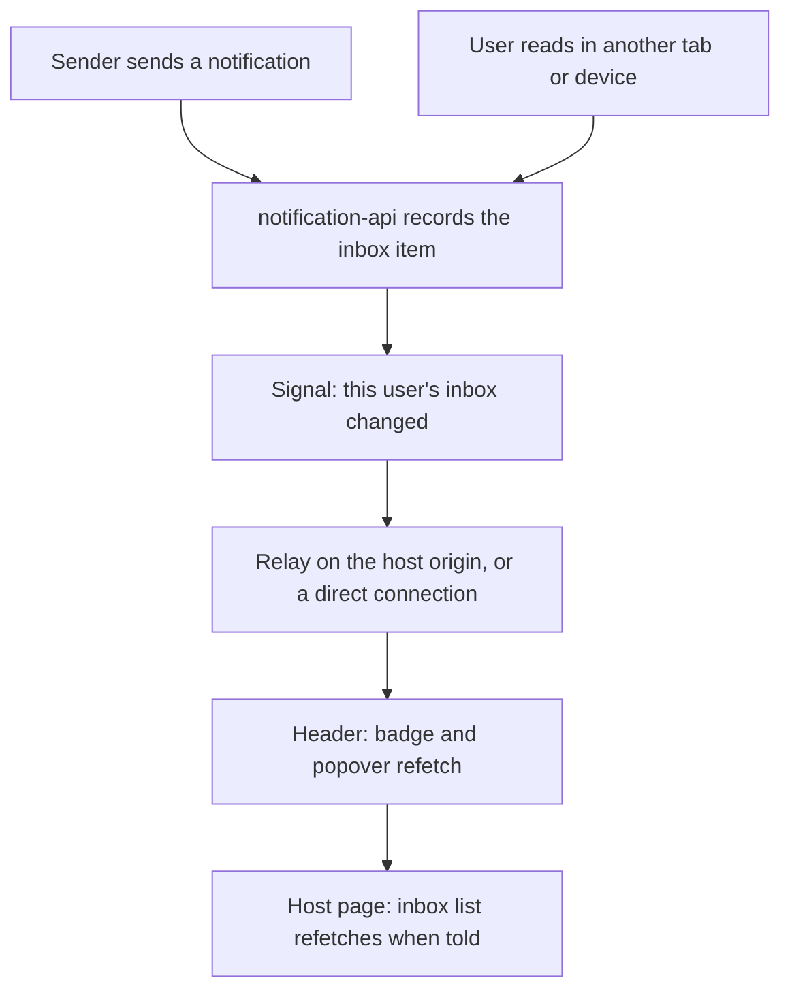
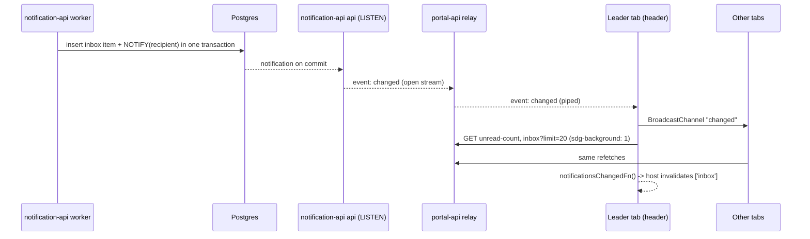
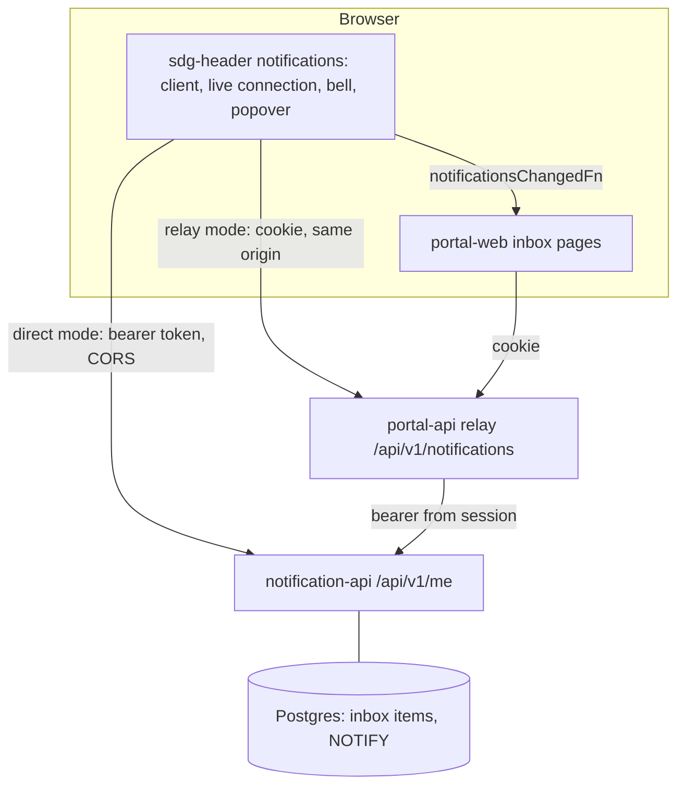
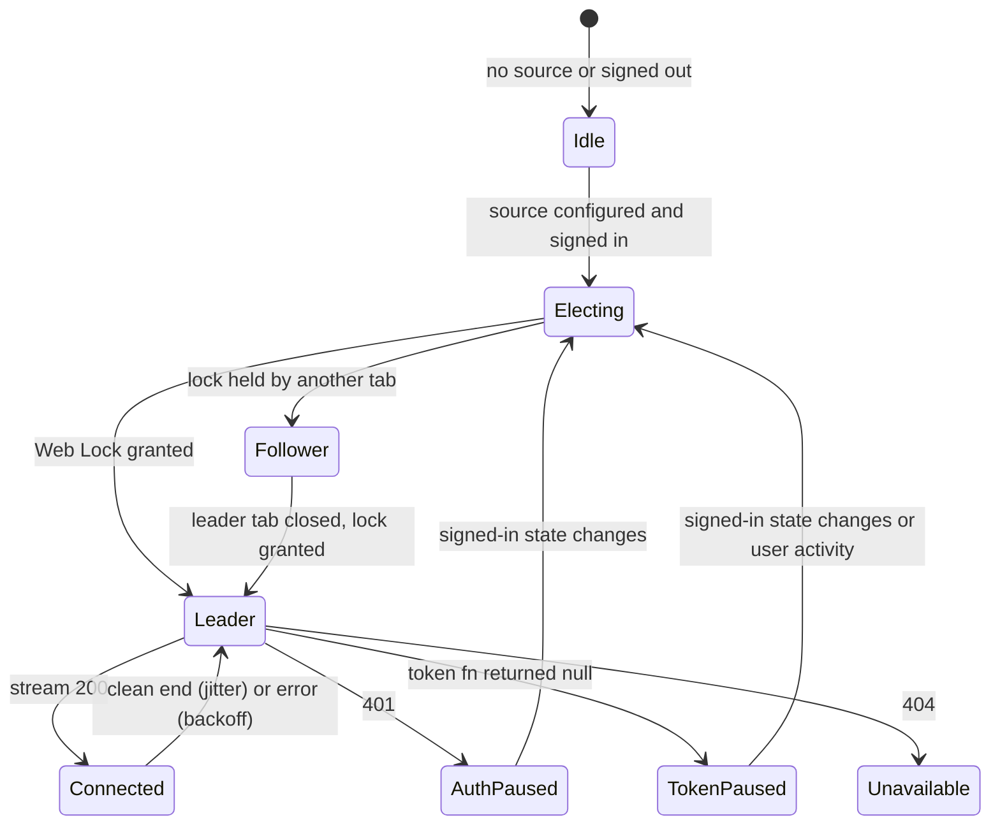
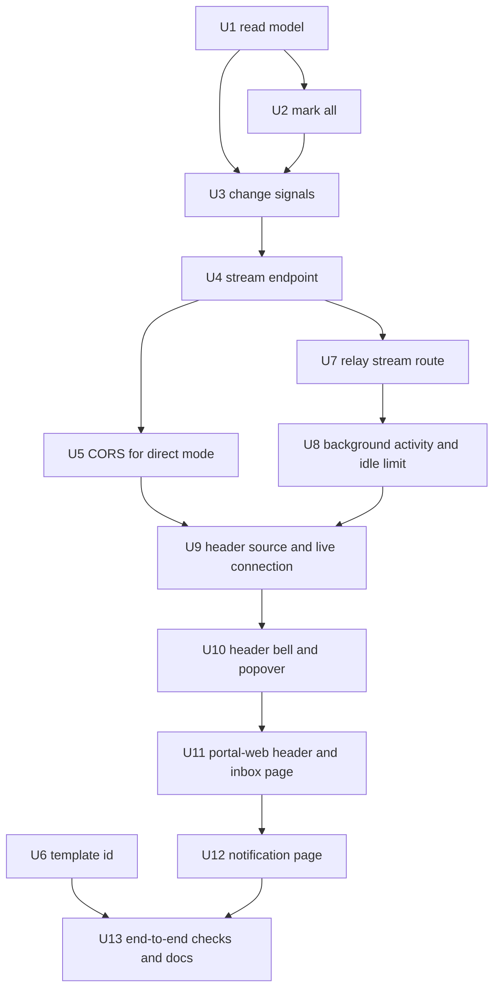

# Portal Inbox - Plan

## Goal Capsule

- **Objective:** A signed-in portal user notices a new notification the moment it arrives, on any portal page, can read each one and look back through older ones, and reading a notification in the portal stops the reminders still waiting on it.
- **Means:** A self-contained notifications bell and popover in the shared `<sdg-header>` (KTD1), an inbox page and a page per notification in portal-web, and new recipient capabilities plus a live "inbox changed" stream in notification-api (KTD2, KTD3), reached through portal-api's relay or directly with a browser-held token (KTD7).
- **Authority:** The Product Contract wins on behavior; Key Technical Decisions win on mechanism within it; units override neither. Items under Scope Boundaries are not active scope. This plan extends the notification-api spike (`docs/plans/2026-11-04-1302-feat-notification-api-plan.md`), whose Product Contract still governs notification-api behavior this plan does not change.
- **Execution profile:** Thirteen units (U1–U13) on work branches `spike/portal-inbox-uN`, each merged locally into `spike/notification-api` with `--no-ff`, verified by the Verification Contract and the end-to-end checks in U13.
- **Stop conditions:** Stop and ask when a unit would need to change a Product Contract requirement, when the live stream cannot be made to flush through the compose edge (U7, checked in U13), or when anything would push to a remote, open a PR or deploy.
- **Open blockers:** None.

---

## Product Contract

Product Contract preservation: changed R1, R3, R5, R7, R15, R20 and the Key Decisions on the header, the live stream and mark-all, from user decisions during planning (the header owns the popover and loads its own data; a direct token mode; mark-all covers what had arrived; the Unread tab rule covers other devices); added R31–R36.

### Summary

The shared header gets a self-contained notifications bell: an unread count that updates live and a popover of the newest notifications, with "Mark all as read" at the top right and "View all" at the bottom. An app turns it on with configuration only, pointing it at a relay on its own origin or straight at notification-api with a token. portal-web adds a paged inbox page with All and Unread tabs and a page per notification at `/inbox/$notificationId` that marks it read. notification-api gains the recipient capabilities these need plus a per-user "inbox changed" stream.

### Problem Frame

notification-api already delivers in-app notifications to portal users, but portal-web has nowhere to show them: the inbox exists only as an API. A citizen cannot see what a government service sent them unless they happen to get the email copy.

That gap also defeats escalation. A sender's policy can say "email them if it is still unread after a day", and reading in-app is what stops that reminder. With no in-app place to read, every such notification escalates, so users get reminder emails for notices they never had a chance to see in the portal.

The header is shared by other government sites, including ones this team does not build, so whatever the portal gets should work for them without each site re-implementing it. The original spike plan listed a portal-web inbox UI as deferred; this plan picks it up.

### Actors

- A1. Portal user: a person signed in to the portal with BC Services Card. Always a user recipient in notification-api.
- A2. Sender: a system that sends notifications through notification-api, whose policies may schedule reminders that reading stops.
- A3. portal-web: the browser app that hosts the header and shows the inbox pages.
- A4. portal-api: holds the user's session and relays recipient calls and the live stream to notification-api with the user's token.
- A5. notification-api: owns inbox state and emits the "inbox changed" signal.
- A6. Other host sites: apps that use `<sdg-header>` and turn the bell on, through their own relay or with a browser-held token.

### Key Decisions

- **The header owns the bell, the badge and the popover, and loads its own data from a configured source.** Sites this team does not build would otherwise each re-implement fetching, live updates and mark-all. (session-settled: user-directed — chosen over a popover drawn by portal-web and over the host passing notification data in: the header is shared by apps other teams build.) Governs R1, R3, R5, R7, R31, R33.
- **A popover anchored to the bell.** It keeps the user on the page they were on. (session-settled: user-approved — chosen over a modal dialog: a quick glance should not take over the page.) Governs R4, R8.
- **The popover shows the newest ~20 notifications, read and unread, with unread ones marked.** The user sees recent context, not just the backlog. (session-settled: user-approved — chosen over an unread-only list: read items still give context.) Governs R4.
- **Two source modes: a cookie relay on the host's origin, or notification-api directly with a host-supplied token.** Sites that sign in with PKCE and hold the token in the browser need no relay. (session-settled: user-approved — chosen over relay-only now with direct mode later, and over direct mode only for other sites: other teams build against the header's configuration, so it is settled once.) Governs R32, R34.
- **Acknowledging means reading.** Portal users see one state, read or unread; there is no separate "Got it" step. The portal never sets notification-api's separate acknowledged state, so a sender that checks for acknowledgement specifically will never see it set from the portal. (session-settled: user-directed — chosen over a distinct acknowledge action for important notices: the user defined acknowledging as reading.) Governs R19.
- **"Mark all as read" counts as reading every unread notification that had arrived when it was pressed, so it stops all their pending reminders.** A sender cannot tell a bulk read from a single read, and an arrival in the same instant is not swept up unseen. (session-settled: user-approved — chosen over keeping reminders for items never opened, over a confirmation step, and over sweeping items that arrive during the request: one meaning of "read", one click, nothing read unseen.) Governs R6, R20.
- **Arrivals update the badge and lists live, with a polite screen-reader announcement and no toast.** (session-settled: user-approved — chosen over adding a toast and over updating only the badge: noticeable without covering the page.) Governs R3, R23, R25.
- **Inbox page: All and Unread tabs, "Load more", a "Mark read" button per row.** This fits notification-api's cursor paging without total counts. (session-settled: user-approved — chosen over numbered pages, which need totals and offset paging, and over plain Older/Newer buttons with no unread view.) Governs R10, R11, R12, R14.
- **Live updates come from notification-api as a per-user stream, reached through the configured source.** notification-api owns the data and serves more than one host, so every host gets the same stream. (session-settled: user-approved — chosen over portal-api holding the browser connections and being told by notification-api what changed, which only benefits the portal, and over fast polling, which is not real-time.) Governs R22, R29, R30.
- **The stream says only "your inbox changed"; the header and pages refetch through the normal endpoints.** No notification content travels on a second path. Governs R24, R27.
- **Background traffic never extends a sign-in.** An open tab must not keep a user signed in. (session-settled: user-directed — chosen over letting the live connection's reconnects count as activity: the user rejected an indefinitely extended session.) Governs R35.
- **Items marked read on the Unread tab stay put until the user leaves the tab, wherever they were read.** The list does not jump under the pointer. (session-settled: user-approved — chosen over removing items read on another device as they change: one rule for every read.) Governs R15.
- **Someone else's notification looks the same as a missing one.** A stranger cannot confirm that an id exists. Governs R18.
- **On narrow screens the bell stays in the top bar beside the menu button.** (session-settled: user-approved — chosen over moving it into the collapsed menu panel: the count stays visible.) Governs R1.

### Requirements

**Header bell**

- R1. The bell appears only when the host configures a notifications source and a user is signed in; otherwise the header renders exactly as it does today, including on sites that load it from the CDN. On narrow screens it sits in the top bar beside the menu button.
- R2. The badge shows the unread count, shows "99+" above 99, and is hidden at zero.
- R3. Pressing the bell opens the popover anchored to it. The bell's accessible name includes the unread count, and count changes are announced politely to screen readers.

**Popover**

- R4. The popover lists the newest ~20 notifications newest first, read and unread, with unread ones marked by more than color alone.
- R5. Each row shows the title, a short plain-text excerpt and how long ago it arrived. Activating a row marks it read, closes the popover and opens that notification's page under the configured inbox link (R17).
- R6. "Mark all as read" sits at the top right of the popover and does R20. It is unavailable when nothing is unread.
- R7. "View all" at the bottom of the popover opens the configured inbox page.
- R8. Escape or clicking outside closes the popover and returns focus to the bell. The popover is fully usable by keyboard.
- R9. The popover has an empty state ("no notifications yet") and a load-failure state with a retry.

**Inbox page**

- R10. `/inbox` lists the user's notifications newest first under two tabs, All and Unread; the Unread tab label carries the unread count.
- R11. The page loads 20 at a time and offers "Load more" until there are no older notifications.
- R12. Each unread row has a "Mark read" button that marks it read without leaving the page; activating the row itself opens the notification's page (R17).
- R13. The page offers the same "Mark all as read" (R20) at the top right.
- R14. Each tab has its own empty state, and the page has a load-failure state with a retry.
- R15. On the Unread tab, an item that becomes read, whether here, in another tab or on another device, stays where it is, shown as read, until the user leaves or switches the tab.
- R16. The inbox page and notification pages require a signed-in user; a signed-out visitor is sent to sign in and returns to the page they asked for.

**Notification page**

- R17. `/inbox/$notificationId` shows the title, the full message, the date received and, when the sender gave one, the action link as a button, with a way back to the inbox.
- R18. Opening the page marks the notification read whatever the entry point: the popover, the inbox page, a bookmark or a link in an email. An id that does not exist or is not the signed-in user's shows "not found", never "forbidden".

**Reading and reminders**

- R19. Read is the only state the portal shows or sets. Marking a notification read, by any route in this plan, stops its pending reminders exactly as reading does today.
- R20. "Mark all as read" marks every notification that was unread and had arrived when the user pressed it as read, including ones not loaded on screen, and stops all their pending reminders.
- R21. Marking an already-read notification read again changes nothing; the first read time is kept.
- R22. The new recipient capabilities (mark all as read, opening one notification by its notification id, the unread count, the live stream) are available to any trusted host's users, not only the portal's.

**Live updates**

- R23. When a notification arrives for the user, the badge, an open popover and an open inbox page show it without a reload. New arrivals appear at the top of the popover and of both inbox tabs.
- R24. When the user reads a notification in another tab or on another device, every other open tab reflects it the same way.
- R25. Live changes to the unread count are announced politely to screen readers; nothing pops up over the page.
- R26. When the live connection drops (network loss, token expiry, a deploy), the browser reconnects on its own and refetches, so no change is missed. The badge also refreshes when the tab regains focus.
- R27. The live connection carries only a signal that the user's inbox changed, never notification content.
- R28. A user's live connection only ever carries signals about that user's own inbox, and it closes when their session ends.
- R29. Live updates keep working when several notification-api and portal-api instances run.
- R30. The live connection survives the platform's idle-connection limits between changes.

**Shared header across apps**

- R31. The header loads and updates its own notifications from the configured source, so a host supplies configuration, never notification data.
- R32. The source is either a relay on the host's own origin that uses the host's session, or notification-api directly with an access token the host supplies.
- R33. The header tells the host when the user's inbox changed, so a host page can refresh without opening its own live connection.
- R34. notification-api accepts browser calls to its recipient endpoints only from configured website origins.

**Sign-in**

- R35. Background traffic (the live connection and the refreshes it triggers) never extends the user's sign-in. With a relay, the session still ends after the normal idle limit with no real activity, even with a tab open; with a host-supplied token, the host is told the request is background so it can decline to refresh.

**Email links**

- R36. A notification's templates can use its notification id, so an email can link to its page.

### Key Flows

- F1. A notification arrives while the user is browsing
  - **Trigger:** A sender's notification reaches the user's in-app inbox.
  - **Actors:** A2, A5, A4, A3, A1
  - **Steps:** notification-api signals that the user's inbox changed; the header in each open tab refetches; the badge count goes up and a screen reader announces it; an open popover shows the new item at the top; the header tells the host, and an open inbox page refetches.
  - **Covered by:** R2, R23, R25, R27, R33
- F2. Reading from the popover
  - **Trigger:** The user presses the bell.
  - **Actors:** A1, A3
  - **Steps:** The header's popover opens with the newest notifications; the user activates an unread row; the header marks it read, closes the popover and opens the notification page, which also marks it read; the badge drops by one in every open tab.
  - **Covered by:** R3, R4, R5, R18, R24
- F3. Opening a notification from an email link
  - **Trigger:** The user follows a link to `/inbox/$notificationId` from an email whose template used the notification id.
  - **Actors:** A2, A1, A3, A4
  - **Steps:** A signed-out user signs in and returns to the page; the page shows the notification and marks it read; any reminder still waiting on it is stopped.
  - **Covered by:** R16, R17, R18, R19, R36
- F4. Clearing the backlog
  - **Trigger:** The user presses "Mark all as read" in the popover or on the inbox page.
  - **Actors:** A1, A3, A5
  - **Steps:** Every notification unread when pressed becomes read, loaded or not; their pending reminders stop; the badge hides in every open tab.
  - **Covered by:** R6, R13, R20, R24
- F5. Recovering from a dropped connection
  - **Trigger:** The live connection drops.
  - **Actors:** A3, A4, A5
  - **Steps:** The header reconnects on its own and refetches the count and any open list; changes that happened while it was disconnected appear.
  - **Covered by:** R26, R28
- F6. Another site turns the bell on
  - **Trigger:** A6 configures the header with a relay URL, or with notification-api's URL and a token function.
  - **Actors:** A6, A5
  - **Steps:** The header loads the count and items from that source, holds the live connection and marks items read; its inbox links go to the configured inbox page.
  - **Covered by:** R31, R32, R33, R34

### Acceptance Examples

- AE1. **Covers R1.** **Given** a site loads the header from the CDN without configuring a notifications source, **when** a user is signed in, **then** no bell appears and the header looks as it does today.
- AE2. **Covers R2.** **Given** the user has 0, 7 and 140 unread notifications, **then** the badge is hidden, shows "7", and shows "99+" respectively.
- AE3. **Covers R15.** **Given** the user is on the Unread tab with three items, **when** they press "Mark read" on the middle one, or read it on their phone, **then** it stays in the middle shown as read; **when** they switch to All and back, **then** the Unread tab shows two items.
- AE4. **Covers R18.** **Given** notification `n1` belongs to another user, **when** the signed-in user opens `/inbox/n1`, **then** they see the same "not found" page as for an id that does not exist, and nothing is marked read.
- AE5. **Covers R20.** **Given** the user has 45 unread notifications and the popover shows 20, **when** they press "Mark all as read", **then** all 45 become read and the reminders waiting on any of them stop; **given** a 46th arrives while the request is in flight, **then** it stays unread.
- AE6. **Covers R18, R19.** **Given** a notification whose policy emails a reminder if it is unread after a day, **when** the user opens its page an hour after it arrived, **then** the reminder is never sent.
- AE7. **Covers R24.** **Given** the user has the inbox page open on a laptop and the portal open on a phone, **when** they read a notification on the phone, **then** the laptop's badge drops and the row shows as read without a reload.
- AE8. **Covers R26.** **Given** the user's connection drops for a minute during which two notifications arrive, **when** it comes back, **then** the badge and an open list show both without a reload.
- AE9. **Covers R16.** **Given** a signed-out visitor follows a link to `/inbox/n2`, **when** they finish signing in, **then** they land on `/inbox/n2` and it is marked read.
- AE10. **Covers R35.** **Given** a portal tab stays open with the live connection running and the user does nothing for longer than the session idle limit, **when** the next background request arrives, **then** the session has ended and the header shows the user signed out.
- AE11. **Covers R32, R34.** **Given** a site on an allowed origin configures the header with notification-api's URL and a token function, **then** the bell loads and updates live; **given** the same site on an origin not on the list, **then** the browser blocks the calls and no bell appears.

### Success Criteria

- On a running local stack, a notification sent to a signed-in user shows on the badge of an open portal tab within two seconds, with no reload.
- With keyboard alone and with a screen reader, a user can open the popover, hear the unread count, open a notification, mark all as read and page through the inbox.
- notification-api's existing escalation tests still pass, and a new end-to-end check shows that reading in the portal stops a scheduled reminder.

### Scope Boundaries

- Deleting, archiving or dismissing notifications.
- Filtering by type or sender, and search.
- Switching a notification's language in the portal.
- Notification preferences (channels, quiet hours) in the portal.
- Browser push notifications when no portal tab is open; web push stays a separate future channel in the spike plan.
- Setting notification-api's acknowledged state from the portal (per the acknowledging-means-reading decision).
- Any change to the email or webhook channels or to how senders define reminders, beyond the template variable in R36.
- Turning the bell on in any production site other than portal-web; this plan proves direct mode only in the compose stack.
- Deploying notification-api with a public route or Helm chart; direct mode is exercised in the local compose stack only.

#### Considered and not built

- A per-page notifications API inside portal-web: the header owns loading (R31), so portal-web pages reuse the header's change signal (R33) instead of a second connection.
- Raising the OpenShift route timeout: a 15-second keep-alive keeps the connection inside every idle limit on the path (KTD4), so no route annotation is needed. Revisit if a proxy on the path is found to buffer comments.
- Re-sanitizing notification HTML in the browser: notification-api already sanitizes in-app bodies and escapes raw HTML (`apps/notification-api/src/templates/markdown.ts`). Revisit if bodies ever accept raw HTML.
- A per-recipient cap on concurrent streams: a normal browser holds one stream (KTD5), and a scripted flood of streams from one signed-in user is a denial-of-service concern the existing JSON endpoints share; a cap is cheap to add later. Revisit if stream counts per recipient show abuse.
- Serializing token refreshes across portal-api replicas: one live connection per browser (KTD5) removes the reconnect bursts that would make the race likely; the race already exists for ordinary traffic. Revisit if refresh-token reuse errors appear in logs.

### Dependencies / Assumptions

- Builds on the local `spike/notification-api` branch. Work goes on per-unit branches merged back locally; nothing is pushed and no PR is opened, because opening a PR deploys to OpenShift.
- portal-api refreshes the session's access token before each relayed call (`apps/portal-api/src/notifications/token-refresh.service.ts`), so a reconnecting stream presents a fresh token.
- portal-api's sign-in already returns the user to the page they asked for (`apps/portal-api/src/auth/auth.controller.ts`, `loginHref` in `apps/portal-web/src/auth/api.ts`).
- Each notification has at most one inbox entry per user (`apps/notification-api/src/database/schema/deliveries.ts`: `inbox_items` unique on `notification_recipient_id`, `notification_recipients` unique on notification and recipient), so `/inbox/$notificationId` always means one item.
- notification-api already accepts user tokens issued to any client in `RELAYING_CLIENT_IDS`, including that client as audience (`apps/notification-api/src/auth/token-kind.ts`), so a direct-mode site's client id only needs adding there.
- The production edge allows same-origin connections in its CSP and proxies `/api*` to portal-api (`apps/portal-web/caddy/common.caddy`). Caddy 2.11.7 and coraza-caddy v2.6.2 in `apps/portal-web/caddy/Dockerfile` include the fixes that let `encode` and the WAF pass a stream through.
- Postgres is reached directly, with no connection pooler (`charts/postgres`), so LISTEN works on a dedicated connection.

### Outstanding Questions

**Resolve Before Planning**

- None.

**Deferred to Implementation**

- Whether jsdom-based header tests can drive the fetch stream reader directly or need a small fake transport behind the live-connection seam (U9).
- The exact debounce window for bursts of change signals; start at 250 ms and adjust if the two-second target is missed (U9).

### Sources / Research

- Spike plan: `docs/plans/2026-11-04-1302-feat-notification-api-plan.md` (portal-web inbox UI listed as deferred; escalation stops on in-app read).
- Relay: `apps/portal-api/src/notifications/relay.controller.ts` maps `/api/v1/notifications/*` to notification-api `/api/v1/me/*`; `apps/portal-api/src/notifications/relay.service.ts` forces `accept: application/json`, buffers the whole reply and times out after 10 seconds.
- Inbox API: `apps/notification-api/src/inbox/inbox.controller.ts` has list, `:itemId/read` and `:itemId/acknowledge`; `apps/notification-api/src/inbox/inbox.service.ts` `mark` locks the `notification_recipients` row and calls `cancelPendingSteps` (`apps/notification-api/src/delivery/escalation.ts`).
- Item creation: `apps/notification-api/src/delivery/planner.ts` inserts inbox items in the worker role, so the change signal must cross processes.
- Header: `packages/sdg-header/src/sdg-header.ts`, `packages/sdg-header/src/account-menu.ts` (trigger, ARIA, outside click via `composedPath`, focus return), `packages/sdg-header/src/icons.ts`, `packages/sdg-header/src/tokens.test.ts`.
- Design system: `@bcgov/design-system-react-components` 0.9.1 exports no Popover and bundles its own react-aria copy, which is why the popover lives in the header rather than in React.
- External guidance: one EventSource-style stream per browser because the edge route uses the router's default certificate and stays on HTTP/1.1 (six connections per host); HAProxy's 30-second client and server idle limits; LISTEN needs a dedicated, non-pooled connection and NOTIFY is delivered on commit; Nest's SSE header set includes `Cache-Control: no-transform`, which makes Caddy's `encode` skip compression.

---

## Planning Contract

### Key Technical Decisions

- KTD1. **The header carries a notifications feature built from Lit reactive controllers: a source client, a live connection, and the bell and popover views.** It follows the account-menu pattern (`packages/sdg-header/src/account-menu.ts`) for the trigger, outside click via `composedPath`, Escape and focus return, so anchoring across the shadow DOM never arises. New inputs: `notifications-url` and `inbox-href` attributes, and `accessTokenFn` and `notificationsChangedFn` properties, named `*Fn` per AGENTS.md. Opening an item calls `navigateFn` when set, else assigns the location. Instantiates the header Key Decision; governs R1, R3, R5, R7, R31, R33.
- KTD2. **notification-api adds recipient endpoints under `me/inbox`:** an `unread=true` filter on the list, `GET unread-count`, `POST read-all` (KTD9), `GET by-notification/:notificationId`, and `GET stream`. Every item gains a plain-text `excerpt`, rendered server-side with `html-to-text`, which notification-api already depends on. Paths are relative to the configured base, so a relay and a direct connection share one contract. A malformed id on `by-notification` answers 404, not 400 (R18).
- KTD3. **The change signal travels over Postgres NOTIFY on one channel with the recipient id as payload, sent inside the same transaction as each inbox write.** The writes are the planner's insert, `mark`, and `read-all`. Each api-role instance holds one dedicated LISTEN client (not from the shared pool) and an in-memory map of recipient to open streams. After the listener reconnects, every local stream receives a `changed`, because signals may have been missed. The listener sits behind a DI token with an in-memory implementation for PGlite tests. Governs R23, R24, R29.
- KTD4. **The stream is hand-written Server-Sent Events on a raw Express response, not Nest's `@Sse`.** That gives full control of comments, closing and headers. It sends an opening comment to flush headers, a `: keep-alive` comment every 15 seconds, and `event: changed` with a non-empty `data` line. It ends cleanly at the token's `exp`, on application shutdown, and when the client goes away. Headers: `content-type: text/event-stream`, `cache-control: no-cache, no-transform`, `x-accel-buffering: no`. Stream paths join `isQuietPath` in both apps, so long requests stay out of logs and latency histograms. (session-settled: user-approved — chosen over raising the OpenShift route timeout: HAProxy's client timeout cannot be raised per route, and a keep-alive inside 30 seconds needs no route change.) Governs R27, R28, R30.
- KTD5. **One live connection per browser, per source.** The header reads the stream with `fetch` and a small SSE parser, not native `EventSource`, so direct mode can send `Authorization` and every status code is visible. A Web Lock named after the source URL elects one leader tab to hold the stream; a `BroadcastChannel` of the same name passes `changed` and `open` to the other tabs. Every tab refetches on `changed`, on stream open, and on focus or visibility. Where Web Locks are unavailable, each tab holds its own stream. Reconnect rules:
  1. A clean end reconnects after 0–2 seconds of jitter.
  2. A network error or 5xx backs off 1, 2, 4… seconds, capped at 30.
  3. A 401 stops until the signed-in state changes.
  4. A 404 means notifications are unavailable at this source, and the bell hides.

  (session-settled: user-approved — chosen over one stream per tab: the edge stays on HTTP/1.1, where a few tabs would exhaust the six connections per host.) Governs R24, R26, R29.

- KTD6. **portal-api relays the stream on its own route, declared before the catch-all:** `GET /api/v1/notifications/inbox/stream`. It pipes the upstream body to the browser with a connect-and-headers timeout only, aborts the upstream when the browser disconnects, copies `content-type` and `cache-control`, and adds `x-accel-buffering: no`. On each upstream keep-alive it re-reads the session from the store and ends the stream when the session is gone or idle-expired, so sign-out closes it within 15 seconds (R28). On shutdown it ends every piped stream so pods drain quickly. The JSON endpoints keep going through the existing catch-all unchanged. Governs R22, R28, R29.
- KTD7. **Direct mode: notification-api answers CORS for `/api/v1/me/*` only, from origins in a new `CORS_ALLOWED_ORIGINS` list.** The list is empty by default, which means off. It allows `GET` and `POST`, the `authorization`, `content-type` and `sdg-background` headers, and no credentials. The header calls `accessTokenFn({ background })` before each request; a `null` result pauses all requests and the stream until the next pointer or key event in the page, which retries with `background: false`. Locally, direct mode uses notification-api's existing compose host, `https://notify.sdg.localhost`. (session-settled: user-approved — chosen over relay-only: other teams build against the header's configuration.) Governs R32, R34, R35.
- KTD8. **Background marking and the idle limit.** The header and portal-web send `sdg-background: 1` on every request that is not a user action: count, list and stream loads, and refetches triggered by signals or focus. User actions (`read`, `read-all`, opening a page) never carry it. One portal-api middleware, after the session middleware and before any guard:
  1. When a signed-in session's stored `lastActivityAt` is older than `SESSION_TTL_SECONDS`, it ends the Keycloak session over the back channel (the session's refresh token to the realm's logout endpoint, through `@repo/auth`'s OIDC client), logs and continues if that call fails, and destroys the session. The request then proceeds signed out, so guards answer 401 and `/api/auth/me` answers no user.
  2. Otherwise, on a signed-in session and a request without the marker, it stamps `lastActivityAt` when the stored value is more than 5 minutes old (the session store's touch threshold), so the idle limit is accurate to within 5 minutes and sessions are not rewritten on every request.
  3. A signed-in session without the field starts its clock at its next request.

  Background requests may still refresh the access token, so the identity-provider session lives at most until the portal's idle limit, when step 1 ends it. (session-settled: user-directed — chosen over counting reconnects as activity: the user rejected an indefinitely extended session.) Governs R35.

- KTD9. **Mark-all marks the caller's unread items that are committed when its update runs.** It takes no client bound: under Postgres's read-committed isolation the update sees only committed rows, so an item whose planner transaction commits after the press stays unread (AE5), while one that arrived before the press is marked even if the list never showed it (R20). It locks the affected `notification_recipients` rows in id order before marking, cancels each row's pending steps with `cancelPendingSteps`, and sends one NOTIFY. Governs R20.
- KTD10. **Templates get `notification.id` and `recipient.hasInbox` alongside the sender's data.** `RenderRequest` (`apps/notification-api/src/templates/render.service.ts`) gains the notification id, passed by its callers in `apps/notification-api/src/delivery/planner.ts` and `apps/notification-api/src/delivery/processor.ts`. `recipient.hasInbox` is true only for user recipients, since address recipients have no inbox. Senders write `https://<portal>/inbox/{{ notification.id }}`; there is no portal URL setting. Template preview uses a sample id. Governs R36.
- KTD11. **portal-web's inbox data uses react-query with an `['inbox']` key family.** The header's `notificationsChangedFn` invalidates that family. The inbox page uses `useInfiniteQuery` per tab; refetches re-run every loaded page with its stored cursor and de-duplicate rows by id. The Unread tab keeps, per tab visit, the ids it has shown, so an item that turns read stays rendered as read (R15). Tabs are `?tab=unread` search-param links with `aria-current`, so a tab is linkable and survives reload. The design system has no Tabs component.
- KTD12. **The notification page's loader fetches by notification id without side effects, and the component marks read with a POST once it has rendered an unread item.** The router preloads on intent (`defaultPreload: 'intent'` in `apps/portal-web/src/router.ts`), so a hover must never mark anything read. A route guard (`beforeLoad`) ensures the current user and otherwise sends the visitor to `loginHref(location.href)` (R16). The body renders as notification-api's sanitized HTML. A null title or body falls back to "Notification" with no body, in the header and the pages alike.
- KTD13. **The header owns screen-reader announcements of count changes.** It uses one polite live region, stays silent on first load, and announces at most once per debounce window. portal-web's inbox page announces nothing about counts. Governs R25.

### High-Level Technical Design

Live signal path, relay mode (direct mode drops the portal-api hop and sends a bearer token from the browser):

Where each mode's pieces live:

Live connection states in each tab (KTD5):

### Implementation Constraints

- Files stay at or under 300 lines and functions under 50 (global quality gates). The inbox controller and service in notification-api, and `sdg-header.ts`, already sit near their limits, so the new work goes in new files.
- NestJS constructor injection uses explicit `@Inject(...)`; request and response schemas are zod via `@Query/@Body/@Param({ schema })` and `@ApiOkResponse({ standardSchema })`; no DTO classes.
- `packages/sdg-header` uses `.js` relative imports, `var(--bcgov-token, value)` CSS with fallbacks checked by `tokens.test.ts`, the `svg` tag for nested SVG, and no `style` attributes; the React entry and the CDN build stay under their size guards in `package.test.ts`; U10 raises the CDN guard deliberately.
- No `.env` file is read or written; new settings go in each app's `.env.example` and `src/config/env.ts`.
- Errors in portal-api are logged as `logger.<level>({ msg, error: describeError(error) })`.

### Sequencing

notification-api units (U1–U6) land first, then portal-api (U7, U8), then the header (U9, U10), then portal-web (U11, U12), then U13.

---

## Implementation Units

| U-ID | Title                                                                   | Key files                                                      | Depends on |
| ---- | ----------------------------------------------------------------------- | -------------------------------------------------------------- | ---------- |
| U1   | Inbox read model: unread filter, count, excerpt, lookup by notification | `apps/notification-api/src/inbox/inbox-queries.service.ts`     | —          |
| U2   | Mark all as read                                                        | `apps/notification-api/src/inbox/read-all.service.ts`          | U1         |
| U3   | Inbox change signals over NOTIFY                                        | `apps/notification-api/src/inbox/signals/`                     | U1, U2     |
| U4   | Live stream endpoint                                                    | `apps/notification-api/src/inbox/inbox-stream.controller.ts`   | U3         |
| U5   | CORS for direct mode                                                    | `apps/notification-api/src/http/cors.ts`                       | U4         |
| U6   | `notification.id` template variable                                     | `apps/notification-api/src/templates/render.service.ts`        | —          |
| U7   | Relay stream route                                                      | `apps/portal-api/src/notifications/relay-stream.controller.ts` | U4         |
| U8   | Background requests and the idle limit                                  | `apps/portal-api/src/session/activity.middleware.ts`           | U7         |
| U9   | Header notifications source and live connection                         | `packages/sdg-header/src/notifications/`                       | U5, U8     |
| U10  | Header bell, badge and popover                                          | `packages/sdg-header/src/notifications/popover.ts`             | U9         |
| U11  | portal-web header wiring and inbox page                                 | `apps/portal-web/src/routes/inbox/index.tsx`                   | U10        |
| U12  | portal-web notification page                                            | `apps/portal-web/src/routes/inbox/$notificationId.tsx`         | U11        |
| U13  | End-to-end checks and docs                                              | `apps/notification-api/scripts/e2e/flows-inbox.ts`             | U6, U12    |

### U1. Inbox read model: unread filter, count, excerpt, lookup by notification

- **Goal:** Give hosts what the header and pages read: an unread-only list, the unread count, a plain-text excerpt per item and one item by notification id.
- **Requirements:** R2, R4, R5, R10, R17, R18, R22; KTD2.
- **Dependencies:** None.
- **Files:**
  - `apps/notification-api/src/inbox/inbox-queries.service.ts` (new)
  - `apps/notification-api/src/inbox/inbox.controller.ts`
  - `apps/notification-api/src/inbox/inbox.schemas.ts`
  - `apps/notification-api/src/inbox/inbox.service.ts`
  - `apps/notification-api/src/inbox/inbox.module.ts`
  - `apps/notification-api/src/inbox/inbox-queries.test.ts` (new)
- **Approach:**
  1. Move list and select logic into a queries service, leaving `mark` in `InboxService`, to keep both files under the line limit.
  2. Add `unread` to the list query schema, `and()`-ed with `isNull(readAt)`; the cursor stays filter-agnostic.
  3. Add `GET me/inbox/unread-count` returning `{ unread }`, served by the existing recipient and created-at index.
  4. Add `excerpt` to `inboxItemSchema`: the body converted to plain text with `html-to-text`, collapsed whitespace, cut at about 140 characters on a word boundary; null when the body is null.
  5. Add `GET me/inbox/by-notification/:notificationId`. A non-uuid id or an id that is not the caller's answers 404.
- **Patterns to follow:** `inbox.controller.ts` route shape and guards; `afterCursor` and `toPage` in `apps/notification-api/src/http/pagination.ts`.
- **Test scenarios:**
  - The list with `unread=true` returns only unread items, newest first, and its cursor pages through further unread items.
  - The unread count is 0 for a new recipient, rises with deliveries, and falls after a read.
  - An item whose body is long Markdown gets an excerpt of plain text under the limit, with no tags.
  - An item with a null body has a null excerpt.
  - Covers AE4. `by-notification` for another recipient's notification answers 404 with the same body as an unknown id, and a non-uuid id also answers 404.
  - `by-notification` for the caller's own notification returns the item with its `id` and `readAt`.
- **Verification:** The new endpoints appear in the OpenAPI document under `me`, and the inbox tests pass.

### U2. Mark all as read

- **Goal:** One request marks every unread item up to the newest the client has seen, and stops their reminders.
- **Requirements:** R6, R13, R19, R20, R21; F4; KTD9.
- **Dependencies:** U1.
- **Files:**
  - `apps/notification-api/src/inbox/read-all.service.ts` (new)
  - `apps/notification-api/src/inbox/inbox.controller.ts`
  - `apps/notification-api/src/inbox/inbox.schemas.ts`
  - `apps/notification-api/src/inbox/read-all.test.ts` (new)
- **Approach:**
  1. `POST me/inbox/read-all` with no body, answering `{ marked }`.
  2. In one transaction, select the caller's unread items, lock their `notification_recipients` rows `FOR UPDATE` ordered by id, set `read_at = coalesce(read_at, now)`, and call `cancelPendingSteps` per row with cause `read` (KTD9).
- **Patterns to follow:** `InboxService.mark` (`apps/notification-api/src/inbox/inbox.service.ts`); escalation assertions in `apps/notification-api/src/inbox/inbox.test.ts`.
- **Execution note:** Start with a failing test that a pending reminder for an unloaded item is cancelled by read-all.
- **Test scenarios:**
  - Covers AE5. With 45 unread items, all 45 become read and each scheduled reminder delivery is `cancelled` with reason "read in app".
  - Covers AE5. An item whose planner transaction commits after read-all's update ran stays unread, and its reminder stays scheduled (gated real-Postgres test with two connections).
  - Already-read items keep their original `readAt`.
  - Another recipient's items are untouched.
- **Verification:** Read-all tests pass alongside the existing escalation tests.

### U3. Inbox change signals over NOTIFY

- **Goal:** Every inbox write tells every api instance which recipient changed.
- **Requirements:** R23, R24, R29; KTD3.
- **Dependencies:** U1, U2.
- **Files:**
  - `apps/notification-api/src/inbox/signals/inbox-signals.ts` (new: DI token, interface, NOTIFY helper)
  - `apps/notification-api/src/inbox/signals/pg-inbox-signals.ts` (new: dedicated LISTEN client)
  - `apps/notification-api/src/inbox/signals/pglite-inbox-signals.ts` (new: test implementation)
  - `apps/notification-api/src/delivery/planner.ts`
  - `apps/notification-api/src/inbox/inbox.service.ts`
  - `apps/notification-api/src/inbox/read-all.service.ts`
  - `apps/notification-api/src/testing/app.ts`
  - `apps/notification-api/src/inbox/signals/inbox-signals.test.ts` (new)
  - `apps/notification-api/src/inbox/signals/pg-inbox-signals.pg.test.ts` (new, gated on `NOTIFICATION_TEST_DATABASE_URL`)
- **Approach:**
  1. A `notifyInboxChanged(tx, recipientId)` helper runs `pg_notify` on one channel inside the caller's transaction. The planner calls it after each inbox insert, and `mark` and read-all call it after their updates.
  2. The pg implementation opens its own client from `DATABASE_URL` on module init in the api role, LISTENs, and dispatches to subscribers by recipient id. On error it reconnects with backoff and then emits `changed` to every local subscriber. It closes on shutdown.
  3. `subscribe(recipientId, callback)` returns an unsubscribe function.
  4. The test app overrides the token with a PGlite-backed implementation that uses PGlite's `listen()` on the same channel, so tests exercise the real SQL NOTIFY path and its commit-only delivery; the gated pg test proves a NOTIFY committed by one connection reaches a listener on another, and that a rolled-back one does not.
- **Patterns to follow:** gated real-Postgres test in `apps/notification-api/src/delivery/claimer.pg.test.ts`; DI overrides in `apps/notification-api/src/testing/app.ts`; role registration in `apps/notification-api/src/app.module.ts`.
- **Test scenarios:**
  - Running the worker on a new notification signals that recipient once its transaction commits.
  - Reading an item signals its recipient.
  - Read-all signals its recipient once, however many items it marks.
  - A subscriber for another recipient receives nothing.
  - After the listener reconnects, every local subscriber receives `changed`.
  - (pg) A rolled-back write sends no signal.
- **Verification:** Signal tests pass on PGlite, and the gated pg test passes against the compose database.

### U4. Live stream endpoint

- **Goal:** `GET me/inbox/stream` holds an SSE connection that says "changed" whenever the caller's inbox changes.
- **Requirements:** R23, R26, R27, R28, R30; KTD4.
- **Dependencies:** U3.
- **Files:**
  - `apps/notification-api/src/inbox/inbox-stream.controller.ts` (new)
  - `apps/notification-api/src/inbox/sse.ts` (new: frame writer and keep-alive timer)
  - `apps/notification-api/src/inbox/inbox.module.ts`
  - `apps/notification-api/src/http/quiet-paths.ts`
  - `apps/notification-api/src/inbox/inbox-stream.test.ts` (new)
- **Approach:**
  1. Behind `RecipientGuard`, resolve the recipient and write the headers in KTD4 plus an opening comment.
  2. Subscribe to signals and write `event: changed` with data `{}` on each signal, and `: keep-alive` every 15 seconds.
  3. End the response at the token's `exp` from `principal.user.claims`, on `close` of the request, and when the app shuts down. Track open streams in a registry the controller ends in `beforeApplicationShutdown`.
  4. Add the stream path to `isQuietPath`.
- **Patterns to follow:** `apps/notification-api/src/inbox/inbox.controller.ts` guards and principal; `apps/notification-api/src/testing/delivery.ts` `relayedUser`.
- **Test scenarios:**
  - A relayed user's stream answers 200 with `text/event-stream` and `no-transform`, and receives a `changed` event after a notification is planned for them.
  - Another recipient's notification produces no event on this stream.
  - With fake timers, a `: keep-alive` comment arrives every 15 seconds.
  - A token that expires in 2 seconds ends the stream cleanly at expiry.
  - A credential token answers 403, and no token answers 401.
  - Closing the client unsubscribes, so a later signal writes nothing.
  - Shutting the app down ends open streams.
- **Verification:** Stream tests pass, and request logs no longer list the stream path.

### U5. CORS for direct mode

- **Goal:** Browsers on configured origins can call `/api/v1/me/*` with a bearer token, and no other origin or path is opened.
- **Requirements:** R32, R34; KTD7.
- **Dependencies:** U4.
- **Files:**
  - `apps/notification-api/src/http/cors.ts` (new)
  - `apps/notification-api/src/bootstrap.ts`
  - `apps/notification-api/src/config/env.ts`
  - `apps/notification-api/.env.example`
  - `compose.yaml`
  - `apps/notification-api/src/http/cors.test.ts` (new)
- **Approach:**
  1. Parse `CORS_ALLOWED_ORIGINS` as a comma list of exact origins; empty means no CORS headers anywhere.
  2. Register CORS middleware only for `/api/v1/me/*` with the methods and headers in KTD7, `credentials: false`, and a preflight max age.
  3. Set `CORS_ALLOWED_ORIGINS` in `compose.yaml` to a local test origin; browsers reach notification-api at `https://notify.sdg.localhost`.
- **Patterns to follow:** `configureApp` in `apps/notification-api/src/bootstrap.ts`; `commaList` in `apps/notification-api/src/config/env.ts`.
- **Test scenarios:**
  - Covers AE11. A preflight from an allowed origin to `/api/v1/me/inbox` answers with that origin and allows `authorization` and `sdg-background`.
  - A preflight from an unlisted origin gets no `access-control-allow-origin`.
  - A preflight to an admin path from an allowed origin gets no CORS headers.
  - With the list empty, no response carries CORS headers.
  - Responses never carry `access-control-allow-credentials`.
- **Verification:** CORS tests pass, and the env schema rejects a malformed origin.

### U6. `notification.id` template variable

- **Goal:** Templates on every channel can reference the notification's id, so emails can link to its page.
- **Requirements:** R36; KTD10.
- **Dependencies:** None.
- **Files:**
  - `apps/notification-api/src/templates/render.service.ts`
  - `apps/notification-api/src/templates/renderer.ts`
  - `apps/notification-api/src/templates/versions.service.ts`
  - `apps/notification-api/src/delivery/planner.ts`
  - `apps/notification-api/src/delivery/processor.ts`
  - `apps/notification-api/src/templates/render.test.ts` (new or extended alongside existing template tests)
  - `apps/notification-api/README.md`
- **Approach:**
  1. Add the notification id to `RenderRequest`, pass it from the planner (in-app) and the processor (email and webhook), and expose `notification: { id }` and `recipient: { hasInbox }` to templates; previews use a sample id and `hasInbox: true`.
  2. The sender's own `data` cannot override either.
  3. Document both variables and the guarded portal link shape in the README.
- **Patterns to follow:** how `envelope` reaches the renderer (`apps/notification-api/src/templates/render.service.ts`).
- **Test scenarios:**
  - An email template containing `{{ notification.id }}` renders the notification's id in both the HTML and text parts.
  - An in-app action URL template using the id renders it.
  - A sender `data` key named `notification` does not replace the id.
  - A template preview renders the sample id.
  - An address recipient renders `recipient.hasInbox` as false, so a guarded portal link is left out of their email.
- **Verification:** Template tests pass, and the README shows the variable.

### U7. Relay stream route

- **Goal:** portal-api passes the live stream through to the browser without buffering or a total timeout.
- **Requirements:** R22, R26, R28, R29; KTD6.
- **Dependencies:** U4.
- **Files:**
  - `apps/portal-api/src/notifications/relay-stream.controller.ts` (new)
  - `apps/portal-api/src/notifications/relay.service.ts`
  - `apps/portal-api/src/notifications/notifications.module.ts`
  - `apps/portal-api/src/logging/logging.module.ts` and `apps/portal-api/src/telemetry/otel-config.ts` (quiet path)
  - `apps/portal-api/src/notifications/relay-stream.test.ts` (new)
- **Approach:**
  1. Register the stream controller ahead of the catch-all, under the same `RelayEnabledGuard` and `SessionAuthGuard`.
  2. Add a `stream()` method to `RelayService` that fetches with `accept: text/event-stream`, applies a 10-second timeout to headers only, and returns the response.
  3. Non-200 upstream statuses map as the JSON relay does.
  4. On 200, write the headers in KTD6 and pipe the body, aborting the fetch on request `close`.
  5. On each upstream keep-alive, re-read the session from the store and end the piped stream when it is gone or idle-expired (KTD6).
  6. Track piped streams and end them on shutdown.
- **Patterns to follow:** `apps/portal-api/src/notifications/relay.controller.ts`, `apps/portal-api/src/testing/notification-upstream.ts` (`startUpstream` can write chunks over time).
- **Test scenarios:**
  - An upstream that writes an event after 500 ms delivers it to the client before the upstream ends, which proves there is no buffering.
  - The client response carries `text/event-stream`, `no-transform` and `x-accel-buffering: no`.
  - Closing the client aborts the upstream request.
  - An upstream that ends cleanly ends the client response cleanly.
  - An upstream 401 answers 401, and an unreachable upstream answers 502.
  - A stream still open after 15 seconds is not cut by the JSON relay's timeout.
  - With the relay disabled, the stream path answers 404 like every other relay path.
  - Destroying the session (sign-out) ends an open relay stream at the next upstream keep-alive.
- **Verification:** Relay stream tests pass, and the existing relay tests still pass.

### U8. Background requests and the idle limit

- **Goal:** Background traffic never extends the portal session; a session idle past `SESSION_TTL_SECONDS` ends on its next request.
- **Requirements:** R28, R35; KTD8.
- **Dependencies:** U7.
- **Files:**
  - `apps/portal-api/src/session/activity.middleware.ts` (new)
  - `apps/portal-api/src/session/session.module.ts`
  - `apps/portal-api/src/session/session.types.ts`
  - `apps/portal-api/src/auth/session-auth.guard.ts`
  - `packages/auth/src/oidc-client.ts` (back-channel end-session)
  - `apps/portal-api/src/session/activity.test.ts` (new)
- **Approach:**
  1. Add the activity middleware after the session middleware, in the order KTD8 gives: expiry check first, then the throttled stamp. The stream route counts as background regardless of the header.
  2. Add an end-session method to `@repo/auth`'s OIDC client that posts the refresh token to the realm's logout endpoint with the client credentials.
  3. `SessionAuthGuard` and `GET /api/auth/me` need no idle logic of their own; they see a signed-out request after step 1.
- **Patterns to follow:** `sessionOp` in `apps/portal-api/src/session/session.module.ts`; `signIn` test helper in `apps/portal-api/src/testing/notification-upstream.ts`.
- **Test scenarios:**
  - Covers AE10. With fake time, background requests every minute for longer than the TTL end the session, and the next request answers 401.
  - After the TTL passes with no requests, a user request (no marker) answers 401 and does not revive the session, and `/api/auth/me` answers no user.
  - An idle-expired session triggers the back-channel end-session call before answering; when that call fails, the session is still destroyed and the failure is logged.
  - A user request resets the clock, so the session survives past the TTL measured from sign-in.
  - Two user requests a minute apart write the session once.
  - An anonymous request creates no session row.
  - Stream connections never stamp `lastActivityAt`, even without the header.
  - A signed-in session created before this change gets a clock on its first request rather than an immediate 401.
- **Verification:** Activity tests pass alongside the existing session and auth tests.

### U9. Header notifications source and live connection

- **Goal:** The header can load, mark and live-update notifications from a relay or directly, with one stream per browser.
- **Requirements:** R20, R23, R24, R26, R27, R29, R31, R32, R33, R35; F1, F5, F6; KTD1, KTD5, KTD7, KTD8.
- **Dependencies:** U5, U8.
- **Files:**
  - `packages/sdg-header/src/notifications/source.ts` (new: endpoints, `sdg-background`, `accessTokenFn`)
  - `packages/sdg-header/src/notifications/event-stream.ts` (new: SSE parser over a fetch body)
  - `packages/sdg-header/src/notifications/live-connection.ts` (new: Web Lock leader, BroadcastChannel, backoff)
  - `packages/sdg-header/src/notifications/notifications-controller.ts` (new: state, refetch triggers, debounce, `notificationsChangedFn`)
  - `packages/sdg-header/src/types.ts`
  - `packages/sdg-header/src/notifications/source.test.ts`, `event-stream.test.ts`, `live-connection.test.ts`, `notifications-controller.test.ts` (new)
- **Approach:**
  1. The source builds URLs relative to `notifications-url` and sends `sdg-background: 1` on background requests (KTD8). In direct mode it adds `Authorization` from `accessTokenFn`; in relay mode it sends `credentials: 'same-origin'`.
  2. The event-stream parser yields events and ignores comments.
  3. The live connection implements the states in the HLD state diagram and the reconnect rules in KTD5.
  4. The controller holds `{ unread, items, status }`. It refetches count and the newest 20 items on `changed`, open, focus and visibility, debounced. It calls `notificationsChangedFn` after each refetch caused by a change and after its own mark actions.
  5. A 401 from the source also calls `notificationsChangedFn`, so the host can refresh its signed-in state.
  6. A failed mark-read or mark-all leaves the stored read state and count unchanged and reports the failure to the view (U10).
- **Patterns to follow:** `ReactiveController` usage in `packages/sdg-header/src/account-menu.ts` and `packages/sdg-header/src/media-query-controller.ts`.
- **Execution note:** Put a fake transport behind the source so jsdom tests do not depend on fetch streaming support.
- **Test scenarios:**
  - Relay mode sends `credentials: 'same-origin'`, no `Authorization`, and `sdg-background: 1` on loads but not on `read`.
  - Direct mode calls `accessTokenFn({ background: true })` for loads and sends its token; a `null` result sends nothing until a pointer event, which retries with `background: false`.
  - The parser handles events split across chunks, multiple events in one chunk, and comments.
  - With two controllers sharing a fake lock and channel, only one opens a stream, and a `changed` makes both refetch.
  - When the leader releases the lock, the follower takes it and opens a stream.
  - A clean end reconnects after jitter; a 500 backs off 1, 2, 4 seconds; a 401 stops; a 404 sets status to unavailable.
  - Five `changed` events within 100 ms cause one refetch.
  - `notificationsChangedFn` is called after a change-driven refetch and after mark-all.
  - A 401 on a count load calls `notificationsChangedFn` and stops the stream.
  - A failed mark-all leaves the unread count as it was.
- **Verification:** Header unit tests pass, and the controller works without Web Locks by holding its own stream.

### U10. Header bell, badge and popover

- **Goal:** The header draws the bell with its badge and the popover, wired to U9.
- **Requirements:** R1–R9, R25; F1, F2, F4; KTD1, KTD13.
- **Dependencies:** U9.
- **Files:**
  - `packages/sdg-header/src/notifications/bell.ts` (new: button, badge, live region)
  - `packages/sdg-header/src/notifications/popover.ts` (new: popover controller and template)
  - `packages/sdg-header/src/notifications/relative-time.ts` (new)
  - `packages/sdg-header/src/notifications/styles.ts` (new: `bellStyles`, `popoverStyles`)
  - `packages/sdg-header/src/icons.ts`
  - `packages/sdg-header/src/sdg-header.ts`
  - `packages/sdg-header/src/react/index.ts`
  - `packages/sdg-header/src/test-support/mount.ts`
  - `packages/sdg-header/src/tokens.test.ts`
  - `packages/sdg-header/src/package.test.ts`
  - `packages/sdg-header/README.md`
  - `packages/sdg-header/src/notifications/bell.test.ts`, `popover.test.ts` (new)
- **Approach:**
  1. Add the `notifications-url` and `inbox-href` properties and the `accessTokenFn` and `notificationsChangedFn` properties to the element and to the React wrapper's props.
  2. Render the bell only when a source is set, a user is present and the status is not unavailable. Wide screens place it before the account control; narrow screens place it in the bar beside the hamburger.
  3. Badge text: hidden at 0, the number up to 99, "99+" above. Accessible name: "Notifications, N unread".
  4. The popover follows the account-menu controller:
     - `aria-haspopup="dialog"`, `aria-expanded` and `aria-controls` on the bell
     - a labelled `role="dialog"` panel with a header row holding the title and "Mark all as read"
     - a list of item buttons with an unread dot plus visually hidden "Unread" text
     - a "View all" link
     - loading, empty and error-with-retry states
  5. Escape and outside click close it, and focus returns to the bell. Opening moves focus to the first item or to the empty-state text. "Mark all as read" uses `aria-disabled` so it stays focusable; after it succeeds, focus moves to the first item. Rows arriving while the popover is open are added at the top without moving focus.
  6. The panel is right-aligned to the bell, no wider than the viewport minus the page gutter on narrow screens, and has a max height with internal scrolling, so its header row and "View all" stay visible. Rows and header buttons are at least 44px tall.
  7. A failed mark-read or mark-all shows an inline error beside the control, announced in the live region, and the control stays available for retry.
  8. Activating an item marks it read through U9 and navigates to `${inboxHref}/${notificationId}`.
  9. One polite live region announces count changes per KTD13.
  10. Add `faBell` to the icons and the new style exports to `tokens.test.ts`. Raise the CDN size guard in `package.test.ts` (today 50,000 bytes against a 48.8 KB build) to a ceiling measured from the finished build plus headroom, and record the new size in the README with the inputs and the relay contract.
- **Patterns to follow:** `packages/sdg-header/src/account-menu.ts` and its tests; `packages/sdg-header/src/nav-panel.ts` for the narrow layout; `packages/sdg-header/src/icons.test.ts` for SVG namespaces.
- **Test scenarios:**
  - Covers AE1. Without `notifications-url`, or with no user, no bell renders and the existing header tests still pass.
  - Covers AE2. Counts 0, 7 and 140 render no badge, "7" and "99+", and the accessible name carries the real count.
  - Pressing the bell opens the popover with `aria-expanded="true"` and focus on the first item.
  - Escape closes it and focus returns to the bell; a click outside the header closes it; a click inside the panel does not.
  - Unread rows show the dot and hidden "Unread" text; read rows show neither.
  - Activating an item calls the mark-read source call and `navigateFn` with `/inbox/<notificationId>`.
  - "Mark all as read" is disabled when the unread count is 0.
  - Empty and error states render, and retry refetches.
  - A count change after first load updates the live region once; the first load leaves it empty.
  - At narrow widths the bell renders in the bar, not inside the nav panel, and the open panel stays within the viewport.
  - After "Mark all as read" succeeds, focus is on the first item; the button is `aria-disabled`, not removed from the tab order.
  - A failed mark-all shows an inline error and leaves the badge count unchanged.
  - Every new `var()` has a fallback equal to its token value (`tokens.test.ts`).
- **Verification:** Header tests pass, `pnpm --filter @repo/sdg-header build` produces the CDN and React builds, and both size guards hold.

### U11. portal-web header wiring and inbox page

- **Goal:** portal-web turns the bell on and adds `/inbox` with tabs, paging and per-row mark read.
- **Requirements:** R10–R16, R23, R33; F1, F4; KTD11.
- **Dependencies:** U10.
- **Files:**
  - `apps/portal-web/src/components/site-header/index.tsx`
  - `apps/portal-web/src/inbox/api.ts` (new)
  - `apps/portal-web/src/inbox/queries.ts` (new)
  - `apps/portal-web/src/auth/require-user.ts` (new)
  - `apps/portal-web/src/routes/inbox/index.tsx` (new)
  - `apps/portal-web/src/components/inbox-list/index.tsx` (new)
  - `apps/portal-web/src/routeTree.gen.ts` (regenerated)
  - `apps/portal-web/src/inbox/inbox.test.tsx` (new)
  - `apps/portal-web/e2e/inbox.spec.ts` (new)
- **Approach:**
  1. In the site header, pass `notificationsUrl="/api/v1/notifications"`, `inboxHref="/inbox"` and a memoised `notificationsChangedFn` that invalidates `['inbox']` and `['auth', 'me']`.
  2. `require-user` is a `beforeLoad` helper: `ensureQueryData` on the current user, and on null, assign `loginHref(location.href)`. It never redirects when `beforeLoad` runs as a preload.
  3. The api module follows the confirm-email fetch pattern and adds `sdg-background: 1` to refetches.
  4. The inbox page reads `?tab`, runs `useInfiniteQuery` for the tab, de-duplicates by id, keeps the Unread tab's shown ids per KTD11, and offers "Load more", "Mark read" per unread row and "Mark all as read".
  5. Rows reuse the header's unread marker (dot plus visually hidden "Unread"). The title is the row's single link to the notification page, and "Mark read" is a sibling button whose accessible name includes the title.
  6. "Load more" shows a loading state while fetching; on success focus moves to the first new row; a failed next page shows an inline error with retry below the loaded rows. A tab with no cached data shows a loading state.
  7. After a user action, the moved control's focus goes to the next row or the list heading. A failed mark-read or mark-all shows an inline alert and leaves the rows as they were.
  8. A 401 from any inbox call replaces the page content with "Your session ended" and a sign-in link built with `loginHref(location.href)`.
- **Patterns to follow:** `apps/portal-web/src/routes/confirm-email.tsx`, `apps/portal-web/src/confirm-email.test.tsx`, `apps/portal-web/src/test-support/header.ts`, `apps/portal-web/e2e/auth.spec.ts`.
- **Test scenarios:**
  - Signed out, `/inbox` sends the visitor to the login URL with `returnTo=/inbox`.
  - The All tab lists 20 items and "Load more" appends the next page from the cursor, and disappears when `nextCursor` is null.
  - `?tab=unread` lists unread items, and the tab label shows the unread count.
  - Covers AE3. On the Unread tab, "Mark read" on the middle item keeps it in place as read, and switching tabs and back drops it.
  - Covers AE3. A change signal that refetches the Unread tab keeps an item read elsewhere in place, shown as read.
  - A refetch after a new arrival puts it at the top with no duplicate rows across loaded pages.
  - "Mark all as read" posts once and the refetched list shows every row read.
  - Hovering an `/inbox` link while signed out does not navigate.
  - A 401 from a refetch shows the session-ended message with a sign-in link, not the retry error.
  - A failed "Load more" keeps the loaded rows and shows a retry below them.
  - A 401 reported through `notificationsChangedFn` clears the signed-in user in the header.
  - Each tab shows its empty state, and a failed load shows an error with retry.
  - (e2e, mocked API) The bell renders with a count, the popover opens, and "View all" lands on `/inbox`.
- **Verification:** portal-web unit and Playwright tests pass, and `csp-hashes.test.ts` still passes.

### U12. portal-web notification page

- **Goal:** `/inbox/$notificationId` shows one notification and marks it read without preload side effects.
- **Requirements:** R16, R17, R18, R19; F3; KTD12.
- **Dependencies:** U11.
- **Files:**
  - `apps/portal-web/src/routes/inbox/$notificationId.tsx` (new)
  - `apps/portal-web/src/components/notification-detail/index.tsx` (new)
  - `apps/portal-web/src/inbox/api.ts`
  - `apps/portal-web/src/inbox/notification-page.test.tsx` (new)
- **Approach:**
  1. Use the `require-user` guard. The loader fetches `by-notification` with no side effects. A 404 renders the not-found component; other failures render an error component with retry and a link back to the inbox; a 401 renders the session-ended message (U11). A pending component shows while the loader runs.
  2. The component renders the title, date, sanitized body and action button. It runs one read mutation when the item is unread, then invalidates `['inbox']`.
  3. A "Back to inbox" link goes to `/inbox`.
- **Patterns to follow:** `apps/portal-web/src/components/not-found`, `apps/portal-web/src/components/link`.
- **Test scenarios:**
  - Covers AE6. Opening an unread item's page posts exactly one read, and reopening a read item posts none.
  - Covers AE4. A 404 renders the not-found page and posts nothing.
  - Covers AE9. Signed out, the guard sends the visitor to login with `returnTo` set to the page.
  - Preloading the route (hovering a link) fetches the item but posts no read.
  - An item with an action URL shows it as a button link; one without shows none.
  - A null title shows "Notification".
  - A 500 renders the error component with retry, not the not-found page.
- **Verification:** Notification page tests pass.

### U13. End-to-end checks and docs

- **Goal:** The full stack proves the live path and that a portal read stops a reminder; docs describe the header setup and both modes.
- **Requirements:** R18, R19, R23, R26, R29, R30, R35, R36; Success Criteria.
- **Dependencies:** U6, U12.
- **Files:**
  - `apps/notification-api/scripts/e2e/flows-inbox.ts` (new)
  - `apps/notification-api/scripts/e2e.ts`
  - `apps/notification-api/README.md`
  - `packages/sdg-header/README.md`
  - `README.md`
- **Approach:**
  1. Add an e2e flow that opens the portal relay stream as the portal user and sends a notification. It expects `changed` within two seconds and checks that a keep-alive arrives within 20 seconds.
  2. The same flow sends a notification with a delayed email reminder, reads it through the portal relay by notification id, and expects the reminder delivery to be `cancelled`.
  3. An email template that uses `notification.id` renders a link containing it in Mailpit.
  4. A preflight for `/api/v1/me/inbox/unread-count` with `authorization` and `sdg-background` through `https://notify.sdg.localhost` is allowed from the configured origin and refused from an unlisted one.
  5. Document the header inputs, the relay contract (paths, `sdg-background`, stream headers) and direct mode (`CORS_ALLOWED_ORIGINS`, `RELAYING_CLIENT_IDS`, `accessTokenFn`).
- **Patterns to follow:** `apps/notification-api/scripts/e2e/flows-topics.ts`, `apps/notification-api/scripts/e2e/context.ts`.
- **Test scenarios:**
  - A live signal reaches the portal user's relayed stream within two seconds of sending.
  - The relayed stream stays open past 30 seconds through the compose edge, receiving keep-alives.
  - Reading by notification id through the relay cancels the scheduled reminder.
  - The rendered email contains `/inbox/<notification id>`.
  - Covers AE11. The CORS preflight succeeds for the allowed origin and carries no allow-origin for an unlisted one.
- **Verification:** `pnpm --filter notification-api e2e` passes against the compose stack with real SSO, and the docs name every new setting.

---

## System-Wide Impact

- **Auth boundaries:** notification-api's recipient endpoints become browser-reachable from configured origins (U5). Admin and credential endpoints stay off CORS. portal-api's session gains an idle limit that applies to every route (U8).
- **Shared header contract:** the new inputs are a public interface for other teams; once released, renames break them.
- **Operations:** long-lived connections on api pods and portal-api pods; both drain on shutdown. Stream paths are excluded from request logs and latency metrics.
- **Database:** one extra connection per notification-api api-role instance for LISTEN.

## Risks & Mitigations

| Risk                                                                                                                                    | Mitigation                                                                                                             |
| --------------------------------------------------------------------------------------------------------------------------------------- | ---------------------------------------------------------------------------------------------------------------------- |
| The stream is buffered at the edge (encode or WAF) and misses the two-second target                                                     | Nest-style `no-transform` header; the U13 e2e check runs through the compose Caddy; stop condition in the Goal Capsule |
| A future Caddy upgrade without the matching coraza-caddy release buffers the stream again                                               | The U13 e2e check fails; versions are noted under Dependencies                                                         |
| Missed signals while LISTEN reconnects                                                                                                  | Broadcast `changed` to every local stream after reconnect (KTD3), plus refetch on focus (KTD5)                         |
| Reconnect bursts at token expiry or deploy                                                                                              | One stream per browser and jittered reconnects (KTD5)                                                                  |
| NOTIFY takes a database-wide lock at commit, so concurrent planner transactions commit one at a time; large broadcasts plan more slowly | Accepted for the spike, with no throughput baseline to size it; one NOTIFY per transaction, never per row              |
| Idle-limit change signs out users who only kept a tab open                                                                              | Intended (R35); the limit is the existing `SESSION_TTL_SECONDS`                                                        |

---

## Verification Contract

| Gate                      | Command                                                                          | Applies to |
| ------------------------- | -------------------------------------------------------------------------------- | ---------- |
| notification-api tests    | `pnpm --filter notification-api test`                                            | U1–U6      |
| Real-Postgres signal test | `NOTIFICATION_TEST_DATABASE_URL=… pnpm --filter notification-api test`           | U3         |
| portal-api tests          | `pnpm --filter portal-api test`                                                  | U7, U8     |
| Header tests and build    | `pnpm --filter @repo/sdg-header test` and `pnpm --filter @repo/sdg-header build` | U9, U10    |
| portal-web tests          | `pnpm --filter portal-web test` and `pnpm --filter portal-web test:e2e`          | U11, U12   |
| Repo gates                | `pnpm typecheck`, `pnpm lint`, `pnpm format:check`                               | every unit |
| End to end                | `pnpm --filter notification-api e2e` against the compose stack                   | U13        |

## Definition of Done

- Every unit's test scenarios exist and pass, and the repo gates pass with no new lint warnings.
- The U13 end-to-end run passes on the compose stack, including the two-second live signal and the cancelled reminder.
- Each unit is committed on its `spike/portal-inbox-uN` branch and merged into `spike/notification-api` with `--no-ff`; nothing is pushed and no PR is opened.
- No `.env` file is read, written or committed; new settings appear in `.env.example` files and docs.
- Dead-end or experimental code from abandoned approaches is removed from the diff.
