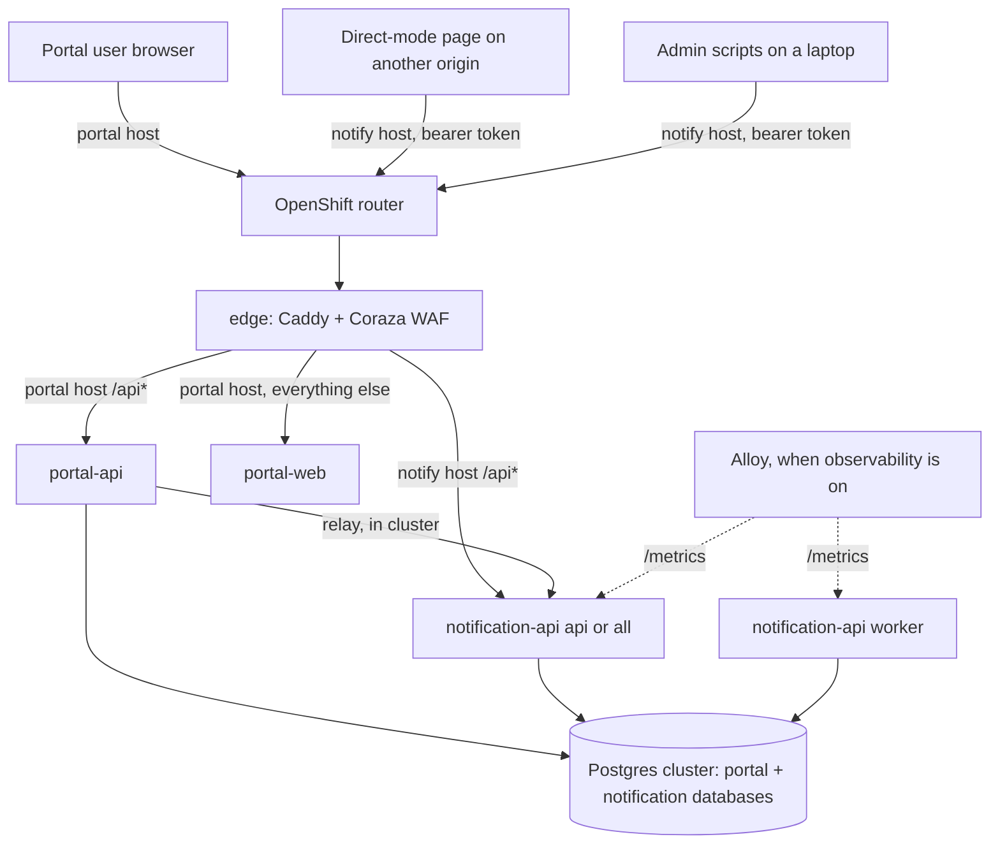
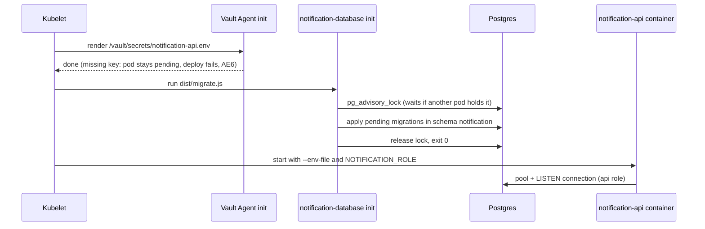
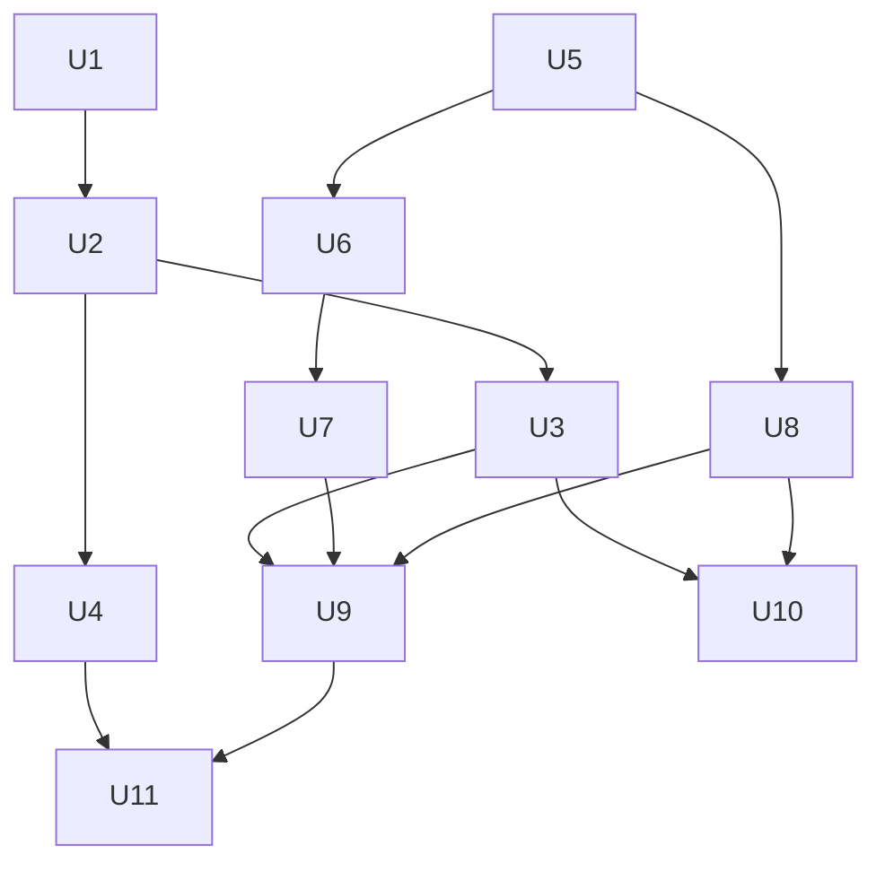

# Notification API Deploy - Plan

## Goal Capsule

- **Objective:** The portal's inbox and the header's direct mode work against real deployed environments. Every environment the `sdg` release deploys to runs notification-api, and callers outside the cluster reach it at its own public address.
- **Means:** A `charts/notification-api` chart in the `sdg` umbrella, a `packages/notification-database` package with its own migrator image, a second hostname on the existing edge and WAF, and Vault-sourced secrets, delivered by a pull request from the spike (KTD1, KTD3, KTD6).
- **Authority:** The Product Contract decides behavior and scope. Key Technical Decisions (KTD1–KTD13) decide mechanism within it. Units override neither. Key rotation and the before-production safeguards are related work, not active scope (see How This Work Fits Together).
- **Execution profile:** Eleven units (U1–U11) on work branches merged locally into `spike/notification-api`, verified by the Verification Contract, then one PR from the spike (R17) whose deploy is checked by hand against the Success Criteria.
- **Stop conditions:** Stop and ask before any push or PR, and before anything would change GitHub, Vault, Keycloak or OpenShift settings (a person does those, R18). Also stop when a session-settled decision proves infeasible, or when a unit would need to change a Product Contract requirement.
- **Open blockers:** None for planning. Deploying needs the Vault secrets in R10 to exist before the PR opens.

---

## Product Contract

**Product Contract preservation:** changed: R1, R6, R8, R15, R16, R18, Summary, Success Criteria, Scope Boundaries, two Key Decisions, and AE2 removed. During planning the user decided that notification-api runs wherever the release deploys, with no PROD switch because PROD is not currently deployed, and that its database lives in its own `packages/notification-database` package. The deferred Outstanding Questions were resolved by KTD1–KTD13 and removed.

### Summary

notification-api ships as part of the stack's single Helm release, reachable from outside the cluster at its own hostname through the existing edge and WAF, and reachable by portal-api inside the cluster. It runs wherever the release deploys and has no default email server configured for now. Its database schema and migrations move into a `packages/notification-database` package, and a pull request from `spike/notification-api` delivers the work.

### Problem Frame

notification-api and the portal inbox were proved in a local spike, and nothing about them runs on OpenShift. The portal's inbox relay has no service to call in a deployed environment, so the bell and inbox work only on a developer's laptop. The header's direct mode, where a page on another website calls notification-api with the user's own token, has never been tried against a real environment, an https origin or the WAF.

ADR 0002 (`docs/adr/0002-shared-notification-service.md`) lists a Helm chart, NetworkPolicies and a public route, including one for direct mode, as follow-up work. Until that exists, nobody outside the team can see or test the service, and the decision about how the spike reaches `main` can't be made from a working deployment.

### Actors

- A1. **Portal user.** Signs in to the portal with BC Services Card and reads notifications in the header's bell and the inbox pages, through portal-api's relay.
- A2. **Direct-mode tester.** Runs a page on another origin (a local dev server or a hosted test site), signs in with that site's own Keycloak client, and calls notification-api's public address directly with the user's token.
- A3. **Admin.** A person with notification-api's admin role who sets up a deployed environment's catalog, senders and credentials from a laptop with the scripts in `apps/notification-api/scripts`.
- A4. **Sender.** A system holding a sender credential that sends notifications through the public address. For now that's the admin's test credentials; later it's other teams' systems.
- A5. **Platform team member.** Creates the Vault secrets, GitHub variables and Keycloak client settings. Automated agents never do this (AGENTS.md, Settings).
- A6. **Deploy workflows.** `pr-open.yml`, `merge.yml` and `release.yml` build images and install the `sdg` release.

### Key Decisions

- **The work goes all the way to a PR deploy, not just deploy-ready files.** The no-push rule for the spike is lifted for this. Governs R17. (session-settled: user-directed — chosen over staying local and over a manual install to dev: a PR deploy is the only way the portal and a direct-mode tester can use it.)
- **Outside callers use a second hostname on the existing edge and WAF.** This keeps one front door and one WAF ruleset, matches `notify.sdg.localhost` locally, and keeps the service's address independent of the portal. Governs R2, R4, R5. (session-settled: user-approved — chosen over a separate route that skips the WAF and over a path on the portal's hostname.)
- **The whole API is public.** Admin scripts and future senders work against the deployed address, and every route still checks its token and role. Governs R3. (session-settled: user-approved — chosen over exposing only the inbox, or the inbox plus sending, and reaching the rest through port-forward.)
- **Direct-mode origins and sign-in clients come from per-environment configuration.** Governs R7. (session-settled: user-directed — chosen over a fixed local-dev-only or hosted-site-only setup.)
- **No default email server is configured for now.** Setting one up is not part of this work. Senders can still add their own email integrations. Governs R13. (session-settled: user-approved — chosen over a mail catcher per PR and over a real SMTP relay.)
- **notification-api is part of every `sdg` release, with no environment switch.** PROD is not currently deployed, so it gets no special handling. Governs R1. (session-settled: user-directed — chosen over turning it off in PROD by configuration: a switch adds wiring for an environment nobody deploys.)
- **Every PR environment carries it, and the quota cost is accepted.** About one PR environment fits in the shared dev namespace at a time instead of two. Governs R1, R12. (session-settled: user-directed — chosen over squeezing requests and over opt-in per PR.)
- **notification-api uses its own database in the existing Postgres cluster, defined in its own package.** A second cluster would cost PVC quota that PR namespaces don't have. The schema and migrations live in `packages/notification-database`, mirroring `packages/portal-database`. Governs R8, R15. (session-settled: user-directed — chosen over keeping the schema and migrations inside `apps/notification-api`.)
- **Key rotation is separate work, brainstormed next.** Governs nothing here (see How This Work Fits Together). (session-settled: user-approved — chosen over folding rotation into this plan.)

### Requirements

**Where it runs and how it is reached**

- R1. notification-api is part of the `sdg` release in every environment the release deploys to, with no environment-specific switch.
- R2. Each environment gives notification-api its own public hostname, served by the existing edge with the same WAF that protects the portal.
- R3. Every notification-api API route (under `/api`) is reachable at that hostname and keeps its own token and role checks. `/metrics` and `/healthz` stay inside the cluster, as they do for portal-api.
- R4. Browser CORS preflight (`OPTIONS`) reaches notification-api on its hostname, and the WAF keeps rejecting `OPTIONS`, `TRACE` and `TRACK` everywhere else.
- R5. Hostnames are generated per environment from the release name under the cluster's apps domain, the same way the portal's are, with no vanity hostname or custom certificate.

**Portal and direct mode**

- R6. portal-api calls notification-api inside the cluster, so the inbox relay and the email-confirmation route work.
- R7. Allowed browser origins and extra relaying sign-in clients are set per environment from configuration. The portal's own client is always allowed, the origin list defaults to empty, and PR environments may list localhost origins.

**Data, secrets and network**

- R8. notification-api has its own database and database user in the environment's existing Postgres cluster, separate from the portal's, with its schema and migrations in `packages/notification-database`.
- R9. Only the edge and portal-api can open connections to notification-api, plus the observability scraper when observability is on, and Postgres admits notification-api.
- R10. `NOTIFICATION_ENCRYPTION_KEY` comes from Vault. PR environments share one Vault path, and TEST and PROD each have their own, so no two of them share a key.
- R11. Schema migrations are applied before notification-api serves requests or delivers, and they are applied once even when several pods start together.

**Runtime**

- R12. PR environments run notification-api as a single pod with both roles, sized to fit beside the rest of the PR stack.
- R13. No platform default email integration is configured in any environment for now. For a sender without an email integration of its own, email delivery steps fail and are recorded in history, and in-app delivery is unaffected.
- R14. notification-api's telemetry follows the repo's opt-in rule: traces, logs and scrape wiring appear only when the release's observability settings are set.
- R15. notification-api and its migrator (`notification-database`) have production images that meet the same rules as the other images: they build from the repo root, drop all capabilities and pass `scripts/images-smoke.sh`.

**Delivery and setup**

- R16. The PR workflow builds and installs notification-api, the merge workflow deploys it to TEST, and a published release deploys it to PROD like the rest of the stack, with no manual cluster steps beyond those in R18. The first deploy to an existing environment (TEST, or a PR environment created before this lands) succeeds with no failed deploy in between.
- R17. The work is delivered as a pull request from `spike/notification-api`.
- R18. The setup a person does by hand is documented where the charts and deploys are already documented. That covers the Vault secrets, GitHub variables, Keycloak client settings (including two service-account clients per realm for the seed's sender credentials, and the admin login callback on notification-api's client), checking that the two new container packages are public, and clearing other PR environments before a deploy that needs the quota slot.
- R19. Chart changes pass `pnpm test:charts`, with notification-api covered by its own chart tests and the umbrella render checks.
- R20. The admin scripts (`apps/notification-api/scripts`) work against a deployed environment's public address: seeding needs no in-cluster test receiver, and a failed seed never leaves a catalog the script refuses to finish. They can also send one test notification from a sender credential, to the seeded platform topic or to a given issuer and subject (the subject a direct-mode tester reads from their own token, for F4).

### Key Flows

- F1. PR deploy
  - **Trigger:** A PR is opened or updated.
  - **Actors:** A6, A5
  - **Steps:** The workflow builds the notification-api and notification-database images with the others and installs the release. Postgres gains notification-api's database and user, migrations apply, notification-api starts with its key from Vault, and the edge answers the new hostname.
  - **Outcome:** The PR comment lists the portal URL and the notification URL, and notification-api is up at its own hostname.
  - **Covered by:** R1, R2, R5, R8, R10, R11, R12, R16
- F2. Admin sets up a deployed environment
  - **Trigger:** A fresh PR or TEST environment has an empty catalog.
  - **Actors:** A3, A4
  - **Steps:** The admin gets a token with the login script and runs the seed script against the environment's public notification address. That creates a type, a sender and credentials, after which a sender credential sends a notification.
  - **Outcome:** The environment has a working catalog and a sent notification.
  - **Covered by:** R2, R3, R20
- F3. Portal user sees a notification
  - **Trigger:** A signed-in portal user subscribes through the portal to the platform topic the seed created (F2), and the sender broadcasts a test notification to that topic.
  - **Actors:** A1, A4
  - **Steps:** portal-api relays the subscription, inbox calls and the live stream to notification-api inside the cluster. The bell updates without a reload.
  - **Outcome:** The notification appears in the bell and the inbox. An email step, if the type has one, fails visibly in history.
  - **Covered by:** R6, R13, R20
- F4. Direct-mode tester reads an inbox
  - **Trigger:** A tester opens a header page on an allowed origin.
  - **Actors:** A2, A5
  - **Steps:** The page signs in with its own Keycloak client, which A5 has added to that environment's relaying clients. It then calls the public notification address directly; preflight passes the WAF and the live stream connects.
  - **Outcome:** The tester's inbox and live updates work from another origin.
  - **Covered by:** R2, R4, R7, R20

### Acceptance Examples

- AE1. **Covers R4.** Given a deployed environment, when a browser on an allowed origin sends a preflight to notification-api's hostname, it gets notification-api's CORS answer. When the same `OPTIONS` request goes to the portal's hostname, the edge answers 405.
- AE3. **Covers R7.** Given TEST with an empty origin list, when a page on any other origin calls notification-api, the response carries no CORS headers and the browser blocks it. Server-side callers and portal-api are unaffected.
- AE4. **Covers R11.** Given two notification-api pods starting at the same time on a new release, migrations are applied once and both pods start.
- AE5. **Covers R13.** Given a sender with no email integration of its own and a type whose policy escalates to email, when the in-app item goes unread, the email step is recorded as failed for lack of an email integration, and the in-app item stays.
- AE6. **Covers R10.** Given a PR environment whose Vault path holds no `NOTIFICATION_ENCRYPTION_KEY`, the deploy fails rather than starting notification-api without its key.

### Success Criteria

- On a PR environment, F2, F3 and F4 all work end to end: an admin sets up a sender, a send shows up live in a portal user's bell, and a page on `http://localhost:5173`, signed in through its own client, reads and live-updates in direct mode the inbox of the identity it signs in as, after a send addressed to that identity, from the PR's public notification address.
- After merge, the same F2 and F3 work on TEST.
- `pnpm test:charts` and `scripts/images-smoke.sh` pass, and existing portal behavior doesn't change.

<!-- ce-section: work-relationships -->

### How This Work Fits Together

This plan covers getting notification-api deployed with the rest of the stack, reachable from outside the cluster. The surrounding areas below are the current understanding, not a committed roadmap.

- **Key rotation.** Make the encryption key, webhook signing secrets, sender callback secrets and portal-api's session secret rotatable without data loss or dropped deliveries. Brainstormed next as its own plan.
  - Can proceed independently of this plan. Its one link here is that Vault must be able to hold a previous key beside the current one later.
  - Until it exists, an environment's encryption key can't be replaced without losing the secrets stored under it.
- **Before-production safeguards.** Unsubscribe for email and anti-spam safeguards for sends to raw public addresses (ADR 0002 follow-up work).
  - Enables configuring a real email server and sending email to members of the public.
- **Spike exit.** How the spike reaches `main`.
  - Depends on this plan: merging this PR is that decision (R17).
- **Admin UI** for the catalog, senders and credentials.
  - Can proceed independently of this plan. Until it exists, deployed environments are set up with the scripts (F2).

### Scope Boundaries

- Key rotation of any kind (see How This Work Fits Together).
- PROD-specific sizing.
- Unsubscribe, anti-spam safeguards, configuring a platform default email server, and an in-cluster mail catcher.
- One person's inbox across sign-in clients (linking the identities a person gets from different Keycloak clients).
- Vanity hostnames and custom TLS certificates for the notification hostname (`route-tls.yml` stays the only place for vanity TLS).
- Automatic seeding of deployed environments, and an admin UI.
- Opting PRs in or out of notification-api individually, and trimming the rest of the PR stack to win back quota.
- A second Postgres cluster, or PgBouncer in front of notification-api (`LISTEN` needs a direct connection; ADR 0002 Notes).
- Changes to notification-api behavior beyond what deploying it needs. R11's migration safety, moving the schema into its own package and Postgres schema, and R20's admin-script changes are deployment needs, so they stay in scope.
- Considered and not built: an egress NetworkPolicy for notification-api. No chart in this repo has one, and nothing here needs one; revisit with the before-production safeguards.
- Considered and not built: a `VAULT_SECRET_PATH`-style override for notification-api's Vault path. Paths are derived per environment (KTD10), and an override is the variable that leaked one environment's secret into another before.

### Dependencies / Assumptions

- A5 creates `NOTIFICATION_ENCRYPTION_KEY` in Vault before each environment's first deploy: `d62e77-nonprod/notification-api` before the PR opens, `d62e77-nonprod/notification-api-test` before merge, and `d62e77-prod/notification-api` before any release is published (KTD10).
- The existing Vault roles (`d62e77-nonprod`, `d62e77-prod`) can read the new paths because they are in the same KV mounts. This is unverified, since the roles' policies can't be read; the first PR deploy confirms it for nonprod.
- A person's BC Services Card subject probably differs between the portal's client and a direct-mode site's client. This is unverified, and the spike's service plan lists the same risk. Direct mode therefore shows the inbox of the identity the site signs in as, and F4 is the first real test.
- notification-api's Keycloak client (`sdg-notifications-api-idir-6725`) exists in the dev and test loginproxy realms. A direct-mode tester's site client exists in the same realm as the environment it tests.
- The `bcgov/sdg` repository is public, and packages a workflow publishes with its built-in token inherit the repository's visibility, as the existing images do. So the two new container packages are expected to be public on their first build. If the first PR deploy can't pull one, a person changes that package's visibility in its settings page; no workflow setting controls it.
- The shared `d62e77-dev` namespace leaves room for roughly one PR environment at a time once notification-api is included (about 250m CPU and 900Mi memory free, against roughly 90m and 500Mi per PR). When the spike PR deploys, no other PR environment may be running, so a person closes or uninstalls the others first. After merge, a second PR deployed while another PR environment is up fails its deploy and its required PR check until that environment is gone.
- Opening the PR puts the whole spike (notification-api, the portal inbox and the header changes) into review, and PR deploys of the full stack.

### Sources / Research

- `docs/adr/0002-shared-notification-service.md`: follow-up work, the before-production list, and the `LISTEN` note.
- `docs/plans/2026-11-04-1302-feat-notification-api-plan.md` and `docs/plans/2026-11-05-1632-feat-portal-inbox-plan.md`: the spike's design.
- `charts/README.md`, `charts/common`, `charts/edge`, `charts/portal-api`, `charts/postgres`, `charts/sdg`: the patterns to extend.
- `packages/portal-database`: the package, migrator entry (`src/migrate.ts`) and image (`Dockerfile`) that `packages/notification-database` mirrors.
- `apps/portal-web/caddy/Caddyfile`, `Caddyfile.dev`, `common.caddy`, `coraza.conf`: the edge today. Rule 1009 denies `OPTIONS`; the audit log records headers and bodies of matching requests.
- `apps/notification-api/src/config/env.ts`: the env contract.
- `apps/portal-api/src/config/env.ts`: `NOTIFICATION_API_URL`, where blank means the relay routes answer 404.
- Crunchy PGO v5 user reconciliation: `CREATE DATABASE` without an owner, `GRANT ALL PRIVILEGES ON DATABASE`, existing roles and databases adopted, `public` never granted, `databaseInitSQL` run once (postgres-operator `internal/postgres/users.go`; PGO docs, "User / Database Management").
- drizzle-orm 0.45 `migrate()`: journal in `drizzle.__drizzle_migrations`, no lock, last-applied read outside the transaction.
- Caddy 2.11, tested in a container: an empty `{$VAR}` in a `host` matcher fails at load, and `{$VAR:default}` only applies when the variable is unset. `reverse_proxy` flushes `text/event-stream` immediately.
- GitHub Docs, "About GitHub Packages with GitHub Actions": packages published with `GITHUB_TOKEN` inherit the repository's visibility.

---

## Planning Contract

### Key Technical Decisions

- KTD1. **A new `charts/notification-api` leaf chart joins the `sdg` umbrella, with two layouts.** `mode: split` (the default, TEST and PROD) renders an `api` and a `worker` Deployment. `mode: combined` (`values-pr.yaml`) renders one Deployment with `NOTIFICATION_ROLE=all`. Every Deployment selects on `app.kubernetes.io/component` (`api`, `worker` or `all`) from the first release, because selectors are immutable and `common.selectorLabels` alone would let api and worker select each other's pods. Every pod keeps `app.kubernetes.io/name: notification-api`, so NetworkPolicy peers match all of them. The Service and PodDisruptionBudget select `api` or `all` only. Governs R1, R12.
- KTD2. **portal-api's Vault and database helpers move into `charts/common`, and both app charts use them.** That covers the Vault Agent template and annotations (parameterized by the env-file name), the `DATABASE_URL`/`PGSSLMODE`/CA env and the Postgres CA mount. portal-api's existing `vault_test.yaml` and `deployment_test.yaml` are the regression check. (session-settled: user-approved — chosen over copying the helpers into a second chart as `charts/observability` did: one copy for two apps.)
- KTD3. **`packages/notification-database` mirrors `packages/portal-database`.** It is a Node library: Vite library mode, `.js` relative imports and the AGENTS.md tsconfig layout. It exports the schema, the migrations folder and test helpers, and ships `dist/migrate.js` plus `migrations/` in its `files`. Its own Dockerfile builds the `notification-database` migrator image, which runs as an init container on every notification-api Deployment, as `portal-database` does for portal-api. notification-api drops `src/database/schema`, `drizzle/`, `run-migrations.ts` and `scripts/migrate.ts`, and keeps its Nest database module. Governs R8, R11, R15. (session-settled: user-directed — chosen over keeping the schema and migrations in `apps/notification-api`.)
- KTD4. **All tables live in a dedicated `notification` Postgres schema, with the migrations regenerated as one baseline.** PGO gives the app user rights to create a schema in its database but none on `public`, so a dedicated schema needs no manual step in any environment, existing or new (R16). The spike was never deployed, so a fresh baseline loses nothing. Local databases are reset once. Hand-written SQL that names a table bare (for example the delivery expander's `FROM notifications`, and the pagination cursor's `getTableName`) is schema-qualified, and the PGlite-backed tests catch any that are missed. (session-settled: user-approved — chosen over keeping `public` and documenting a superuser step on TEST and on PR environments created before this lands.)
- KTD5. **The migration runner takes a session-level `pg_advisory_lock` on its single client around drizzle's `migrate`, with a bounded wait.** drizzle has no lock and reads the last applied migration outside its transaction, so concurrent init containers would race (AE4). The runner keeps creating the database when it is missing (the local stack needs that; under PGO the database already exists). Migrations stay compatible with the previous release, because old pods keep running during a rolling update and after a rollback. Governs R11.
- KTD6. **The edge routes the notification hostname through a terminal Caddy block selected by env.** It follows the established `import notify_{$NOTIFY:off}` pattern. The chart always renders `NOTIFY` as `on` or `off`, because an empty `host` matcher fails Caddy at load and `{$VAR:default}` does not cover a set-but-empty variable. In `notify_on`, requests on that host go to notification-api for `/api*` and get 404 for everything else, so `/metrics` and `/healthz` stay internal (R3). Nothing falls through to portal-api or portal-web. The notification host keeps the site-wide security headers along with notification-api's own helmet headers. Neither the CSP nor `Cross-Origin-Resource-Policy: same-origin` affects CORS-mode fetches (`apps/notification-api/src/http/cors.ts`), so the shared `import security_headers`, which `apps/portal-web/src/csp-hashes.test.ts` parses, stays as it is. Governs R2, R3.
- KTD7. **The WAF exception is a static host rule in `coraza.conf`, placed before rule 1009.** It matches a notification host by its label shape (`<release>-notify.` or `notify.sdg.localhost`), and lifts rule 1009 with `ctl:ruleRemoveById` only for `OPTIONS` on paths under `/api/v1/me/`. Those are the only paths notification-api answers CORS on, so `TRACE`/`TRACK` and every other host stay blocked. The same host match sets the audit-log parts for every request on that host to an explicit list without request headers (B) and request body (I), because bearer tokens and integration secrets travel there. An explicit list avoids depending on `+`/`-` modifier semantics. A static pattern avoids relying on env substitution inside Coraza directives, and only hosts in the edge's Ingress reach the edge. Governs R4.
- KTD8. **The notification hostname is derived from the portal host as one DNS label: `<release>-notify.apps.<domain>`.** The router's default certificate is a single-label wildcard, so `notify.<release>.apps…` would need a custom certificate (R5). A `common` helper derives it from `global.host`, with no override, so the rendered host always matches KTD7's WAF host rule. The edge Ingress adds a second rule on the same `tls: [{}]`. `deploy-values.sh outputs` adds a `notify_url=`, which the PR comment shows. Governs R2, R5.
- KTD9. **The postgres chart declares a second user, `notification`, with database `notification`, and admits notification-api pods on 5432.** PGO creates the role, database and `<release>-postgres-pguser-notification` Secret on install and on upgrade of an existing cluster, so no init SQL changes (KTD4). notification-api reads `uri` from that Secret, with `PGSSLMODE=require` and the cluster CA, as portal-api does. Governs R8, R9.
- KTD10. **`deploy-values.sh` derives notification-api's settings per environment and rejects unsafe ones.**
  - The Vault path is `<plate>-nonprod/notification-api` for PRs, `<plate>-nonprod/notification-api-test` for TEST and `<plate>-prod/notification-api` for PROD, with no override variable.
  - `NOTIFICATION_CLIENT_ID` is a new GitHub variable.
  - Relaying clients are always the portal's `KEYCLOAK_CLIENT_ID` plus optional extras, and browser origins default to empty.
  - PR targets read only `NOTIFICATION_PR_RELAYING_CLIENT_IDS` and `NOTIFICATION_PR_CORS_ORIGINS`. These are repository-level variables, because PR deploys have no GitHub environment, and they may hold `http://localhost` origins.
  - TEST and PROD read only `NOTIFICATION_RELAYING_CLIENT_IDS` and `NOTIFICATION_CORS_ORIGINS`, set as GitHub-environment variables, with https origins only.

  GitHub environments inherit repository variables and can't set one to empty, so a single shared name would carry a PR's localhost origin into TEST and fail its deploy, and would make a direct-mode tester's client trusted in TEST. Separate PR-only names stop both, and derived Vault paths keep the PR key out of TEST, which is the trap that broke TEST sign-in before. Governs R7, R10, R16.

- KTD11. **The two new images join every workflow package list.**
  - `notification-api` and `notification-database` go into the pr-open matrix (with their trigger paths), pr-close's `packages`, `release.yml`'s image check and promote matrix, and the commented promote list in `merge.yml`.
  - `notification-api` joins the chart build loop in `reusable-deploy.yml`.

  pr-open tags `latest` for untouched packages, and only pr-close sets `latest` on merge, so an incomplete list breaks later PRs. Governs R16.

- KTD12. **TEST and PROD use RollingUpdate for the api Deployment and Recreate for the worker.** The worker has no Service, and a short gap in delivery is harmless. Recreate also keeps two worker generations from claiming work side by side during a rollout. PR environments use Recreate throughout, as the rest of the PR stack does. Governs R1, R12.
- KTD13. **The admin scripts become safe against a deployed environment.**
  - The seed is re-runnable, so a partial seed is finished by running it again (R20). notification-api has no endpoint that lists senders, and sender names aren't unique, so the seed finds its objects through ones it can list. It finds or creates the platform topic by key first, then finds its sender among that topic's broadcasters. If there is none, it creates the sender and grants it on the topic right away, and it links only the credential client ids the sender doesn't have yet.
  - It sets a failure callback only when a receiver URL is given.
  - A new `send` script uses a sender credential's client-credentials token to post one notification to the seeded platform topic or to a given issuer and subject.
  - Every script prints the base URL and issuer it will act on before writing, so a local `.env` can't silently aim a run at the wrong environment.

  Governs R20.

### High-Level Technical Design

Request paths once deployed. Solid lines are network calls; the NetworkPolicy allows exactly these.

Startup of a notification-api pod. Every Deployment runs the same init container, and the advisory lock serializes it.

### Implementation Constraints

- AGENTS.md governs throughout: TypeScript 7 for libraries (no compiler-API tools), Node libraries use `.js` relative imports, images drop all capabilities (`scripts/images-smoke.sh`), chart map values default to `{}` and fall back in the template, observability stays opt-in, and charts never create RBAC.
- Chart tests use helm-unittest without snapshots, like every existing chart.
- `charts/*/Chart.lock` files are committed and `charts/*/charts/` is not.
- Agents never run setup scripts with `--apply`, and never change GitHub, Vault or OpenShift settings.

### Deferred to Implementation

- Exact value keys and helper names in the new chart and in `charts/common`.
- Request and limit sizes for the api, worker and combined Deployments, checked against the TEST quota (500m CPU, 2Gi memory) by rendering `values-test.yaml` (KTD12) and against the PR budget in `values-pr.yaml`.
- The bounded wait for the migration lock (KTD5) and its log line.
- Whether any hand-written SQL beyond the two known sites names a table bare (KTD4); the PGlite tests decide.

---

## Implementation Units

| U-ID | Title                                      | Key files                                                                       | Depends on |
| ---- | ------------------------------------------ | ------------------------------------------------------------------------------- | ---------- |
| U1   | notification-database package              | `packages/notification-database/`                                               | none       |
| U2   | notification-api uses the package          | `apps/notification-api/src/database/`, `compose.yaml`                           | U1         |
| U3   | notification-api and migrator images       | `apps/notification-api/Dockerfile`, `packages/notification-database/Dockerfile` | U1, U2     |
| U4   | Admin scripts for deployed environments    | `apps/notification-api/scripts/`                                                | U2         |
| U5   | Shared chart helpers and portal-api wiring | `charts/common/templates/_helpers.tpl`, `charts/portal-api/`                    | none       |
| U6   | notification-api chart                     | `charts/notification-api/`                                                      | U5         |
| U7   | Postgres user and umbrella                 | `charts/postgres/`, `charts/sdg/`                                               | U6         |
| U8   | Edge routing and WAF exception             | `apps/portal-web/caddy/`, `charts/edge/`                                        | U5         |
| U9   | Deploy values and workflows                | `scripts/deploy-values.sh`, `.github/workflows/`, `scripts/charts-test.sh`      | U3, U7, U8 |
| U10  | Image smoke checks                         | `scripts/images-smoke.sh`                                                       | U3, U8     |
| U11  | Setup and developer docs                   | `charts/README.md`, `DEVELOPER.md`, `apps/notification-api/README.md`           | U4, U9     |

### U1. notification-database package

- **Goal:** A workspace package that owns notification-api's schema, migrations and migration runner, built like `packages/portal-database`.
- **Requirements:** R8, R11, R15 (KTD3, KTD4, KTD5)
- **Dependencies:** none
- **Files:**
  - `packages/notification-database/package.json`, `tsconfig*.json`, `vite.config.ts`, `vitest.config.ts`, `drizzle.config.ts` (new)
  - `packages/notification-database/src/schema/*.ts` (moved from `apps/notification-api/src/database/schema/`, tables on a `notification` pgSchema)
  - `packages/notification-database/src/run-migrations.ts`, `src/migrate.ts`, `src/migrations-folder.ts`, `src/index.ts`, `src/testing/index.ts` (new or moved)
  - `packages/notification-database/migrations/` (regenerated baseline)
  - `packages/notification-database/src/run-migrations.test.ts`, `src/migrations.test.ts`, `src/package-exports.test.ts` (new)
- **Approach:**
  1. Scaffold from `packages/portal-database`: the same scripts, exports (`.`, `./schema`, `./testing`), `files: ["dist", "migrations"]`, peer dependency on drizzle-orm, and the Node-library tsconfig presets.
  2. Move the schema modules and put every table on one `pgSchema('notification')`.
  3. Delete the old journal and generate one baseline migration with drizzle-kit. The baseline creates the `notification` schema first.
  4. Move `run-migrations.ts`. Keep `ensureDatabase` and the credential-masking errors, and add the advisory lock with a bounded wait around `migrate` (KTD5).
  5. Add `src/migrate.ts` as the image entry, mirroring `packages/portal-database/src/migrate.ts`, with the `unhandledRejection` handler and exit codes 0/1.
  6. Export a test helper that applies the migrations to PGlite, as `apps/notification-api/src/testing/database.ts` does today.
- **Patterns to follow:** `packages/portal-database` (layout, `migrate.ts`, `run-migrations.ts`, `package-exports.test.ts`); `apps/notification-api/src/database/run-migrations.ts` (database creation, error masking).
- **Test scenarios:**
  - Covers AE4. Two runners started at the same moment against one real Postgres database both exit 0, and the journal holds each migration exactly once. Like today's server tests, this runs when `NOTIFICATION_TEST_DATABASE_URL` is set; U10 is the always-run proof.
  - A runner that cannot get the lock within the bounded wait exits 1 with a message naming the lock, not a credential.
  - A missing or non-Postgres `DATABASE_URL` fails with the existing masked messages.
  - The baseline applied to an empty PGlite database creates every table in schema `notification` and none in `public`.
  - Applying the migrations twice is a no-op the second time.
  - The package's exports resolve from `dist` (`.`, `./schema`, `./testing`).
- **Verification:** The package builds, typechecks and passes its tests, and `dist/migrate.js` migrates a local database.

### U2. notification-api uses the package

- **Goal:** notification-api, its tests and the local stack run on `@repo/notification-database`, with no schema or migrations left in the app.
- **Requirements:** R8 (KTD3, KTD4)
- **Dependencies:** U1
- **Files:**
  - `apps/notification-api/package.json` (dependency on `@repo/notification-database`; drop `db:*` scripts that move)
  - `apps/notification-api/src/database/database.module.ts` (imports the schema from the package)
  - `apps/notification-api/src/**/*.ts` importing `database/schema` (about 49 files: change the import source only)
  - `apps/notification-api/src/delivery/expander.ts`, `src/http/pagination.ts` (schema-qualified SQL)
  - `apps/notification-api/src/testing/database.ts` (uses the package's test helper)
  - Delete `apps/notification-api/src/database/schema/`, `src/database/run-migrations.ts` and its test, `drizzle/`, `drizzle.config.ts`, `scripts/migrate.ts`
  - `compose.yaml` (`notification-migrate` runs the package's migrate; `nm-notification-database` volume in `x-workspace` and `volumes:`)
  - `apps/notification-api/README.md` (one-off local reset)
- **Approach:**
  1. Point every schema import at the package.
  2. Qualify bare table names in hand-written SQL, using drizzle table references where possible so the schema follows automatically.
  3. Switch the PGlite test helper and compose's migrate service to the package.
  4. Document the one-off local reset (drop the `notification` database, or `podman compose down -v`) for anyone who ran the spike locally.
- **Patterns to follow:** How portal-api consumes `@repo/portal-database` (`apps/portal-api/src/database/database.module.ts`, `src/testing/database.ts`); compose's portal `migrate` service.
- **Test scenarios:**
  - The existing notification-api test suite passes unchanged on the new schema. That is the proof that every query resolves its tables.
  - The audience expander resolves `recipients`-kind notifications against schema `notification`.
  - Cursor pagination returns the next page when tables live in schema `notification`.
- **Verification:** `apps/notification-api` has no schema or migrations of its own, its tests pass, and the local stack starts and migrates from a fresh volume.

### U3. notification-api and migrator images

- **Goal:** Production images for notification-api and notification-database that meet the repo's image rules.
- **Requirements:** R15 (KTD3)
- **Dependencies:** U1, U2
- **Files:**
  - `apps/notification-api/Dockerfile` (new)
  - `packages/notification-database/Dockerfile` (new)
  - `.dockerignore` (only if a new path needs excluding)
- **Approach:**
  1. Copy `apps/portal-api/Dockerfile` with `notification-api...` filters: pnpm fetch, offline install, build, `pnpm deploy --prod`, then Alpine Node 24 without apk, `USER 1001`, `NODE_ENV=production`, and `CMD` preloading `dist/instrumentation.js`.
  2. Copy `packages/portal-database/Dockerfile` with `@repo/notification-database...` filters and `CMD ["node", "dist/migrate.js"]`.
- **Execution note:** This is packaging; prove it with the image smoke run (U10) rather than unit tests.
- **Patterns to follow:** `apps/portal-api/Dockerfile`, `packages/portal-database/Dockerfile`, AGENTS.md image rules.
- **Test scenarios:** Test expectation: none -- packaging only; U10's smoke checks cover image contents and runtime.
- **Verification:** Both images build from the repo root with `podman build -f <dir>/Dockerfile .`.

### U4. Admin scripts for deployed environments

- **Goal:** An admin can seed and test a deployed environment from a laptop (F2, F3, F4).
- **Requirements:** R20 (KTD13)
- **Dependencies:** U2
- **Files:**
  - `apps/notification-api/scripts/seed.ts`, `scripts/lib/*.ts` (find-or-create steps; optional callback; target banner)
  - `apps/notification-api/scripts/send.ts` (new), `package.json` (`send` script)
  - `apps/notification-api/scripts/login.ts` (target banner)
  - `apps/notification-api/scripts/lib/*.test.ts` (new tests for the step helpers)
  - `apps/notification-api/.env.example` (document the deployed-environment variables)
- **Approach:**
  1. Replace `assertUnseeded` with find-or-create steps in the order KTD13 gives: types by key, platform topic by key (`GET /api/v1/admin/topics`), sender through that topic's broadcasters (granted on the topic as soon as it is created), then only the missing credential client ids (`GET /api/v1/senders/:id/credentials`). No list-senders endpoint is needed.
  2. Set the sender's failure callback only when `WEBHOOK_RECEIVER_INTERNAL_URL` is given.
  3. Add `send`. It takes a client-credentials token for a sender credential and posts one notification, either to the seeded platform topic or to a given issuer and subject. It reuses the e2e `send()` and `to()` helpers and `lib/tokens.ts`.
  4. Make every script print the base URL and issuer before its first write.
- **Patterns to follow:** `scripts/e2e/notifications.ts` (send shape), `scripts/lib/tokens.ts`, `scripts/lib/env.ts`.
- **Test scenarios:**
  - A seed run after a partial seed that created the topic and sender but no credentials finds that sender through the topic, creates no second sender, and links only the missing credentials.
  - A second full seed run creates nothing.
  - A seed run with no `WEBHOOK_RECEIVER_INTERNAL_URL` completes and sets no failure callback.
  - `send` with a topic id posts a topic-audience notification; with `--issuer` and `--subject` it posts a recipient-reference audience.
  - `send` with neither a topic nor a subject exits 1 with a usage message before calling the API.
- **Verification:** The seed and send work against the local stack's `https://notify.sdg.localhost`, and a second seed run is a no-op.

### U5. Shared chart helpers and portal-api wiring

- **Goal:** One copy of the Vault and database helpers in `charts/common`, and portal-api pointed at notification-api.
- **Requirements:** R6, R10 (KTD2)
- **Dependencies:** none
- **Files:**
  - `charts/common/templates/_helpers.tpl` (Vault template and annotations by env-file name, database env, CA mount, notification-host helper from KTD8)
  - `charts/portal-api/templates/_helpers.tpl`, `deployment.yaml`, `configmap.yaml`, `values.yaml`
  - `charts/portal-api/tests/configmap_test.yaml`, `vault_test.yaml`, `deployment_test.yaml`
- **Approach:**
  1. Move the helpers, parameterized by env-file name and values root, and switch portal-api to them with no change to its rendered output.
  2. Add `notificationApiUrl` to portal-api's values, defaulting to `'http://{{ .Release.Name }}-notification-api:3000'` and rendered with tpl into the ConfigMap as `NOTIFICATION_API_URL`.
  3. Add the `common` helper that derives the notification host (KTD8).
- **Patterns to follow:** existing `common.*` helpers; `charts/edge/values.yaml` tpl'd upstreams.
- **Test scenarios:**
  - portal-api's existing Vault and deployment tests pass unchanged, which shows the move kept its output.
  - The ConfigMap renders `NOTIFICATION_API_URL: http://sdg-notification-api:3000` for release `sdg`.
  - The notification-host helper turns `sdg-12.apps.gold.devops.gov.bc.ca` into `sdg-12-notify.apps.gold.devops.gov.bc.ca`.
- **Verification:** `pnpm test:charts` passes for portal-api and common.

### U6. notification-api chart

- **Goal:** A chart that runs notification-api in either layout with its secrets, database, probes, policies and telemetry.
- **Requirements:** R1, R3, R7, R9, R10, R11, R12, R13, R14 (KTD1, KTD2, KTD9, KTD12)
- **Dependencies:** U5
- **Files:**
  - `charts/notification-api/Chart.yaml`, `Chart.lock`, `values.yaml` (new)
  - `charts/notification-api/templates/configmap.yaml`, `deployment.yaml` (one or two Deployments by `mode`), `service.yaml`, `networkpolicy.yaml`, `pdb.yaml` (new)
  - `charts/notification-api/tests/*_test.yaml` (new)
- **Approach:**
  1. Fill the ConfigMap from values:
     - `NODE_ENV=production`, `PORT`, `LOG_LEVEL`, `TRUST_PROXY=true`
     - `KEYCLOAK_ISSUER_URL`, `NOTIFICATION_CLIENT_ID`, `RELAYING_CLIENT_IDS`, `CORS_ALLOWED_ORIGINS`
     - `CONFIRM_EMAIL_URL=https://<global.host>/confirm-email`
     - no `DEFAULT_SMTP_*` (R13)
     - OTEL only when observability is set (R14)
  2. Each Deployment gets the Vault env file (`NOTIFICATION_ENCRYPTION_KEY`), `DATABASE_URL` from `<release>-postgres-pguser-notification`, the CA mount and the `notification-database` init container, all through the `common` helpers.
  3. Probes are `/healthz/live` (startup and liveness) and `/healthz/ready`. Scrape annotations go on every Deployment.
  4. The NetworkPolicy admits the edge and portal-api on 3000, plus the scraper rule.
  5. Strategy: RollingUpdate for api and Recreate for worker by default, and `values-pr.yaml` sets Recreate (KTD12).
- **Patterns to follow:** `charts/portal-api` (all templates and tests), `charts/observability/templates/_helpers.tpl` (component-aware selectors, without `name = component`).
- **Test scenarios:**
  - `mode: split` renders an api and a worker Deployment with roles `api` and `worker` and disjoint selectors; the Service selects only api pods.
  - `mode: combined` renders one Deployment with role `all`, which the Service selects.
  - Every Deployment has the `notification-database` init container, the Vault annotations for `notification-api.env` and the PGO Secret reference.
  - Without Vault and without `existingSecret`, rendering fails with a clear message (AE6's chart-side guard).
  - The ConfigMap has no `DEFAULT_SMTP_*` keys, and `RELAYING_CLIENT_IDS` and `CORS_ALLOWED_ORIGINS` render from values.
  - The NetworkPolicy admits edge and portal-api pods on 3000 and nothing else unless observability is on.
  - With observability set, both Deployments carry scrape annotations and OTEL env; without it, neither does.
  - Worker strategy is Recreate and api strategy is RollingUpdate by default.
- **Verification:** The chart lints strictly and its unit tests pass.

### U7. Postgres user and umbrella

- **Goal:** The `sdg` release installs notification-api with its database user, in every environment.
- **Requirements:** R1, R8, R9, R12 (KTD1, KTD9)
- **Dependencies:** U6
- **Files:**
  - `charts/postgres/values.yaml`, `templates/postgrescluster.yaml`, `templates/networkpolicy.yaml`, `tests/postgres_test.yaml`
  - `charts/sdg/Chart.yaml`, `Chart.lock`, `values.yaml`, `values-pr.yaml`, `templates/NOTES.txt`
  - `charts/sdg/tests/umbrella_test.yaml`, `tests/pr_values_test.yaml`
- **Approach:**
  1. The postgres chart renders a second `users` entry from values (`notification`/`notification`) and a second `from` peer for notification-api pods on 5432.
  2. The umbrella adds the dependency with `condition: notification-api.enabled`, `enabled: true` like the other subcharts, and the required-value placeholders (Keycloak, Vault).
  3. `values-pr.yaml` sets `mode: combined`, small requests and Recreate, and updates its per-PR totals comment.
- **Patterns to follow:** existing umbrella blocks and cross-chart agreement tests.
- **Test scenarios:**
  - The PostgresCluster lists users `portal` and `notification`, each with its own database.
  - The postgres NetworkPolicy admits portal-api and notification-api pods on 5432.
  - In the umbrella, the edge's notification upstream, portal-api's `NOTIFICATION_API_URL` and the notification-api Service name agree.
  - notification-api's `DATABASE_URL` Secret name matches the PGO user Secret the postgres chart implies.
  - With `values-pr.yaml`, notification-api renders one combined Deployment with Recreate and the PR requests.
- **Verification:** `pnpm test:charts` passes, including the umbrella render.

### U8. Edge routing and WAF exception

- **Goal:** The edge serves the notification hostname through the WAF, with preflight allowed only there.
- **Requirements:** R2, R3, R4, R5 (KTD6, KTD7, KTD8)
- **Dependencies:** U5
- **Files:**
  - `apps/portal-web/caddy/Caddyfile`, `Caddyfile.dev`, `common.caddy`, `coraza.conf`
  - `charts/edge/values.yaml`, `templates/deployment.yaml`, `templates/ingress.yaml`
  - `charts/edge/tests/edge_test.yaml`
- **Approach:**
  1. Add `notify_on` and `notify_off` snippets to `common.caddy`. `notify_on` matches `{$NOTIFY_HOST}`, proxies `/api*` to `{$NOTIFICATION_API_URL}` and answers 404 for everything else (KTD6).
  2. Import it in `Caddyfile` before `collect_` and `api_proxy`, and leave `import security_headers` unchanged.
  3. In `Caddyfile.dev`, give the `notify.sdg.localhost` block the WAF and the same routes, so R4 can be tried locally.
  4. In `coraza.conf`, add the host-scoped `OPTIONS` exemption and the audit-log trim ahead of rule 1009 (KTD7).
  5. The edge chart always renders `NOTIFY` (`on` when a notification host resolves), `NOTIFY_HOST` and `NOTIFICATION_API_URL`, and the Ingress gains the second host rule.
- **Patterns to follow:** `collect_{$TELEMETRY:off}` and its chart wiring; `charts/edge/templates/ingress.yaml`.
- **Test scenarios:**
  - The Ingress has rules for the portal host and the derived notification host, under one `tls: [{}]`.
  - The edge Deployment renders `NOTIFY=on`, `NOTIFY_HOST` and `NOTIFICATION_API_URL` for release `sdg-12`, and `NOTIFY=off` when no host resolves.
  - Covers AE1. Preflight on the notification host passes the WAF; on the portal host it gets 405 (proved in U10).
  - `/metrics` and `/healthz/ready` on the notification host get 404 (proved in U10).
  - `apps/portal-web/src/csp-hashes.test.ts` still passes.
- **Verification:** The chart tests pass, and the local stack serves `https://notify.sdg.localhost/api/...` through the WAF with preflight working from `http://localhost:5173`.

### U9. Deploy values and workflows

- **Goal:** PR, TEST and PROD deploys install notification-api with the right per-environment settings, and every package list includes the new images.
- **Requirements:** R7, R10, R16, R19 (KTD8, KTD10, KTD11)
- **Dependencies:** U3, U7, U8
- **Files:**
  - `scripts/deploy-values.sh`, `scripts/deploy-values.test.sh`
  - `scripts/charts-test.sh` (`LEAF_CHARTS`, lint values, per-environment render checks)
  - `.github/workflows/pr-open.yml`, `pr-close.yml`, `reusable-deploy.yml`, `release.yml`, `merge.yml`
  - `scripts/setup-environments.sh` (variable checks only; never run with `--apply`)
- **Approach:**
  1. In `deploy-values.sh`, validate the new inputs and emit the `notification-api:` block: Keycloak issuer and client id, relaying clients, origins and Vault settings derived per KTD10.
  2. Add a `notify_url=` output.
  3. Pass the new variables through `reusable-deploy.yml`, add `notification-api` to its chart build loop and expose the notify URL for the PR comment.
  4. Add both images to every package list (KTD11).
  5. Extend `charts-test.sh` so PR, TEST and PROD renders contain notification-api and the notification host.
- **Patterns to follow:** existing `check` validations and conditional observability block; `deploy-values.test.sh` `expect` and `rejects` helpers.
- **Test scenarios:**
  - A PR target emits Vault path `d62e77-nonprod/notification-api`, TEST emits `d62e77-nonprod/notification-api-test` and PROD emits `d62e77-prod/notification-api`.
  - `RELAYING_CLIENT_IDS` always includes the portal's `KEYCLOAK_CLIENT_ID`, plus extra ids when set.
  - Covers AE3. TEST with no `NOTIFICATION_CORS_ORIGINS` emits an empty origin list, even when `NOTIFICATION_PR_CORS_ORIGINS=http://localhost:5173` is set.
  - With `NOTIFICATION_PR_RELAYING_CLIENT_IDS` set, a PR render includes those ids and a TEST or PROD render does not.
  - TEST or PROD with an `http://localhost` value in `NOTIFICATION_CORS_ORIGINS` is rejected; a PR target accepts one in `NOTIFICATION_PR_CORS_ORIGINS`.
  - A malformed origin, such as one with a path, is rejected.
  - `outputs` prints `notify_url=https://sdg-12-notify.apps.gold.devops.gov.bc.ca` for PR 12 on Gold.
  - `charts-test.sh` renders notification-api resources and the notification host for PR, TEST and PROD values.
- **Verification:** `scripts/deploy-values.test.sh` and `pnpm test:charts` pass, and the workflow package lists match in every file.

### U10. Image smoke checks

- **Goal:** `scripts/images-smoke.sh` proves both new images and the edge's notification routing.
- **Requirements:** R3, R4, R11, R15 (KTD5, KTD6, KTD7)
- **Dependencies:** U3, U8
- **Files:** `scripts/images-smoke.sh`
- **Approach:**
  1. Build the two images with the others.
  2. Check their contents: `dist` present and no `src`, migrations present in the migrator, no dev dependencies, no `.env`, no package manager.
  3. Run the migrator against the compose Postgres, including two at once.
  4. Start notification-api read-only as an arbitrary UID with all capabilities dropped.
  5. Send requests through the edge to both hosts.
- **Patterns to follow:** the existing portal-database, portal-api and edge sections of the script, including container cleanup by name.
- **Test scenarios:**
  - Covers AE4. Two migrator containers started together both exit 0, and the journal count equals the migration count.
  - The migrator with a wrong password exits 1 and masks the password.
  - notification-api answers `/healthz/live` 200 and logs JSON.
  - Covers AE1. `OPTIONS /api/v1/me/inbox` on the notification host with an allowed `Origin` returns notification-api's CORS headers; the same request on the portal host returns 405.
  - `TRACE` on the notification host still returns 405.
  - `GET /metrics` and `GET /healthz/ready` on the notification host return 404.
  - A request carrying `Authorization: Bearer <JWT-shaped token>` to the notification host is not blocked by the WAF.
  - A request on the notification host that trips a WAF rule (for example a SQL-injection query argument), carrying a marker bearer token and a JSON body with a marker secret, is blocked. The edge's audit entry for it contains neither marker. The same request on the portal host still logs its headers.
- **Verification:** `scripts/images-smoke.sh` passes with no capability on any image.

### U11. Setup and developer docs

- **Goal:** A person can do R18's setup and an admin can run F2–F4 from the docs alone.
- **Requirements:** R18, R20
- **Dependencies:** U4, U9
- **Files:**
  - `charts/README.md` (chart table, prerequisites, install example, configuration table, the notification host)
  - `DEVELOPER.md` (packages list of six, Vault secrets per environment, new GitHub variables, Keycloak setup, PR quota note, local notification stack and reset)
  - `apps/notification-api/README.md` (running the scripts against a deployed environment)
  - `apps/notification-api/.env.example`, `packages/notification-database/README.md` (new, brief)
- **Approach:** Extend the existing sections rather than adding new ones. The R18 checklist covers:
  - the three Vault paths
  - `NOTIFICATION_CLIENT_ID`, the PR-only `NOTIFICATION_PR_*` variables at repository level, and `NOTIFICATION_CORS_ORIGINS` / `NOTIFICATION_RELAYING_CLIENT_IDS` as `test` and `prod` environment variables (KTD10)
  - the Keycloak service-account clients and login callback
  - checking that the two packages are public after their first build
  - clearing other PR environments before the spike PR deploys
- **Patterns to follow:** existing `DEVELOPER.md` checklist and tables; `charts/README.md` structure.
- **Test scenarios:** Test expectation: none -- documentation.
- **Verification:** Every R18 item and every new variable appears in the docs, and the scripts' documented commands match `package.json`.

---

## System-Wide Impact

- **Every deploy carries notification-api.** PR environments grow to about 90m CPU and 500Mi memory, so roughly one fits in `d62e77-dev` at a time (settled; see Dependencies).
- **Shared edge.** The edge image and config change for every environment. Portal traffic keeps its routes, headers and WAF rules; only the notification host gets the preflight exception and the audit-log trim.
- **Shared chart library.** The helper move in `charts/common` touches portal-api's rendering; its tests guard that.
- **Auth boundary.** The whole notification-api API becomes internet-reachable behind the WAF, and every route still checks its token and role (settled).
- **Local development.** The notification database moves to schema `notification`, so local spike databases need one reset (U2).

## Risks

| Risk                                                                                                          | Mitigation                                                                                                                                                    |
| ------------------------------------------------------------------------------------------------------------- | ------------------------------------------------------------------------------------------------------------------------------------------------------------- |
| The Vault role can't read the new paths                                                                       | The first PR deploy shows it (AE6); a person adjusts the role, which agents can't                                                                             |
| The WAF's header rules flag JWTs and block API calls                                                          | U10 sends a bearer token through the edge; a rule tweak lands in U8 if it fails                                                                               |
| TEST rollout exceeds the 500m/2Gi quota                                                                       | Worker uses Recreate (KTD12); sizes are checked against a TEST render before merge                                                                            |
| A migration breaks the previous release during rollout or rollback                                            | Migrations stay backward compatible (KTD5); the baseline is the only migration in this work                                                                   |
| A new package comes out private                                                                               | A person changes its visibility after the first build (R18)                                                                                                   |
| The split api/worker layout first runs on TEST, after merge, because PRs and compose run one combined process | Inbox signals already cross processes through Postgres `NOTIFY`, and the spike's e2e runs a second worker process; the TEST check of F3 catches anything left |
| Direct mode shows an empty inbox because BC Services Card subjects differ per client                          | Success is defined per signed-in identity (F4); cross-client linking is out of scope                                                                          |

---

## Verification Contract

| Check                                               | Command                                                                        | Proves                                                                |
| --------------------------------------------------- | ------------------------------------------------------------------------------ | --------------------------------------------------------------------- |
| Build                                               | `pnpm build`                                                                   | Both packages and the app compile, including `dist/migrate.js`        |
| Types                                               | `pnpm typecheck`                                                               | TypeScript 7 for libraries, TS 6 for the Nest app, no errors          |
| Lint and format                                     | `pnpm lint`, `pnpm format:check`                                               | No oxlint warnings, oxfmt clean                                       |
| Unit tests                                          | `pnpm test`                                                                    | U1, U2, U4 scenarios and the existing suites                          |
| Charts                                              | `pnpm test:charts`                                                             | U5–U7, U8 chart tests, lint, umbrella render, per-environment renders |
| Deploy values                                       | `bash scripts/deploy-values.test.sh`                                           | U9 scenarios                                                          |
| Images and edge                                     | `scripts/images-smoke.sh`                                                      | U3, U8, U10 scenarios against real containers                         |
| Local stack                                         | `podman compose up` then the U4 scripts against `https://notify.sdg.localhost` | F2–F4 locally, including preflight through the WAF                    |
| PR deploy (manual, after the user approves pushing) | Open the PR from `spike/notification-api`                                      | The first two Success Criteria on the PR environment                  |
| TEST (manual, after merge)                          | Merge workflow                                                                 | F2 and F3 on TEST                                                     |

## Definition of Done

- Every unit's Verification holds and every command in the Verification Contract passes.
- `apps/notification-api` has no schema, migrations or migrate script of its own; `packages/notification-database` owns them.
- The PR environment and then TEST meet the Success Criteria, checked by hand.
- The docs cover every R18 item.
- No experimental or abandoned code from approaches that didn't pan out is left in the diff.
- Nothing was pushed, and no GitHub, Vault, Keycloak or OpenShift setting was changed, without the user's explicit go-ahead.
