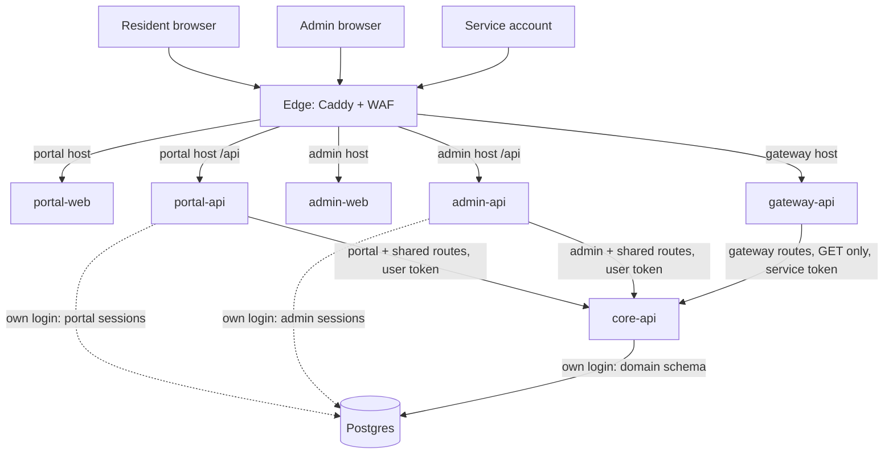
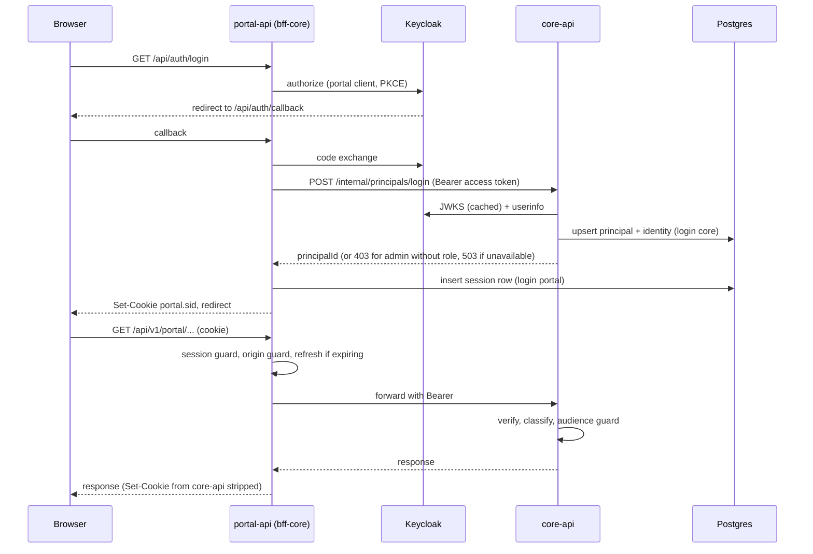
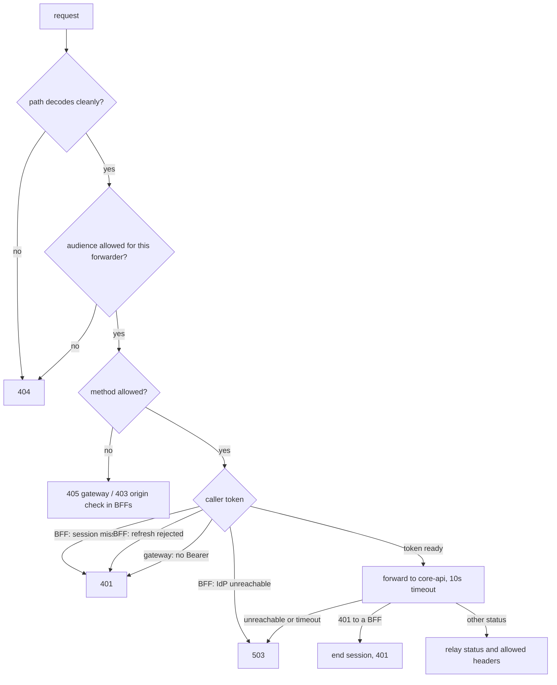
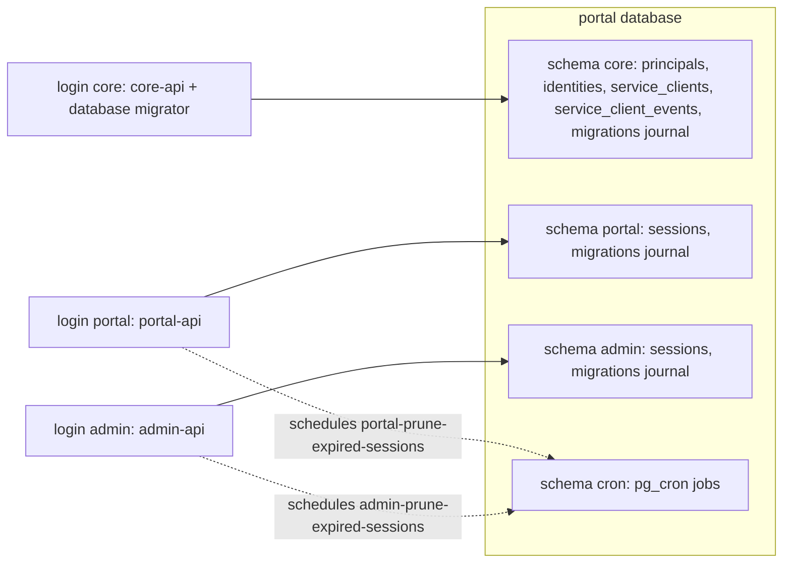
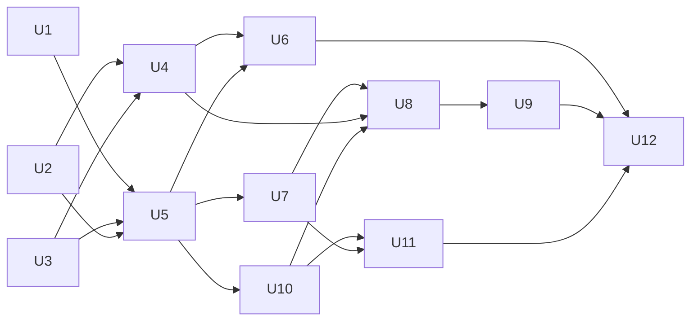

# Core API with Portal, Admin and Gateway Entry Points - Plan

## Goal Capsule

- **Objective:** BC Services Card residents, IDIR administrators and pre-authorized service accounts each reach the system through their own entry point, and every business rule lives in one place behind all three. Admins managing the service-account registry that gateway callers are checked against proves the whole chain works.
- **Means:** A new core-api service behind three thin forwarders (portal-api, admin-api, gateway-api), built on shared `server-core` and `bff-core` packages (KTD1), with per-service database logins on recreated clusters (KTD8).
- **Product authority:** This Product Contract decides behaviour; the Planning Contract's KTDs decide mechanism within it; units override neither. The repo owner decides product questions the contract leaves open.
- **Execution profile:** Three phases, each one PR (see Phased Delivery). Phase 1 is the cut-over; Phases 2 and 3 add admin and gateway.
- **Stop conditions:** Stop and ask before changing repository or organization settings, before any step that deletes a Postgres cluster or PVC (a person does that, see Operational Notes), and if Keycloak's userinfo endpoint or token shapes in DEV contradict KTD4 or KTD5.
- **Who finishes:** An implementing agent builds and verifies each phase locally. A person runs the setup steps marked as theirs (Keycloak client requests, Vault secrets, GHCR visibility, TEST cluster reset) and decides when to merge.
- **Open blockers:** None.

---

## Product Contract

Product Contract preservation: changed R12 — one re-sign-in for every resident at the cut-over, approved with recreating the TEST and PROD databases. Restructured, no scope change: F2's steps now name core-api as the role check (KTD6), and R14's wording says "admin client role". The Outstanding Questions deferred to planning are resolved by KTD2, KTD4, KTD8, KTD9, KTD11 and Phased Delivery.

### Summary

Split the backend into one core service and three thin entry points: the existing BCSC portal, a new IDIR admin app, and a new service-account gateway.
core-api holds every domain rule and table and authorizes every call from the caller's own token.
The forwarders only authenticate, keep sessions where a browser is involved, and forward their own audience's routes.
The first real feature is an admin screen for the service-account registry that gateway-api enforces.

### Problem Frame

Today the system has one way in: BC Services Card users sign in to portal-web, and portal-api acts as its backend-for-frontend.
portal-api mixes reusable login plumbing with the only domain rule the system has, creating or refreshing a principal at login (`apps/portal-api/src/principals/principals.service.ts`).
Two more kinds of caller are coming: IDIR staff who administer the system, and external systems that need to fetch data with pre-authorized service accounts.
Building them on the current shape would mean copying login and session plumbing into a second BFF and spreading business rules across several backends, each with its own authorization logic.
There are no admin or machine-facing features yet, so this is the cheapest moment to set the structure.

### Key Decisions

- **core-api is its own service and the single owner of domain logic.** (session-settled: user-directed — chosen over a shared core library imported by each BFF: domain logic should live in one deployable service.) Governs R1, R2, R23.
- **Forwarders pass the caller's own access token to core-api.** core-api authenticates and authorizes every request itself, so a compromised forwarder can act only as callers who are currently signed in. (session-settled: user-approved — chosen over the BFF authenticating as itself and naming the user in a trusted header: no forwarder becomes a trusted asserter of identity.) Governs R6, R8, R9.
- **Forwarding is a generic proxy restricted to an audience allow-list.** (session-settled: user-approved — chosen over forwarding everything, and over typed per-route BFF endpoints: keeps the forwarders thin while making admin and gateway routes unreachable from the portal even if a core-api check is missed.) Governs R4.
- **Sessions stay in the same Postgres cluster, and each service gets its own database login.** (session-settled: user-approved — chosen over one shared login, and over storing sessions through core-api: least privilege with no new infrastructure.) Governs R24, R25.
- **admin-web gets its own hostname on the shared edge.** (session-settled: user-approved — chosen over a second edge and over an /admin path on the portal host: a separate origin isolates cookies and scripts without adding edge pods.) Governs R13.
- **gateway-api follows the same pattern, with its own hostname on the shared edge.** Machine callers stay off the portal and admin origins, and the WAF still applies. Governs R18.
- **Admin sign-in requires the admin client role.** (session-settled: user-approved — chosen over admitting any IDIR user, and over checking the role only in core-api.) Governs R14.
- **Service-account pre-authorization is a registry stored in core-api's database.** (session-settled: user-directed — chosen over a per-environment config allow-list: authorized clients are managed as data, not deployments.) Governs R16, R20, R21.
- **Managing the registry is admin-web's first real feature.** (session-settled: user-approved — chosen over a per-environment script and over admin API routes with no UI: it exercises the full admin chain and records who changed what.) Governs R16, R17.
- **Every PR environment deploys the full stack, sized down.** (session-settled: user-approved — chosen over deploying admin services only when admin paths change.) Governs R28.
- **Every repository created from this template runs all six services.** (session-settled: user-directed — chosen over making admin and gateway opt-in, deployed only when their config exists: the full shape is part of the template.) Governs R28, R33.
- **Only the needed token-handling concepts come from the notification-api spike.** (session-settled: user-directed — the spike branch is not merged; port only the pieces this work needs, shaped so a later merge is easier.) Governs R30.
- **TEST and PROD databases are recreated at the cut-over.** (session-settled: user-approved — chosen over preserving existing data with a superuser runbook and a two-release rollout: TEST holds only test data and PROD has not been released.) Governs R12, R25.
- **gateway-api is read-only for now.** The stated purpose is fetching data; write access for machines would be a separate decision. Governs R19.
- **The registry records only whether a client is allowed.** What each client may read arrives with the first real gateway data. Governs R16.

### Actors

- A1. Resident: a BC Services Card user signing in to portal-web.
- A2. Administrator: an IDIR user with the admin client role, signing in to admin-web.
- A3. Service account: an external system holding its own Keycloak client and calling gateway-api with a client-credentials token.
- A4. Keycloak: the BC Gov SSO standard realm, which issues every token. Client roles appear in its top-level `client_roles` claim.

### Architecture



The text requirements below are complete without the diagram.

### Requirements

**Service topology**

- R1. core-api is a new deployable application that owns all domain logic. It is the only service that reads or writes domain tables.
- R2. portal-api, admin-api and gateway-api hold no domain logic. Each forwards its audience's requests to core-api.
- R3. core-api is unreachable from the edge. Its network policy admits only portal-api, admin-api and gateway-api, plus the metrics scraper when observability is enabled.
- R4. core-api groups its routes by audience: portal, admin, gateway, and shared person routes such as "current user". Each forwarder forwards only its own group (the two BFFs also forward shared routes) and answers any other route with 404 without contacting core-api.

**Shared BFF foundation**

- R5. Login, logout, the encrypted Postgres session store, the session guard, health checks, telemetry and logging move from portal-api into a shared bff-core package that portal-api and admin-api both use.
- R6. Before forwarding, bff-core refreshes the user's access token when it has expired or is about to. When Keycloak rejects the refresh token, the session ends and the BFF responds 401. When Keycloak cannot be reached, the BFF responds 503 and keeps the session.
- R7. portal-api and admin-api each have their own Keycloak client, session cookie and session data.
- R31. bff-core refuses any request other than GET or HEAD whose Origin header is missing or is not the BFF's own origin, responding 403 without contacting core-api.

**Identity and authorization in core-api**

- R8. core-api authenticates every request from the forwarded Bearer token. It accepts tokens issued to the portal (BCSC) client, the admin (IDIR) client, and registered service-account clients. For a service-account token it verifies signature, issuer and expiry first, then looks the client up in the registry as a separate authorization step, so a registry miss is never a verification failure (R20).
- R9. core-api authorizes by audience. Portal routes need a portal-client user token. Admin routes need an admin-client token carrying the admin client role. Gateway routes need a service-account token from a registered, enabled client. Shared routes accept portal-client or admin-client person tokens.
- R10. When Keycloak's signing keys cannot be fetched, core-api responds 503, not 401.
- R11. At login callback, the BFF asks core-api to create or refresh the caller's principal and identity using the fresh access token. core-api takes the identity only from the token. If core-api is unavailable, sign-in fails with an error and no session is created.

**Portal**

- R12. Residents see no change in behaviour: signing in, the current-user display and sign-out work as they do today. The one exception is a single re-sign-in at the cut-over, when the TEST and PROD databases are recreated.

**Admin**

- R13. admin-web is a new React app served on its own hostname through the shared edge. On that host, `/api` goes to admin-api.
- R14. Only IDIR users holding the admin client role on the admin client can sign in. Anyone else sees a not-authorized page that says the admin client role is required and offers a sign-out that also ends their Keycloak session. No session or principal is created for them.
- R15. admin-web shows the shared `<sdg-header>` with the administrator's name and sign-out.
  - Superseded: the header requirement is replaced by docs/plans/2026-11-12-1016-feat-console-app-shell-plan.md (console-web's sidebar shell and account menu).
- R16. admin-web has a service-account registry screen. Administrators can list registered clients, add one by Keycloak client id with a display name, disable or re-enable one, and remove one after confirming.
- R17. Every registry change records which administrator made it and when, and the registry screen shows that history. The history is one log that outlives the entries it describes: removing a client keeps its earlier history and records the removal.
- R32. admin-web handles admin-api's refusals explicitly. A 401 returns the administrator to sign-in with a "session ended" message. A 503 keeps the session and offers a retry. A 403 shows the not-authorized page (R14). No registry change is shown as successful unless core-api confirmed it.

**Gateway**

- R18. gateway-api is a new application on its own hostname through the shared edge. It accepts only client-credentials Bearer tokens and has no login and no session.
- R19. gateway-api forwards only GET requests. Any other method is refused without contacting core-api.
- R20. A token from a client that is not in the registry, or that is disabled, gets 403. An invalid or expired token gets 401.
- R21. Disabling or removing a client takes effect on that client's next request, even if its current token has not expired.
- R22. gateway-api initially exposes one route, which returns the calling client's registry entry.

**Data**

- R23. `packages/portal-database` is renamed `packages/database`. It holds the domain schema owned by core-api: principals, identities and the service-account registry.
- R24. Session storage belongs to bff-core. Each BFF's session data is reachable only through that BFF's database login.
- R25. Each service connects to Postgres with its own login, which can reach only the tables that service owns.
- R26. Expired sessions keep being pruned once the database logins are split. Today the prune job runs as the single shared login.
- R27. The rename follows an explicit checklist covering every reference: workflows, charts, `compose.yaml`, Dockerfiles, `AGENTS.md`, `DEVELOPER.md` and the `.mdd` docs.

**Delivery**

- R28. Every PR environment deploys the full stack: portal-web, portal-api, admin-web, admin-api, gateway-api, core-api, edge and postgres. Each new service's chart defaults request PR-level sizes, so TEST and PROD inherit them as well as PR environments.
- R29. Each new application follows the repo's existing conventions:
  - a production image that starts with all capabilities dropped
  - a Helm chart in the `sdg` umbrella
  - a compose service with its own `node_modules` volume and a local hostname behind Caddy
  - observability that is opt-in, per `AGENTS.md`
- R33. The template's setup covers admin and gateway, so a new team can still reach a working first PR deploy: the `DEVELOPER.md` setup checklist, the variable checks in `scripts/setup-environments.sh`, the Vault paths, and the Keycloak client requests all include them.
- R30. Token handling from the notification-api spike is rebuilt here in a shape that keeps a later merge of that branch simple:
  - in core-api: accepting several client audiences, recognizing service-account tokens, reading roles from `client_roles`, and returning 503 when the signing keys are unreachable
  - in bff-core: the spike's token refresh (the OIDC client's refresh grant, refreshing within 30 seconds of expiry, one refresh at a time per session) and its forward-with-Bearer relay, as the basis for R6 and R4

### Key Flows

- F1. Resident sign-in
  - **Trigger:** A resident chooses sign in on portal-web.
  - **Actors:** A1, A4
  - **Steps:** portal-api redirects to Keycloak with the portal client. On callback it asks core-api to create or refresh the principal, passing the fresh access token. It stores the tokens in an encrypted session and sets the session cookie.
  - **Outcome:** The resident is signed in, exactly as today.
  - **Covered by:** R5, R11, R12
- F2. Administrator sign-in
  - **Trigger:** An IDIR user opens admin-web and chooses sign in.
  - **Actors:** A2, A4
  - **Steps:** admin-api redirects to Keycloak with the admin client. On callback it asks core-api to create or refresh the principal; core-api refuses a token without the admin client role. On that refusal admin-api ends the Keycloak session, shows the not-authorized page and stops. Otherwise it continues as in F1.
  - **Outcome:** Administrators reach admin-web, and no one else gets a session.
  - **Covered by:** R11, R14
- F3. Registry change
  - **Trigger:** An administrator adds, disables, re-enables or removes a service-account client.
  - **Actors:** A2
  - **Steps:** admin-web calls admin-api. admin-api forwards the admin route with the administrator's token. core-api checks the admin role, applies the change and records who made it and when.
  - **Outcome:** The registry and its history reflect the change, and gateway-api enforces it on the next request.
  - **Covered by:** R4, R9, R16, R17, R21
- F4. Service-account call
  - **Trigger:** An external system calls gateway-api with a client-credentials token.
  - **Actors:** A3, A4
  - **Steps:** gateway-api refuses non-GET requests and routes outside the gateway audience. It forwards the rest with the caller's token. core-api verifies the token and looks up the client in the registry.
  - **Outcome:** A registered, enabled client gets data. Anyone else gets 401 or 403.
  - **Covered by:** R18, R19, R20, R21, R22

### Acceptance Examples

- AE1. **Covers R14.** Given an IDIR user without the admin client role, when they finish the Keycloak login for admin-web, then they see the not-authorized page, receive no session cookie, and no principal is created.
- AE2. **Covers R4.** Given a signed-in resident, when their browser requests an admin route on the portal host, then portal-api responds 404 and core-api receives no request.
- AE3. **Covers R20, R21.** Given a registered client that an administrator has just disabled, when it calls gateway-api with a token that has not yet expired, then it gets 403.
- AE4. **Covers R20.** Given a valid client-credentials token from a client not in the registry, when it calls gateway-api, then it gets 403. Given an expired token from a registered client, it gets 401.
- AE5. **Covers R19.** Given a registered client, when it sends a POST to gateway-api, then the request is refused and core-api receives nothing.
- AE6. **Covers R6.** Given a resident whose access token has expired but whose refresh token is still valid, when they make a request, then it succeeds after the token is refreshed without them noticing. Given a refresh token that Keycloak rejects, the session ends and the response is 401. Given Keycloak cannot be reached during refresh, the response is 503 and the session survives.
- AE7. **Covers R11.** Given core-api is down, when a resident completes the Keycloak callback, then sign-in fails with an error page that offers a retry, and no session is created.
- AE8. **Covers R10.** Given Keycloak's signing keys cannot be reached, when any forwarded request arrives at core-api, then it responds 503.
- AE9. **Covers R31.** Given a signed-in administrator, when a page on another origin submits a POST to a registry route on the admin host, then admin-api responds 403 and core-api receives no request.

### Scope Boundaries

- Domain features beyond principals and the service-account registry.
- Per-client limits on what a service account may read.
- Rate limiting per service account. The edge WAF still applies to the gateway host.
- Write access through gateway-api.
- Linking a resident's BCSC identity to an administrator's IDIR identity. They stay separate principals.
- Merging the notification-api spike (PR #48) or moving notification features into core-api.
- Service-account callers other than through gateway-api, such as notification-api calling core-api.
- The `POST /api/auth/token` route described in `.mdd/docs/06-portal-api.md`. Token refresh here happens inside the BFF (R6), not through a browser-facing route.

**Considered and not built**

- Checking the token's `identity_provider` claim on top of its client (`azp`). Each Keycloak client is configured for one IdP, so the client check already separates BCSC from IDIR. Revisit if a client is ever shared across IdPs.
- Caching registry lookups. One indexed read per gateway call is cheap, and any cache breaks R21 with more than one core-api replica. Revisit when gateway latency measurements show the lookup matters.
- A gateway-api k6 load script and Grafana dashboards for the new services. Existing alerts and scrape annotations cover the new pods. Revisit when the gateway serves real data.

### Dependencies / Assumptions

- A Keycloak IDIR client for admin-web with an admin client role must be requested in the BC Gov SSO standard realm for each environment, with redirect and post-logout URIs for the admin host (a wildcard for PR hosts in DEV). The existing IDIR client `sdg-notifications-api-idir-6725` belongs to the notification-api spike.
- Each external system gets its own Keycloak service-account client through the BC Gov SSO service. The registry stores those client ids; it does not create clients.
- Admin and gateway hostnames are needed for each environment. Vanity-route TLS stays in the on-demand `route-tls` workflow, per `AGENTS.md`.
- Each environment needs Vault secrets for admin-api: a session secret and the Keycloak client secret.
- The dev namespace now holds only this project (500m CPU / 2Gi memory requests). At PR sizes the full stack in R28 needs about 140m CPU / 790Mi memory requests, so two PR environments fit at once.
- TEST and PROD also have 500m CPU / 2Gi memory request quotas, and a merge deploy rolls every Deployment at once with a surge pod each. Steady state plus that surge must fit. PROD also hosts the observability stack (about 130m / 864Mi) and may need a quota increase to run both.
- Keycloak's userinfo endpoint in the standard realm returns name and email for BCSC and IDIR access tokens (KTD5). Unverified; checked against DEV at the start of U5.

### Sources / Research

- `apps/portal-api/src/principals/principals.service.ts`: the only domain logic today; moves to core-api.
- `apps/portal-api/src/session/session.types.ts`: the session already keeps the access, refresh and ID tokens on the server "for future downstream calls".
- `packages/auth/src/nestjs/jwt-auth.guard.ts` and `packages/auth/src/types.ts`: Bearer verification exists but nothing uses it, and audience accepts only fixed values.
- `packages/portal-database/migrations/0002_prune_sessions.sql`: the session-prune cron job runs as the app login.
- `apps/portal-web/caddy/Caddyfile` and `apps/portal-web/caddy/common.caddy`: a single edge site that proxies `/api*` to portal-api.
- `charts/portal-api/templates/networkpolicy.yaml`: the edge-only ingress pattern core-api adapts.
- `charts/sdg/values-pr.yaml`: the existing PR sizing.
- `charts/postgres/templates/init-sql.yaml`: runs once as superuser at cluster creation; today it hands `public` to the single `portal` login.
- Branch `spike/notification-api`, `apps/notification-api/src/auth/token-kind.ts`, `principal.resolver.ts` and `admin.guard.ts`: the multi-audience, service-account, `client_roles` and 503-on-key-outage handling that R30 ports. The spike checks the registry during verification (a 401); R8 moves that check after verification.
- Branch `spike/notification-api`, `packages/auth/src/oidc-client.ts` (refresh grant, `endSession`) and `apps/portal-api/src/notifications/token-refresh.service.ts` and `relay.service.ts`: the refresh-before-forward and relay that R30 ports into bff-core. The spike maps an unreachable IdP to 502 and its same-origin guard checks `Sec-Fetch-Site`; R6 and R31 differ and win.
- BC Gov SSO (CSS) docs and `bcgov/sso-terraform-keycloak-client`: client roles arrive in a top-level `client_roles` claim; service accounts exist only on confidential clients, and a client-credentials token's `aud` names its own client, so core-api identifies service accounts by `azp`. Token lifetimes, refresh-token rotation and access-token profile claims are not documented and are treated as unverified.

---

## Planning Contract

### Key Technical Decisions

- KTD1. **Two shared packages: `server-core` for every Nest service, `bff-core` for the two browser BFFs.** `packages/server-core` holds what all four Nest apps need: env helpers and validation, logging with `describeError`, OpenTelemetry bootstrap parameterized by service name, health module, `configureApp` bootstrap, Swagger setup, and the forwarding contract (KTD2, KTD3). `packages/bff-core` holds sessions, OIDC login, the session guard, token refresh and the origin guard, and depends on `server-core`. core-api and gateway-api depend only on `server-core`, so no service depends on a package named for browser login. Both follow `packages/auth`: Node library, TS7 with `isolatedDeclarations`, `.js` relative imports, Nest as optional peers, subpath exports. Governs U2, U4.
- KTD2. **One route contract, defined once in `server-core`.** Forwarded paths have the shape `/api/v<N>/<audience>/…` with audience `portal`, `admin`, `gateway` or `shared`; core-api mounts its controllers under the same prefixes, so forwarders pass the path through unchanged. `/api/auth/*` and `/healthz/*` stay local to each service, and core-api's BFF-only routes live under `/internal/*`, which no forwarder ever forwards. Forwarders classify the percent-decoded path and answer 404 to encoded slashes or dots, dot segments and empty segments, so the forwarder and core-api always agree on the audience (R4).
- KTD3. **One forwarder in `server-core`, configured per caller.** It uses `fetch` with `redirect: 'manual'` and a 10-second timeout. Request headers are an allow-list (`Accept`, `Accept-Language`, `Content-Type`, trace context, request id); `Cookie` and any browser-sent `Authorization` are dropped, and the caller supplies the Bearer token. `Set-Cookie` and hop-by-hop headers are stripped from responses. core-api unreachable or timed out becomes 503 in every forwarder. A 401 from core-api to a BFF ends that session and is logged as an error, because the BFF just held a token it believed valid. The spike's `relay.service.ts` is the starting point; its 502 mapping is replaced.
- KTD4. **core-api verifies tokens with `@repo/auth` extended from the spike, then authorizes in separate guards.** The verifier gains the spike's `AudiencePredicate` and `verifier_unavailable` error (503, R10). The predicate accepts a token whose `azp` is the portal or admin client id, or any service-account token (a `client_id` claim or a `service-account-` username), and does no database lookup. A resolver classifies the token as a portal user, admin user (with `isAdmin` from `client_roles`) or service account, and per-audience guards enforce R9. The gateway guard looks up `azp` in the registry and answers 403 on a miss or a disabled entry (R8, R20). A person token from any client other than the portal or admin client fails the predicate and gets 401, like any unknown client.
- KTD5. **Principal upsert is an internal core-api route that reads the profile from Keycloak userinfo.** The BFF calls `/internal/principals/login` with the fresh access token after code exchange (R11). core-api takes issuer and subject from the verified token and name, email and username from the userinfo endpoint called with that same token, so residents keep their real display name whether or not the realm maps profile claims into access tokens (R12). The upsert keeps `upsertFromLogin`'s transaction and race handling and `persistableClaims`. `/internal/*` accepts only portal-client and admin-client person tokens.
- KTD6. **The admin role gate is core-api's refusal at the upsert.** core-api answers 403 at `/internal/principals/login` for an admin-client token without the admin role, and creates nothing. admin-api turns that 403 into the not-authorized page, ends the Keycloak session back-channel with the spike's `endSession`, and creates no session (R14, AE1). The gate still runs at sign-in, matching the settled decision, and the BFF never parses roles (R2). The page's sign-out link completes the IDIR logout chain; the exact chain is verified in DEV (Deferred to Implementation).
- KTD7. **Sessions are per BFF and safe across pods.** Each BFF has its own schema, cookie (`portal.sid`, `admin.sid`) and HKDF info string. `destroy` leaves a tombstone (`destroyed_at`, removed by the prune job after expiry) and `set` upserts only where no tombstone exists, so express-session's normal insert of a new session still works and a destroyed session cannot come back from a racing save. Refresh follows the spike: within 30 seconds of expiry, deduplicated per session in process. On `invalid_grant` the BFF re-reads the session row and uses newer tokens if another pod already refreshed; only then does it end the session with 401. An unreachable IdP answers 503 and keeps the session (R6). `/api/auth/me` stays session-local, so page loads never depend on core-api or Keycloak.
- KTD8. **One database, three logins, schema per login, on recreated clusters.** (session-settled: user-approved — chosen over preserving TEST/PROD data with a superuser runbook and two releases: TEST holds only test data and PROD has not been released.) The PGO database keeps the name `portal`. Logins `core`, `portal` and `admin` each own a schema of the same name, so Postgres's default `search_path` (`"$user", public`) resolves every unqualified table to the login's own schema. Init SQL (superuser, at cluster creation) creates the schemas, grants each BFF login `USAGE` on `cron`, and schedules the one `purge-cron-run-details` job. compose's dev Postgres runs the same SQL with non-superuser logins. Governs R24, R25, R26.
- KTD9. **Each login runs its own migrations, with its own journal.** `packages/database` restarts its history with one baseline migration for `core` (principals, identities); the registry follows in U7. `bff-core` ships one sessions migration set, applied by each BFF into its own schema, which schedules `<login>-prune-expired-sessions` as that login. Every migrator passes its own schema as drizzle's `migrationsSchema`, so journals never collide. core-api's chart runs the `database` image as its initContainer; each BFF chart runs its own image's session-migrate entry as an initContainer.
- KTD10. **The edge routes by host inside its one `:3000` site.** Host matchers select the admin and gateway hosts from `ADMIN_HOST` and `GATEWAY_HOST`; the portal handler is the catch-all for every other host, so the release host and any PROD vanity host (`route-tls.yml`) keep working. The `api_proxy` snippet takes its upstream as an argument. The gateway host serves only `/api*`, and anything else gets 404. Hosts are `<release>`, `<release>-admin` and `<release>-gateway` under the cluster apps domain, which stays within the 63-character label because a release name is at most 53 characters. `csp-hashes.test.ts` checks every `security_headers` line.
- KTD11. **Registry: two tables, one transaction, no cascade.** `service_clients` holds client id (unique), display name and enabled flag. `service_client_events` holds client id as text, the action, the actor's principal id and a snapshot of their display name, and the time; it has no foreign key, so history outlives removal and a re-added client id continues its history (R17). Each change and its event commit together. Disable or enable of a client already in that state is a no-op with no event; adding an existing client id is 409; acting on a missing one is 404. Client ids are validated for format and may not be the portal or admin client ids. Lookups are uncached (R21).
- KTD12. **gateway-api checks shape only and leaves verification to core-api.** It answers 401 locally to a missing or non-Bearer `Authorization`, 405 to every method other than GET (R19), and 404 outside the gateway audience; everything else is forwarded with the caller's header unchanged. core-api's verification is authoritative, so the gateway holds no JWKS cache of its own.
- KTD13. **Client configuration.** core-api reads `KEYCLOAK_ISSUER_URL`, `PORTAL_CLIENT_ID` and `ADMIN_CLIENT_ID`. admin-api reads the admin client id from a new `KEYCLOAK_ADMIN_CLIENT_ID` repository variable and its secret from Vault at `<role>/admin-api`. core-api and gateway-api need no client secret because they only verify tokens. `ADMIN_CLIENT_ID` is optional until Phase 2: while unset, core-api accepts no admin-client tokens, so the Phase 1 cut-over deploys without the admin client.
- KTD14. **New charts default to PR-level requests.** core-api, admin-api and gateway-api request 20m / 128Mi and admin-web 10m / 32Mi by default (R28). Unchanged, this keeps TEST near 240m / 1.15Gi steady and under 400m / 1.9Gi while a merge deploy rolls every Deployment at once.

### High-Level Technical Design

Sign-in and a forwarded call, showing where each requirement acts:



The forwarder's decision path, shared by all three forwarders (KTD2, KTD3, KTD12):



Database ownership after the cut-over (KTD8, KTD9):



### Output Structure

```text
packages/
  database/            renamed from portal-database; schema core, fresh baseline
  server-core/         env, logging, telemetry, health, bootstrap, swagger, forwarding contract + forwarder
  bff-core/            sessions (+ migrations), OIDC login controller, session/origin guards, token refresh
apps/
  core-api/            NestJS: principals, registry, token resolver + audience guards
  portal-api/          thinned onto bff-core
  admin-api/           NestJS on bff-core, admin client
  admin-web/           React + Vite, sdg-header, registry screen
  gateway-api/         NestJS on server-core, forwarder only
charts/
  core-api/  admin-api/  admin-web/  gateway-api/
```

### Assumptions

- The standard realm's userinfo endpoint is reachable from core-api and returns profile claims for both clients (KTD5). U5 checks this first; if it fails, stop and ask (Goal Capsule).
- The DEV admin client can use the same "Test with username and password" IdP that portal-web's e2e setup uses. If it cannot, admin-web's signed-in e2e specs run only where `E2E_ADMIN_USERNAME` and `E2E_ADMIN_PASSWORD` are set and are skipped otherwise; signed-out specs always run.
- Keycloak may rotate refresh tokens with reuse detection; KTD7's re-read handles it either way.

### Alternatives Considered

- **One `bff-core` package with subpath exports for core-api's plumbing.** Rejected: core-api and gateway-api would depend on a browser-login package, and the dependency graph would hide which services hold sessions.
- **Caddy forwards straight to core-api and injects nothing.** Rejected: the browser holds only a session cookie, so something must turn it into a Bearer token; that is the BFF's job.
- **Preserve TEST data with a superuser runbook and a two-release expand/contract.** Rejected by the user in favour of recreating clusters (KTD8).
- **Read the admin role in admin-api's callback.** Rejected in favour of KTD6: it puts authorization logic in a BFF (R2) and can disagree with core-api if the ID token and access token carry different roles.

### Phased Delivery



- **Phase 1, the cut-over (one PR):** U1, U2, U3, U4, U5, U6, plus the rename part of U12. Residents see the portal as before; core-api exists and owns principals. A person resets the TEST Postgres cluster just before merging (Operational Notes).
- **Phase 2, admin (one PR):** U7, U10, U8, U9, plus the admin part of U12. Needs the DEV admin client and admin-api Vault secret before the PR opens, or its PR deploy fails.
- **Phase 3, gateway (one PR):** U11 plus the gateway part of U12.

### System-Wide Impact

- **Auth boundaries:** core-api becomes the only place authorization decisions are made; the BFFs gate only sign-in and session state.
- **Data lifecycle:** every existing session and principal in TEST and in open PR environments is discarded at the cut-over; developers reset their local `portal-pgdata` volume once.
- **Shared infrastructure:** the edge now serves three hosts; the CSP, WAF and telemetry collection apply to each.
- **Template consumers:** every repository created from this template inherits all six services and the new setup steps (R33).
- **Observability:** Alloy's compose scrape list and the Faro label for browser telemetry change (U10); the new pods carry scrape annotations through `common.scrapeAnnotations`.

### Risks & Dependencies

| Risk                                                                                                       | Mitigation                                                                                                                                                |
| ---------------------------------------------------------------------------------------------------------- | --------------------------------------------------------------------------------------------------------------------------------------------------------- |
| Userinfo unavailable or missing claims in the standard realm                                               | Checked against DEV first in U5; stop condition in the Goal Capsule                                                                                       |
| IDIR logout leaves a SiteMinder session that signs the same account straight back in                       | Verify the chain in DEV during U8; the page explains how to switch accounts if the chain cannot be completed                                              |
| Phase 2 PR deploy or TEST merge deploy fails without the admin Keycloak client and Vault secret            | A person sets both up for DEV before the PR opens and for TEST before it merges (Operational Notes); `setup-environments.sh` reports the missing variable |
| PR environments open at the Phase 1 merge keep clusters built with the old init SQL                        | A person deletes their clusters right after the merge (Operational Notes)                                                                                 |
| New GHCR packages (`database`, `core-api`, `admin-api`, `admin-web`, `gateway-api`) are private by default | A person makes them public after the first build, per `DEVELOPER.md`                                                                                      |
| PROD quota cannot hold the stack plus observability                                                        | PR-level defaults (KTD14); a quota increase request before the first release if the rendered PROD total exceeds 500m / 2Gi                                |
| Least-privilege mistakes hidden locally                                                                    | compose uses the same non-superuser logins as the clusters (U1)                                                                                           |

### Operational Notes

- Before merging the Phase 1 PR, a person deletes the TEST `PostgresCluster` and its PVCs so the merge deploy recreates it with the new init SQL. Agents never do this.
- Developers run `podman compose down -v` (or remove `portal-pgdata`) once after pulling Phase 1, because the dev Postgres init script runs only on a fresh volume.
- Right after the Phase 1 merge, a person deletes the `PostgresCluster` and PVCs of every PR environment still open, so each PR's next deploy recreates its cluster with the new init SQL. PR data is throwaway.
- Before opening the Phase 2 PR, a person requests the DEV admin client (IDIR, `admin` client role, wildcard redirect for PR admin hosts), sets `KEYCLOAK_ADMIN_CLIENT_ID`, and stores the admin-api Vault secret.
- Before merging the Phase 2 PR, a person does the same for TEST (TEST admin-host redirect and post-logout URIs, test-scope `KEYCLOAK_ADMIN_CLIENT_ID`, admin-api Vault secret at TEST's path), because the merge deploys admin-api to TEST. PROD needs the same before the first release that includes Phase 2.
- PROD's first release creates its cluster fresh; no PROD data exists to migrate.

### Deferred to Implementation

- Exact module and helper names inside the new packages.
- The IDIR logout chain URL behind the not-authorized page's sign-out (KTD6), verified in DEV.
- Whether drizzle's `migrationsSchema` creates the schema or needs it present (it is present from init SQL either way).
- The Alloy relabel mechanism for admin-web's Faro telemetry (host-based or header-based).

---

## Implementation Units

| U-ID | Title                                       | Key files                                                            | Depends on  |
| ---- | ------------------------------------------- | -------------------------------------------------------------------- | ----------- |
| U1   | Rename database package; per-login Postgres | `packages/database/`, `charts/postgres/`, `compose.yaml`             | —           |
| U2   | `server-core` package                       | `packages/server-core/`                                              | —           |
| U3   | `@repo/auth` ports from the spike           | `packages/auth/src/`                                                 | —           |
| U4   | `bff-core` package                          | `packages/bff-core/`                                                 | U2, U3      |
| U5   | core-api with principals                    | `apps/core-api/`, `charts/core-api/`                                 | U1, U2, U3  |
| U6   | portal-api onto bff-core                    | `apps/portal-api/`, `charts/portal-api/`                             | U4, U5      |
| U7   | Service-account registry in core-api        | `packages/database/`, `apps/core-api/src/registry/`                  | U5          |
| U8   | admin-api                                   | `apps/admin-api/`, `charts/admin-api/`                               | U4, U7, U10 |
| U9   | admin-web                                   | `apps/admin-web/`, `charts/admin-web/`                               | U8          |
| U10  | Multi-host edge                             | `apps/portal-web/caddy/`, `charts/edge/`, `scripts/deploy-values.sh` | U5          |
| U11  | gateway-api                                 | `apps/gateway-api/`, `charts/gateway-api/`                           | U7, U10     |
| U12  | Template setup and docs                     | `DEVELOPER.md`, `scripts/setup-environments.sh`, `AGENTS.md`         | U6, U9, U11 |

### U1. Rename database package; per-login Postgres

**Goal:** `packages/database` holds the core schema with a fresh baseline, and every environment, local included, has the `core`, `portal` and `admin` logins with their own schemas.

**Requirements:** R23, R25, R26, R27; KTD8, KTD9.

**Dependencies:** None.

**Files:**

- Rename `packages/portal-database/` to `packages/database/` (package `@repo/database`); rename `createPortalDatabase`, `PortalDatabase`, `PortalSchema` to `createDatabase`, `Database`, `DatabaseSchema`
- Replace `packages/database/migrations/` (0000–0002 and `meta/`) with one baseline for schema `core` (principals, identities)
- Move `packages/database/src/schema/sessions.ts` out (to bff-core in U4)
- Modify `packages/database/src/run-migrations.ts` (`migrationsSchema: 'core'`), `drizzle.config.ts`, `src/testing/index.ts`, `Dockerfile`, `vite.config.ts`, `package.json`
- Modify `packages/database/dev-postgres/init-pg-cron.sql` (or add a sibling init script) to create the logins, schemas, cron grants and purge job
- Modify `charts/postgres/values.yaml`, `templates/postgrescluster.yaml` (three `users:` entries on database `portal`), `templates/init-sql.yaml`, `templates/networkpolicy.yaml` (core-api, portal-api, admin-api peers), `charts/postgres/tests/`
- Modify every reference in the R27 checklist below
- Test: `packages/database/src/migrations.test.ts`, `packages/database/src/schema/schema.test.ts`, `packages/database/src/package-exports.test.ts`

**Approach:**

1. Rename the package and identifiers; regenerate the baseline with `pgSchema('core')`.
2. Rewrite init SQL per KTD8: create roles' schemas owned by each login, `GRANT USAGE ON SCHEMA cron` to `portal` and `admin`, revoke `CREATE` on `public` from `PUBLIC`, schedule `purge-cron-run-details` as superuser. Keep the PGO database and `cron.database_name` as `portal`.
3. compose: `x-database-url` becomes one URL per login; the dev Postgres init creates the same non-superuser logins. Add the `nm-*` volumes for new workspace packages as they appear (U2, U4).
4. R27 checklist: `.github/workflows/{pr-open,release,merge,pr-close}.yml`, `charts/portal-api/{values.yaml,Chart.yaml,tests/deployment_test.yaml}`, `charts/sdg/tests/umbrella_test.yaml`, `charts/README.md`, `charts/postgres/values.yaml`, `compose.yaml`, `scripts/{images-smoke,compose-smoke}.sh`, `DEVELOPER.md`, `AGENTS.md`, `pnpm-lock.yaml`, and the `.mdd/` docs (local-only). Image name becomes `database`.

**Patterns to follow:** `packages/portal-database` as it stands; `charts/postgres/templates/init-sql.yaml` comments on why init SQL exists.

**Test scenarios:**

- Applying the baseline to a fresh PGlite database creates `core.principals` and `core.identities` and records the journal in `core`.
- Running the migrator twice applies nothing the second time.
- The package's exported entry never pulls in Nest or test-only modules.
- `helm template` of the postgres chart renders three users on database `portal` and init SQL with the three schemas and cron grants.
- The postgres network policy admits core-api, portal-api and admin-api and nothing else.

**Verification:** `rg 'portal-database|PortalDatabase' --glob '!.claude/**'` returns nothing outside history; compose comes up from an empty volume with three logins that cannot read each other's schemas.

### U2. `server-core` package

**Goal:** Every Nest service shares one platform layer, and the forwarding contract and forwarder exist once.

**Requirements:** R4, R29; KTD1, KTD2, KTD3.

**Dependencies:** None.

**Files:**

- Create `packages/server-core/` (package.json, tsconfigs, `vite.config.ts`, `vitest.config.ts`) with subpaths `.`, `./nestjs`, `./telemetry`, `./forwarding`
- Move from `apps/portal-api/src/`: `config/env.ts` helpers, `logging/*`, `telemetry/*`, `http/quiet-paths.ts`, `metrics/metrics.ts`, `health/*` (minus the Keycloak indicator, which takes an injected check), `bootstrap.ts` (`configureApp`), `openapi/swagger.ts` (title and version passed in)
- Create `packages/server-core/src/forwarding/{routes.ts,normalize.ts,forwarder.ts}`
- Tests: `packages/server-core/src/forwarding/{routes,normalize,forwarder}.test.ts`, moved telemetry/logging/metrics/swagger/health tests, `src/package-exports.test.ts`

**Approach:**

- Parameterize every hard-coded `portal-api` string (`DEFAULT_SERVICE_NAME`, `OTEL_SERVICE_NAME` default, Swagger title, `main.ts` log lines).
- Keep the import-in-the-middle hook registration working when telemetry is imported from the package; each app keeps its own `src/instrumentation.ts` preloaded with `node --import`.
- The route contract exports the audience list and a classifier that returns the audience for a normalized path or nothing (KTD2). The forwarder takes an allowed-audience set, a method filter and a token supplier (KTD3).

**Execution note:** Move the existing tests with the code first and keep them green before adding the forwarder.

**Patterns to follow:** `packages/auth` (exports, optional Nest peers, `defineLibraryConfig`, `package-exports.test.ts`); `relay.service.ts` on the spike branch for the forwarder.

**Test scenarios:**

- Classifier: `/api/v1/portal/x` → portal; `/api/v1/admin/x` → admin; `/api/v1/unknown/x` → none; `/api/auth/me` → none.
- Normalizer: `%2f`, `%2F`, `%2e%2e`, `/./`, `/../`, `//` in the path → rejected; a percent-encoded space in the last segment → accepted.
- Covers AE2. A portal-configured forwarder given `/api/v1/admin/registry` answers 404 and makes no upstream call.
- Forwarder strips a browser `Authorization` and `Cookie`, sets the supplied Bearer, and keeps `Accept` and trace headers.
- Forwarder removes `Set-Cookie` and `Connection` from the upstream response.
- Upstream refuses the connection → 503; upstream exceeds 10 seconds → 503.
- Upstream 3xx is relayed, not followed.
- Telemetry bootstrap with a service name option exports metrics under that name; without an OTLP endpoint it exports no traces.

**Verification:** portal-api still builds and passes its tests while importing the moved code from `@repo/server-core`.

### U3. `@repo/auth` ports from the spike

**Goal:** The auth package can verify multi-client tokens, report key outages distinctly, refresh tokens and end sessions back-channel.

**Requirements:** R8, R10, R30; KTD4, KTD6, KTD7.

**Dependencies:** None.

**Files:**

- Modify `packages/auth/src/{types.ts,jwt-verifier.ts,errors.ts,oidc-client.ts,index.ts}`
- Create `packages/auth/src/tokens.ts` (audiences, service-account detection, `clientRoles` from `resource_access` and top-level `client_roles`)
- Export `./testing` (fake IdP from `src/test-support/fake-idp.ts`)
- Tests: `packages/auth/src/{jwt-verifier,oidc-client,tokens}.test.ts`

**Approach:** Port the spike's `AudiencePredicate`, `KeySetUnavailable` → `AuthError('verifier_unavailable')`, `refresh()` (keeps the old ID and refresh tokens when omitted, puts the IdP `error` in `detail`) and `endSession()`. Match the spike's names and signatures so its later merge is mechanical (R30).

**Patterns to follow:** the spike's `packages/auth` diff; existing `jwt-verifier.ts` algorithm restrictions.

**Test scenarios:**

- A predicate returning false rejects the token as `invalid_token`; a predicate is not consulted when the signature fails.
- JWKS returning 500 or timing out → `verifier_unavailable`.
- `clientRoles` reads `client_roles` for the token's own `azp` and merges `resource_access.<azp>.roles`.
- A token with a `client_id` claim, or a username starting `service-account-`, is a service account; a portal-client user token is not.
- `refresh()` with `invalid_grant` → `refresh_failed` with detail `invalid_grant`; a network error → `refresh_failed` with a different detail.
- `endSession()` posts the refresh token to the end-session endpoint and times out after 5 seconds.

**Verification:** `packages/auth` tests pass; the spike's equivalent tests would pass against these exports.

### U4. `bff-core` package

**Goal:** portal-api and admin-api get login, sessions, refresh, origin checks and forwarding from one package.

**Requirements:** R5, R6, R7, R24, R26, R31, R30; KTD3, KTD7, KTD9.

**Dependencies:** U2, U3.

**Files:**

- Create `packages/bff-core/` with subpaths `.`, `./nestjs`, `./migrations`
- Move from `apps/portal-api/src/`: `session/*`, `auth/{auth.controller,session-auth.guard,auth.schemas,auth.module}.ts`
- Create `packages/bff-core/src/{refresh/token-refresh.service.ts,origin/origin.guard.ts,forward/bff-forward.controller.ts,migrations/*}`
- Move `sessions` schema from the database package; add the sessions migration (table plus `<login>-prune-expired-sessions` job)
- Tests: `packages/bff-core/src/session/{postgres-session.store,session-cipher,session.module}.test.ts`, `src/auth/auth.controller.test.ts`, `src/refresh/token-refresh.service.test.ts`, `src/origin/origin.guard.test.ts`, `src/forward/bff-forward.controller.test.ts`, `src/migrations/migrations.test.ts`

**Approach:**

- Module options name the cookie, HKDF info, session schema login, allowed audiences, core-api base URL and an `onLogin` hook that receives the code-exchange result.
- `onLogin` calls core-api's `/internal/principals/login` (KTD5): 403 → caller-defined refusal (admin-api's not-authorized path), 503 or unreachable → `authError=unavailable` so the web app offers a retry (AE7); a successful login regenerates the session.
- Store `destroy` writes a tombstone and `set` skips tombstoned rows (KTD7); the sessions migration adds the `destroyed_at` column and the prune job removes expired tombstones.
- Refresh service ports the spike, maps an unreachable IdP to 503, and re-reads the row on `invalid_grant` before ending the session.
- Origin guard applies to every non-GET/HEAD route under `/api`, auth routes included (R31).
- `/api/auth/me` returns the session's user without contacting core-api.

**Execution note:** Start with failing tests for the session-resurrection race and the cross-pod refresh before porting the refresh service.

**Patterns to follow:** current `apps/portal-api/src/session/*` and `auth/*`; spike `token-refresh.service.ts`.

**Test scenarios:**

- Covers AE6. Access token 10 seconds from expiry with a valid refresh token → refreshed, saved, request forwarded with the new token.
- Covers AE6. Refresh rejected with `invalid_grant` and the row unchanged → session destroyed, 401, cookie cleared.
- Refresh rejected with `invalid_grant` but the row now holds newer tokens from another pod → those tokens are used, request succeeds.
- Covers AE6. IdP unreachable during refresh → 503, session row unchanged.
- Two concurrent requests on one session in one process → one refresh call.
- Logout destroys the row while another request saves refreshed tokens → the row stays destroyed and no cookie is re-set.
- Login stores the pending authorization in a brand-new session, and the callback finds it → signed in (guards the tombstone change against breaking express-session's first save).
- Covers AE9. POST with a foreign Origin → 403, no upstream call; POST with no Origin → 403; POST with the BFF's own origin → forwarded.
- Callback with core-api returning 503 → redirect with `authError=unavailable`, no session row.
- Callback with core-api returning 403 → the configured refusal runs and no session row exists.
- Two BFF module instances use different cookies and HKDF info, and a cookie from one is not readable by the other.
- Sessions migration applied as two different logins into two schemas → two tables and two distinctly named prune jobs.

**Verification:** portal-api's existing auth e2e tests pass unchanged once U6 wires it.

### U5. core-api with principals

**Goal:** A deployable core-api owns principals, verifies every caller and enforces audiences.

**Requirements:** R1, R3, R8, R9, R10, R11, R12, R29, R30; KTD4, KTD5, KTD9, KTD13, KTD14.

**Dependencies:** U1, U2, U3.

**Files:**

- Create `apps/core-api/` (NestJS on TS6: `src/{main,app.module,instrumentation}.ts`, `src/auth/{principal.resolver,audience.guards}.ts`, `src/principals/{principals.module,principals.service,principals.controller}.ts`, `src/me/me.controller.ts`, `.env.example`, `Dockerfile`, `nest-cli.json`, `vitest.config.ts`)
- Move `apps/portal-api/src/principals/*` here
- Create `charts/core-api/` (deployment with `database` migrator initContainer, service, configmap, networkpolicy, pdb, tests); add to `charts/sdg/Chart.yaml`, `values.yaml`, `values-pr.yaml`, `charts/sdg/tests/`
- Modify `compose.yaml` (core-api service, `nm-core-api`), `.github/workflows/{pr-open,reusable-deploy,release,pr-close}.yml`, `scripts/{images-smoke,charts-test,deploy-values}.sh`, `charts/observability/files/alloy/compose/metrics.alloy`
- Tests: `apps/core-api/src/auth/{principal.resolver,audience.guards}.test.ts`, `src/principals/{principals.service,principals.controller}.test.ts`, `test/e2e/{auth,health}.e2e.test.ts`, `charts/core-api/tests/*_test.yaml`

**Approach:**

1. First, against DEV Keycloak, confirm userinfo returns name and email for a BCSC and an IDIR access token (Assumptions); stop if not.
2. Resolver and guards per KTD4; `/internal/principals/login` per KTD5 and KTD6; `/api/v1/shared/me` returns the principal for person tokens.
3. Chart: ingress from portal-api, admin-api and gateway-api peers plus the scraper rule; `DATABASE_URL` from the `core` login secret; lift `databaseUrlEnv`, `postgresCaMount` into `charts/common` if duplicating them would be the alternative.

**Patterns to follow:** `apps/portal-api` app layout and test helpers (`src/testing/app.ts`); spike `principal.resolver.ts` and `admin.guard.ts`; `charts/portal-api`.

**Test scenarios:**

- Login upsert with a fresh portal-client token → principal and identity created with userinfo's name; a second login → same principal, refreshed fields.
- Two concurrent first logins for one subject → one principal survives (ported race test).
- Covers AE1. Admin-client token without the admin role at `/internal/principals/login` → 403 and no rows.
- Admin-client token with the role → principal created.
- Service-account token at `/internal/principals/login` → 403.
- Portal token on an admin route → 403; admin token with role on a portal route → 403.
- Token from an unknown client → 401.
- Covers AE8. JWKS unreachable → 503 on every route.
- Userinfo unreachable during login → 503 and no rows.
- Persisted claims never contain access, refresh or ID tokens.
- Chart: network policy admits only the three forwarders and the scraper; the initContainer runs the `database` image with the `core` login.

**Verification:** compose stack runs core-api; `images-smoke.sh` builds and starts it; `pnpm test:charts` passes with core-api in the umbrella.

### U6. portal-api onto bff-core

**Goal:** portal-api is a thin BFF and residents notice nothing beyond the one re-sign-in.

**Requirements:** R2, R4, R5, R7, R11, R12, R24, R25; KTD3, KTD7, KTD9.

**Dependencies:** U4, U5.

**Files:**

- Modify `apps/portal-api/src/{app.module,main,bootstrap,instrumentation}.ts`; remove the moved directories
- Create `apps/portal-api/src/migrate.ts` (sessions migration entry)
- Modify `apps/portal-api/src/testing/{app,database}.ts`, `test/e2e/*`, `.env.example`, `package.json`, `Dockerfile`
- Modify `charts/portal-api/` (`portal` login secret, sessions initContainer, `CORE_API_URL`, tests)
- Tests: `apps/portal-api/test/e2e/{auth,forward,health}.e2e.test.ts`

**Approach:** Wire `bff-core` with cookie `portal.sid`, the existing HKDF info, schema login `portal`, audiences `portal` and `shared`, and `onLogin` calling core-api. Health readiness checks only the service's own database, in every app; Keycloak and core-api outages surface per request as 503 (R6, KTD3) and as `authError=unavailable` at the callback, so a dependency outage never pulls a pod from its Service and turns every `/api` call into an edge 502.

**Patterns to follow:** current `apps/portal-api/src/testing/app.ts` (PGlite, OIDC stub), extended with a core-api stub.

**Test scenarios:**

- Covers F1. Login → callback → core-api stub receives the access token → session cookie `portal.sid` set → `/api/auth/me` returns the name.
- Covers AE7. Callback with the core-api stub down → redirect with `authError=unavailable`, no cookie.
- Covers AE2. Signed-in GET `/api/v1/admin/anything` → 404, stub receives nothing.
- Signed-in GET `/api/v1/portal/x` → stub receives Bearer and no Cookie.
- Signed-out GET `/api/v1/portal/x` → 401.
- Logout → row deleted, Keycloak end-session redirect as today.

**Verification:** portal-web's Playwright suite passes against the compose stack; the PR deploy smoke check (`/` 200, `/api/auth/me` 401) passes.

### U7. Service-account registry in core-api

**Goal:** core-api stores the registry with its history and enforces it for gateway routes.

**Requirements:** R16, R17, R20, R21, R22, R9; KTD4, KTD11.

**Dependencies:** U5.

**Files:**

- Create `packages/database/src/schema/{service-clients,service-client-events}.ts` and the next migration
- Create `apps/core-api/src/registry/{registry.module,registry.service,registry.admin.controller,registry.gateway.controller,gateway.guard}.ts`
- Tests: `apps/core-api/src/registry/{registry.service,registry.admin.controller,gateway.guard}.test.ts`, `packages/database/src/migrations.test.ts`

**Approach:** Admin routes under `/api/v1/admin/service-clients` (list, add, enable, disable, remove, history); gateway route `/api/v1/gateway/me` returns the caller's entry (R22). Each change and its event in one transaction (KTD11).

**Test scenarios:**

- Covers F3. Add → 201, one `added` event with the actor's id and display name.
- Add an existing client id → 409, no event.
- Add the portal or admin client id, or a malformed id → 400.
- Disable an enabled client → `disabled` event; disable again → 200, no new event.
- Remove → entry gone, `removed` event kept; history still lists earlier events.
- Re-add a removed client id → history shows the earlier events and the new `added`.
- Act on a missing client → 404.
- Covers AE3. Disabled client calling `/api/v1/gateway/me` with a valid token → 403.
- Covers AE4. Unregistered service account → 403; expired token from a registered client → 401.
- Person token whose `azp` is a registered client id → 401 (rejected by the audience predicate, like any unknown client).
- Enabled client → 200 with its entry.

**Verification:** registry routes pass e2e tests in core-api; the migration applies cleanly over U1's baseline.

### U8. admin-api

**Goal:** IDIR administrators sign in through their own BFF, and nobody else gets a session.

**Requirements:** R2, R4, R7, R13, R14, R24, R25, R29, R31; KTD6, KTD7, KTD13, KTD14.

**Dependencies:** U4, U7, U10.

**Files:**

- Create `apps/admin-api/` (NestJS on TS6, mirroring portal-api's shape after U6, plus `src/migrate.ts`)
- Create `apps/admin-api/src/not-authorized/` (the refusal hook: back-channel `endSession`, redirect to the web app's not-authorized route)
- Create `charts/admin-api/`; add to the umbrella, `values-pr.yaml`, `scripts/{deploy-values,charts-test,images-smoke}.sh`, workflows, `compose.yaml`
- Modify `charts/postgres/templates/networkpolicy.yaml` (already lists admin-api from U1)
- Tests: `apps/admin-api/test/e2e/{auth,forward}.e2e.test.ts`, `charts/admin-api/tests/*_test.yaml`

**Approach:** Wire `bff-core` with cookie `admin.sid`, its own HKDF info, schema login `admin`, audiences `admin` and `shared`, and the refusal hook. Vault path `<role>/admin-api` (KTD13).

**Test scenarios:**

- Covers F2 / AE1. Callback with core-api stub answering 403 → `endSession` called with the fresh refresh token, redirect to the not-authorized route, no `admin.sid`, no session row.
- Callback with core-api answering 200 → `admin.sid` set.
- Covers AE9. Signed-in POST from a foreign origin → 403, stub receives nothing.
- Signed-in GET `/api/v1/portal/x` → 404.
- A `portal.sid` cookie presented to admin-api → treated as signed out.

**Verification:** compose serves admin-api at the admin host after U10; PR deploy renders admin-api with its Vault and login secrets.

### U9. admin-web

**Goal:** Administrators see their name, manage the registry, and get a clear page for every refusal.

**Requirements:** R13, R14, R15, R16, R17, R32, R29; KTD10.

**Dependencies:** U8.

**Files:**

- Create `apps/admin-web/` (Vite + React 19 + TanStack Router/Query, `src/routes/{__root,index,not-authorized,service-clients}.tsx`, `src/auth/api.ts`, `src/components/site-header/`, `src/api/http.ts`, `Caddyfile`, `Dockerfile`, `playwright.config.ts`, `e2e/`)
- Create `charts/admin-web/`; add to umbrella, workflows, `images-smoke.sh`, `compose.yaml`
- Tests: `apps/admin-web/src/**/*.test.tsx`, `apps/admin-web/e2e/{auth,not-authorized,service-clients}.spec.ts`

**Approach:**

- One fetch wrapper applies R32: 401 → sign-in with a "session ended" message, 503 → retry message without leaving the page, 403 → not-authorized route.
- Remove asks for confirmation; success is shown only after the API confirms (R16, R32).
- The not-authorized route explains the admin client role and links to the IDIR logout chain (KTD6).
- `authError=unavailable` shows a retry that restarts at `/api/auth/login`.

**Patterns to follow:** `apps/portal-web` (router setup, `auth/api.ts`, `components/site-header`, Playwright config and setup project).

**Test scenarios:**

- Signed-out landing shows the header's sign-in link.
- Covers AE1. Visiting the not-authorized route shows the role message and a sign-out link.
- API 401 during a list load → sign-in page with "session ended".
- API 503 on disable → retry message, the row still shows enabled.
- Remove → confirmation dialog; cancel leaves the row; confirm removes it after the API's 200.
- Add with a 409 → inline error, no new row.
- History panel lists events with actor names and times, including removed clients.
- Covers F3. Signed-in Playwright run (when admin credentials are available): add, disable, re-enable, remove a client end to end.

**Verification:** Playwright signed-out specs pass in CI; signed-in specs pass locally against DEV with admin credentials.

### U10. Multi-host edge

**Goal:** One edge serves the portal, admin and gateway hosts with the right upstreams and headers.

**Requirements:** R13, R18, R3; KTD10.

**Dependencies:** U5.

**Files:**

- Modify `apps/portal-web/caddy/{Caddyfile,Caddyfile.dev,common.caddy}` (host matchers, parameterized `api_proxy`, `admin.sdg.localhost`, `gateway.sdg.localhost`)
- Modify `apps/portal-web/src/csp-hashes.test.ts` (every `security_headers` line)
- Modify `charts/edge/` (upstreams and host env, ingress rules for three hosts, tests), `scripts/deploy-values.sh` and `scripts/deploy-values.test.sh` (three hosts), `scripts/charts-test.sh`
- Modify `.github/workflows/{reusable-deploy,reusable-tests,pr-open}.yml` (output and comment all three URLs; smoke the admin and gateway hosts)
- Modify `charts/observability/files/alloy/common.alloy` (admin-web Faro label)
- Tests: `charts/edge/tests/edge_test.yaml`, `apps/portal-web/src/csp-hashes.test.ts`

**Approach:** Per KTD10. Until U11 lands, the gateway host block answers 404 for everything.

**Test scenarios:**

- Edge chart renders ingress rules for `<release>`, `<release>-admin` and `<release>-gateway` hosts.
- A 53-character release name still yields host labels of 63 characters or fewer.
- The CSP hash test fails when any site's `security_headers` line lacks a hash a library injects.
- Smoke: admin host `/` → 200 and `/api/auth/me` → 401; gateway host `/` → 404.
- A request with an unlisted Host (standing in for a vanity host) is served by portal-web and portal-api.

**Verification:** compose serves `https://admin.sdg.localhost`; `pnpm test:charts` and `scripts/deploy-values.test.sh` pass.

### U11. gateway-api

**Goal:** Registered service accounts can call the gateway, and everything else is refused before reaching core-api.

**Requirements:** R2, R4, R18, R19, R20, R22, R29; KTD3, KTD12, KTD14.

**Dependencies:** U7, U10.

**Files:**

- Create `apps/gateway-api/` (NestJS on `server-core` only: `src/{main,app.module,instrumentation}.ts`, `src/forward/gateway-forward.controller.ts`, `Dockerfile`, `.env.example`)
- Create `charts/gateway-api/`; add to umbrella, workflows, `images-smoke.sh`, `compose.yaml`, `Caddyfile` gateway block
- Tests: `apps/gateway-api/test/e2e/forward.e2e.test.ts`, `charts/gateway-api/tests/*_test.yaml`

**Test scenarios:**

- Covers AE5. POST, PUT, DELETE, HEAD → 405, core-api stub receives nothing.
- No `Authorization`, or a Basic one → 401 locally.
- `/api/v1/portal/x` → 404.
- Covers F4. GET `/api/v1/gateway/me` with a Bearer token → forwarded with the same header; the stub's 403 and 401 are relayed unchanged.
- core-api stub down → 503.

**Verification:** PR deploy smoke: gateway host `/api/v1/gateway/me` without a token → 401.

### U12. Template setup and docs

**Goal:** A team creating a repository from the template can reach a working first PR deploy with all six services.

**Requirements:** R27, R33.

**Dependencies:** U6, U9, U11 (each phase lands its own part).

**Files:**

- Modify `DEVELOPER.md` (setup checklist: admin Keycloak client, `KEYCLOAK_ADMIN_CLIENT_ID`, admin-api Vault keys, admin and gateway redirect URIs and hosts, new GHCR packages to make public, the local volume reset; images and charts tables)
- Modify `scripts/setup-environments.sh` (check `KEYCLOAK_ADMIN_CLIENT_ID` per scope)
- Modify `AGENTS.md` (new packages and apps, renamed database package, route contract, per-login Postgres)
- Modify `charts/README.md`, `.mdd/docs/` (local-only: rename, sizing totals in `15-helm-workflows.md` and `18-pr-deploy-sizing.md`)
- Modify `.github/workflows/release.yml` (`components` and image lists), `monitoring/alerts` component list
- Test: `scripts/setup-environments.sh` run without `--apply` reports the new variable when missing

**Test expectation:** Docs and setup checks only; the script's preview output is the check.

**Verification:** Following `DEVELOPER.md` from a fresh template copy lists every variable, secret and client the PR deploy needs; `setup-environments.sh` without `--apply` ends with `All set` once they exist.

---

## Verification Contract

| Gate                       | Command                                                                                      | Applies to               |
| -------------------------- | -------------------------------------------------------------------------------------------- | ------------------------ |
| Types                      | `pnpm typecheck`                                                                             | every unit               |
| Lint and format            | `pnpm lint`, `pnpm format:check`                                                             | every unit               |
| Unit and integration tests | `pnpm test` (or `pnpm test:all`)                                                             | U1–U11                   |
| Charts                     | `pnpm test:charts`                                                                           | U1, U5, U6, U8–U11       |
| Images                     | `scripts/images-smoke.sh`                                                                    | U1, U5, U6, U8, U9, U11  |
| Local stack                | `scripts/compose-smoke.sh` from an empty volume                                              | U1, U5, U6, U8, U10, U11 |
| Browser e2e                | `pnpm test:e2e` (portal-web; admin-web signed-out specs, signed-in when credentials are set) | U6, U9                   |
| Deploy scripts             | `scripts/deploy-values.test.sh`                                                              | U5, U10                  |
| PR deploy smoke            | `reusable-tests.yml` checks on each PR environment                                           | each phase               |

Each phase's PR environment must fit the dev quota: two PR environments of the full stack at once (R28).

## Definition of Done

- Every R and AE in the Product Contract is covered by a passing test or, for R27, R29 and R33, by the checks in its unit's Verification.
- All gates in the Verification Contract pass for the phase being shipped.
- No reference to `portal-database` or `PortalDatabase` remains outside history and `.claude/`.
- No service other than core-api can read the `core` schema, checked against compose's non-superuser logins.
- portal-web's existing e2e suite passes unchanged.
- Each new image starts with all capabilities dropped (`images-smoke.sh`).
- No abandoned-attempt or dead code remains in the diff, including code from approaches that were tried and dropped.

---

## Deferred / Open Questions

### From 2026-11-10 review

- **notification-api's end state relative to core-api is undeclared** — Scope Boundaries / Key Decisions (P1, product-lens, confidence 75)

  Once the notification-api spike (PR #48) merges, the system could hold two service-account registries, two IDIR admin clients and two admin surfaces, the "several backends, each with its own authorization logic" outcome this plan exists to prevent. The spike keeps its own registry of Keycloak service-account clients, its own admin client and checks, and a portal-api relay that forwards to notification-api rather than core-api. Deciding whether notification-api becomes a core-api domain or stays a peer service sharing core-api's registry and admin client would let the registry (R16, the admin-managed service-account registry) be designed with the spike's registry in mind.
