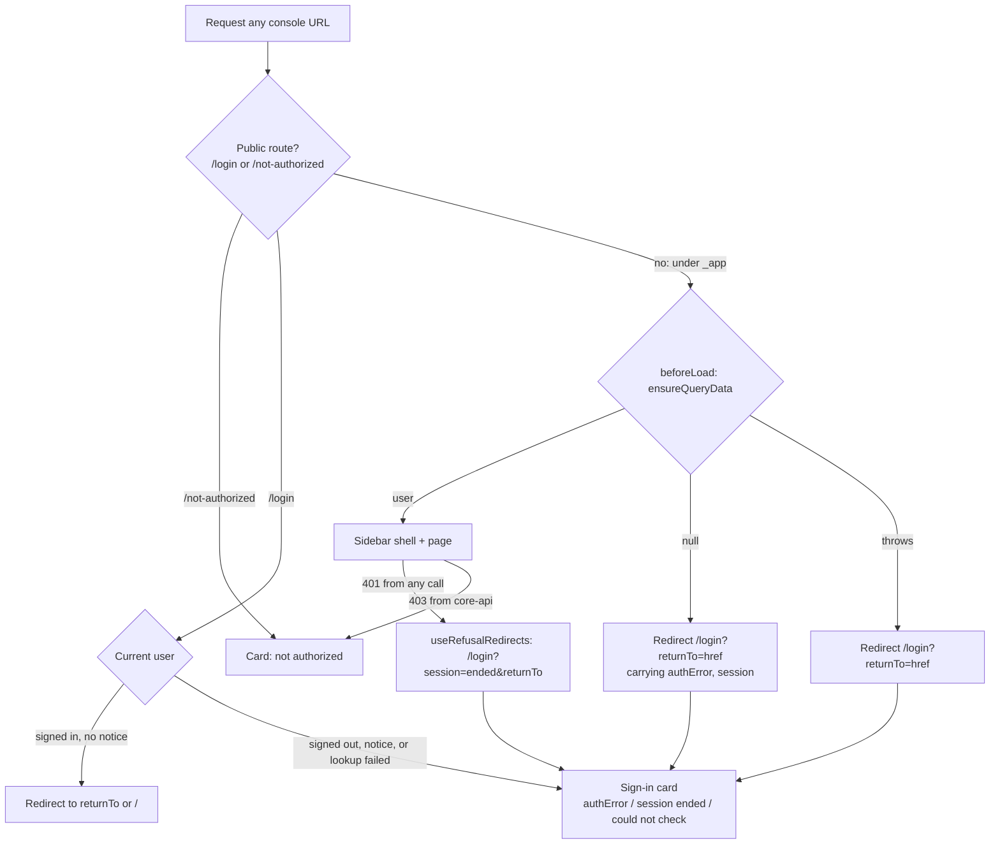
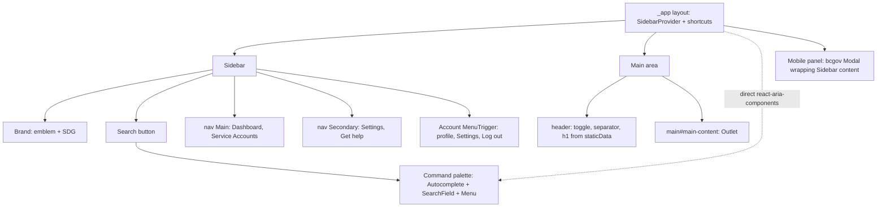
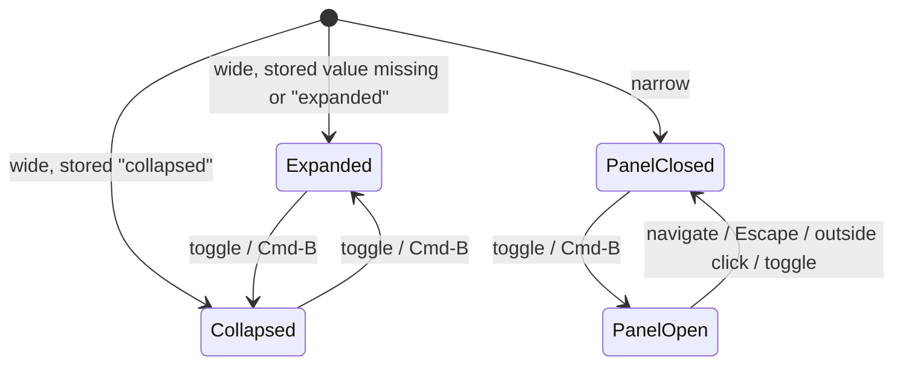

# Console App Shell - Plan

## Goal Capsule

- **Objective:** Government administrators using SDG Console sign in from a centered sign-in card and then work in an admin workspace: a sidebar that collapses to icons, a command palette, and an account menu. It is laid out like shadcn's dashboard-01 and sidebar-07 and looks like the B.C. Government design system. Sign-in, sign-out, session-ended and not-authorized flows keep working under the edge's strict CSP.
- **Means:** Two shells in console-web, built from `@repo/design-system` components and react-aria primitives. A guarded pathless layout route separates them (KTD1, KTD2, KTD4).
- **Product authority:** This Product Contract decides behaviour. The Planning Contract's KTDs decide mechanism within it. Units override neither. The repo owner decides product questions the contract leaves open.
- **Execution profile:** One PR on a new branch off the current work. Units run in order U1 to U8. U5 and U6 can run in parallel once U4 lands; U7 follows U5.
- **Stop conditions:** Stop and ask:
  - before adding any UI kit, CSS framework or styling dependency beyond `react-aria-components` and `@fortawesome/fontawesome-svg-core` (the icon core `@repo/design-system/icons` already uses, needed for KTD9) (R16);
  - before loosening the edge CSP or adding a style hash for anything other than a fixed react-aria style (R17);
  - before changing `packages/bff-core` redirect targets, portal-web or `packages/sdg-header` (R20).
- **Who finishes:** An implementing agent builds and verifies locally, including the console E2E suite against `pnpm preview` and the compose stack. A person reviews the look in a browser and decides when to merge.
- **Open blockers:** None.

---

## Product Contract

### Summary

console-web gets its own app shell instead of the portal's header and footer.
Signed-out visitors see a centered sign-in card. Signed-in administrators get a dashboard-01-style workspace: a sidebar with the BC Gov emblem and "SDG", search, the main and secondary navigation, and an account menu, collapsing to an icon rail like sidebar-07.
Everything is built from the B.C. design system's components and tokens; shadcn is the reference for structure and behaviour only.

### Problem Frame

console-web currently renders the same `<sdg-header>` and bcgov footer as the resident-facing portal (`apps/console-web/src/components/root-layout/index.tsx`), with a landing page that doubles as the sign-in screen.
That shell suits a public website, not a tool administrators work in all day: navigation is a header strip, there is no room for more sections, and the sign-in state is mixed into the home page.
More console sections are coming (a dashboard, settings, help), so the console needs an application layout now, before more screens are written against the old one.

### Key Decisions

- **Shell only; page content stays.** The Service Accounts registry moves into the new shell unchanged apart from its page heading (KTD5); restyling it is separate work. Governs R6, R19.
- **Placeholder pages.** Dashboard, Settings and Get help are a title plus an empty state, not dashboard-01's sample cards, chart and table. Governs R15.
- **Search covers navigation only.** The palette jumps between the four destinations; searching service accounts is later work. Governs R8, R14.
- **Get help is an in-app placeholder page** at `/help`, since no help destination exists yet. Governs R10, R15.
- **The look is the B.C. design system's.** shadcn's dashboard-01 and sidebar-07 set structure and behaviour, not appearance or dependencies (session-settled: user-directed — chosen over building with shadcn and Tailwind: the console must use the design-system components and look). Governs R16.

### Requirements

**Sign-in and access**

- R1. A signed-out visitor to any console page is sent to `/login`, a sign-in card centered on the page with the BC Gov emblem, the title "SDG Console", one line of explanation and a Sign in button; signing in returns them to the page they asked for, or the Dashboard by default.
- R2. Sign-in failures (`authError` codes) and the session-ended message show on the sign-in card with their existing retry and dismiss behaviour.
- R3. `/not-authorized` uses the same card layout and keeps its Sign out and "Sign in with a different account" actions.
- R4. When the session cannot be checked (console-api unreachable), the sign-in card says so and still offers Sign in.
- R5. A signed-in administrator who opens `/login` with no notice to show goes to the Dashboard.

**Authenticated shell**

- R6. Signed-in pages use the dashboard-01 layout: a sidebar on the left, and a main area with a top bar (sidebar toggle, separator, page title) above the page content.
- R7. The sidebar header shows the BC Gov emblem and the title "SDG", linking to the Dashboard.
- R8. A Search control sits directly under the sidebar header, before the navigation items, and opens the command palette; ⌘K (Ctrl+K off macOS) also opens it.
- R9. The main navigation is Dashboard (`/`) and Service Accounts (`/service-clients`), with the current page marked.
- R10. The secondary navigation, at the bottom of the sidebar, is Settings (`/settings`) and Get help (`/help`).
- R11. The account button sits at the very bottom of the sidebar (avatar, name, email) and opens a menu with, in order: a non-interactive profile block (avatar, name, email), a separator, a Settings item, a separator, and Log out.
- R12. On wide screens the sidebar collapses to an icon rail like sidebar-07: icons only, labels as tooltips, the emblem alone in the header, the account button as just the avatar. The top-bar toggle and ⌘B (Ctrl+B) switch it, and the choice survives a reload.
- R13. Below 768px wide, the sidebar is a slide-over panel opened from the top-bar toggle; it closes on navigation, Escape, or a click outside it.
- R14. The command palette lists Dashboard, Service Accounts, Settings and Get help, filters as the administrator types, navigates and closes on selection, and closes on Escape with focus returned to where it was.
- R15. Dashboard, Settings and Get help are placeholder pages: a title and a short empty-state message.

**Constraints**

- R16. Built only from `@repo/design-system` components, `@bcgov/design-tokens` CSS variables, and react-aria primitives; no Tailwind, shadcn, Radix or other UI kit.
- R17. Works under the existing edge CSP (`apps/portal-web/caddy/Caddyfile`, no `'unsafe-inline'` styles): no new `<style>` elements and no `style` attributes in markup.
- R18. Keyboard and screen-reader usable: a "Skip to main content" link, a labelled main navigation landmark, accessible names on every icon-only control, and visible focus.
- R19. Existing contracts hold: `/service-clients` and `/not-authorized` keep their URLs, `index.html` keeps `<title>SDG Console</title>`, and console-api's redirects (`/?authError=<code>`, `/` after logout) keep working.
- R20. portal-web, `packages/sdg-header` and `packages/bff-core` are unchanged.

### Acceptance Examples

- AE1. Covers R1, R5. Given a signed-out visitor, when they open `/service-clients`, then they land on `/login?returnTo=%2Fservice-clients`; after signing in they are on `/service-clients` inside the sidebar shell. Given a signed-in administrator, when they open `/login`, then they are on `/`.
- AE2. Covers R2, R19. Given a failed Keycloak login, when console-api redirects to `/?authError=login_failed`, then the visitor sees the sign-in card with the login-failed notice and its retry.
- AE3. Covers R2. Given a signed-in administrator on `/service-clients`, when a call returns 401, then they land on the sign-in card with the session-ended notice, and signing in again returns them to `/service-clients`.
- AE4. Covers R12. Given the sidebar collapsed on a wide screen, when the administrator focuses the Service Accounts icon, then a "Service Accounts" tooltip shows and the link's accessible name is "Service Accounts"; after a reload the sidebar is still collapsed.
- AE5. Covers R13. Given a 390px-wide viewport, when the administrator opens the panel from the top bar and picks Settings, then the panel closes and `/settings` shows.

### Scope Boundaries

- Not rebuilding the Service Accounts registry, its table, form or dialogs in the new style.
- No dashboard metrics, charts or tables; no Settings or Help content.
- No searching service accounts or other data from the palette.
- No dark mode or theme switching; the bcgov tokens have none.
- No collapsible sub-groups in the navigation (sidebar-07's nested items); the four destinations are flat.
- No footer in either shell.
- Considered and not built: a server-side cookie for the sidebar state (shadcn's `sidebar_state`). The SPA reads state on the client, so `localStorage` is enough. A server-rendered console would change this.

#### Deferred to Follow-Up Work

- Restyle the Service Accounts registry to fit the shell.
- Real content for Dashboard, Settings and Get help; deciding whether Get help should point to an external page.
- Move the sidebar, card and command palette into `@repo/design-system` when a second app needs them.
- Disable FontAwesome's style injection for portal-web too, before portal-web renders its first icon (KTD9).

---

## Planning Contract

### Key Technical Decisions

- KTD1. **Build from bcgov components wherever one exists.** Use Button, NavLink, Tooltip/TooltipTrigger, MenuTrigger/Menu/MenuSection/MenuSectionHeader/MenuItem, Separator, Avatar, Modal/Dialog, Heading, Text and Link from `@repo/design-system`. The bcgov package bundles its own copy of react-aria-components (its `dist/esm/index.js` imports only react and react-dom), so these components share contexts only with each other. That matters because a bcgov TooltipTrigger needs a bcgov Button or NavLink as its trigger. Passing `className` to most bcgov components replaces their styling, so lay out with wrapper elements and style through bcgov's `data-*` state attributes.
- KTD2. **Add `react-aria-components` as a direct console-web dependency, used only for the command palette.** bcgov exports no Autocomplete, SearchField or ListBox, and its Menu always wraps itself in a Popover, so it can't be the palette's list. The palette uses `ModalOverlay > Modal > Dialog > Autocomplete (useFilter contains) > SearchField + Menu`, all from the direct copy, so no context has to cross copies. Pin the catalog entry exactly to the version bcgov depends on (1.22.1), with a comment saying the two move together. The bundle carries a second, tree-shaken react-aria; that is accepted. Rejected: a hand-built combobox, which means re-solving active-descendant and focus handling ourselves.
- KTD3. **Build the mobile panel from the bcgov Modal and Dialog, around the same sidebar content component.** The panel then shares a react-aria copy with the NavLinks, Tooltips and account MenuTrigger inside it. The panel needs its own CSS module for the slide-in look, because a className replaces the modal's styling. Close it on route change by watching the router location.
- KTD4. **Guard the signed-in routes with a pathless `_app` layout route.**
  - **Guard:** `beforeLoad` calls `context.queryClient.ensureQueryData(currentUserQueryOptions)`.
  - **Signed out (`null`):** throw a redirect to `/login`, with `returnTo` set to the requested href and any `authError`/`session` search params carried over.
  - **Lookup throws (API down):** redirect to `/login` with `returnTo`. The card reads the cached query error and shows R4's message, so no new search param is needed.
  - **Public routes:** `/login` and `/not-authorized` sit outside `_app`. `__root` keeps only the Outlet, `useRefusalRedirects` and Devtools.
  - **Rejected:** today's per-component `useCurrentUser` checks, which would have to repeat in every page.
  - **bff-core:** no changes (R20). Its `/?authError=` and post-logout `/` redirects hit `_app`'s guard and are forwarded (AE2).
- KTD5. **The top bar's page title is the page's `h1`, taken from route `staticData.title`.** The shell reads it from the deepest match with `useMatches`. Pages drop their own `h1`; for the registry page that's one line in `registry-page.tsx`. This avoids two visible "Service accounts" headings while keeping one `h1` per page.
- KTD6. **One sidebar context holds the shell state.**
  - **What it holds:** `expanded` (desktop) and `mobileOpen`, plus `isMobile` from `matchMedia('(max-width: 767.98px)')`. That is the same breakpoint as sdg-header's `media-query-controller.ts`.
  - **Rail controls:** when collapsed, every sidebar control shows only its icon or avatar, keeps its accessible name, and gets a bcgov `TooltipTrigger` label: nav items, Search ("Search", with the ⌘K hint hidden) and the account button (the user's name).
  - **Rendering:** state goes into `data-state` / `data-collapsible` attributes on the sidebar root. CSS-module selectors and an `@media` rule style them. Widths are CSS custom properties defined in the module (16rem expanded, 3rem rail), never inline `style` attributes (R17).
  - **Persistence:** `expanded` is stored in `localStorage` under `console.sidebar`. Every read and write is wrapped so a blocked store falls back to expanded.
- KTD7. **One `document` keydown listener in the shell owns the shortcuts.** ⌘/Ctrl+K opens the palette and ⌘/Ctrl+B toggles the sidebar (the mobile panel when narrow). Both call `preventDefault`. Mount the listener only inside `_app`, so the shortcuts do nothing on the sign-in card. The palette and the mobile panel never stack: opening the palette (Search or ⌘K) while the panel is open closes the panel first and opens the palette once it has closed. The two come from different react-aria copies, and each copy's focus containment and hide-outside handling would fight the other's.
- KTD8. **Menus and the palette navigate with `onAction` + `router.navigate`.** bcgov doesn't export its RouterProvider, so a bcgov MenuItem `href` would reload the page. Sidebar links use TanStack's `createLink(NavLink)`, which gives client navigation and `aria-current="page"`.
- KTD9. **Stop FontAwesome injecting a `<style>`.** These are the first icons any app renders. `@fortawesome/fontawesome-svg-core` adds a `<style>` element the first time an icon renders (`autoAddCss`), which the edge CSP blocks. Set `config.autoAddCss = false` and import `@fortawesome/fontawesome-svg-core/styles.css` once, in `apps/console-web/src/main.tsx` and `src/test-setup.ts`. console-web declares `@fortawesome/fontawesome-svg-core` (`catalog:`) itself, because pnpm doesn't expose `@repo/design-system`'s copy to it. This is the same icon core the design-system icons use, not a new styling dependency under R16. Keeping it in console-web keeps `@repo/design-system` free of module side effects. Recording portal-web's equivalent is deferred.
- KTD10. **The emblem is the existing `apps/console-web/public/favicon.svg`,** which is already the BC Gov emblem with inline fills. Render it as a decorative `` beside the visible "SDG" text. Rejected: a React export of sdg-header's Lit logo template, which needs new generator output for one image.
- KTD11. **Add a console-web CSP hash check for its own react-aria copy.** Only two fixed `<style>` texts exist: `usePress` touch-action and `usePreventScroll` overscroll-behavior. Both match the hashes already in the Caddyfile, but `apps/portal-web/src/csp-hashes.test.ts` only scans bcgov's bundled copy.
  - **Where:** a new `apps/console-web/src/csp-hashes.test.ts`, so portal-web stays unchanged (R20). It reads `apps/portal-web/caddy/Caddyfile` and asserts both hashes appear in every `security_headers` line.
  - **What it scans:** react-aria-components 1.22.1 depends on the `react-aria` monopackage (3.53.1); there is no `@react-aria/*` package. Resolve `react-aria-components` from console-web, then `react-aria/package.json` from there. Read `dist/private/interactions/usePress.mjs` and `dist/private/overlays/usePreventScroll.mjs`.
  - **Guard:** assert each file yields exactly one fixed text, so the test can't pass on an empty scan.
  - **Why:** a version drift between the two copies then fails this test rather than the edge.

### High-Level Technical Design

Route and guard flow (KTD4):



Shell composition (component boundaries; the dashed edge is the separate react-aria copy, KTD2):



Sidebar state (KTD6):



Crossing the 768px breakpoint switches between the wide and narrow families. The stored `expanded` value is untouched, and an open panel closes.

### Output Structure

```text
apps/console-web/src/
  components/
    auth-card/            centered card layout for /login and /not-authorized
    app-shell/
      sidebar-context.tsx state, persistence, isMobile (KTD6)
      app-shell.tsx       _app layout composition, shortcuts (KTD7)
      sidebar.tsx         desktop sidebar + shared sidebar content
      sidebar-nav.tsx     main and secondary nav items
      account-menu.tsx    account button and menu
      top-bar.tsx         toggle, separator, page title
      mobile-panel.tsx    bcgov Modal panel (KTD3)
      command-palette.tsx react-aria-components palette (KTD2)
      nav-items.ts        the four destinations, shared by nav and palette
      *.module.css
  routes/
    login.tsx  not-authorized.tsx  _app.tsx
    _app/index.tsx  _app/service-clients.tsx  _app/settings.tsx  _app/help.tsx  _app/$.tsx
```

### Assumptions

- The four destinations' icons come from FontAwesome solid via `@repo/design-system/icons`: `faGauge` (Dashboard), `faKey` (Service Accounts), `faGear` (Settings), `faCircleQuestion` (Get help), `faMagnifyingGlass` (Search), and `faAnglesLeft`/`faBars` for the toggle. A reviewer may swap them.

### System-Wide Impact

- **Auth boundary:** the route guard becomes the console's single signed-in gate. Its URLs, console-api's redirects and the 401/403 handling stay compatible (R19). No server change.
- **CSP:** this adds the first icons and the first direct react-aria dependency. KTD9 and KTD11 keep both inside the existing policy.
- **Shared tests and CI:** CI and the smoke scripts grep `<title>SDG Console</title>` and expect `/service-clients` to return 200. Both still hold.
- **Repo rules:** AGENTS.md currently states that console UI uses `<sdg-header>` and that `<sdg-header>` is "the only header apps use". Both lines change in U8.

### Risks & Dependencies

| Risk                                                                                                          | Mitigation                                                                                                                                                                                                                                                                                                                                                     |
| ------------------------------------------------------------------------------------------------------------- | -------------------------------------------------------------------------------------------------------------------------------------------------------------------------------------------------------------------------------------------------------------------------------------------------------------------------------------------------------------- |
| The direct react-aria copy drifts from bcgov's (e.g. Renovate bumps one) and its fixed `<style>` text changes | Exact catalog pin with a comment (KTD2); the hash test scans both copies (KTD11); the console CSP E2E opens the palette                                                                                                                                                                                                                                        |
| bcgov Modal can't be restyled as a side panel without fighting its CSS                                        | Keep the bcgov Modal (a direct-copy modal would break focus and hide-outside for the bcgov contents, KTD3). bcgov passes `className` to the react-aria Modal and still renders the default `react-aria-ModalOverlay`, so `mobile-panel.module.css` styles the panel through its own class and the overlay through `:global(.react-aria-ModalOverlay):has(...)` |
| bcgov Tooltip on NavLink doesn't show on focus in the rail                                                    | Check this first in U4 (bcgov Link uses the same copy's focusable hook, so it should work). If it fails, stop and ask; there is no mixed-copy fallback                                                                                                                                                                                                         |
| `ensureQueryData` caches an error, so the card keeps showing "could not check" after the API recovers         | The card's Sign in is a full-page navigation, which refetches; a retry on the card is not needed                                                                                                                                                                                                                                                               |

### Deferred to Implementation

- Exact component and hook names, and whether `sidebar.tsx` splits further to stay under 300 lines.
- The exact selectors that style the bcgov `Modal` as a side panel (Risks).
- The empty-state wording on the placeholder pages and the card's one-line explanation.

---

## Implementation Units

### U1. Dependencies and CSP groundwork

- **Goal:** Make icons and a direct react-aria dependency safe under the edge CSP before any UI uses them.
- **Requirements:** R16, R17; KTD2, KTD9, KTD11.
- **Dependencies:** None.
- **Files:**
  - `pnpm-workspace.yaml` (catalog: `react-aria-components` pinned to 1.22.1 with a comment)
  - `apps/console-web/package.json` (add `react-aria-components` and `@fortawesome/fontawesome-svg-core`, both `catalog:`; remove `@repo/sdg-header`)
  - `apps/console-web/src/main.tsx`, `apps/console-web/src/test-setup.ts` (FontAwesome config + stylesheet)
  - `apps/console-web/src/csp-hashes.test.ts` (new)
  - `apps/console-web/src/icons-csp.test.tsx` (new)
- **Approach:**
  1. Add the catalog entry and both console-web dependencies. Confirm the lockfile resolves one 1.22.1 copy for console-web.
  2. Disable `autoAddCss` and import FontAwesome's stylesheet before the app's own styles in `main.tsx`; do the same in test setup.
  3. Write the console-web hash test per KTD11, reusing the fixed-text parsing pattern from portal-web's test without editing that file.
  4. Removing `@repo/sdg-header` here leaves console-web failing to compile until U2/U3 delete its uses. Land U1–U3 together if a green build per unit matters.
- **Patterns to follow:** existing bcgov scan in `apps/portal-web/src/csp-hashes.test.ts` (read, not edited); `@repo/design-system/icons` re-exports.
- **Test scenarios:**
  - Rendering a `FontAwesomeIcon` in console-web's test environment adds no `<style>` element to `document.head`.
  - The hash test finds exactly one fixed text in each of `usePress.mjs` and `usePreventScroll.mjs`, and each text's hash is in every `security_headers` line of the edge Caddyfile.
  - The hash test fails when a fixed react-aria style text in console-web's copy has no matching `'sha256-…'` in the Caddyfile.
- **Verification:** both tests pass; `pnpm install --frozen-lockfile` is clean; typecheck of console-web passes once U3 lands.

### U2. Sign-in card and public routes

- **Goal:** Signed-out and refused visitors see a centered card instead of the portal-style landing.
- **Requirements:** R1, R2, R3, R4, R5, R18; KTD10.
- **Dependencies:** U1.
- **Files:**
  - `apps/console-web/src/components/auth-card/index.tsx`, `auth-card.module.css` (new)
  - `apps/console-web/src/routes/login.tsx` (new), `login.test.tsx` (new)
  - `apps/console-web/src/routes/not-authorized.tsx`, `not-authorized.test.tsx`
  - `apps/console-web/src/routes/index.tsx` and `index.test.tsx` (landing logic moves to `login.tsx`; the index route itself moves under `_app` in U3)
- **Approach:**
  1. The card is a `main#main-content` landmark centering a bordered, rounded, shadowed surface built from bcgov tokens (`--surface-color-*`, `--layout-*`). It shows the emblem (KTD10), a `Heading level 1`, body slot and an actions slot. A skip link isn't needed on a page with no navigation.
  2. `/login` validates `authError`, `session` and `returnTo` with the existing `parseAuthError`/`parseReturnTo`. It shows `AuthErrorNotice` / `SessionEndedNotice` above the card body, an inline "could not check your session" message when the current-user query is in error (R4), and Sign in as a bcgov button-styled Link to `loginHref(returnTo ?? '/')`.
  3. Signed in with no notice: `beforeLoad` redirects to `returnTo ?? '/'` (R5).
  4. `/not-authorized` keeps its copy and actions, wrapped in the card.
- **Patterns to follow:** `apps/console-web/src/routes/index.tsx` (search validation, notices, dismiss via `navigate` with `replace`); `components/auth-error-notice`.
- **Test scenarios:**
  - Covers AE2. `/login?authError=login_failed` renders the card with the login-failed notice and its retry.
  - `/login?session=ended&returnTo=%2Fservice-clients` shows the session-ended notice, and Sign in points to `/api/auth/login?returnTo=%2Fservice-clients`.
  - Signed out with no params: card heading "SDG Console" and a Sign in link to `/api/auth/login?returnTo=%2F`.
  - `returnTo=//evil.example` is dropped; Sign in returns to `/`.
  - Current-user lookup fails (fake API 500): the card shows the could-not-check message and still offers Sign in.
  - Covers AE1. Signed in, `/login` with no params redirects to `/`.
  - `/not-authorized` renders inside the card with Sign out and "Sign in with a different account".
- **Verification:** all public-route tests pass; no `<sdg-header>` or footer renders on these pages.

### U3. Guarded app routes and placeholders

- **Goal:** Every signed-in page sits under one guarded layout route; signed-out visitors are sent to the card and brought back.
- **Requirements:** R1, R2, R9, R10, R15, R19; KTD4, KTD5.
- **Dependencies:** U2.
- **Files:**
  - `apps/console-web/src/routes/__root.tsx`
  - `apps/console-web/src/components/root-layout/` (reduce to Outlet + refusal redirects + Devtools, or delete in favour of `__root`)
  - `apps/console-web/src/routes/_app.tsx` (new; temporary plain layout until U4)
  - `apps/console-web/src/routes/_app/index.tsx`, `_app/service-clients.tsx`, `_app/settings.tsx`, `_app/help.tsx` (moved/new)
  - `apps/console-web/src/routes/_app/$.tsx` (new splat: the not-found page inside the shell, `staticData.title` "Page not found")
  - `apps/console-web/src/routes/service-clients.tsx` (moved), `routes/index.tsx` (moved)
  - `apps/console-web/src/api/use-refusal-redirects.ts`
  - `apps/console-web/src/components/service-clients/registry-page.tsx` (drop its `h1`, KTD5)
  - `apps/console-web/src/components/site-header/` (delete; `useSignOut` moves to `src/auth/`)
  - `apps/console-web/src/test-support/header.ts` (delete)
  - `apps/console-web/src/app.test.tsx`, `routes/_app/*.test.tsx`, `api/use-refusal-redirects` coverage
- **Approach:**
  1. Add `_app.tsx` with the KTD4 `beforeLoad`. Move the index and service-clients routes under it with `staticData.title` ("Dashboard", "Service accounts"), and add Settings and Get help placeholders (R15).
  2. Signed-out handling inside the service-clients page goes away; the guard owns it.
  3. Unknown paths match the `_app` splat route, so a signed-in administrator sees "Page not found" inside the shell and a signed-out visitor is sent to the card by the guard. The shell's title falls back to "SDG Console" for any match without `staticData.title`, so the `h1` is never empty.
  4. Point `useRefusalRedirects`' session-ended navigation at `/login` and change its "already there" check to `/login`.
  5. `useSignOut` moves to `src/auth/use-sign-out.ts` for the account menu and the not-authorized page.
  6. Regenerate `routeTree.gen.ts` through the router plugin.
- **Patterns to follow:** `src/router.ts` context (`queryClient`); `src/auth/use-current-user.ts` `currentUserQueryOptions`; memory-history rendering in `src/test-support/render.tsx`.
- **Test scenarios:**
  - Covers AE1. Signed out, `/service-clients` ends on `/login` with `returnTo=/service-clients`.
  - Covers AE2. Signed out, `/?authError=access_denied` ends on `/login?authError=access_denied`.
  - Lookup fails (500): `/` ends on `/login` with `returnTo=/`.
  - Signed in, `/`, `/service-clients`, `/settings` and `/help` render their pages, with titles Dashboard, Service accounts, Settings, Get help.
  - Covers AE3. A 401 from the registry query sends the app to `/login?session=ended&returnTo=%2Fservice-clients`; a second 401 while already on `/login` doesn't navigate again.
  - A 403 from core-api sends the app to `/not-authorized`.
  - Signed in, an unknown path renders "Page not found" inside the shell, with that text as the page's only `h1`.
  - Signed out, an unknown path ends on `/login`.
- **Verification:** unit tests pass with no reference to `<sdg-header>`; `/service-clients` still answers 200 from `pnpm preview`.

### U4. Sidebar shell (desktop)

- **Goal:** The dashboard-01 layout with a sidebar that collapses to an icon rail.
- **Requirements:** R6, R7, R9, R10, R12, R18; KTD1, KTD5, KTD6, KTD7, KTD8, KTD10.
- **Dependencies:** U3.
- **Files:**
  - `apps/console-web/src/components/app-shell/sidebar-context.tsx`, `app-shell.tsx`, `sidebar.tsx`, `sidebar-nav.tsx`, `top-bar.tsx`, `nav-items.ts`, `*.module.css` (new)
  - `apps/console-web/src/routes/_app.tsx` (render the shell)
  - `apps/console-web/src/components/app-shell/sidebar.test.tsx`, `sidebar-context.test.tsx` (new)
- **Approach:**
  1. The shell is a skip link, then the sidebar, then the main area. The main area holds a `header` (toggle Button, vertical Separator, `h1` from the deepest match's `staticData.title`) and `main#main-content` with the Outlet.
  2. The sidebar is a column: brand link (emblem + "SDG", to `/`), a Search button (wired in U6), `nav aria-label="Main"` with Dashboard and Service Accounts, a spacer, `nav aria-label="Secondary"` with Settings and Get help, then the account slot (U5).
  3. Each nav item is `createLink(NavLink)` with an icon and a text label. When collapsed, the label is visually hidden but stays the accessible name, and a bcgov `TooltipTrigger` shows it (tooltips render only while collapsed).
  4. The toggle button's accessible name is "Collapse sidebar" or "Expand sidebar", with `aria-expanded` and `aria-controls` pointing at the sidebar.
  5. Shortcut listener per KTD7. The ⌘K handler gets wired in U6.
- **Execution note:** Prove bcgov Tooltip on a NavLink in the rail first (Risks table); it decides how nav items are built.
- **Patterns to follow:** hoisted nav arrays and memoised props as in the old `components/site-header/index.tsx` (oxlint `react-perf`); `packages/sdg-header/src/media-query-controller.ts` breakpoint.
- **Test scenarios:**
  - The sidebar shows "SDG", a Search button, Main nav (Dashboard, Service Accounts) and Secondary nav (Settings, Get help), in that DOM order.
  - On `/service-clients`, the Service Accounts link has `aria-current="page"` and Dashboard doesn't.
  - Clicking a nav link navigates client-side (router location changes, no full reload).
  - The top bar `h1` reads "Service accounts" on `/service-clients` and "Dashboard" on `/`; the page has exactly one `h1`.
  - Covers AE4. Clicking the toggle collapses the sidebar (`data-state="collapsed"`); links keep their accessible names; focusing one shows its tooltip.
  - Collapsed, the Search button keeps the name "Search", hides the ⌘K hint, and shows a "Search" tooltip on focus.
  - Ctrl+B toggles the sidebar; the state is written to `localStorage` and read back on a fresh render.
  - `localStorage` throwing on read and write leaves the sidebar expanded and the app working.
  - The skip link moves focus to `main#main-content`.
- **Verification:** tests pass; in a browser at 1280px the expanded and collapsed sidebars match the sidebar-07 structure with bcgov styling.

### U5. Account menu

- **Goal:** The account button and its menu at the foot of the sidebar.
- **Requirements:** R11, R12, R18; KTD1, KTD8.
- **Dependencies:** U4.
- **Files:**
  - `apps/console-web/src/components/app-shell/account-menu.tsx`, `account-menu.module.css`, `account-menu.test.tsx` (new)
- **Approach:**
  1. The trigger is a bcgov Button containing a small decorative `Avatar`, the name and the email (avatar only when collapsed), with accessible name "Account menu for <name>". Keep that name so existing E2E selectors carry over.
  2. The menu is built by hand from the bcgov pieces: a `MenuSection` whose `MenuSectionHeader` holds the profile block (medium Avatar, name, email), then a Separator, a "Settings" MenuItem (`onAction` navigates to `/settings`), another Separator, and a "Log out" MenuItem that calls `useSignOut`.
  3. Open the menu toward the content side (`placement` right/top when docked at the bottom).
- **Patterns to follow:** labels and structure of `packages/sdg-header/src/account-menu.ts`; `useSignOut` (moved in U3).
- **Test scenarios:**
  - The trigger's name is "Account menu for Ada Lovelace"; opening it shows a menu whose first content is the profile block with name and email, which is not a `menuitem`.
  - Menu items in order are exactly "Settings", "Log out", with a separator before each.
  - Choosing Settings navigates to `/settings` without a reload and closes the menu.
  - Choosing Log out posts to `/api/auth/logout` and navigates to the returned `redirectUrl`.
  - A user with `email: null` shows the name only, with no empty line.
  - With the sidebar collapsed, the trigger shows only the avatar, keeps its accessible name, and shows the user's name as a tooltip on focus.
- **Verification:** tests pass; menu is keyboard-operable (Enter/Space open, arrows move, Escape closes to the trigger).

### U6. Command palette

- **Goal:** Search opens a palette that jumps to any destination.
- **Requirements:** R8, R14, R17, R18; KTD2, KTD7, KTD8.
- **Dependencies:** U1, U4.
- **Files:**
  - `apps/console-web/src/components/app-shell/command-palette.tsx`, `command-palette.module.css`, `command-palette.test.tsx` (new)
  - `apps/console-web/src/components/app-shell/sidebar.tsx`, `app-shell.tsx` (wire the Search button and ⌘K)
- **Approach:**
  1. Build the palette from react-aria-components, imported directly (KTD2): `ModalOverlay > Modal > Dialog aria-label="Search" > Autocomplete (useFilter contains, case-insensitive) > SearchField (placeholder "Search…") + Menu` of `nav-items.ts`.
  2. Selecting an item calls `router.navigate` and closes the palette. An empty result shows "No results".
  3. Style the overlay and panel with bcgov tokens in the module CSS.
  4. The Search button shows a ⌘K / Ctrl+K hint via `Keyboard` when expanded, and its accessible name stays "Search".
- **Patterns to follow:** dialog focus-return behaviour asserted in `apps/console-web/e2e/csp.spec.ts` for the remove dialog.
- **Test scenarios:**
  - Clicking Search opens a dialog named "Search" with the input focused and four items listed.
  - Typing "serv" leaves only "Service Accounts"; typing "zzz" shows "No results".
  - Enter on "Settings" navigates to `/settings` and closes the palette.
  - Escape closes the palette and focus returns to the Search button.
  - Ctrl+K (and Meta+K) opens the palette from anywhere in the shell; it does nothing on `/login`.
  - Opening the palette while the mobile panel is open closes the panel first (KTD7). The "Search" dialog is focused and not `aria-hidden`, and Escape returns focus to the top-bar toggle.
- **Verification:** tests pass; opening the palette adds no unhashed `<style>` (checked in U8's CSP E2E).

### U7. Mobile panel

- **Goal:** On narrow screens the sidebar becomes a slide-over panel.
- **Requirements:** R13, R18; KTD3, KTD6.
- **Dependencies:** U4, U5.
- **Files:**
  - `apps/console-web/src/components/app-shell/mobile-panel.tsx`, `mobile-panel.module.css`, `mobile-panel.test.tsx` (new)
  - `apps/console-web/src/components/app-shell/app-shell.tsx`, `sidebar.tsx`, `top-bar.tsx`
- **Approach:**
  1. When `isMobile`, the desktop sidebar is not rendered. The top-bar toggle (accessible name "Open navigation", `faBars`) opens a bcgov Modal + Dialog (`aria-label="Navigation"`) holding the shared sidebar content, always expanded.
  2. Close it on location change, Escape, outside press, or the toggle.
  3. Slide-in and overlay styling live in the module CSS. Honour `prefers-reduced-motion`.
- **Patterns to follow:** `matchMedia` test stubbing as in `packages/sdg-header/src/media-query-controller.ts` tests.
- **Test scenarios:**
  - With a narrow `matchMedia` stub, no sidebar renders until "Open navigation" is pressed; then a dialog named "Navigation" holds the Main and Secondary navs and the account button.
  - Covers AE5. Choosing Settings in the panel navigates to `/settings` and the dialog closes.
  - Escape closes the panel and returns focus to the toggle.
  - Pressing Search inside the open panel closes the panel and opens a focused "Search" dialog that is not `aria-hidden`.
  - Switching the stub from narrow to wide while the panel is open closes it and shows the desktop sidebar in its stored state.
- **Verification:** tests pass; at 390px in a browser the panel opens, traps focus, and closes on navigation.

### U8. End-to-end coverage and docs

- **Goal:** The E2E suite and repo docs describe the new shell.
- **Requirements:** R17, R19, R20; KTD9, KTD11.
- **Dependencies:** U2–U7.
- **Files:**
  - `apps/console-web/e2e/setup/console.setup.ts`, `auth.spec.ts`, `not-authorized.spec.ts`, `service-clients.spec.ts`, `csp.spec.ts`, `support/mock-console-api.ts`
  - `apps/console-web/e2e/shell.spec.ts` (new)
  - `AGENTS.md` (the `<sdg-header>` "only header" line and the console UI line)
  - `apps/console-web/Dockerfile` (build-stage comment naming sdg-header), `compose.yaml` (console-web comment)
  - `docs/plans/2026-11-10-1001-feat-core-api-admin-gateway-plan.md` (one-line note that R15's header requirement is superseded by this plan)
  - `docs/architecture.md` and `DEVELOPER.md` where they describe console-web's UI
- **Approach:**
  1. Setup: go to the console, follow the redirect to `/login`, click the card's "Sign in", log in, wait for `/`, and expect the sidebar's "Account menu for …" button.
  2. CSP spec: replace the footer assertions with shell assertions (sidebar nav visible; a bcgov element's computed style applied). Add cases that open the palette, the account menu and the mobile panel, each with no unhashed `<style>` and no violations.
  3. New shell spec: collapse persists across reload, ⌘K navigation, and the mobile panel at 390px.
  4. AGENTS.md: `<sdg-header>` is the portal's header, console-web has its own sidebar shell built from `@repo/design-system` plus direct `react-aria-components` for the palette, and FontAwesome icons need `autoAddCss` off (KTD9).
- **Patterns to follow:** existing `collectViolations` / `styleState` helpers in `apps/console-web/e2e/csp.spec.ts`.
- **Test scenarios:**
  - Signed out, `/service-clients` shows the sign-in card. After Keycloak login the browser is back on `/service-clients` inside the shell.
  - Log out from the account menu ends on the sign-in card.
  - A refused account lands on `/not-authorized` in the card layout.
  - Opening the palette, account menu and mobile panel each records no CSP violations and no unhashed `<style>`.
  - The collapsed sidebar stays collapsed after reload.
- **Verification:**
  - The console E2E suite passes against `pnpm preview`. That run covers the auth and shell flows plus the unhashed-`<style>` and computed-style checks; it sends no CSP.
  - The suite also passes against the compose stack at `https://console.sdg.localhost`. Its dev edge allows inline styles and Vite injects its own `<style>`, so this run proves auth and routing behind Caddy, not the CSP.
  - The suite passes against the PR deployment (CI `E2E_BASE_URL`), the only run under the production CSP.
  - AGENTS.md no longer claims console-web uses `<sdg-header>`.

---

## Verification Contract

| Gate            | Command                                                                                          | Proves                                                                      |
| --------------- | ------------------------------------------------------------------------------------------------ | --------------------------------------------------------------------------- |
| Unit tests      | `pnpm --filter console-web test`                                                                 | U2–U7 scenarios                                                             |
| CSP hashes      | `pnpm --filter console-web test -- csp-hashes` (plus portal-web's unchanged test in `pnpm test`) | KTD11; edge hashes cover both react-aria copies                             |
| Typecheck       | `pnpm typecheck`                                                                                 | Route tree regenerated; no stale `@repo/sdg-header` imports                 |
| Lint            | `pnpm lint`                                                                                      | No warnings, including `react-perf`                                         |
| Format          | `pnpm format:check`                                                                              | oxfmt clean                                                                 |
| Build           | `pnpm --filter "console-web..." build`                                                           | Production bundle builds with the direct react-aria dependency              |
| E2E (local)     | `pnpm --filter console-web test:e2e`                                                             | U8 flows against `pnpm preview`; no unhashed `<style>` (no CSP sent)        |
| E2E (stack)     | console E2E with `E2E_BASE_URL=https://console.sdg.localhost`                                    | Auth and shell flows behind the compose edge (dev CSP allows inline styles) |
| E2E (PR deploy) | CI console E2E against the PR deployment's `E2E_BASE_URL`                                        | No CSP violations under the production edge policy                          |

---

## Definition of Done

- Every requirement R1–R20 is met and each Acceptance Example passes in a test.
- All Verification Contract gates pass with no linter warnings and no file over 300 lines or function over 50 lines.
- console-web no longer depends on `@repo/sdg-header`; portal-web, `packages/sdg-header` and `packages/bff-core` have no diff.
- No `style` attribute in console-web markup and no new Caddyfile hash.
- Code from abandoned attempts (e.g. a discarded drawer or tooltip approach) is removed from the diff.
- AGENTS.md and the docs listed in U8 describe the new shell.
