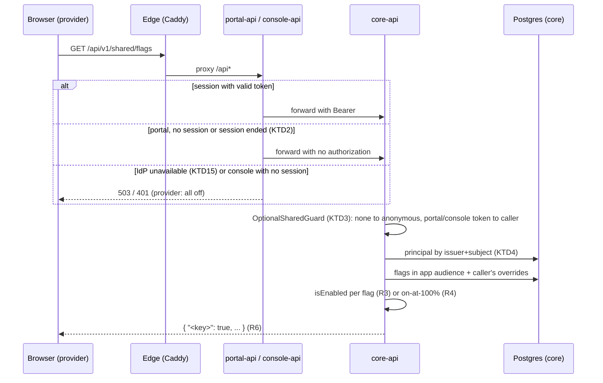
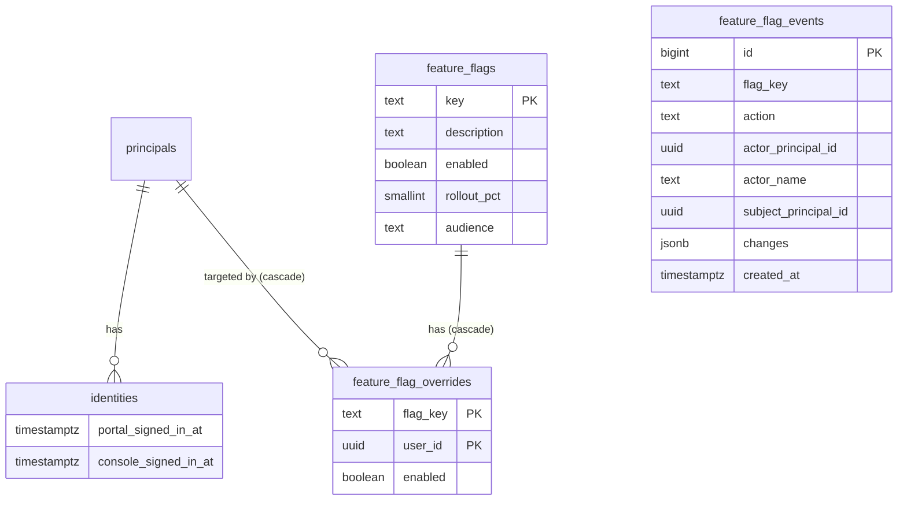

# Feature Flags - Plan

## Goal Capsule

- **Objective:** Console admins can turn a portal or console feature on or off, roll it out to a percentage of people, or force it for named residents or console users, all without a deploy. Each person sees exactly the features their flags allow in the app they're using, and the API applies the same answer.
- **Means:** Flag tables in the `core` schema, a core-api feature-flags module that evaluates with the supplied `isEnabled` behind one shared-audience flag list (KTD1), optional-session forwarding in portal-api (KTD2), a Feature Flags page in console-web, and one flag provider package shared by portal-web and console-web (KTD11). A `hello_world` flag gates a demo endpoint and component end to end.
- **Product authority:** The requester's spec (tables, `isEnabled`, `FlagProvider`, quoted in the Appendix) as amended by the Key Decisions below. The Product Contract wins on behavior; KTDs win on mechanism within it.
- **Stop conditions:** Stop and ask if a session-settled decision proves unworkable, if the Coraza WAF blocks ordinary name searches in a way the console can't word around (Risks), or if any unit needs a chart, secret or repository-setting change, or a workflow change beyond U8's trigger entries.
- **Execution profile:** Units land in dependency order (the Implementation Units table). Each unit leaves `pnpm typecheck`, `pnpm lint` and its package's tests green.
- **Open blockers:** None.

---

## Product Contract

**Product Contract preservation:** changed: R1, R3–R6, R8, R11–R13, R15, R16, R18, R21, AE9, AE10 and the Summary — console users and per-flag audience added at the user's direction during planning (Key Decisions on audience and console overrides). F1's trace corrected from R11 to R8. Outstanding Questions resolved into the Planning Contract (KTD1–KTD15) and removed.

### Summary

Console admins manage feature flags on a new Feature Flags page. Each flag targets the portal, the console, or both. Admins can create, toggle, set the rollout percentage, delete, override flags per person and see a change history.
Both apps read their evaluated flags through one shared provider. The portal's flag list is public: it evaluates per resident when signed in, and for a signed-out visitor applies only flags that are on at 100%. The console's flag list evaluates per console user.
A `hello_world` flag gates a hello-world endpoint and a component on the portal home page and the console dashboard.

### Problem Frame

SDG has no way to release a portal or console change to some people and not others. Whatever merges goes live for every resident or administrator at once, and taking a change back out means another deploy through GitHub Actions.
That makes it risky to ship anything unfinished or uncertain. Gradual rollout, trying a change on a few named people first, and an off-switch that needs no deploy are all unavailable.

### Actors

- A1. Console admin: a government user signed in to console-web through IDIR, with the `admin` client role. Manages flags and overrides, and as a console user also sees console flags (every console user is an admin, since console-api refuses anyone without the role).
- A2. Signed-in resident: a portal user signed in through BC Services Card, identified by their principal id.
- A3. Signed-out visitor: anyone using the portal without a session.

### Key Decisions

- **Evaluate with the supplied `isEnabled`, keyed on the person's principal id.** The principal id is already a uuid, matching `user_id uuid`, and it stays the same when someone links another login. Governs R3.
- **Each flag has an audience: portal, console, or both.** (session-settled: user-directed — chosen over one shared namespace evaluated everywhere and over separate per-app flag lists: each app's list holds only its own flags, so the public portal list never names a console flag.) Governs R1, R5, R6, R18.
- **Overrides can target console users as well as residents, matching the flag's audience.** (session-settled: user-directed — chosen over residents-only overrides: a console feature can be tried on a few staff first.) Governs R18.
- **An override beats the flag's on/off switch.** This follows the supplied `isEnabled`. Turning a flag off doesn't hide it from people with an "on" override; deleting the flag or the override does. (session-settled: user-approved — chosen over treating off as a kill switch that also silences overrides: the consequence was shown in the scoping synthesis and accepted.) Governs R3, R18, R21.
- **Signed-out visitors get flag-level evaluation from one public, optionally authenticated endpoint.** (session-settled: user-directed — chosen over "everything off when signed out" and anonymous cookie bucketing: flags that are fully on should reach everyone, and one endpoint should evaluate the caller if a session exists.) Governs R4, R5.
- **The hello-world endpoint follows the same rules as the flag list, and is public on the portal.** (session-settled: user-approved — chosen over a signed-in-only endpoint: the component and endpoint must never disagree, and the demo exercises the signed-out path.) Governs R12.
- **Pages render immediately and only flagged parts wait for their flag.** (session-settled: user-directed — chosen over blocking the whole app until flags load, with a timeout, and over rendering with all flags off until they arrive: the portal is never blank and a flagged part never shows the wrong variant first.) This replaces the supplied `FlagProvider`'s `return null`. Governs R8, R9.
- **Console admins pick a person for an override by searching on partial name or email.** (session-settled: user-directed — chosen over pasting a principal id and over exact-email lookup, with the exposure of residents' personal data to staff in view.) Governs R18.
- **The first version manages the full flag lifecycle.** (session-settled: user-directed — chosen over create-only, the spec's original wording.) Governs R15–R19.
- **The public flag list returns only flags that are on for the caller.** Unreleased flag names would otherwise be readable by anyone on the internet, and the provider already treats a missing key as off. Governs R6.
- **Flag keys are immutable.** Code refers to flags by key, so renaming one would silently turn its feature off. Governs R2.

### Requirements

**Flag data**

- R1. Flags store a unique key, an optional description, an on/off switch (default off), a rollout percentage from 0 to 100 (default 100) per the requester's table definition, and an audience of portal, console or both. Per-person overrides store a flag key, a principal id and an on/off value, and are removed when their flag is deleted.
- R2. A flag's key can't be changed after creation.

**Evaluation**

- R3. For a signed-in resident or console user, each flag is evaluated with the supplied `isEnabled` using their principal id: an override wins, then a flag that is off is off, then the person's stable bucket is compared with the rollout percentage.
- R4. For a signed-out portal visitor, a flag is on only when it is on and its rollout percentage is 100. Overrides and partial rollouts don't apply.

**Flag lists**

- R5. Each app reads its evaluated flags from one endpoint. The portal's is public and applies R3 when the request carries a resident session and R4 when it doesn't. The console's requires a console session and applies R3.
- R6. The list names only the flags that are on for the caller and whose audience includes the caller's app.
- R7. If the flag list can't be fetched or read, every flag is off for that page load and no error is shown.

**Rendering in both apps**

- R8. portal-web, and console-web's signed-in shell, are each wrapped in the same flag provider, which fetches the list once per page load and never delays rendering of unflagged content.
- R9. A flagged component renders nothing until its flag's value is known, then renders according to it. The flag hook reports that loading state as well as the on/off value.
- R10. A flag the list doesn't name is off.
- R11. After sign-in or sign-out, each app shows the flags for the new sign-in state.

**Hello-world demo**

- R12. A hello-world endpoint returns "Hello, world!" when `hello_world` is on for the caller under R3 or R4 and its audience includes the caller's app, and answers 404 otherwise. It is public on the portal and requires a session on the console.
- R13. The portal home page and the console dashboard each show a hello-world component, gated by `hello_world`, that calls the endpoint and shows its response. While the call is pending, or if it fails or answers 404, the component renders nothing and shows no error, and a 404 is not retried.

**Console management**

- R14. console-web has a Feature Flags entry in the sidebar and the command palette.
- R15. Console admins can create a flag with a key, description, audience, on/off switch and rollout percentage.
- R16. Console admins can change a flag's description, audience, on/off switch and rollout percentage.
- R17. Console admins can delete a flag, which also removes its overrides.
- R18. Console admins can find a person by partial name or email, set an on or off override for a flag, and remove an override. The search returns only people who have signed in to an app in the flag's audience (residents for portal, console users for console, either for both), each labelled resident or console user.
- R19. Every change to a flag or override is recorded with the admin who made it, when, and what changed. Admins can view this history in the console, and it remains after its flag is deleted.
- R20. Only console admins can read or change flags, overrides and history, or search people.
- R21. The console shows each flag's override count. Turning a flag off while it has "on" overrides shows a notice naming how many people still get the feature, with a link to those overrides.

### Key Flows

- F1. Gradual rollout
  - **Trigger:** An admin wants to release a feature in stages.
  - **Actors:** A1, A2
  - **Steps:** The admin creates the flag (off, 0%). The admin turns it on at 10%, then raises it to 50% and later 100%. People pick up each change on their next page load.
  - **Outcome:** The feature reaches more people at each step, and someone who has it keeps it as the percentage rises.
  - **Covered by:** R3, R8, R15, R16, R19
- F2. Page load
  - **Trigger:** A resident, visitor or console user opens a page.
  - **Actors:** A1, A2, A3
  - **Steps:** The page renders at once. The provider fetches the evaluated list. Flagged components stay empty until it arrives, then render or stay hidden.
  - **Outcome:** Unflagged content is never delayed, and flagged content appears only for callers it is on for.
  - **Covered by:** R5–R10
- F3. Per-person override
  - **Trigger:** An admin wants a named person to have, or not have, a feature.
  - **Actors:** A1, A2
  - **Steps:** On the flag, the admin searches people in the flag's audience by name or email, picks one and sets the override on or off.
  - **Outcome:** That person's result follows the override from their next page load, whatever the switch and percentage say.
  - **Covered by:** R3, R18, R19

### Acceptance Examples

- AE1. **Covers R3, R12, R13.** Given `hello_world` is off with no overrides, when a signed-in resident opens the home page, no hello-world component appears, and a direct call to the hello-world endpoint answers 404.
- AE2. **Covers R4, R12, R13.** Given `hello_world` is on at 100% with audience portal, when a signed-out visitor opens the home page, the component shows "Hello, world!".
- AE3. **Covers R3, R4.** Given `hello_world` is on at 50%, a signed-out visitor never sees the component. Each signed-in resident gets the same result on every load, and about half of residents see it.
- AE4. **Covers R3, R16.** Given `hello_world` is raised from 50% to 80%, every resident who saw it at 50% still sees it.
- AE5. **Covers R3, R18.** Given `hello_world` is off and resident X has an "on" override, X sees the component and other residents don't.
- AE6. **Covers R6.** Given flag `new_thing` is off and `hello_world` is on at 100%, the flag list for a signed-out visitor names `hello_world` only.
- AE7. **Covers R17, R19.** Given `hello_world` has overrides and is deleted, no one sees the component, the overrides are gone, and the history still shows the flag's changes and its deletion.
- AE8. **Covers R7, R9.** Given the flag list request fails, the home page still renders and the hello-world component stays hidden.
- AE9. **Covers R5, R6, R13.** Given `hello_world` is on at 100% with audience console, a console user sees the component on the dashboard, and the portal's flag list, signed in or out, doesn't name `hello_world`.
- AE10. **Covers R3, R18.** Given a console flag at 0% and console user Y has an "on" override, Y sees the feature and other console users don't, and the override search for that flag lists console users only.

### Scope Boundaries

- Deferred: anonymous bucketing for signed-out visitors.
- Deferred: scheduled or automatic rollouts.
- Deferred: attribute targeting (by region, age or similar).
- Deferred: live push of flag changes to open pages; a change applies on the next page load.
- Deferred: renaming flags; R2 keeps keys immutable.
- Deferred: an audit trail of people searches; R19 records flag and override changes only.
- Out of scope: reading or changing flags from gateway-api service accounts.

### Deferred to Follow-Up Work

- Backfilling the sign-in-app marker (KTD5) for people who signed in before this ships, once someone confirms which stored userinfo claims distinguish BCSC from IDIR in a real realm.
- Fixing the stale `IdentityClaims` doc comment in `packages/database/src/schema/identities.ts` ("Decoded ID-token claims"; the code stores userinfo claims).

### Considered and not built

- Rate limiting the public endpoints. Nothing in the edge or apps limits rates today, and these GETs are cheap reads. Revisit with the edge's rate-limit work, not here.
- Optimistic concurrency (an `updated_at` precondition) on flag edits. PATCH of changed fields (KTD8) already stops admins overwriting each other's untouched fields.

### Dependencies / Assumptions

- portal-api and console-api both forward `/api/v<N>/shared/*` to core-api (bff-core adds `shared` to every BFF's audiences), so both apps reach one flag list and one hello-world endpoint (KTD1). The spec's `/api/flags` would get a 404.
- Today portal-api's forwarder answers 401 when there's no session, without calling core-api, and core-api's resolver throws 401 when the token is missing. KTD2 and KTD3 add the optional-session path.
- Residents and console users are always different people (`docs/architecture.md`), so each override targets one or the other.
- The hash includes the flag key, so two flags each at 10% reach different sets of people.
- console-api's sign-in upserts IDIR users into `core.principals` through the same `/internal/principals/login` call as portal-api, under the same realm and issuer. Stored claims come from userinfo and don't record the client, so login must record it (KTD5).

### Sources / Research

- `packages/database/src/schema/service-clients.ts`, `packages/database/src/schema/service-client-events.ts`: table and no-foreign-key history patterns in `core`.
- `packages/database/src/schema/principals.ts`, `packages/database/src/schema/identities.ts`: principal id and the (issuer, subject) lookup.
- `apps/core-api/src/auth/audience.guards.ts`, `apps/core-api/src/auth/principal.resolver.ts`, `apps/core-api/src/auth/current-caller.decorator.ts`: per-controller guards, the 401 on a missing token, and a caller decorator that throws when no caller exists.
- `apps/core-api/src/registry/`: console controller, service, schemas and tests to model on, including actor lookup and paged history.
- `apps/core-api/src/principals/principals.controller.ts`, `apps/core-api/src/principals/principals.service.ts`, `apps/core-api/src/auth/userinfo.client.ts`: login flow; caller kind is known at login and currently dropped.
- `packages/server-core/src/forwarding/forwarder.ts`, `packages/server-core/src/forwarding/headers.ts`: `TokenResult` and the always-set Bearer header.
- `packages/bff-core/src/forward/bff-forward.controller.ts`, `packages/bff-core/src/refresh/token-refresh.service.ts`, `packages/bff-core/src/nestjs/bff.options.ts`: token cases (signed-out, ended, unavailable) and the options extension point.
- `apps/console-web/src/components/service-clients/`, `apps/console-web/src/api/http.ts`, `apps/console-web/src/components/app-shell/nav-items.ts`: registry page, API caller and navigation to model on.
- `apps/portal-web/src/main.tsx`, `apps/portal-web/src/auth/use-current-user.ts`, `apps/portal-web/src/test-setup.ts`: default QueryClient retries and refetches, the `retry: false` pattern, and the 401 fetch stub every test sees.
- `apps/portal-web/caddy/coraza.conf`, `apps/portal-web/caddy/common.caddy`: WAF rules on query and body arguments, and the edge's request log.

---

## Planning Contract

### Key Technical Decisions

- KTD1. **Both apps use the `shared` audience: `GET /api/v1/shared/flags` and `GET /api/v1/shared/hello-world`.** Every BFF already forwards `shared`, so neither BFF needs a new route. The caller's app comes from the caller: no token or a portal token means portal, a console token means console. The list body is the supplied provider's shape, a JSON object mapping each on key to `true`. Hello-world answers `{ "message": "Hello, world!" }` or 404. Governs R5, R6, R12.
- KTD2. **Only portal-api forwards without a session, on an allow-list of normalized GET paths.** bff-core gains an `optionalSessionPaths` option; portal-api lists the two KTD1 paths. On those paths, signed-out forwards anonymously, ended clears the cookie and forwards anonymously, and IdP-unavailable stays 503. A core-api 401 on an anonymous forward never ends a session. server-core's `TokenResult` gains an anonymous variant and the forwarded `authorization` header becomes optional, additively, so gateway-api is unaffected. console-api sets no paths, so a signed-out console request stays 401. Inherits the signed-out Key Decision; governs R4, R5.
- KTD3. **core-api's `OptionalSharedGuard` admits no token as anonymous, and otherwise resolves as today.** A malformed or invalid token stays 401 and verifier outage stays 503. A portal or console person token is admitted. A service-account token is 403. An `@OptionalCaller()` decorator returns the caller or `undefined`, since `@CurrentCaller()` throws without one. Governs R5, R12.
- KTD4. **A person token with no principal row evaluates as signed out: R4 for portal, nothing for console.** core-api resolves the principal from issuer and subject on each request, because the BFF never forwards the session's principal id. A missing row logs a warning with no personal data, and both endpoints share one evaluation path, so they always agree. Governs R3, R4, R12.
- KTD5. **Login records which app each identity signed in through, as `portal_signed_in_at` and `console_signed_in_at` on `core.identities`.** `upsertFromLogin` sets the column matching the caller kind it already knows and never clears either one. Evaluation never reads them; people search and override validation do. Existing rows are not backfilled, so someone who signed in earlier is searchable after their next sign-in. (session-settled: user-approved — chosen over backfilling from stored userinfo claims, which are unverified for telling BCSC from IDIR: the consequence was shown in the scoping synthesis and accepted.) Governs R18.
- KTD6. **Schema follows the supplied SQL, plus an audience column and an override foreign key to principals.** `feature_flags.audience` is text, not null, default `portal`, checked against `portal`, `console` and `both`. `feature_flag_overrides.user_id` references `core.principals(id)` on delete cascade, so an override can't target an unknown id and goes when its person does. The supplied SQL's trailing comma after the `CHECK` clause is dropped. (session-settled: user-approved — chosen over the supplied SQL's unlinked `user_id`: the departure was shown in the scoping synthesis and accepted.) Governs R1, R17, R18.
- KTD7. **History is one `core.feature_flag_events` table with no foreign keys, read through one console-wide endpoint filtered by key.** Each row records the action (`created`, `updated`, `deleted`, `override_set`, `override_removed`), the flag key, the actor's principal id and display-name snapshot, the override target's principal id, a `changes` JSON of `{field: {from, to}}`, and the time. A delete records `overridesRemoved`, not one event per cascaded override. A target's name is joined at read time, never snapshotted. Governs R19.
- KTD8. **Flag edits are `PATCH` with only the changed fields; overrides are `PUT` and `DELETE` by principal id.** A PATCH or PUT that changes nothing records no event. An edit, override or delete on a missing flag answers 404; override writes lock the flag row first (U6), so a concurrent delete is a plain 404. The PATCH response carries the flag's current count of "on" overrides for the R21 notice. console-web's `apiRequest` method type widens to `PATCH` and `PUT`. Governs R16, R17, R18, R21.
- KTD9. **People search is `POST /api/v1/console/people/search` with the query in the body.** That keeps names and emails out of the edge's and both APIs' request logs. The trimmed query is at least 2 characters, matches display name or email by case-insensitive substring with `%`, `_` and `\` escaped, and returns at most 20 results plus a `more` flag. The audience in the request filters by KTD5's markers, and each result carries its kind and last sign-in. Governs R18, R20.
- KTD10. **core-api caches the flag table in memory; a console create, edit or delete clears it, and it expires after 30 seconds.** Overrides are still read per request. The clear is per pod, so another replica (core-api runs one today) or a change made outside the console lags by at most the expiry. (session-settled: user-directed — chosen over no caching, Postgres LISTEN/NOTIFY across replicas, and a shared cache: the public flag list shouldn't read Postgres on every page load, and one replica makes the in-pod clear exact.) Governs R8.
- KTD11. **A new React library `@repo/feature-flags` holds the provider and hook, built on TanStack Query.** The flags query is keyed by an exported constant, `['@repo/feature-flags', 'evaluated']`, so no app's own query keys or prefix invalidations can touch it. It uses `retry: false`, `staleTime: Infinity` and no refetch on focus or reconnect, so "once per page load" holds against both apps' QueryClient defaults. `useFlag(key)` returns `{ isLoading, isEnabled }` and throws outside a provider. Any failure, including a non-JSON or wrong-shape body, settles to all off with `isLoading` false. Governs R7–R11.
- KTD12. **The console create form starts the rollout at 0%; the column default stays 100.** Switching on a flag created with the defaults would otherwise release it to everyone at once. Governs R15.
- KTD13. **Keys match `^[a-z][a-z0-9_]{1,62}$`, descriptions are trimmed with empty stored as null and a 500-character cap, and rollout is an integer from 0 to 100.** zod validates at core-api; console-web repeats the key rule for instant feedback. Governs R2, R15, R16.
- KTD14. **No migration creates `hello_world`.** An admin creates it in the console. core-api tests insert flag rows directly, and both apps' e2e tests fake the flag and hello-world routes with `page.route`, since PR environments start with an empty table. Governs R12, R13.
- KTD15. **When the IdP is unreachable during a token refresh, the flag list answers 503 and the app shows all flags off.** Degrading to anonymous evaluation would show a 100% flag to someone with an "off" override. During an IdP outage, signed-in people lose flagged features until it recovers and they reload. (session-settled: user-approved — chosen over falling back to signed-out evaluation: the cost was shown in the scoping synthesis and accepted.) Governs R3, R7.

### High-Level Technical Design

**Flag list request across the stack.** Hello-world follows the same path and evaluation.



**How core-api picks the evaluation.**

| Caller after KTD3     | Principal row | App     | Evaluation                                       |
| --------------------- | ------------- | ------- | ------------------------------------------------ |
| No token              | n/a           | portal  | R4 over portal and both flags                    |
| Portal person token   | found         | portal  | R3 with principal id over portal and both flags  |
| Portal person token   | missing       | portal  | R4, warning logged (KTD4)                        |
| Console person token  | found         | console | R3 with principal id over console and both flags |
| Console person token  | missing       | console | empty list, warning logged (KTD4)                |
| Service-account token | n/a           | n/a     | 403                                              |

**Data model.**



`feature_flag_events` has no foreign keys (KTD7). `identities` shows only the two new columns.

### System-Wide Impact

- **Auth boundary:** an anonymous request now reaches core-api for the first time, on two GET paths only (KTD2, KTD3). Every other path keeps today's 401.
- **Shared libraries:** `@repo/server-core/forwarding` and `@repo/bff-core` change additively. gateway-api and console-api behavior is unchanged and their tests must still pass.
- **Data:** three new tables and two identity sign-in columns in one migration. No backfill.
- **CI:** a new workspace package needs its path in the image-build triggers of `.github/workflows/pr-open.yml`, or a change to it alone wouldn't rebuild the web images.
- **Load:** every signed-out portal page load now costs a core-api request and two small reads (Considered and not built).
- **Local stack:** a new workspace package needs its `node_modules` volume in `compose.yaml`.

### Risks

- **The WAF may block ordinary names.** Coraza checks body arguments for SQL injection on every host, so a search like `O'Brien` could come back as a bare 403 that console-web reads as "blocked". U11 gives the search its own copy for that case. The signed-in e2e spec checks whether it happens; CI has no console test credentials, so run it by hand against a deployed console host with the admin test account before merge. If ordinary names are blocked, stop and ask (Goal Capsule).
- **Narrowing a flag's audience makes some overrides inactive without deleting them.** Evaluation loads only in-audience flags, so a staff override on a flag moved from both to portal is never consulted. The flag detail lists every override with its kind, so an admin can see and remove them.
- **Overrides aren't access control.** A resident with an "off" override sees a 100% flag after signing out (R4). Nothing should use an "off" override to protect anything.

### Assumptions

- Keycloak's portal and console clients keep distinct `azp` values, which core-api already relies on to classify callers.
- console-web's sign-in and sign-out are full-page navigations, as portal-web's are, so fetching once per page load covers R11 in both apps.

---

## Implementation Units

| U-ID | Title                                          | Key files                                                                                                          | Depends on  |
| ---- | ---------------------------------------------- | ------------------------------------------------------------------------------------------------------------------ | ----------- |
| U1   | Flag tables and sign-in markers                | `packages/database/src/schema/feature-flags.ts`, migration                                                         | none        |
| U2   | Record the sign-in app at login                | `apps/core-api/src/principals/principals.service.ts`                                                               | U1          |
| U3   | Anonymous forwarding on allow-listed paths     | `packages/server-core/src/forwarding/`, `packages/bff-core/src/forward/`, `apps/portal-api/src/bff/bff-options.ts` | none        |
| U4   | Optional caller guard                          | `apps/core-api/src/auth/audience.guards.ts`                                                                        | none        |
| U5   | Evaluation, flag list and hello-world          | `apps/core-api/src/feature-flags/`                                                                                 | U1, U4      |
| U6   | Console flag management API                    | `apps/core-api/src/feature-flags/`                                                                                 | U1, U5      |
| U7   | People search API                              | `apps/core-api/src/principals/`                                                                                    | U1, U2      |
| U8   | Shared flag provider package                   | `packages/feature-flags/`, `compose.yaml`                                                                          | none        |
| U9   | portal-web flags and hello-world               | `apps/portal-web/src/`                                                                                             | U3, U5, U8  |
| U10  | console-web provider and dashboard hello-world | `apps/console-web/src/`                                                                                            | U5, U8      |
| U11  | console-web Feature Flags page                 | `apps/console-web/src/components/feature-flags/`                                                                   | U6, U7, U10 |
| U12  | Architecture docs                              | `docs/architecture.md`                                                                                             | U3–U7       |

### U1. Flag tables and sign-in markers

**Goal:** Add the three flag tables and the two identity sign-in columns in one migration.

**Requirements:** R1, R2, R17, R19; KTD5, KTD6, KTD7.

**Dependencies:** None.

**Files:**

- Create: `packages/database/src/schema/feature-flags.ts` (flags and overrides), `packages/database/src/schema/feature-flag-events.ts`, `packages/database/migrations/0002_feature_flags.sql` (generated, with its snapshot and journal entry)
- Modify: `packages/database/src/schema/identities.ts`, `packages/database/src/schema/column-types.ts` (a smallint column alias), `packages/database/src/schema/index.ts`
- Test: `packages/database/src/schema/schema.test.ts`, `packages/database/src/migrations.test.ts`, `packages/database/src/package-exports.test.ts`

**Approach:**

1. Declare each table with an explicit `PgTableOf<…>` alias, as `service-clients.ts` does. The composite primary key uses `primaryKey({ columns })` in the extra config.
2. Export `FEATURE_FLAG_AUDIENCES` and `FEATURE_FLAG_EVENT_ACTIONS` tuples and build each CHECK from its tuple, as `service-client-events.ts` does with its actions.
3. Generate with `db:generate --name feature_flags` (it needs `DATABASE_URL` set even to generate).

**Patterns to follow:** `packages/database/src/schema/service-clients.ts`, `packages/database/src/schema/service-client-events.ts`, `packages/database/src/schema/identities.ts`.

**Test scenarios:**

- The schema test lists `feature_flags`, `feature_flag_overrides` and `feature_flag_events` among the `core` tables.
- Migrating a fresh PGlite database creates every column, with defaults off, 100 and `portal`.
- Inserting a flag with `rollout_pct` 101 or audience `admin` fails its CHECK.
- Deleting a flag removes its overrides. Deleting a principal removes their overrides.
- Inserting an override for an unknown principal id fails the foreign key.
- Deleting a flag leaves its event rows.
- The package's schema exports and `db.query` keys include the new tables.

**Verification:** `@repo/database` tests pass, and the journal lists `0002_feature_flags`.

### U2. Record the sign-in app at login

**Goal:** Stamp `portal_signed_in_at` or `console_signed_in_at` on the identity at each sign-in.

**Requirements:** R18; KTD5.

**Dependencies:** U1.

**Files:**

- Modify: `apps/core-api/src/principals/principals.controller.ts`, `apps/core-api/src/principals/principals.service.ts`
- Test: `apps/core-api/src/principals/principals.service.test.ts`, `apps/core-api/src/principals/principals.controller.test.ts`

**Approach:** Pass the caller kind the login controller already resolved into `upsertFromLogin`, which sets the matching column on insert and on update and leaves the other untouched.

**Patterns to follow:** the existing `lastLoginAt` handling in `principals.service.ts`.

**Test scenarios:**

- A portal sign-in sets `portal_signed_in_at` and leaves `console_signed_in_at` null.
- A console sign-in sets `console_signed_in_at`.
- A second portal sign-in updates `portal_signed_in_at` and never clears a set `console_signed_in_at` on the same identity.
- A refused console caller without the admin role writes nothing.

**Verification:** core-api principals tests pass, and the login response is unchanged.

### U3. Anonymous forwarding on allow-listed paths

**Goal:** Let portal-api forward the two KTD1 paths to core-api without a token when there's no usable session.

**Requirements:** R4, R5, R11; KTD2, KTD15.

**Dependencies:** None.

**Files:**

- Modify: `packages/server-core/src/forwarding/forwarder.ts`, `packages/server-core/src/forwarding/headers.ts`, `packages/bff-core/src/nestjs/bff.options.ts`, `packages/bff-core/src/forward/bff-forward.controller.ts`, `apps/portal-api/src/bff/bff-options.ts`
- Test: `packages/server-core/src/forwarding/forwarder.test.ts`, `packages/bff-core/src/forward/bff-forward.controller.test.ts`, a portal-api test under `apps/portal-api/src/`

**Approach:**

1. Add an anonymous `TokenResult` variant, and make `forwardedRequestHeaders` omit `authorization` when no token is given.
2. Add `optionalSessionPaths` to `BffModuleOptions`, matched against the decoded, normalized path that `isForwardedPath` already computes, never the raw URL, and for GET only.
3. In `BffForwardController.token`, map signed-out and ended to anonymous on a matching path, keeping the cookie clear for ended. Unavailable stays 503.
4. Skip `rejectedByCoreApi` when nothing was sent.
5. portal-api lists `/api/v1/shared/flags` and `/api/v1/shared/hello-world`.

**Patterns to follow:** the options extension point documented in `packages/bff-core/src/nestjs/bff-env-options.ts`, and the existing cases in `bff-forward.controller.test.ts`.

**Test scenarios:**

- A GET to a listed path with no session forwards with no `authorization` header and relays core-api's 200.
- A GET to a listed path whose refresh is rejected clears the session cookie and forwards anonymously.
- A session signed out while a refresh was running (`saveTokens` returns ended) forwards anonymously.
- A GET to a listed path when the IdP is unreachable answers 503 without calling core-api.
- A POST, or a HEAD, to a listed path with no session still answers 401.
- An unlisted path with no session still answers 401.
- `/api/v1/shared/flags/`, `/api/v1/shared/%66lags` and `..` variants match only if they normalize to a listed path.
- A core-api 401 on an anonymous forward is relayed without ending a session or logging the rejection error.
- A valid session still forwards its Bearer token on a listed path.
- gateway-api's and console-api's existing forwarding tests pass unchanged.

**Verification:** server-core, bff-core, portal-api, console-api and gateway-api tests pass.

### U4. Optional caller guard

**Goal:** Give core-api a guard and decorator for routes that admit both anonymous and person callers.

**Requirements:** R5, R12; KTD3.

**Dependencies:** None.

**Files:**

- Create: `apps/core-api/src/auth/optional-caller.decorator.ts`
- Modify: `apps/core-api/src/auth/audience.guards.ts`, `apps/core-api/src/auth/auth.module.ts`
- Test: `apps/core-api/src/auth/audience.guards.test.ts`

**Approach:** `OptionalSharedGuard` admits a request with no `authorization` header without resolving. Otherwise it calls the resolver and admits only portal and console person callers. Register and export it beside the other guards.

**Patterns to follow:** `audience.guards.ts` and its faked-resolver tests; `registry/gateway.guard.ts` for a guard with its own decorator.

**Test scenarios:**

- No `authorization` header is admitted, and the decorator yields `undefined`.
- A valid portal token is admitted with a portal-user caller.
- A valid console token is admitted with a console-user caller.
- A service-account token gets 403.
- A malformed header (`Basic …`) or an invalid token gets 401.
- A verifier outage gets 503.

**Verification:** core-api auth tests pass.

### U5. Evaluation, flag list and hello-world

**Goal:** Serve the evaluated flag list and the hello-world endpoint from core-api.

**Requirements:** R3–R7, R10, R12; KTD1, KTD3, KTD4, KTD10; AE1–AE6, AE9.

**Dependencies:** U1, U4.

**Files:**

- Create: `apps/core-api/src/feature-flags/is-enabled.ts` (the supplied function, verbatim apart from lint formatting), `apps/core-api/src/feature-flags/flag-evaluation.service.ts`, `apps/core-api/src/feature-flags/feature-flags.shared.controller.ts`, `apps/core-api/src/feature-flags/feature-flags.schemas.ts`, `apps/core-api/src/feature-flags/feature-flags.module.ts`
- Modify: `apps/core-api/src/app.module.ts`
- Test: `apps/core-api/src/feature-flags/is-enabled.test.ts`, `apps/core-api/src/feature-flags/feature-flags.shared.controller.test.ts`

**Approach:**

1. The evaluation service takes an optional caller and returns the set of on keys. It picks the app and evaluation by the "How core-api picks the evaluation" table in High-Level Technical Design.
2. It loads the flags whose audience is the app or `both`. For a principal, it also loads that principal's overrides, keyed `${flagKey}:${principalId}`, and calls `isEnabled` per flag. Without one, a flag is on when it's enabled at 100%.
3. The shared controller, under `OptionalSharedGuard`, maps the set to the list body (KTD1), and to hello-world's message or a 404.
4. Both responses set `Cache-Control: private, no-store`.

**Patterns to follow:** `apps/core-api/src/registry/` for module, controller, schema and test layout; `me.controller.ts` for the principal lookup.

**Test scenarios:**

- `isEnabled` puts a pinned key and principal id in a fixed bucket, so the hash can't drift silently.
- `isEnabled` returns an override's value even for a disabled or missing flag.
- `isEnabled` returns false for a disabled flag with no override.
- For any one key and id, `isEnabled` is monotonic in the rollout percentage.
- Covers AE1. With `hello_world` off, a signed-in resident's list omits it and hello-world answers 404.
- Covers AE2. With `hello_world` on at 100%, a request with no token gets `{ "hello_world": true }` and hello-world's message.
- Covers AE3. At 50%, an anonymous request never gets the flag. A given resident gets the same answer on repeated calls. Across 200 seeded principals, between 35% and 65% get it.
- Covers AE4. Raising 50% to 80% keeps every principal who had it.
- Covers AE5. With the flag off, the resident with an "on" override gets it and another resident doesn't.
- Covers AE6. A signed-out list names only flags that are on.
- Covers AE9. A console-audience flag at 100% appears for a console token and never for a portal token or no token.
- A `both` flag appears for portal and console callers.
- A portal token with no principal row gets the anonymous result and logs a warning without personal data. A console token with no row gets an empty list and a hello-world 404.
- A service-account token gets 403 from both endpoints.
- Both responses carry `Cache-Control: private, no-store`.

**Verification:** core-api tests pass, and both routes appear in core-api's OpenAPI document under `shared`.

### U6. Console flag management API

**Goal:** Let console admins create, edit, delete and override flags and read their history.

**Requirements:** R1, R2, R15–R21; KTD6, KTD7, KTD8, KTD13; AE7, AE10.

**Dependencies:** U1, U5.

**Files:**

- Create: `apps/core-api/src/feature-flags/feature-flags.console.controller.ts` (flags and history), `apps/core-api/src/feature-flags/feature-flag-overrides.console.controller.ts`, `apps/core-api/src/feature-flags/feature-flags.service.ts`, `apps/core-api/src/feature-flags/feature-flag-overrides.service.ts`
- Modify: `apps/core-api/src/feature-flags/feature-flags.module.ts`, `apps/core-api/src/feature-flags/feature-flags.schemas.ts`
- Test: `apps/core-api/src/feature-flags/feature-flags.console.controller.test.ts`, `apps/core-api/src/feature-flags/feature-flag-overrides.console.controller.test.ts`

**Approach:**

1. Routes under `ConsoleGuard`:
   - `console/feature-flags`: list with "on" and "off" override counts, and create
   - `console/feature-flags/:key`: detail with its overrides, the target's name, email and kind, PATCH and DELETE
   - `console/feature-flags/:key/overrides/:principalId`: PUT and DELETE
   - `console/feature-flag-history`: optional key filter, paged by `before` and `limit`
2. Each change and its event commit in one transaction, with the actor resolved as the registry does.
3. Every override PUT and DELETE transaction first locks the flag's row (`FOR UPDATE`) and answers 404 when it's gone. This serializes override writes per flag, so `changes.from` is right even for a first insert, and a concurrently deleted flag is a plain 404 with no foreign-key error to map.
4. A PUT then checks the target's sign-in marker (KTD5): a portal flag needs a portal marker, a console flag a console marker, and a both flag either one, else 404.
5. Split controllers and services so every file stays under 300 lines.

**Patterns to follow:** `apps/core-api/src/registry/registry.console.controller.ts` and `registry.service.ts` (transactions, `onConflictDoNothing().returning()` giving 409, update-with-predicate no-ops, history paging with `limit + 1`).

**Test scenarios:**

- Creating a flag returns it and records a `created` event with its initial state.
- Creating a duplicate key answers 409.
- Keys like `Hello`, `9x`, `a:b` or 64 characters fail validation with 400, as do rollout 101 or 1.5.
- PATCH of the rollout alone leaves description and audience untouched and records `updated` with only `rollout_pct` in `changes`.
- A PATCH that changes nothing records no event.
- PATCH turning a flag off returns its count of "on" overrides.
- PATCH, DELETE or an override PUT on a missing key answers 404, never 500.
- Two concurrent PUTs of a new override for the same person both succeed or one answers cleanly, with exactly one row and events whose `from` values are consistent.
- A both flag accepts an override for a resident and for a console user.
- PUT sets an override and records `override_set` with the target. Flipping it records `{from, to}`. Repeating the same value records nothing.
- PUT for a principal without a marker for the flag's audience answers 404. A resident is refused on a console flag; covers AE10.
- DELETE of an override records `override_removed`. Deleting a missing override answers 404.
- Covers AE7. Deleting a flag with two overrides answers 204, removes them, and records one `deleted` event with `overridesRemoved: 2`. The history endpoint filtered by that key still returns every event.
- The history is newest first, pages with `before`, and joins the target's current name.
- A portal token or a console token without admin gets 403 on every route (R20).

**Verification:** core-api tests pass, and the routes appear in OpenAPI under `console`.

### U7. People search API

**Goal:** Let console admins find people in a flag's audience by partial name or email.

**Requirements:** R18, R20; KTD5, KTD9; AE10.

**Dependencies:** U1, U2.

**Files:**

- Create: `apps/core-api/src/principals/people.console.controller.ts`, `apps/core-api/src/principals/people-search.service.ts`
- Modify: `apps/core-api/src/principals/principals.module.ts`, `apps/core-api/src/principals/principals.schemas.ts`
- Test: `apps/core-api/src/principals/people.console.controller.test.ts`

**Approach:** `POST console/people/search` under `ConsoleGuard` takes `{ query, audience }` and matches `principals.display_name` or `email`. It filters to principals with an identity carrying the marker for that audience, and returns each result's principal id, name, email, kind and last sign-in.

**Patterns to follow:** registry console controller conventions; the `limit + 1` pattern for `more`.

**Test scenarios:**

- `ada` finds "Ada Lovelace" by name, and `LOVELACE@` finds her by email.
- A query under 2 characters after trimming answers 400.
- `j_smith` matches only a literal underscore, and `%` matches only a literal percent.
- Audience `portal` returns residents only, `console` returns console users only, and `both` returns both, each with its kind; covers AE10.
- A principal with no marker isn't returned.
- 21 matches return 20 results with `more: true`.
- A non-admin console token gets 403.

**Verification:** core-api tests pass.

### U8. Shared flag provider package

**Goal:** Publish `FlagProvider` and `useFlag` as `@repo/feature-flags` for both web apps.

**Requirements:** R7–R11; KTD11.

**Dependencies:** None.

**Files:**

- Create: `packages/feature-flags/package.json`, `packages/feature-flags/src/index.ts`, `packages/feature-flags/src/flag-provider.tsx`, `packages/feature-flags/src/fetch-flags.ts`, the tsconfig set (`tsconfig.json`, `tsconfig.lib.json`, `tsconfig.test.json`, `tsconfig.node.json`, `tsconfig.build.json`), `packages/feature-flags/vite.config.ts`, `packages/feature-flags/vitest.config.ts`
- Modify: `compose.yaml` (the package's `node_modules` volume in `x-workspace` and `volumes:`), `.github/workflows/pr-open.yml` (`packages/feature-flags/` in the portal-web and console-web `triggers` lists), `pnpm-workspace.yaml` only if a new catalog entry is needed
- Test: `packages/feature-flags/src/flag-provider.test.tsx`, `packages/feature-flags/src/fetch-flags.test.ts`

**Approach:**

1. A React library in Vite library mode with extensionless imports. React and TanStack Query are peer dependencies.
2. `fetchFlags` follows `apps/portal-web/src/auth/api.ts`: same-origin, always read the body, throw on non-OK or a wrong shape.
3. The provider runs one query with the KTD11 key and options and exposes `{ isLoading, flags }`. `useFlag` derives `isEnabled`.

**Patterns to follow:** `packages/design-system` for package layout, tsconfig presets (`react-library.json`, `react-library-build.json`) and build scripts (`defineLibraryConfig({ platform: 'react' })`); `apps/portal-web/src/auth/use-current-user.ts` for query options.

**Test scenarios:**

- While the request is pending, `useFlag('x')` is loading and not enabled.
- After `{ "x": true }`, `x` is enabled and `y` is not (R10).
- A 401, a 503, a non-JSON body and `{ "x": "yes" }` each settle to not loading and not enabled, with one request and no retry; covers AE8.
- A window focus or reconnect event doesn't refetch.
- `useFlag` outside a provider throws.

**Verification:** package tests and build pass, and `docker compose config` accepts the new volume.

### U9. portal-web flags and hello-world

**Goal:** Wrap portal-web in the provider and show the hello-world component on the home page.

**Requirements:** R7–R13; KTD11, KTD14; AE1, AE2, AE8.

**Dependencies:** U3, U5, U8.

**Files:**

- Create: `apps/portal-web/src/components/hello-world/index.tsx`, `apps/portal-web/src/components/hello-world/api.ts`, `apps/portal-web/e2e/feature-flags.spec.ts`
- Modify: `apps/portal-web/package.json`, `apps/portal-web/src/app.tsx`, `apps/portal-web/src/routes/index.tsx`
- Test: `apps/portal-web/src/components/hello-world/hello-world.test.tsx`, `apps/portal-web/src/app.test.tsx`

**Approach:** Place `FlagProvider` inside `QueryClientProvider` around the router. The hello-world component reads `useFlag('hello_world')`, and only when enabled runs a query with `retry: false` and `staleTime: Infinity`. It renders the message below the page heading, and nothing while loading, off, failed or 404.

**Patterns to follow:** `apps/portal-web/src/auth/api.ts` and its `vi.stubGlobal` fetch tests; `apps/portal-web/e2e/auth.spec.ts` for `page.route` fakes.

**Test scenarios:**

- Existing app tests still pass with `test-setup.ts` answering 401 to the flags fetch, and the home page renders with no hello-world.
- With the flag on and hello-world answering its message, the component shows "Hello, world!".
- With the flag off, no hello-world request is sent.
- With hello-world answering 404 or 500, the component renders nothing, logs no visible error and sends one request.
- Covers AE2. In e2e with both routes faked as on and signed out, the home page shows "Hello, world!".
- Covers AE8. In e2e with the flags route failing, the heading renders and hello-world doesn't.
- The CSP e2e still passes with the provider mounted.

**Verification:** portal-web unit and e2e tests pass.

### U10. console-web provider and dashboard hello-world

**Goal:** Wrap console-web's signed-in shell in the provider, show hello-world on the dashboard, and widen the API caller's methods.

**Requirements:** R8–R13; KTD8, KTD11; AE9.

**Dependencies:** U5, U8.

**Files:**

- Create: `apps/console-web/src/components/hello-world/index.tsx`
- Modify: `apps/console-web/package.json`, `apps/console-web/src/routes/_app.tsx`, `apps/console-web/src/routes/_app/index.tsx`, `apps/console-web/src/api/http.ts`, `apps/console-web/src/test-support/fake-console-api.ts`
- Test: `apps/console-web/src/components/hello-world/hello-world.test.tsx`, `apps/console-web/src/api/http.test.ts`, `apps/console-web/e2e/feature-flags.spec.ts`

**Approach:** Mount `FlagProvider` inside the `_app` guard, so only signed-in pages fetch flags. The dashboard's hello-world mirrors U9's behavior using `apiRequest`, with any failure rendering nothing. Add `PATCH` and `PUT` to `ApiRequest['method']`.

**Patterns to follow:** `apps/console-web/src/routes/_app.tsx` guard; `apps/console-web/src/api/http.ts`.

**Test scenarios:**

- `apiRequest` sends PATCH and PUT with the JSON body and the existing error-kind mapping.
- Covers AE9. With the flag on, the dashboard shows "Hello, world!".
- With the flag off, the flags request failing, or hello-world answering 404, the dashboard renders without it and without an error notice or a refusal redirect.
- The login and not-authorized pages make no flags request.

**Verification:** console-web unit and e2e tests pass.

### U11. console-web Feature Flags page

**Goal:** Give console admins the Feature Flags page: list, create, edit, delete, overrides with people search, the R21 notice, and history.

**Requirements:** R14–R21; KTD8, KTD9, KTD12, KTD13; AE7, AE10.

**Dependencies:** U6, U7, U10.

**Files:**

- Create: `apps/console-web/src/api/feature-flags.ts`, `apps/console-web/src/routes/_app/feature-flags.tsx`, `apps/console-web/src/routes/_app/feature-flags.$key.tsx`, `apps/console-web/src/components/feature-flags/` (page, flag table, create form, flag detail, edit form, delete dialog, overrides panel, people search, history panel, hooks, CSS module), `apps/console-web/src/test-support/fake-feature-flags-api.ts`, `apps/console-web/e2e/feature-flags-admin.spec.ts`
- Modify: `apps/console-web/src/components/app-shell/nav-items.ts`, `apps/console-web/playwright.config.ts` (add `feature-flags-admin.spec.ts` to `SIGNED_IN_SPECS`)
- Test: `apps/console-web/src/components/feature-flags/*.test.tsx`, `apps/console-web/src/components/app-shell/sidebar.test.tsx`, `apps/console-web/src/components/app-shell/command-palette.test.tsx`, `apps/console-web/src/app.test.tsx`, `apps/console-web/e2e/feature-flags.spec.ts`, `apps/console-web/e2e/feature-flags-admin.spec.ts`

**Approach:**

1. Mirror the service-accounts page: an API module with type guards, TanStack Query hooks under `['feature-flag-admin', …]` keys that update the cache only after the server confirms, and an actions hook with status and notices. Use `Modal` with `AlertDialog` for delete.
2. Layout: the flag table is the landing view, with a create section above it. Selecting a flag opens its detail (a child route, `/feature-flags/$key`) with the edit form, the overrides panel and the history filtered by its key. A console-wide history panel with a key filter sits on the landing view, so a deleted flag's history stays reachable. The R21 notice renders in the detail's status region after the PATCH response and links to the overrides panel by moving focus to it. It stays until dismissed or the flag is turned back on.
3. The people search is a text field plus a results list (the design system has no combobox). It debounces about 300 ms and sends nothing below 2 characters. Each result shows name, email, kind and last sign-in and is a button, reachable with Tab and chosen with Enter or Space. The search has these states: a hint below 2 characters, a searching state, no matches, a "showing the first 20, refine your search" line when `more` is true, a generic failure notice, and the WAF-specific copy. A polite live region announces the result count.
4. Add a nav entry with `faFlag`, widening the `to` union.

**Patterns to follow:** `apps/console-web/src/components/service-clients/` throughout, including its "already removed by another administrator" handling.

**Test scenarios:**

- The sidebar and command palette list Feature Flags, and `/feature-flags` has its page title.
- The list shows key, audience, on/off, percentage and override counts.
- The create form starts at 0% and audience portal, rejects `Hello` before submitting, and shows the server's 409 for a duplicate.
- Editing the percentage sends a PATCH with only that field.
- Turning off a flag with 3 "on" overrides shows the notice naming 3 people, and its link moves focus to the overrides panel (R21).
- Opening `/feature-flags/hello_world` directly shows that flag's detail. A deleted key shows a not-found state that links to its history.
- The delete dialog names the key and its override count and says history is kept; confirming removes the row.
- Covers AE10. Searching on a console flag sends the flag's audience, and results are labelled console user.
- Setting and removing an override updates the panel and the counts.
- A 404 from a concurrent delete shows the "already removed by another administrator" notice and refetches.
- A search answered with a bare 403 shows search-specific copy suggesting part of the name. A 503 shows the generic failure notice.
- A one-character query sends no request and shows the hint. A query with no matches says so. A response with `more: true` shows the refine line.
- The results can be reached with Tab and chosen with Enter, and the live region announces the count.
- Covers AE7. The history panel shows a deleted flag's events when filtered by its key.
- Mocked e2e (`feature-flags.spec.ts`, faked routes): list, create, edit and the R21 notice render and behave as above.
- Signed-in e2e through the edge (`feature-flags-admin.spec.ts`, skipped without the console test credentials, like `service-clients.spec.ts`): create a flag, set an override found by search, then delete it. Include a search for `O'Brien` to observe the WAF (Risks).

**Verification:** console-web unit and e2e tests pass, and `src/csp-hashes.test.ts` passes.

### U12. Architecture docs

**Goal:** Keep `docs/architecture.md` true after the new routes and the anonymous path.

**Requirements:** R5; KTD1–KTD3.

**Dependencies:** U3–U7.

**Files:**

- Modify: `docs/architecture.md`

**Approach:** Update the core-api L3 diagram and its database node, the "portal audience has no routes yet" line, and the BFF forward description, to show the shared flag routes, the optional-session allow-list and the new tables.

**Test expectation:** none — documentation only.

**Verification:** The document names every new route group and the optional-session behavior, and its mermaid diagrams render.

---

## Verification Contract

| Gate                 | Command                          | Proves                                                                                                                                                  |
| -------------------- | -------------------------------- | ------------------------------------------------------------------------------------------------------------------------------------------------------- |
| Types                | `pnpm typecheck`                 | Every workspace compiles, including the new package                                                                                                     |
| Lint                 | `pnpm lint`                      | oxlint type-aware rules, no warnings                                                                                                                    |
| Format               | `pnpm format:check`              | oxfmt                                                                                                                                                   |
| Unit and integration | `pnpm test` (or `pnpm test:all`) | All Vitest projects, including database, core-api, server-core, bff-core, portal-api, console-api, gateway-api, both web apps and `@repo/feature-flags` |
| E2E                  | `pnpm test:e2e`                  | portal-web and console-web flows in U9–U11                                                                                                              |
| Images               | `scripts/images-smoke.sh`        | Production images still build with the new package in the workspace                                                                                     |

The only workflow change is the two `triggers` entries in `.github/workflows/pr-open.yml` (U8). No chart or secret changes are expected, so `pnpm test:charts` isn't required unless a unit touches `charts/`. The signed-in console spec (U11) runs by hand against a deployed console host, since CI has no console test credentials.

---

## Definition of Done

- Every unit's verification holds, and every AE (AE1–AE10) has a passing test that names it.
- The gates in the Verification Contract pass from a clean install.
- No file added or changed exceeds 300 lines, and no function exceeds 50 lines.
- `docs/architecture.md` matches the shipped routes (U12).
- Code from abandoned approaches is removed from the diff.
- No secrets, `.env` files or personal data appear in code, tests, logs or fixtures beyond the fake IdP's test identities.

---

## Appendix

### Supplied spec

The requester's tables, evaluation function and provider, as given. KTD6 amends the tables, and the "flagged parts wait" Key Decision amends the provider's `return null`.

```sql
CREATE TABLE feature_flags (
    key          TEXT PRIMARY KEY,
    description  TEXT,
    enabled      BOOLEAN NOT NULL DEFAULT FALSE,
    rollout_pct  SMALLINT NOT NULL DEFAULT 100
                 CHECK (rollout_pct BETWEEN 0 AND 100),
);

CREATE TABLE feature_flag_overrides (
    flag_key  TEXT NOT NULL REFERENCES feature_flags(key) ON DELETE CASCADE,
    user_id   uuid NOT NULL,
    enabled   BOOLEAN NOT NULL,
    PRIMARY KEY (flag_key, user_id)
);
```

```ts
import { createHash } from 'node:crypto';
interface FeatureFlag {
  key: string;
  enabled: boolean;
  rolloutPct: number; // 0–100
}
type Flags = Map<string, FeatureFlag>;
type Overrides = Map<string, boolean>; // keyed by `${flagKey}:${userId}`
export function isEnabled(flagKey: string, userId: string | number, flags: Flags, overrides: Overrides): boolean {
  const id = `${flagKey}:${userId}`;
  const override = overrides.get(id);
  if (override !== undefined) return override;
  const flag = flags.get(flagKey);
  if (!flag || !flag.enabled) return false;
  // Hash to a stable bucket from 0 to 99
  const hash = createHash('sha1').update(id).digest();
  const bucket = hash.readUInt32BE(0) % 100;
  return bucket < flag.rolloutPct;
}
```

```tsx
import { createContext, useContext, useEffect, useState, ReactNode } from 'react';
type FlagValues = Record<string, boolean>;
const FlagContext = createContext<FlagValues>({});
export function FlagProvider({ children }: { children: ReactNode }) {
  const [flags, setFlags] = useState<FlagValues | null>(null);
  useEffect(() => {
    fetch('/api/flags')
      .then((res) => res.json())
      .then(setFlags)
      .catch(() => setFlags({})); // on failure, everything is off
  }, []);
  if (flags === null) return null; // or a loading spinner
  return <FlagContext.Provider value={flags}>{children}</FlagContext.Provider>;
}
export function useFlag(key: string): boolean {
  return useContext(FlagContext)[key] ?? false; // unknown flags are off
}
```
