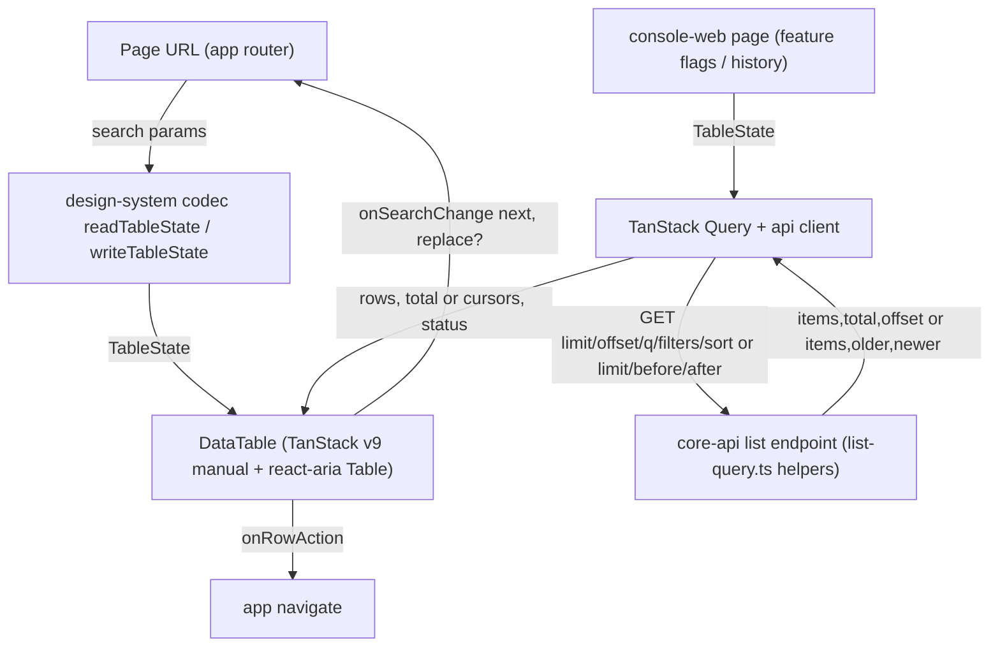

# Data Table - Plan

## Goal Capsule

- **Objective:** Console admins can search, filter, sort and page through the feature flag list, and page through a flag's history, without the browser loading every row. Any later list in a React app can offer the same behaviour by reusing one table component and one server convention, not by building its own.
- **Means:** A `DataTable` component in `@repo/design-system` (react-aria Table plus TanStack Table) with numbered and cursor paging, and a matching core-api list convention, adopted first by the feature flag list and the flag history.
- **Product authority:** This brainstorm's dialogue. It builds on the shipped feature flags work in `docs/plans/2026-11-13-1522-feat-feature-flags-plan.md`, whose behaviour it keeps, except that this plan's R17 pages the flag list through the server and R19 replaces the history list layout shipped there.
- **Stop conditions:** Stop and ask if TanStack Table v9 can't do manual server-side state, if react-aria's Table needs a CSP change, or if a settled decision proves unworkable.
- **Execution profile:** Units land in dependency order (the Implementation Units table). U1, then U2 and U3, form one track; U4, then U5, run in parallel with it.
- **Open blockers:** None.

---

## Product Contract

**Product Contract preservation:** Product Contract unchanged. Outstanding Questions resolved into KTD1–KTD13 and removed.

### Summary

A reusable `DataTable` in `@repo/design-system` gives React apps an accessible table with search, filters, sortable columns and two paging modes: numbered pages for lists with a known total, and newer/older cursor paging for large or append-only data. Its state lives in the page URL.
core-api gains a shared convention for list endpoints in both modes.
The console feature flag list becomes its first numbered-page user, and a flag's history its first cursor-mode user.

### Problem Frame

Each console list is a hand-built `<table>` that loads every row and offers no search, filtering, sorting or paging. That holds while there are a handful of flags, but the console is gaining lists, and some of them grow without bound: audit and change history only ever gets longer. Each new list would otherwise re-solve the same table, URL and API questions on its own, and drift in behaviour and accessibility.

### Actors

- A1. Console admin: browses, searches, filters, sorts and pages the feature flag list and a flag's history.
- A2. Developer adding a list: builds a new table from the shared component and the shared endpoint convention.

### Key Decisions

- **The DataTable lives in `@repo/design-system`.** (session-settled: user-directed — chosen over building it inside console-web first: every React app should be able to use it.) Governs R1.
- **A table's search, filters, sort, page and page size live in the page URL.** (session-settled: user-directed — chosen over component state only, and over keeping only search, filter and sort in the URL: a filtered view can be shared or bookmarked, Back undoes a change, and a reload keeps the user's place.) Governs R7.
- **Layout: a toolbar above the table with search and filters, and the count, page size and pager below.** (session-settled: user-directed — chosen over a filter side panel and over a Filters popover with chips, after comparing rough sketches.) Governs R3.
- **The audience filter asks which app a flag affects, as a single choice.** (session-settled: user-directed — chosen over an exact-match single choice that would hide both-audience flags, and over an exact-match multi-select.) Governs R15.
- **The feature flag list filters by audience and switch only.** (session-settled: user-directed — chosen over also offering rollout stage and "has overrides" filters.) Governs R15.
- **Every feature flag column is sortable: key, audience, switch, rollout and override counts.** (session-settled: user-directed — chosen over sorting only by key and rollout.) Governs R16.
- **A flag's history becomes a cursor-mode DataTable.** (session-settled: user-directed — chosen over keeping the history as a list with "Load more", and over converting the service-accounts history instead: it proves cursor mode on real data.) This supersedes the history list layout the feature flags work shipped. Governs R19, R20.
- **Numbered paging for lists with a knowable total; cursor paging for large or append-only data.** The cursor pattern is the default for any new history, log or other unbounded endpoint. Governs R5, R6, R12, R13.

### Requirements

**DataTable component**

- R1. `@repo/design-system` exports a `DataTable` built on react-aria's Table and TanStack Table, styled to match the existing design-system components.
- R2. A table declares its columns, which columns can be sorted, its filters and whether it has search. Search, filters and sorting are optional per table.
- R3. Search and filter controls sit in one toolbar above the table, with a "Clear filters" action when any is set. The result count, rows per page and pager sit below the table.
- R4. A sortable column header shows its current direction, and activating it cycles from the column's first direction to the opposite direction, then back to the table's default sort; on the column that is already the default sort, it toggles between its two directions. Only one column sorts at a time. Each sortable column declares its first direction: text columns start ascending, number columns (such as rollout and override counts) start descending.
- R5. Numbered mode shows "Showing X–Y of N" and First, Previous, Next and Last controls with "Page P of M".
- R6. Cursor mode shows Newest, Newer and Older controls with no total or page numbers. Each control is disabled when it has nowhere to go.
- R7. The table reads its search, filters, sort, page or cursor, and page size from the page URL, and every change writes back to it, so a reload, a shared link or Back restores the same view. Each table's URL parameters carry a per-table prefix, which can be left off when a page has one table, so two tables on one page keep separate state.
- R8. Changing the search, a filter, the sort or the page size returns to the first page (or the newest, in cursor mode). Search applies once typing pauses, not on every keystroke.
- R9. Rows per page defaults to 20, with 10, 20, 50 and 100 to choose from.
- R10. A table can make each row open a destination. The row responds to a pointer press and to Enter from the keyboard, and the whole table is keyboard-navigable with screen-reader sort state. When a pager control disables itself after being used, focus moves to the table's first row (or the opposite pager control when the table is empty), and the result count is announced politely after every search, filter, sort or page change.
- R11. The table distinguishes loading, an empty list, no matches for the current search or filters (offering "Clear filters"), and a failed load (offering retry).

**Server list convention**

- R12. core-api has one shared convention for numbered list endpoints: requests carry limit, offset, search, filters and one sort column with a direction. Responses carry the page's items and the total matching count. The server always breaks ties by a unique column after the requested sort (for flags, the key), so consecutive pages never repeat or skip rows.
- R13. core-api has one shared convention for cursor list endpoints: requests carry a page size and an optional cursor in either direction (older than, or newer than). Responses carry the items plus the cursors for the next older and next newer pages, or none at the end.
- R14. A request for an offset past the last page answers with the last page instead of an empty one, so a deep link left stale by a delete still shows rows.

**Feature flag list**

- R15. The console flag list can be searched by key and description, and filtered by audience and switch. Each filter is a single choice that defaults to Any. Audience offers Portal and Console and matches the flags that affect that app, so Portal shows portal and both flags, and Console shows console and both flags. Switch offers On and Off.
- R16. The console flag list can be sorted by key, audience, switch, rollout percentage and override counts. Key, ascending, is the default.
- R17. The console flag list pages through the server in numbered mode, and the console never loads every flag at once.
- R18. Each flag row still opens that flag's detail page. After deleting a flag from its page, the admin returns to the list view they opened it from (its search, filters, sort, page and page size) with the deleted confirmation, or to the default view if they didn't come from the list.

**Flag history**

- R19. A flag's history on its detail page is a cursor-mode DataTable showing when, which admin, the action and the change. This replaces the history list, including the history shown for a deleted flag.
- R20. From the history, an admin can move to older events, back to newer ones, and to the newest, including from a reloaded or shared URL.

### Acceptance Examples

- AE1. **Covers R7, R8.** Given an admin on page 3 of the flag list, when they type "check" into search, the list shows the first page of matches and the URL holds the search with no page 3. Copying that URL into another tab shows the same view.
- AE2. **Covers R5, R14.** Given 134 flags and 20 rows per page, page 7 shows "Showing 121–134 of 134". If 20 flags are then deleted and the admin reloads page 7, the list shows the last page, page 6.
- AE3. **Covers R4, R16.** Given the list sorted by key, when the admin activates the "Overrides" header, flags with the most "on" overrides come first, and the header shows the direction.
- AE4. **Covers R11, R15.** Given a search that matches nothing, the table says no flags match, offers "Clear filters", and clearing restores the unfiltered first page.
- AE5. **Covers R6, R20.** Given a flag with 75 history events and 20 rows per page, the admin moves Older twice, reloads the page, and can still go Newer back to the newest events. Newer and Newest are disabled on the newest page.
- AE6. **Covers R10, R18.** Given focus on a flag row, pressing Enter opens that flag's detail page.

### Scope Boundaries

- Deferred: moving the service-accounts registry and its history onto the DataTable.
- Deferred: using the DataTable in portal-web; it's available there but has no user yet.
- Deferred: column resizing, column visibility toggles, multi-column sort, row selection and bulk actions, saved views, and CSV export.
- Deferred: paging the public `/api/v1/shared/flags` list; it stays one evaluated map per caller.
- Out of scope: filtering or searching the flag history; it pages only.

### Dependencies / Assumptions

- TanStack Table is not yet a dependency; it joins the pnpm catalog. `react-aria-components` is already pinned in the catalog (1.22.1, the version bcgov depends on).
- `@repo/design-system` today wraps the bcgov components and has no table; the bcgov library offers none to wrap.
- AGENTS.md says console-web's only direct `react-aria-components` use is the command palette, and the edge CSP has no `'unsafe-inline'` styles. A react-aria Table in the design system changes the first statement and may inject fixed styles whose hashes `csp-hashes.test.ts` must cover.
- The feature flag list endpoint (`GET /api/v1/console/feature-flags`) returns a plain array today, and console-web is its only consumer.
- The history endpoint (`GET /api/v1/console/feature-flag-history`) already pages older with `limit`/`before`/`nextBefore`, but has no "newer than" cursor.
- Override counts are computed per request today; sorting by them must happen in the database query, not in the browser.

### Sources / Research

- `apps/console-web/src/components/feature-flags/flag-table.tsx`, `apps/console-web/src/components/service-clients/client-table.tsx`: the hand-built tables this replaces or later replaces.
- `apps/core-api/src/feature-flags/feature-flags.service.ts` (`list`, `history`), `apps/core-api/src/feature-flags/feature-flags.schemas.ts` (`flagHistoryQuerySchema`, `FLAG_HISTORY_DEFAULT_LIMIT`): today's unpaged list and the existing cursor paging.
- `apps/console-web/src/components/feature-flags/use-feature-flags.ts`: `useInfiniteQuery` history paging with `nextBefore`.
- `packages/design-system/package.json`, `pnpm-workspace.yaml` (catalog): design-system exports and pinned `react-aria-components`.
- `AGENTS.md`: CSP and direct react-aria use constraints, and the catalog rule for dependencies.

---

## Planning Contract

### Key Technical Decisions

- KTD1. **core-api owns the list convention as zod helpers in `apps/core-api/src/common/list-query.ts`; console-web mirrors it.** There is no shared server/web package, and the web apps don't use zod; console-web already mirrors every core-api shape with hand-written guards. `AGENTS.md` documents the convention so the next list follows it. Governs R12, R13.
- KTD2. **Numbered convention: query `limit` (1–100), `offset` (≥ 0), `q`, per-endpoint filter params, and `sort=<column>` plus `order=asc|desc`; response `{ items, total, limit, offset }`.** `offset` in the response is the one actually used, so a clamped request (R14) tells the client which page it got. The server always appends the unique tiebreak column to the requested order. Governs R12, R14.
- KTD3. **Cursor convention: query `limit` plus at most one of `before` or `after` (an opaque, stable id); response `{ items, older, newer }`.** `older` and `newer` are the cursors for the next pages, or null at the end. Order is newest first with the unique id as tiebreak. An `after` request reads ascending and is reversed, so a page always renders newest first. A side's cursor is its boundary item's id when that side has more events, and null otherwise. An `after` read that reaches the newest events returns the full newest page as if no cursor had been sent, and the table drops the cursor from the URL with `replace`. Governs R13, R20.
- KTD4. **Search uses the people-search escaping (`containsPattern`), moved into `list-query.ts`.** `%`, `_` and `\` match literally. people-search imports it from there. Governs R12, R15.
- KTD5. **The flag list is one SQL query for every in-range page.** Flags left-join their aggregated "on"/"off" override counts, with the filters, ILIKE search, order and tiebreak, `limit`/`offset` and `count(*) over ()` applied in the database. An empty page carries no window count, so when the page comes back empty at an offset above 0, a plain `count(*)` with the same filters supplies the total for the clamp. The audience filter `portal` matches `portal` and `both`, and `console` matches `console` and `both`. No new indexes: the flag table is small and already cached whole by `FlagCache`, so the query only has to be correct. Governs R14–R17.
- KTD6. **TanStack Table v9 (`@tanstack/react-table`, pinned at the current 9.x in the catalog), in manual mode, holds column definitions and sort and pagination state.** v9 has been the stable release since 2026-08 and v8 is in maintenance. TanStack's pagination state drives numbered mode only; cursor mode bypasses it. (session-settled: user-directed — the user asked for TanStack Table alongside react-aria's Table, over react-aria alone.) Governs R1, R2.
- KTD7. **The table renders with react-aria-components' Table, as a direct `@repo/design-system` dependency at the catalog version.** It is the same 1.22.1 copy console-web uses, separate from the copy bcgov inlines. bcgov's Button and Link don't work inside it, so the sort headers, pager, filters and search use react-aria controls styled with bcgov tokens. Resizing, the Virtualizer and drag and drop stay off: they would bring layout styles or a dependency on the CSP. Governs R1, R3–R6.
- KTD8. **The DataTable is router-agnostic: the app passes `search` (its URL search params as plain strings) and `onSearchChange(next, { replace })`.** The design system ships pure codec helpers, `readTableState(params, config, prefix?)` and `writeTableState(state, config, prefix?)`, which read only string values, parse with defaults and drop unknown values. console-web's router keeps every search value a plain string (`parseSearch`/`stringifySearch` built on URLSearchParams), because TanStack Router's default JSON-parses values (`?page=3` becomes a number, and a written `"3"` comes out quoted). A search that starts from no search, or the first edit after the search field gains focus, pushes a history entry; further edits while the field keeps focus replace it, so one search is one Back step. Filter, sort, page-size and paging changes push. When the codec dropped an invalid value, or the server clamped the offset or dropped a cursor, the table writes the corrected state with `replace`. Governs R7, R8, R14.
- KTD9. **Rows are real links: the DataTable takes `getRowHref(row)` and sets `href` on each react-aria Row, and console-web wraps its app in react-aria's `RouterProvider` with TanStack Router's `navigate` and `useHref`.** Rows then open in-app without a full page load, and Cmd- or middle-click still opens a new tab, as today's key link does. The DataTable stays router-agnostic, because the provider is app-level. Governs R10, R18.
- KTD10. **On the flag detail page the history table's URL params carry the prefix `h.`, and the list's unprefixed params ride along on the detail URL.** Deleting a flag navigates back to `/feature-flags` with those list params plus `deleted`, and R14 clamps a page that shrank. Governs R7, R18, R19.
- KTD11. **The table keeps the previous rows visible while a new page, sort or search loads,** marking the table region `aria-busy` (TanStack Query `placeholderData: keepPreviousData`). A persistent `role="status"` region announces the result count after each load settles. Pager buttons that run out of pages use react-aria `isDisabled`, and the table moves focus to its first row when the focused control becomes disabled (R10). Governs R10, R11.
- KTD12. **A search the edge firewall refuses (console-web's `blocked` error kind) is its own table state.** It shows the people-search wording and "Clear filters", with no retry, because the same text can never succeed. Governs R11.
- KTD13. **On narrow screens the table scrolls horizontally inside its frame, and the toolbar and pager wrap to their own lines.** Governs R3.

### High-Level Technical Design

| Mode     | Request                                          | Response                                      | Pager                                                            |
| -------- | ------------------------------------------------ | --------------------------------------------- | ---------------------------------------------------------------- |
| Numbered | `limit`, `offset`, `q`, filters, `sort`, `order` | `items`, `total`, `limit`, `offset` (clamped) | First / Previous / Page P of M / Next / Last, "Showing X–Y of N" |
| Cursor   | `limit`, `before` or `after`                     | `items`, `older`, `newer`                     | Newest / Newer / Older                                           |

### Assumptions

- TanStack Table v9's manual pagination exposes a row count or page count option equivalent to v8's `rowCount`/`pageCount`. If it doesn't, the DataTable computes `Page P of M` itself from `total` and `limit`, which numbered mode needs anyway.
- react-aria-components 1.22.1's Table injects no `<style>` nodes. The only fixed styles in its press and scroll-lock hooks are already hashed by `apps/console-web/src/csp-hashes.test.ts`.

---

## Implementation Units

| U-ID | Title                                          | Key files                                                                         | Depends on |
| ---- | ---------------------------------------------- | --------------------------------------------------------------------------------- | ---------- |
| U1   | List convention helpers                        | `apps/core-api/src/common/list-query.ts`                                          | none       |
| U2   | Paged, searchable flag list endpoint           | `apps/core-api/src/feature-flags/`                                                | U1         |
| U3   | Two-way cursor history endpoint                | `apps/core-api/src/feature-flags/`                                                | U1         |
| U4   | Table state codec                              | `packages/design-system/src/components/data-table/`                               | none       |
| U5   | DataTable component                            | `packages/design-system/src/components/data-table/`                               | U4         |
| U6   | Flag list on the DataTable                     | `apps/console-web/src/components/feature-flags/`, `routes/_app/feature-flags.tsx` | U2, U5     |
| U7   | Flag history on the DataTable                  | `apps/console-web/src/components/feature-flags/`                                  | U3, U5, U6 |
| U8   | Conventions in AGENTS.md and architecture docs | `AGENTS.md`, `docs/architecture.md`                                               | U1–U7      |

### U1. List convention helpers

**Goal:** Give every core-api list endpoint one way to read numbered and cursor queries and shape their responses.

**Requirements:** R12, R13, R14; KTD1–KTD4.

**Dependencies:** None.

**Files:**

- Create: `apps/core-api/src/common/list-query.ts`, `apps/core-api/src/common/list-query.test.ts`
- Modify: `apps/core-api/src/principals/people-search.service.ts` (import `containsPattern` from `list-query.ts`)

**Approach:**

1. Provide zod builders: `numberedQuerySchema({ sort: [...columns], defaultSort, filters })` and `cursorQuerySchema()`, with `limit` coerced to 1–100 (default 20), `offset` ≥ 0, `order` `asc|desc`, and `before`/`after` mutually exclusive.
2. Provide response schema builders for `{ items, total, limit, offset }` and `{ items, older, newer }`, so each controller's `@ApiOkResponse({ standardSchema })` stays one line.
3. Provide `clampOffset(offset, limit, total)`, giving the last page's offset when past the end and 0 when the total is 0.

**Patterns to follow:** `apps/core-api/src/feature-flags/feature-flags.schemas.ts` (`flagHistoryQuerySchema`), `apps/core-api/src/principals/people-search.service.ts` (`containsPattern`).

**Test scenarios:**

- `limit` defaults to 20, and 0 or 101 fails. `offset` -1 fails. An unknown `sort` column fails with 400. `order` defaults per column.
- `before` and `after` together fail.
- `clampOffset(120, 20, 100)` is 80, `clampOffset(40, 20, 0)` is 0, and an in-range offset is unchanged.
- `containsPattern('j_smith')` escapes `_`, and people-search tests still pass unchanged.

**Verification:** core-api tests and typecheck pass, and people search behaves as before.

### U2. Paged, searchable flag list endpoint

**Goal:** Serve `GET /api/v1/console/feature-flags` as a numbered page with search, filters and every sortable column.

**Requirements:** R12, R14–R17; KTD2, KTD4, KTD5.

**Dependencies:** U1.

**Files:**

- Modify: `apps/core-api/src/feature-flags/feature-flags.service.ts` (`list`), `apps/core-api/src/feature-flags/feature-flags.schemas.ts`, `apps/core-api/src/feature-flags/feature-flags.console.controller.ts`
- Create: `apps/core-api/src/feature-flags/flag-list.query.ts` (the SQL, kept out of the 300-line service)
- Test: `apps/core-api/src/feature-flags/flag-list.console.test.ts`

**Approach:**

1. Query parameters: `q` (key or description), `audience=portal|console` (affects filter), `enabled=true|false`, `sort=key|audience|enabled|rolloutPct|overridesOn` with `order`, `limit` and `offset`. Default sort is `key asc`, and `overridesOn` defaults to `desc`. The Overrides column shows "N on, M off" and sorts by the "on" count.
2. Run one query: flags left join (per-flag `on`/`off` counts), with `where`, order then `key` as tiebreak, `count(*) over ()`, `limit`/`offset`. When the page comes back empty and `offset` is above 0, run a `count(*)` with the same filters and search; if it is above 0, re-run at `clampOffset(offset, limit, total)`, otherwise answer `{ items: [], total: 0, limit, offset: 0 }`.
3. Return `{ items: FlagSummary[], total, limit, offset }`.

**Patterns to follow:** registry console controller conventions; `countOverrides` (to be replaced by the joined aggregate).

**Test scenarios:**

- With 25 flags and no params, the response has 20 items in key order and `total` 25. `offset=20` returns 5.
- `q=check` matches key or description case-insensitively, and `q=a_b` matches only a literal underscore.
- `audience=portal` returns portal and both flags. `audience=console` returns console and both flags. `enabled=false` returns only off flags.
- `sort=overridesOn` lists the most "on" overrides first. With ties, the order is by key, and pages at `limit=2` across a tied column never repeat or skip a flag.
- `sort=rolloutPct&order=asc` lists 0% first.
- Covers AE2. With 134 flags, `offset=120` returns 14 items. After deleting 20, `offset=120` returns the last page with `offset` 100.
- An unknown `sort` or `audience` value answers 400, and a non-admin gets 403.

**Verification:** core-api tests pass, and the OpenAPI doc shows the page schema.

### U3. Two-way cursor history endpoint

**Goal:** Let `GET /api/v1/console/feature-flag-history` page both older and newer.

**Requirements:** R13, R19, R20; KTD3.

**Dependencies:** U1.

**Files:**

- Modify: `apps/core-api/src/feature-flags/feature-flags.service.ts` (`history`), `apps/core-api/src/feature-flags/feature-flags.schemas.ts`, `apps/core-api/src/feature-flags/feature-flags.console.controller.ts`
- Test: `apps/core-api/src/feature-flags/feature-flags.console.controller.test.ts` (history cases)

**Approach:** Parse `key`, `limit` and one of `before` or `after` with `cursorQuerySchema`.

- `before` reads `id < before` descending.
- `after` reads `id > after` ascending, then reverses.
- With neither, the request reads the newest events.

Fetch `limit + 1` rows to know whether more exist on the side being read, and check the other side with an existence query on the boundary id. Return `{ items, older, newer }`, where each cursor is its boundary item's id when that side has more events, and null otherwise (KTD3). An `after` read with no newer events beyond the page returns the newest page, as with no cursor.

**Test scenarios:**

- Covers AE5. With 75 events at `limit=20`, the newest page has `newer: null`. Following `older` three times reaches the oldest 15 with `older: null`. Following `newer` from there returns the same pages back, and two pages never share an event.
- `after=<the newest id>` returns the newest page with `newer: null`, as with no cursor.
- A request that returns no items (e.g. `before=<the oldest id>`) returns null for both cursors.
- `before` and `after` together answer 400.
- A deleted flag's history still pages.

**Verification:** core-api tests pass.

### U4. Table state codec

**Goal:** Translate between a page's URL params and a table's state, with defaults and per-table prefixes.

**Requirements:** R7, R8, R9, R14; KTD8.

**Dependencies:** None.

**Files:**

- Create: `packages/design-system/src/components/data-table/table-state.ts`, `packages/design-system/src/components/data-table/table-state.test.ts`

**Approach:** Define types for the state: search, filters, sort and either page or cursor, plus page size. A table config declares search, filter options, sortable columns with first directions and the default sort, and the mode.

- `readTableState(params, config, prefix?)` takes `Record<string, unknown>`, reads only string values, and returns `{ state, corrected }`. Unknown sort columns, filter values, page sizes outside 10/20/50/100, and malformed numbers or cursors fall back to defaults, and `corrected` is set.
- `writeTableState(state, config, prefix?)` returns params holding only non-default values.
- The pure transitions are `setSearch`, `setFilter`, `setSort` (the R4 cycle), `setPageSize`, `goToPage` and `goToCursor`. They return the next state and push; the DataTable replaces instead for a search edit that follows another search edit while the field keeps focus (KTD8). Every change except a page or cursor move resets to the first page or the newest.

**Execution note:** Implement test-first; it is pure logic.

**Test scenarios:**

- An empty URL gives the defaults. `?page=3&sort=rolloutPct&order=asc` round-trips. With prefix `h`, `?h.before=42` reads a cursor and ignores unprefixed params.
- `?sort=bogus` and `?pageSize=7` fall back to defaults with `corrected` set.
- `setSort` on a number column starts descending, then ascending, then the default. On the default column it toggles.
- `setSearch` resets to page 1 and pushes. `setFilter` resets and pushes. `goToPage` keeps search, filters and sort and pushes.
- `?q=123`, `?q=true` and `?enabled=false` read as strings, and writing them back produces unquoted values.
- `writeTableState` omits defaults, so the default view is a clean URL.

**Verification:** design-system tests pass.

### U5. DataTable component

**Goal:** Ship the accessible `DataTable` in `@repo/design-system`, in numbered and cursor modes.

**Requirements:** R1–R11, R14; KTD6–KTD9, KTD11–KTD13.

**Dependencies:** U4.

**Files:**

- Create: `packages/design-system/src/components/data-table/index.ts`, `data-table.tsx`, `data-table-toolbar.tsx`, `data-table-pager.tsx`, `data-table.module.css` (or the package's CSS convention), `data-table.test.tsx`
- Modify: `packages/design-system/package.json` (`react-aria-components` and `@tanstack/react-table` from the catalog), `pnpm-workspace.yaml` (catalog entry for `@tanstack/react-table`), `pnpm-lock.yaml`, `packages/design-system/src/package-exports.test.ts` (dependency list), `packages/design-system/src/components/components.test.ts` (`data-table` in the custom list; export only functions and types)

**Approach:**

1. Props:
   - `columns` (TanStack column defs with header, cell renderer, `sortable` and first direction), `rows`, and `getRowId`;
   - `mode` (`numbered` with `total`, or `cursor` with `hasOlder`/`hasNewer`);
   - the config (search, filters, page sizes), `search` and `onSearchChange`;
   - `status` (`loading`, `refreshing`, `ready`, `error`, `blocked`), `onRetry`, `getRowHref`, `caption` and an optional `prefix`.
2. Build a TanStack v9 table in manual mode with sorting from the state. Render react-aria `Table`/`TableHeader`/`Column allowsSorting`/`TableBody renderEmptyState`/`Row`/`Cell`, mapping the sort descriptor both ways and marking the key column `isRowHeader`.
3. The toolbar holds a search field, with a 300 ms debounce hook copied from console-web's people search, one select per filter, and "Clear filters". The pager is numbered or cursor, with the page-size select. A persistent status region announces the count.
4. States, and what the toolbar, count and pager show in each:

   | State                                                                | Rows                                       | Toolbar                   | Count and pager                 |
   | -------------------------------------------------------------------- | ------------------------------------------ | ------------------------- | ------------------------------- |
   | Loading (first load)                                                 | skeleton rows                              | shown, enabled            | hidden                          |
   | Refreshing                                                           | previous rows, `aria-busy`                 | shown, enabled            | previous values, pager disabled |
   | Ready                                                                | the page                                   | shown                     | shown                           |
   | Empty (no rows, no search or filters)                                | empty message                              | search and filters hidden | hidden                          |
   | No matches                                                           | message plus "Clear filters"               | shown                     | hidden                          |
   | Error (including a failed refresh, which replaces the previous rows) | message plus retry                         | shown                     | hidden                          |
   | Blocked                                                              | people-search wording plus "Clear filters" | shown                     | hidden                          |

5. When `corrected` (U4) or a server-clamped offset differs from the URL, call `onSearchChange(corrected, { replace: true })` once.

**Execution note:** Start with failing tests for sort-cycle and pager behaviour, and check that a render adds no `<style>` nodes.

**Patterns to follow:** existing design-system custom components and their tests; console-web's people search for the debounce and blocked copy.

**Test scenarios:**

- Rendering 20 rows numbered with `total` 134 shows "Showing 1–20 of 134" and "Page 1 of 7". First and Previous are disabled.
- Activating the Overrides header calls `onSearchChange` with descending sort and page 1, pushed. Activating it again gives ascending, and a third time restores the default.
- Typing in search calls `onSearchChange` once after the pause and pushes. A second edit while the field keeps focus replaces.
- Choosing a filter pushes and resets to page 1. "Clear filters" clears search and filters.
- Cursor mode shows Newest, Newer and Older, with no total. Newer and Newest are disabled when `hasNewer` is false.
- Pressing Next onto the last page moves focus to the first row, and the status region announces the new count.
- Each row is a link to `getRowHref(row)`. Pressing Enter on a focused row follows it through the app's `RouterProvider`.
- Each state renders its own message: empty, no matches with "Clear filters", error with retry, and blocked without retry.
- While refreshing, the previous rows stay and the region is `aria-busy`.
- Rendering adds no `<style>` elements to the document.

**Verification:** design-system tests, typecheck and build pass, and console-web's `csp-hashes.test.ts` still passes.

### U6. Flag list on the DataTable

**Goal:** Replace the hand-built flag table with the DataTable, backed by the paged endpoint and URL state.

**Requirements:** R7, R8, R14–R18; KTD8–KTD12.

**Dependencies:** U2, U5.

**Files:**

- Modify: `apps/console-web/src/router.ts` (`parseSearch`/`stringifySearch` keep plain strings), `apps/console-web/src/app.tsx` (react-aria `RouterProvider` with the router's `navigate` and `useHref`), `apps/console-web/src/routes/_app/feature-flags.tsx` (`validateSearch` passes the string params plus `deleted`), `apps/console-web/src/api/feature-flags.ts` (`listFlags(query)` and page guard), `apps/console-web/src/components/feature-flags/feature-flags-page.tsx`, `apps/console-web/src/components/feature-flags/use-feature-flags.ts` (list query keyed by its params, with `keepPreviousData`; mutations invalidate the list prefix), `apps/console-web/src/components/feature-flags/use-detail-actions.ts` (delete returns to the carried list params)
- Delete: `apps/console-web/src/components/feature-flags/flag-table.tsx`
- Create: `apps/console-web/src/components/feature-flags/flag-columns.tsx`, `apps/console-web/src/test-support/fake-feature-flag-list.ts` (split from the 280-line fake)
- Modify: `apps/console-web/src/test-support/fake-feature-flags-api.ts`, `apps/console-web/e2e/support/mock-console-api.ts`, `apps/console-web/e2e/feature-flags.spec.ts`, `apps/console-web/e2e/feature-flags-admin.spec.ts` (find the created flag by searching its key, then open its row link)
- Test: `apps/console-web/src/components/feature-flags/flag-list.test.tsx`

**Approach:** The page reads the table state with the U4 codec and fetches with it. It passes rows, total and status to the DataTable, and wires `onSearchChange` to `navigate({ search, replace })` and `getRowHref` to `/feature-flags/$key` carrying the current list params. Delete navigates back to `/feature-flags` with the carried params plus `deleted`.

**Test scenarios:**

- Covers AE1. On page 3, typing "check" shows the first page of matches, and the URL has `q=check` and no page.
- Choosing Audience: Portal requests `audience=portal`, and the table shows the fake's portal and both flags.
- Covers AE3. Activating Overrides requests `sort=overridesOn&order=desc`.
- Covers AE4. A no-match search shows "Clear filters", and clearing restores page 1.
- Covers AE6. Enter on a row opens `/feature-flags/<key>`, carrying the list params, and the row is a link a new tab can open.
- `?page=3&enabled=false&q=2024` round-trips through the router unchanged, and existing string params (`deleted`, `authError`) still work.
- Covers AE1. Back after the first search returns to page 3 with no search.
- Deleting from a flag opened from page 2 of an `enabled=false` view returns there with the deleted confirmation.
- `?pageSize=7` is corrected to the default with a replaced URL. A clamped response replaces the URL with the actual page.
- A bare 403 to a search shows the blocked wording without retry.
- The create modal still starts at 0%, and creating a flag refreshes the current page.
- Mocked e2e: list, search, filter, sort and paging against mocked page responses.

**Verification:** console-web unit tests and the mocked e2e pass, and `csp-hashes.test.ts` passes.

### U7. Flag history on the DataTable

**Goal:** Show a flag's history as a cursor-mode DataTable on its detail page, including for a deleted flag.

**Requirements:** R19, R20; KTD3, KTD10.

**Dependencies:** U3, U5, U6.

**Files:**

- Modify: `apps/console-web/src/routes/_app/feature-flags.$key.tsx` (search passes list params and `h.` params through), `apps/console-web/src/api/feature-flags.ts` (`listHistory({ key, limit, before, after })` and page guard), `apps/console-web/src/components/feature-flags/use-feature-flags.ts` (history query keyed by cursor, with `keepPreviousData`), `apps/console-web/src/components/feature-flags/flag-detail.tsx`
- Replace: `apps/console-web/src/components/feature-flags/history-list.tsx` with `history-table.tsx`
- Modify: `apps/console-web/e2e/feature-flags-admin.spec.ts` (assert the deleted flag's history as table rows)
- Test: `apps/console-web/src/components/feature-flags/history-table.test.tsx` (replacing `history-list.test.tsx`)

**Approach:** Columns are When, Admin, Action and Change, reusing the current history row text. The prefix is `h`. Newest drops the cursor, Older uses `before=<older>`, and Newer uses `after=<newer>`. The deleted-flag view renders the same table.

**Test scenarios:**

- Covers AE5. Older twice, then a reload (re-render from the URL), then Newer twice, reaches the newest page, where Newer and Newest are disabled.
- History params (`h.before`) don't disturb the carried list params, and deleting still returns to the list view.
- A deleted key's page shows its history table and no edit controls.
- `h.after` past the newest event shows the full newest page, and the URL drops `h.after` with replace.

**Verification:** console-web tests and the mocked e2e pass.

### U8. Conventions in AGENTS.md and architecture docs

**Goal:** Record the list convention and the DataTable so the next list follows them.

**Requirements:** R12, R13; KTD1–KTD3, KTD7.

**Dependencies:** U1–U7.

**Files:**

- Modify: `AGENTS.md`, `docs/architecture.md`

**Approach:** Add an AGENTS.md bullet covering:

- numbered versus cursor lists and their parameters and responses (KTD2, KTD3), with `list-query.ts` as the home;
- `DataTable` in `@repo/design-system` with app-supplied URL state and per-table prefixes;
- `onRowAction` navigation.

Replace the statement that the palette is console-web's only direct react-aria use. Note the two endpoints' new shapes in architecture.md.

**Test expectation:** none — documentation only.

**Verification:** The docs name the convention's home, its parameters and the DataTable's URL contract.

---

## Verification Contract

| Gate   | Command                                                                              | Proves                                                                   |
| ------ | ------------------------------------------------------------------------------------ | ------------------------------------------------------------------------ |
| Types  | `pnpm typecheck`                                                                     | All workspaces compile, including the design-system dependency changes   |
| Lint   | `pnpm lint`                                                                          | No warnings                                                              |
| Format | `pnpm format:check`                                                                  | oxfmt                                                                    |
| Tests  | `pnpm test`                                                                          | core-api, design-system, console-web and the rest                        |
| E2E    | console-web `playwright test --project=chromium --project=webkit` after `pnpm build` | Mocked list and history flows                                            |
| Images | `scripts/images-smoke.sh`                                                            | console-web and core-api images still build and pass the edge CSP checks |

---

## Definition of Done

- Every unit's verification holds, and AE1–AE6 each have a passing test that names it.
- The gates above pass.
- No file over 300 lines and no function over 50 lines.
- `flag-table.tsx` and `history-list.tsx` are gone, with no dead code from replaced approaches left in the diff.
- `AGENTS.md` describes the list convention and the DataTable.
