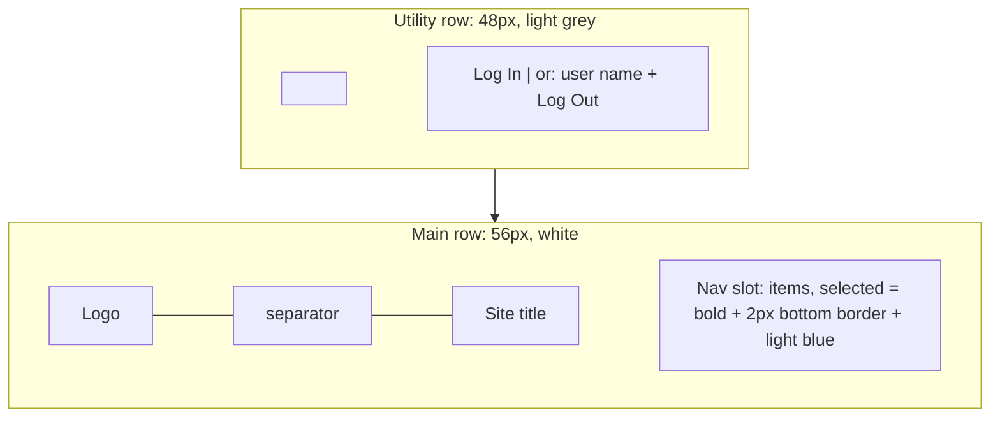
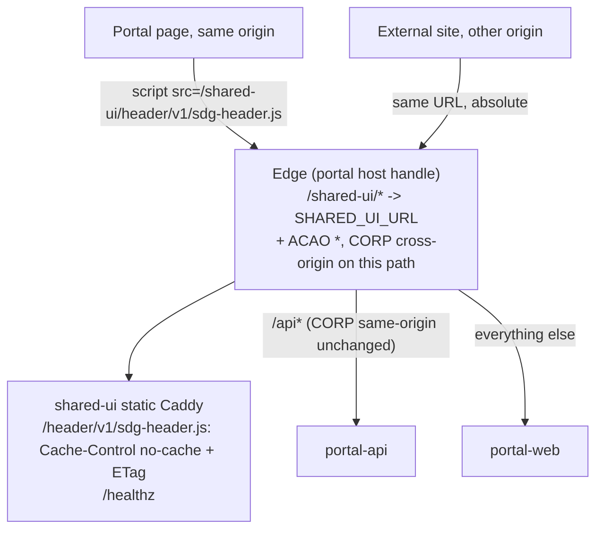
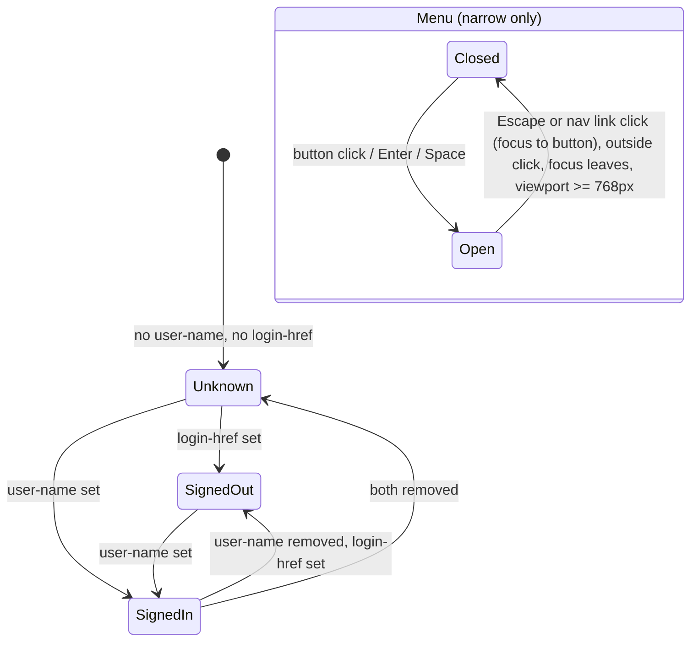

# Shared UI Header - Plan

## Goal Capsule

- **Objective:** Any website, React or not, in this repo or owned by another team, shows the SDG header by adding one script tag, a CSP allowance for the header host, a short pre-load CSS rule and some markup, and picks up every non-breaking header release on its next page load without redeploying.
- **Means:** A new `packages/shared-ui` whose `header` export is a Preact-built `<sdg-header>` web component, shipped as one self-contained script from its own deployable behind the Caddy edge at a floating major-version path (KTD1, KTD3). The existing `packages/sdg-header` is deleted and portal-web moves to the new header.
- **Product authority:** This plan's Product Contract wins on behavior; KTDs win on mechanism within it; units override neither. The existing `packages/sdg-header` is deliberately not a reference for the new component's design or behavior: read it only to find what to delete or rewire.
- **Stop conditions:** Stop and ask if the edge cannot serve the header path with cross-origin headers while `/api*` and app responses keep `Cross-Origin-Resource-Policy: same-origin`; if the self-contained bundle cannot avoid inline styles under the production CSP; or if any change would require a new hostname, a new GitHub scope input, or a repository setting.
- **Execution profile:** U1 → U2 → U3 → U4, then U5 → U6 → U7, then U8 → U9 → U10. Each unit leaves `pnpm typecheck`, `pnpm lint` and the touched packages' tests green.
- **Finishing:** One PR to `main` from a feature branch. Deploys happen through the existing PR → TEST → PROD workflows, never from a workstation.
- **Open blockers:** None.

---

## Product Contract

### Summary

Build a new `<sdg-header>` web component in `packages/shared-ui` (subpath export `header`), built with Preact and served from the edge at one URL per major version. It has a grey utility row (Log In, or the user's name and Log Out) and a white main row (logo, separator, site title, slotted nav items). Implementers configure it with attributes and slots and handle a logout event, so React and vanilla markup are the same; in-repo React apps also get a thin `header/react` wrapper. The old `packages/sdg-header` is deleted and portal-web switches to the new header in the same change.

### Problem Frame

The SDG header has to look and behave the same across a mix of sites: this monorepo's React apps and, later, sites other teams own in other repos and stacks. A header that each site bundles at build time drifts: each site runs whatever version it last deployed, and a header fix only reaches visitors after every implementer redeploys. The current `packages/sdg-header` is consumed that way, by portal-web only. No external site is lined up yet, so the delivery model has to be right before the first one arrives rather than retrofitted after.

### Key Decisions

- **One delivery path for everyone: the edge-served script.** In-repo apps such as portal-web load the header the same way external sites do, so they also pick up minor releases without a redeploy and we run what implementers run. (session-settled: user-approved — chosen over bundling from the workspace: bundled apps drift from what external sites run.) Governs R14, R20, R21, R23.
- **Floating major URLs only.** Implementers reference only a major-version URL that always serves the latest release in that major; there are no exact or minor pins. (session-settled: user-approved — chosen over major plus exact pins: exact pins require storing every published build somewhere that outlives a redeploy.) Governs R14, R15.
- **The header is its own deployable on the shared PR → TEST → PROD pipeline.** A header change rebuilds only the header's image, never portal-web's or the edge's, and reaches PROD with the next regular GitHub Release. (session-settled: user-directed — chosen over its own PROD promotion trigger and over riding the edge image.) Governs R16, R17.
- **Delete the old header outright.** No `sdg-header-old` rename; the old package is removed and portal-web is rewired to the new header in one change, so `<sdg-header>` has exactly one definition. (session-settled: user-directed — chosen over renaming to `sdg-header-old` and switching portal-web later.) Governs R22, R23.
- **The header owns both auth states.** The implementer tells the header who is signed in; the header shows Log In or the user's name plus Log Out. (session-settled: user-directed — chosen over a Log-In-only header and over a slot the host fills.) Governs R3, R4.
- **Log In is a link plus an optional cancelable event; Log Out is a button whose event the host handles.** Markup stays the same in React and vanilla. Sign-out is an action rather than navigation, so there is no sign-out URL another site could send a visitor to. (session-settled: user-directed — chosen over a Log Out link (`logout-href`) backed by a GET sign-out or confirmation page: a sign-out URL lets other sites force a sign-out. Log In as a link is user-approved over events-only and hrefs-only.) Governs R8, R9.
- **A thin React wrapper, in-repo only.** React apps in this monorepo get `<SdgHeader>` from a `header/react` subpath, which renders the edge-loaded element and holds no header code; nothing is published to a registry. (session-settled: user-directed — chosen over shipping types only; distribution in-repo only is user-approved over publishing to npm, deferred until a real external React consumer exists.) Governs R12, R13.
- **Preact builds the component internally.** Implementers only see the custom element, so the framework affects maintainers, not implementers. (session-settled: user-directed — chosen over Lit, which needs no custom-element adapter: the team prefers JSX and hooks.)
- **On narrow screens the nav collapses into a menu; both rows stay.** (session-settled: user-directed — chosen over a horizontally scrolling nav row and over a single row with Log In inside the menu.) Governs R6.
- **Releases reach visitors on their next page load.** (session-settled: user-approved — chosen over an hour-long or day-long cache, which slows releases and rollbacks.) Governs R15.

### Actors

- A1. Implementer: a team embedding the header in their site, in this repo (portal-web, console-web) or elsewhere, React or vanilla.
- A2. Visitor: a person using an implementer's site, signed in or not.
- A3. Header maintainer: this team, which changes and releases the header.

### Requirements

**Layout and appearance**

- R1. The header has two rows: a utility row 48px tall on a light grey background, above a main row 56px tall on a white background.
- R2. The main row shows a logo on the left, a vertical separator, then the site title the implementer supplies; nav items sit on the right.
- R3. When the implementer sets `login-href` and no user name, the utility row shows "Log In" on its right side, as a link styled as a button. When neither is set (the host is still checking the session), the utility row keeps its height and shows no control.
- R4. When the implementer supplies a signed-in user's name, the utility row shows that name and a "Log Out" button instead of "Log In".
- R5. The selected nav item has a 2px bottom border in the link colour (`#255A90` or the matching design token), a light blue background (`#F1F8FE` or the matching token) and bold text, and selecting it does not change its width or shift the other items.
- R6. On narrow screens both rows stay; the nav items move behind a menu button on the main row, opening as a stacked list under the header; the utility row keeps Log In or the user and Log Out.
- R7. The header's own parts (rows, logo, title, auth controls, menu) are not changed by the host page's CSS, inherited page styles such as font and colour do not leak in, and the header's CSS does not change the host page. Nav items stay the host's own elements: host CSS cannot override the R5 selected appearance, and the implementer documentation states that other host rules aimed at links inside the header (spacing, colour, underline) can still change those links.

**Implementer API**

- R8. Log In is a link to the implementer-supplied `login-href`; Log Out is a button with no URL.
- R9. Clicking Log In also dispatches an event the host can cancel to handle sign-in itself; clicking Log Out dispatches a logout event that the host must handle to sign the visitor out (for example, with a POST).
- R10. Implementers configure the header with attributes and supply nav items as their own link elements in a slot, so the markup is the same in React and in plain HTML.
- R11. A nav item is shown as selected when its element has `aria-current="page"`; the header never navigates by itself, so client-side routers (TanStack Router `Link`) and plain `<a>` both work.
- R12. In-repo React apps can use a typed `<SdgHeader>` wrapper (subpath `header/react` of `packages/shared-ui`) with camelCase props and `onLogin`/`onLogout` handlers; it renders the edge-loaded element, loads the script when the page has not, and contains no header behavior.
- R13. TypeScript types for the element's attributes and events ship with `packages/shared-ui` for in-repo apps.

**Delivery and versioning**

- R14. The header is served at one URL per major version that always serves the latest release in that major; a breaking change to the attributes, slots or events, to the header's reserved height at any breakpoint, or to what the R20 pre-load CSS rule targets is a new major at a new URL, and the previous major keeps being served while it is supported.
- R15. Visitors get a new release, or a rolled-back one, on their next page load after it is deployed. An immediate PROD rollback restores every component to the last good release (F4).
- R16. The header is served by its own deployable behind the edge. A header change rebuilds only the header's image (portal-web's and the edge's images stay unchanged), and no implementer has to redeploy to pick it up.
- R17. Header releases follow the existing PR → TEST → PROD pipeline: a PR gets its own preview, merge deploys to TEST, and the GitHub Release promotes to PROD.
- R18. TEST and PROD each serve their own header, so an implementer's TEST site can load the TEST header.
- R19. A page on another origin can load the header with a standard script tag; the only changes it needs are to allow the header's host in its own CSP and to add the R20 pre-load CSS rule. The cross-origin access this needs applies only to the header deployable's static files, never to `/api*`, portal-web or console-web responses, and never allows credentials.

- R20. While the header script is loading, the page reserves the header's full height and hides the raw nav links, so nothing shifts when the header appears; a documented CSS rule that implementers add (and portal-web uses) provides this, and that rule stays valid for the life of a major (R14).
- R21. If the header script fails to load, visitors see no header and no sign-in control; this is an accepted cost of the single delivery path, and the implementer documentation says so.

**Migration**

- R22. `packages/sdg-header` and every live code, configuration and documentation reference to it are removed; historical plans in `docs/plans/` stay as written.
- R23. portal-web shows the new header, loaded from the edge, with its router's links as nav items, sign-in via `login-href`, and sign-out via the logout event (R9) handled by its existing session flow.

**Accessibility**

- R24. The header is a labelled navigation landmark; the narrow-screen menu button is a real button that announces whether the menu is open, and the menu opens by click, Enter or Space and closes on Escape (returning focus to the button), on an outside click and on selecting an item; collapsed items are out of the tab order; every control shows a visible focus indicator.

### Key Flows

- F1. Vanilla embed
  - **Trigger:** An implementer adds the header to a plain HTML site.
  - **Actors:** A1, A2
  - **Steps:** Add the documented pre-load CSS rule (R20); add the major-version script tag; place `<sdg-header>` with a site title, `login-href` and, when signed in, the user's name; put `<a slot="nav">` links inside and set `aria-current="page"` on the current one.
  - **Outcome:** The header renders with no build step on the implementer's side.
  - **Covered by:** R10, R11, R14, R19, R20
- F2. Minor release
  - **Trigger:** A maintainer merges a non-breaking header change.
  - **Actors:** A3, A1, A2
  - **Steps:** The PR preview shows the change; merge deploys it to TEST, where implementers' TEST sites see it; the next GitHub Release promotes it to PROD.
  - **Outcome:** Visitors to every implementer's PROD site see the change on their next page load; no implementer redeploys.
  - **Covered by:** R14, R15, R16, R17, R18
- F3. Sign-out on a POST-only host
  - **Trigger:** A signed-in visitor clicks Log Out on portal-web.
  - **Actors:** A2, A1
  - **Steps:** The header dispatches its logout event; portal-web's handler ends the session with its existing origin-checked POST and navigates to the URL its server returns.
  - **Outcome:** The visitor is signed out; the header shows Log In on the next render.
  - **Covered by:** R4, R9, R23
- F4. Header rollback
  - **Trigger:** A header release in PROD is broken.
  - **Actors:** A3, A2
  - **Steps:** A maintainer re-runs the Release workflow for the last good GitHub Release, which redeploys that release's already-built images (the previous header included) without rebuilding or shipping anything merged since. They then merge a revert PR so main and TEST match, and the next regular release carries it.
  - **Outcome:** Visitors on every implementer's site get the previous header on their next page load once the release is deployed.
  - **Covered by:** R15, R17

### Layout



On narrow screens the nav slot is replaced by a menu button, and the items open as a stacked list under the main row (R6).

### Acceptance Examples

- AE1. Covers R3, R4.
  - **Given** the implementer sets `login-href` and no user name, **then** the utility row shows "Log In".
  - **Given** the implementer sets neither `login-href` nor a user name, **then** the utility row is empty at its full 48px height, with no "Log In" to click.
  - **Given** the implementer sets a user name, **then** it shows that name and "Log Out", and no "Log In".
- AE2. Covers R8, R9.
  - **Given** a host with no Log In handler, **when** the visitor clicks Log In, **then** the browser follows `login-href`; **given** a host that cancels the Log In event, **then** the browser does not navigate and the host's handler runs.
  - **Given** a signed-in visitor, **when** they click Log Out, **then** the header dispatches its logout event and does not navigate; the host's handler signs them out.
- AE3. Covers R5, R11.
  - **Given** three nav links where the second has `aria-current="page"`, **then** only the second is bold with the border and background, and all three keep the same positions they had with none selected.
- AE4. Covers R14, R15.
  - **Given** a visitor who loaded the page before release 1.4.0 and loads it again after 1.4.0 reaches PROD, **then** the second load runs 1.4.0 with no change on the implementer's site.
- AE5. Covers R6.
  - **Given** a narrow viewport, **then** the nav items are hidden behind a menu button on the main row, the utility row still shows Log In or the user and Log Out, and opening the menu lists the items, with the selected one styled per R5.
- AE6. Covers R24.
  - **Given** a narrow viewport and a keyboard-only visitor, **when** they tab to the menu button and press Enter, **then** the menu opens and announces as open, its items are reachable by Tab, and Escape closes it with focus back on the menu button.

### Scope Boundaries

- Exact-version or minor-version URLs, and storage of past builds.
- A header-only PROD promotion trigger; header fixes ride the next GitHub Release.
- Publishing the React wrapper or types to npm or another registry, until a real external React consumer exists.
- Account menus, skip links, language toggles, search, or any header feature not covered by R1–R24.
- A separate CDN hostname; the header is served from a path on the portal host (KTD3).
- Linking the logo or site title to a home page; no requirement asks for it.
- Loading web fonts from the header; it names BC Sans and falls back to system fonts (KTD8).
- A per-release version constant on the element; nothing would check it and it would drift from the deployed release (release tags and ETags identify the build). Revisit if support needs to read the version from a page.
- Server-side rendering of the header and support for browsers without custom elements.
- Re-creating the old header's features; it is not consulted when building the new one.

### Dependencies / Assumptions

- The logo is the standard BC Government logo.
- The header is English only.
- No external site is lined up; cross-origin requirements (R19) are designed for, but not validated against, a real external implementer.
- console-web keeps its own sidebar shell; using the new header there is not part of this work.

### Sources / Research

- `apps/portal-web/caddy/common.caddy:70`: the production `style-src` with no `'unsafe-inline'`.
- `apps/portal-web/caddy/coraza.conf:78-81`: the WAF answers OPTIONS with 405; there are no CORS headers on the edge.
- `packages/bff-core/src/auth/auth.controller.ts:83` (`GET /api/auth/login`, a redirect) and `:138` (`POST /api/auth/logout`, origin-checked, returns `redirectUrl`).
- `@tanstack/react-router` `src/link.tsx:578-579`: an active `Link` sets `aria-current="page"`.
- Consumers of the old package: `apps/portal-web/package.json:20`, `apps/portal-web/src/components/site-header/index.tsx`, `apps/portal-web/src/components/auth-control/index.tsx`, `apps/portal-web/src/test-support/header.ts`, `apps/portal-web/e2e/layout.spec.ts`; plus `compose.yaml` (`nm-sdg-header`), `apps/portal-web/Dockerfile:21`, `AGENTS.md`.
- Pipeline: `.github/workflows/pr-open.yml:67-69` (PR and SHA tags), `merge.yml:42` (TEST), `release.yml:52-100` (PROD promotion of the merge-built images, tag `prod`).
- Charts: one chart per deployable under `charts/`, listed as dependencies in `charts/sdg/Chart.yaml`.
- `pnpm-workspace.yaml`: no `preact` in the catalog today.

**Product Contract preservation:** changed: R7 — the selected appearance (R5) cannot be overridden by host CSS rather than "can be overridden by rules aimed at header links", because `!important` inside the shadow stylesheet is the only way to beat ordinary host link styles (KTD5); other link properties stay overridable as drafted. R22 clarified to live references (historical plans stay as written). The Objective now names the CSP allowance and pre-load rule R19 already required. Outstanding Questions resolved into KTD1–KTD13 and removed. Scope Boundaries gained three considered-and-not-built items. All R/A/F/AE IDs unchanged.

---

## Planning Contract

### Key Technical Decisions

- KTD1. **One self-contained classic script per major, no chunks.** The CDN build emits a single IIFE bundle with Preact and the CSS inlined, at `header/v1/sdg-header.js`. A classic `<script src>` loads cross-origin without CORS, and a module script or chunk graph would need `Access-Control-Allow-Origin` on every file and could pair a new entry with old chunks during a rollout or rollback. Serves R14, R15, R19.
- KTD2. **The major comes from one constant in the shared contract module.** `HEADER_MAJOR` (1) sets the build output folder and the wrapper's default URL; a build-time test fails if the output folder and `HEADER_MAJOR` disagree. Minor and patch releases carry no separate version in code: GitHub Release tags and the file's ETag already identify what is deployed. Only v1 is built; serving two majors side by side is planned when the first breaking change is (R14).
- KTD3. **Served at `/shared-ui/header/v1/sdg-header.js` on the portal host.** The edge's portal catch-all gets a `handle_path /shared-ui/*` that proxies to `{$SHARED_UI_URL}` (unset answers 503, like every other upstream). A path inside the existing host avoids a new hostname, a new `security_headers` import line (which `apps/portal-web/src/csp-hashes.test.ts` counts), and a CSP change for portal-web, which loads it same-origin. The `shared-ui` prefix clears the WAF path denylist in `apps/portal-web/caddy/coraza.conf`. Serves R16, R18, R19.
- KTD4. **Cross-origin headers only on the header path, set by a deferred path-scoped `header` block at the edge.** Inside the portal catch-all, a block matched on `/shared-ui/*` sets `Access-Control-Allow-Origin *` and `Cross-Origin-Resource-Policy cross-origin` with `defer`. File order does not decide this: `security_headers` is itself deferred (it deletes `Server`, which makes Caddy defer the block), and Caddy sorts path-matched `header` directives ahead of unmatched ones, so the path-scoped block wraps `security_headers` and its deferred values are applied last, winning for that path only. The shared `security_headers` snippet stays unchanged. No credentials header is ever sent, and WAF rule 1009 (OPTIONS → 405) stays: simple GETs never preflight. The image smoke proves the header path, `/api*`, `/`, and the console and gateway hosts each get the intended values. Serves R19.
- KTD5. **Slotted nav links get the selected look from `::slotted(...)` rules marked `!important`.** Normal outer-document rules beat `::slotted` rules regardless of specificity, so only `!important` enforces R5 against host link styles; non-selected link properties stay normal so host rules can still adjust them (R7). Bold is faux bold (a thin `text-shadow` in `currentColor`): a real `font-weight` change widens the text, and the width-reserving alternatives need a duplicate label attribute on every implementer's link. Serves R5, R7, AE3.
- KTD6. **A hand-written custom element class renders Preact into an open shadow root.** It defines `observedAttributes` for `site-title`, `user-name` and `login-href`, re-renders on change, dispatches events from `this`, and is registered by an explicit `defineSdgHeader()` guarded by `customElements.get`, so a page that loads the script twice (wrapper plus a host tag) does not throw. `preact-custom-element` was rejected: it has no host-element handle for events and duplicates every attribute under two prop names. This is the how-level choice under the Preact Key Decision.
- KTD7. **Styles ship as one constructable stylesheet adopted into the shadow root.** The CSS is imported as an inline string at build time and applied with `adoptedStyleSheets`; constructed sheets are not governed by `style-src`, so the production edge CSP and implementers' CSPs need no style allowance. Colours and spacing use `@bcgov/design-tokens` values (`typography/color/link`, `color/background/lightBlue`, etc.) written as `var(--token, value)` fallbacks. Serves R7, R19.
- KTD8. **The header names BC Sans with system fallbacks and loads no fonts; the logo is inline SVG.** Fetching a font or image would make every external host allow the portal host in `font-src`/`img-src` too, breaking R19's two-change promise. Serves R2, R19.
- KTD9. **Events are `sdg-login` and `sdg-logout`, both `bubbles` and `composed`, dispatched on the host element.** Log In renders a real `<a href>`; an unmodified primary click dispatches a cancelable `sdg-login`, and the link navigates unless a listener cancels it; modified clicks (new tab, middle-click) are left to the browser. Log Out renders a `<button>` that dispatches `sdg-logout` and does nothing else. Implements the Log In/Log Out Key Decision; serves R8, R9, AE2.
- KTD10. **Narrow layout below 768px; the open menu overlays content.** 768px matches console-web's existing mobile breakpoint. The panel is absolutely positioned under the main row, so opening it never changes the header's reserved 104px (R20). A single `<slot name="nav">` sits inside a container that is an inline row on wide screens and the collapsible panel on narrow ones, so slotted links never move between slots. Serves R6, R20, R24.
- KTD11. **The React wrapper loads the script from a same-origin relative URL by default.** `/shared-ui/header/v{HEADER_MAJOR}/sdg-header.js` resolves correctly on PR, TEST and PROD portal hosts with no per-environment config; an optional `src` prop overrides it. A module-level promise injects the `<script>` at most once and skips injection when `sdg-header` is already defined, which is how jsdom tests and StrictMode double-mounts stay safe. Events are attached with a ref and `addEventListener`, not React 19's case-sensitive `on*` custom-element props. Implements the wrapper Key Decision (in-repo, loads the script; Governs R12, R13); serves R18.
- KTD12. **The pre-load rule ships as a CSS file in the package and as a documented snippet.** `sdg-header:not(:defined)` gets `display: block` and the 104px height, and its children are hidden; the header height is the same at every breakpoint because both rows always stay (R6). In-repo apps import the file; external sites copy the snippet. Serves R20, R21.
- KTD13. **Local development and tests get stand-ins for the header server.** `@repo/shared-ui` gets a `dev` task that rebuilds the CDN bundle on change and serves it; portal-web's Vite dev server proxies `/shared-ui` to it (like `/api`), and compose adds a `shared-ui` service plus the same `handle_path` in `Caddyfile.dev`. jsdom tests import the element module directly in portal-web's `test-setup.ts`, so the wrapper sees the element defined and injects nothing. Serves R23.

### High-Level Technical Design

Request path for the header script. The header deployable is a static Caddy server; the edge adds the cross-origin headers for this path only.



Element states. Attributes drive the utility row; the menu only exists below 768px.



### Output Structure

```text
packages/shared-ui/
  package.json            exports ./header, ./header/react, ./header/preload.css
  Dockerfile              static Caddy image serving dist/cdn
  Caddyfile               :8080, no-cache + ETag on the entry, /healthz
  vite.config.ts          library mode + `--mode cdn` IIFE build
  vitest.config.ts
  tsconfig*.json          solution, lib (jsxImportSource preact), test, node, build
  README.md               implementer guide
  src/header/
    contract.ts           tag, attribute and event names, HEADER_MAJOR, element types
    preload.css           KTD12 rule
    element/              Preact component, custom element class, styles, logo
    react/                SdgHeader wrapper and script loader
charts/shared-ui/         Chart.yaml, values.yaml, templates/, tests/
```

### Assumptions

- `defineReactTestConfig()` (jsdom) is good enough for the element's unit tests. jsdom lacks `adoptedStyleSheets` and `window.matchMedia` and applies no media queries or `::slotted` rules, so the element skips each when absent, unit tests stub `matchMedia` and assert DOM and ARIA state only, and computed styles and layout are proven in portal-web's e2e (U8).
- The official BC Government logo SVG is available from an existing bcgov package already in the lockfile; if not, it is vendored as a single SVG file with its source noted.
- `@preact/preset-vite` is not needed: the library build needs only `jsxImportSource: preact`.

### System-Wide Impact

- **Edge (every environment):** a new route and a path-scoped header override on the portal host; `/api*`, portal-web and the console and gateway hosts keep their current headers (U6 asserts this).
- **Release pipeline:** one more image in every hard-coded image list; a missing entry in `release.yml`'s promote matrix would leave PROD on an untagged image, so U6 updates all lists in one change and `charts-test.sh` checks the rendered image.
- **Namespace quotas:** the new pod uses the same small requests as portal-web (10m CPU, 32Mi) and no PVC.
- **portal-web runtime:** its header now depends on a second deployable; R21 accepts that an outage of it means no header and no sign-in.
- **External implementers (future):** the header path and its response headers become a public contract on the portal host; changing the path or major is a breaking change (R14).

---

## Implementation Units

### U1. Scaffold `packages/shared-ui`

**Goal:** A buildable, testable, lint-clean browser package with Preact JSX, a library build and a CDN build.

**Requirements:** R10, R13, R14 (KTD1, KTD2)

**Dependencies:** None

**Files:**

- `packages/shared-ui/package.json`, `tsconfig.json`, `tsconfig.lib.json`, `tsconfig.test.json`, `tsconfig.node.json`, `tsconfig.build.json`, `vite.config.ts`, `vitest.config.ts`
- `packages/shared-ui/src/header/contract.ts`
- `packages/shared-ui/src/header/contract.test.ts`
- `pnpm-workspace.yaml` (catalog `preact`)
- `.oxlintrc.json` (override for `packages/shared-ui/src/header/element/**`)
- `compose.yaml` (`nm-shared-ui` volume in `x-workspace` and `volumes:`)

**Approach:**

1. Copy the build wiring shape of a browser library (`@repo/typescript-config/browser-library*.json`, `defineLibraryConfig({ platform: 'browser' })`, `.js` relative imports, `vite build && tsc -p tsconfig.build.json`), adding `jsx: react-jsx` + `jsxImportSource: preact` in the lib and test tsconfigs and the matching JSX import source in the Vite config.
2. Entries: `header/index` (element module exporting `defineSdgHeader` and types) and `header/react/index`; React is an optional peer.
3. `vite build --mode cdn` emits one IIFE to `dist/cdn/header/v<HEADER_MAJOR>/sdg-header.js` with everything bundled (KTD1).
4. `contract.ts` holds the tag name, attribute names, event names and `HEADER_MAJOR`, with no Preact import, so the React wrapper can import it without pulling Preact.
5. Turn off React-specific oxlint rules (`react/*`, `react-perf/*`) for the Preact element files only; keep `jsx-a11y`.

**Patterns to follow:** `packages/sdg-header/package.json`, `vite.config.ts`, `tsconfig*.json` (build wiring only); `tooling/vite-config/src/library.ts`; AGENTS.md "Workspace tsconfig layout".

**Test scenarios:**

- `HEADER_MAJOR` is a positive integer and the CDN output path built from it is `header/v1/sdg-header.js`.
- The tag, attribute and event name constants have their documented values (`sdg-header`; `site-title`, `user-name`, `login-href`; `sdg-login`, `sdg-logout`), so a rename fails a test (renames are breaking per R14).

**Verification:** `pnpm --filter @repo/shared-ui build` produces `dist/header/index.js`, `dist/header/react/index.js`, `.d.ts` files and exactly one file under `dist/cdn/header/v1/`; `pnpm typecheck` and `pnpm lint` pass.

### U2. Header element: layout, auth states and events

**Goal:** `<sdg-header>` renders both rows, the three auth states and the login/logout events.

**Requirements:** R1, R2, R3, R4, R7, R8, R9, R10, AE1, AE2 (KTD6, KTD7, KTD8, KTD9)

**Dependencies:** U1

**Files:**

- `packages/shared-ui/src/header/element/sdg-header-element.ts` (custom element class, `defineSdgHeader`)
- `packages/shared-ui/src/header/element/header.tsx` (Preact component)
- `packages/shared-ui/src/header/element/styles.css`, `logo.tsx`
- `packages/shared-ui/src/header/element/cdn.ts` (CDN entry: calls `defineSdgHeader()`)
- `packages/shared-ui/src/header/index.ts`
- `packages/shared-ui/src/header/element/sdg-header-element.test.tsx`

**Approach:**

1. The class attaches an open shadow root on construction, adopts the stylesheet (KTD7), and renders on `connectedCallback` and every `attributeChangedCallback`; `disconnectedCallback` unmounts.
2. Markup: a `<header>` (banner) with the utility row (48px, light grey) and the main row (56px, white): logo, a vertical separator, the site title, then the nav area (U3 fills its behavior).
3. Utility row state follows R3/R4 and the Unknown/SignedOut/SignedIn diagram: Log In is an `<a>` styled as a button; Log Out is a `<button>`; the user's name sits before Log Out.
4. Events per KTD9; the login handler checks `event.button === 0` and no modifier keys before dispatching.
5. `:host` sets `display: block`, the font stack (KTD8), colour and line height so host inherited styles do not leak in (R7).
6. The CDN entry calls `defineSdgHeader()` explicitly (never a bare side-effect import).

**Patterns to follow:** AGENTS.md notes on registering by an explicit `define…()` call; `tooling/vite-config/src/adopted-style-sheets.ts` for the CSP rationale.

**Test scenarios:**

- Covers AE1. With `login-href` set and no `user-name`, the utility row shows a "Log In" link whose `href` equals `login-href`, and no Log Out.
- Covers AE1. With `user-name="Jane Doe"`, the row shows "Jane Doe" and a "Log Out" button, and no Log In.
- Covers AE1. With neither attribute, the utility row renders no link or button and keeps its height.
- Removing `user-name` after render, with `login-href` still set, switches to Log In without re-creating the element.
- Changing `site-title` after render updates the title text.
- Covers AE2. Clicking Log In with no listener dispatches `sdg-login` and the click's default is not prevented.
- Covers AE2. A listener that calls `preventDefault()` on `sdg-login` prevents the link's default navigation.
- A ctrl/meta/shift click or middle-click on Log In dispatches no `sdg-login`.
- Covers AE2. Clicking Log Out dispatches one `sdg-logout` that bubbles to `document`.
- Calling `defineSdgHeader()` twice does not throw and leaves one definition.
- The shadow root contains no `<style>` element and no `style` attribute (CSP).

**Verification:** Tests pass in jsdom; the CDN bundle defines `sdg-header` when loaded as a classic script in a blank page.

### U3. Nav slot, narrow-screen menu and accessibility

**Goal:** Slotted nav links render inline on wide screens and in an accessible disclosure menu on narrow ones, with the selected style enforced.

**Requirements:** R5, R6, R7, R11, R24, AE3, AE5, AE6 (KTD5, KTD10)

**Dependencies:** U2

**Files:**

- `packages/shared-ui/src/header/element/nav.tsx`
- `packages/shared-ui/src/header/element/styles.css`
- `packages/shared-ui/src/header/element/nav.test.tsx`

**Approach:**

1. Render `<nav aria-label="Main">` containing the menu button (narrow only, via media query) and a container holding `<slot name="nav">` (KTD10).
2. Selected styling: `::slotted([aria-current="page"])` gets the 2px bottom border in the link colour token, the light-blue background token and faux bold, each `!important`; base link spacing and colour are normal `::slotted(a)` rules (KTD5).
3. Menu button: `type="button"`, `aria-expanded`, `aria-controls` pointing at the panel. The element tracks the `(min-width: 768px)` media query; the panel gets `hidden` only while the narrow layout is active and the menu is closed, so slotted links leave the tab order then and stay in it on wide screens.
4. Close on Escape, on a click on any slotted link (both return focus to the menu button), on a pointerdown outside the host (check `composedPath()`), on focus leaving the header, and when the media query reports the wide layout.
5. When `<slot name="nav">` has no assigned elements (tracked with `slotchange`), render neither the menu button nor the nav landmark; render both once links arrive.

**Patterns to follow:** WAI-ARIA APG disclosure navigation pattern (cited in Sources).

**Test scenarios:**

- Covers AE3. Three slotted `<a slot="nav">` links where the second has `aria-current="page"`: only the second matches the selected rule (assert the computed or rule-matched state the jsdom environment supports; width stability is proven in U8's e2e).
- Covers AE6. At a narrow viewport, the menu button has `aria-expanded="false"` and the panel is hidden; activating it sets `aria-expanded="true"` and shows the panel.
- Covers AE6. With the menu open, Escape closes it and focus returns to the menu button (`shadowRoot.activeElement`).
- With the menu open, clicking a slotted link closes it and focus moves to the menu button.
- At a wide viewport with the menu closed, the slot container is not hidden and slotted links are focusable.
- With no slotted links, neither the menu button nor a nav landmark renders; adding a link renders both.
- With the menu open, a pointerdown outside the element closes it; one inside does not.
- With the menu open, a change to the wide layout closes it and resets `aria-expanded`.
- Covers AE5. At a narrow viewport the utility row still shows the auth control.
- A host that adds nav links after the element upgraded shows them in the slot without a re-render call.

**Verification:** Tests pass; at narrow and wide widths in a real browser (U8 e2e) the layout matches the Layout diagram and AE3's positions do not change.

### U4. React wrapper, types, pre-load CSS and implementer README

**Goal:** In-repo React apps render `<SdgHeader>` with typed props and handlers; every implementer has the embed instructions.

**Requirements:** R12, R13, R19, R20, R21 (KTD11, KTD12)

**Dependencies:** U1 (contract), U2 (event names in use)

**Files:**

- `packages/shared-ui/src/header/react/sdg-header.tsx`, `load-script.ts`, `index.ts`
- `packages/shared-ui/src/header/react/sdg-header.test.tsx`, `load-script.test.ts`
- `packages/shared-ui/src/header/preload.css`
- `packages/shared-ui/README.md`

**Approach:**

1. `SdgHeader` renders `<sdg-header>` with `site-title`, `user-name`, `login-href` attributes (omitted when undefined) and passes `children` through as light DOM.
2. A ref plus `useEffect` attaches `sdg-login`/`sdg-logout` listeners that call `onLogin`/`onLogout` (KTD11).
3. `loadSdgHeader(src)` keeps one module-level promise: resolve immediately if `customElements.get('sdg-header')`, otherwise append one `<script src>` (deduplicated by `src`) and resolve on load; on error, log with context and reject without retry storms.
4. JSX intrinsic typing for `sdg-header` (attributes and events) ships from the package for apps that use the element directly.
5. README: script tag (with `crossorigin` advice for COEP `require-corp` hosts), the KTD12 CSS snippet, the CSP entry, attributes, slot usage with `aria-current`, events, the "unknown" state, the no-header-on-failure consequence (R21), and the trust note (the script runs with the page's privileges and cannot be pinned with SRI).

**Patterns to follow:** `apps/portal-web/src/auth/api.ts` error handling style (log with context); React 19 custom element behavior (Sources).

**Test scenarios:**

- Rendering `<SdgHeader siteTitle="X" loginHref="/login">` produces `<sdg-header site-title="X" login-href="/login">`; undefined props produce no attribute.
- Children render as light-DOM children of `sdg-header`.
- Dispatching `sdg-logout` on the rendered element calls `onLogout` once; after unmount it no longer does.
- `onLogin` receives the event and can call `preventDefault()`.
- With `sdg-header` already defined, `loadSdgHeader` injects no script.
- Mounting two wrappers (or StrictMode double-mount) injects exactly one script.
- A script `error` event rejects the promise and logs once.
- The default `src` is `/shared-ui/header/v1/sdg-header.js`; a `src` prop overrides it.
- The README documents exactly the tag, attribute and event names exported by the contract module.

**Verification:** Tests pass; `pnpm typecheck` passes in a consumer using both the wrapper and the raw element in JSX.

### U5. Header deployable image

**Goal:** A static Caddy image serves the CDN build with the right caching.

**Requirements:** R14, R15, R16 (KTD1, KTD2)

**Dependencies:** U1, U2

**Files:**

- `packages/shared-ui/Dockerfile`
- `packages/shared-ui/Caddyfile`
- `scripts/images-smoke.sh`

**Approach:**

1. Mirror `apps/portal-web/Dockerfile` stages: pnpm fetch/install/build filtered to `@repo/shared-ui...`, Caddy with its file capability removed, alpine runtime as user 1001 on 8080, `dist/cdn` copied to `/srv`.
2. Caddyfile: no SPA fallback (a missing file is a 404), `Cache-Control: no-cache` on `/header/*/sdg-header.js` so browsers revalidate with the ETag every load, and `respond /healthz 200`.
3. Smoke script: build and run the image; assert `/header/v1/sdg-header.js` is 200 with `no-cache` and an `ETag`, a conditional request is 304, `/healthz` is 200, an unknown path is 404, the image has no package manager and no file capabilities.

**Patterns to follow:** `apps/portal-web/Dockerfile`, `apps/portal-web/Caddyfile`, existing image blocks in `scripts/images-smoke.sh`.

**Test scenarios:**

- Test expectation: covered by the smoke assertions above; no unit tests (packaging only).

**Execution note:** This is packaging; prove it with the image smoke run, not unit tests.

**Verification:** `scripts/images-smoke.sh` passes with the new image included.

### U6. Chart, edge routing and pipeline wiring

**Goal:** Every environment runs the header deployable, and the edge serves it at KTD3's path with KTD4's headers.

**Requirements:** R14, R16, R17, R18, R19, F2, F4 (KTD3, KTD4)

**Dependencies:** U5

**Files:**

- `charts/shared-ui/` (`Chart.yaml`, `values.yaml`, `templates/deployment.yaml`, `service.yaml`, `networkpolicy.yaml`, `pdb.yaml`, `tests/shared_ui_test.yaml`)
- `charts/sdg/Chart.yaml`, `values.yaml`, `values-pr.yaml`, `tests/umbrella_test.yaml`
- `charts/edge/values.yaml`, `templates/deployment.yaml`, its tests
- `apps/portal-web/caddy/Caddyfile`, `coraza.conf` (comment on rule 1009 only)
- `scripts/charts-test.sh`, `scripts/images-smoke.sh` (edge with `SHARED_UI_URL`)
- `.github/workflows/pr-open.yml`, `release.yml`, `pr-close.yml`, `reusable-deploy.yml`, `reusable-tests.yml`
- `charts/README.md`, `DEVELOPER.md` (images table)

**Approach:**

1. Chart copied from `charts/portal-web`: component `web`, probes on `/healthz`, network policy admitting only the edge, `Recreate` strategy in PR values.
2. Umbrella: dependency with `condition: shared-ui.enabled`, `edge.upstreams.sharedUi: http://{{ .Release.Name }}-shared-ui:8080`; the edge deployment maps it to `SHARED_UI_URL`.
3. Edge Caddyfile: inside the portal catch-all, `handle_path /shared-ui/*` → `reverse_proxy {$SHARED_UI_URL}` before the portal-web proxy, and the deferred path-scoped `header` block from KTD4; `common.caddy` is not changed.
4. Add `shared-ui` to every hard-coded image list: the `pr-open.yml` build matrix (triggers: `packages/shared-ui/`, `tooling/`, root manifests and the lockfile), `release.yml` image check, scan components, `monitor-prod` components and promote matrix, the commented-out lists in `merge.yml`, `pr-close.yml` cleanup, the `reusable-deploy.yml` dependency-build loop, `charts-test.sh` `LEAF_CHARTS` and rendered-image check.
5. portal-web's `pr-open.yml` triggers swap `packages/sdg-header/` for the wrapper's paths only: `packages/shared-ui/src/header/react/`, `packages/shared-ui/src/header/contract.ts`, `packages/shared-ui/src/header/preload.css` and the package's manifest and tsconfigs, so an element-only change rebuilds just the header image (R16).
6. `reusable-tests.yml`: after deploy, curl the header URL through the edge and assert 200, `no-cache`, `Access-Control-Allow-Origin: *`, `Cross-Origin-Resource-Policy: cross-origin`, and that `/api/auth/me` still has `Cross-Origin-Resource-Policy: same-origin` and no `Access-Control-Allow-Origin`.

**Patterns to follow:** `charts/console-web` and its umbrella tests (`charts/sdg/tests/umbrella_test.yaml` console-web block); `edge.upstreams.consoleWeb` wiring; AGENTS.md chart rules (map defaults stay `{}`).

**Test scenarios:**

- Chart: image name and tag render from globals; registry and tag are required; the pod runs with the common security contexts; the network policy only admits the edge.
- Umbrella: `shared-ui` renders when enabled and not when disabled; the edge gets `SHARED_UI_URL` pointing at the release's service.
- Edge smoke (images-smoke): `/shared-ui/header/v1/sdg-header.js` through the edge returns the file with `Access-Control-Allow-Origin: *` and `Cross-Origin-Resource-Policy: cross-origin`; `/api/...`, `/`, and the console and gateway hosts keep `same-origin` and send no `Access-Control-Allow-Origin`; with `SHARED_UI_URL` unset the path answers 503; OPTIONS is still 405.
- Deployed smoke (reusable-tests): the assertions in Approach step 6.

**Verification:** `pnpm test:charts` passes; the image smoke passes; a PR deploy serves the header URL with the asserted headers.

### U7. Local development stack

**Goal:** `pnpm dev`, compose and local Playwright all serve the header from a local build.

**Requirements:** R23 (KTD13)

**Dependencies:** U4, U6

**Files:**

- `packages/shared-ui/package.json` (`dev` script)
- `apps/portal-web/vite.config.ts` (proxy `/shared-ui`)
- `compose.yaml` (`shared-ui` service; `SHARED_UI_URL` on caddy), `apps/portal-web/caddy/Caddyfile.dev`
- `turbo.json` (`dev.passThroughEnv` if a new env name is read)
- `apps/portal-web/playwright.config.ts` (local `webServer` also starts the header dev server)
- `scripts/compose-smoke.sh`

**Approach:**

1. The `dev` script rebuilds the CDN bundle on change and serves `dist/cdn` on a fixed local port.
2. portal-web's Vite proxy maps `/shared-ui` to that port with the prefix stripped, mirroring the `/api` proxy.
3. compose: a `shared-ui` service running the dev script; `Caddyfile.dev` gets the same `handle_path` and header block as production.
4. Local Playwright's `webServer` starts both dev servers.

**Patterns to follow:** the `/api` proxy in `apps/portal-web/vite.config.ts`; existing compose services and the `x-workspace` anchor.

**Test scenarios:**

- Compose smoke: `https://sdg.localhost/shared-ui/header/v1/sdg-header.js` returns 200 JavaScript with the cross-origin headers.

**Execution note:** Configuration only; prove it by running the compose smoke and a local e2e run.

**Verification:** `pnpm dev` shows the new header in portal-web; `scripts/compose-smoke.sh` passes; local `pnpm test:e2e` for portal-web starts without manual steps.

### U8. Migrate portal-web to the new header

**Goal:** portal-web shows the new header from the edge, with router links as nav items and its existing session flow behind the auth states.

**Requirements:** R11, R20, R23, F3, AE3, AE6 (KTD11, KTD12)

**Dependencies:** U4, U7

**Files:**

- `apps/portal-web/package.json` (`@repo/shared-ui`; remove `@repo/sdg-header`)
- `apps/portal-web/src/components/site-header/index.tsx`
- `apps/portal-web/src/components/auth-control/index.tsx`, `auth-control.test.tsx`
- `apps/portal-web/src/main.tsx` or the root stylesheet (import `@repo/shared-ui/header/preload.css`)
- `apps/portal-web/src/test-setup.ts` (import and define the element)
- `apps/portal-web/src/test-support/header.ts`, `src/app.test.tsx`
- `apps/portal-web/e2e/layout.spec.ts`, `auth.spec.ts`, `header-nav.spec.ts`, `feature-flags.spec.ts`, new `e2e/shared-header.spec.ts`
- `apps/portal-web/Dockerfile` (comment)

**Approach:**

1. `SiteHeader` renders `<SdgHeader siteTitle=…>` with TanStack `<Link slot="nav">` children for Home (exact match) and Help; TanStack sets `aria-current="page"` on the active link.
2. The auth hook maps pending → neither attribute (unknown state), signed out → `loginHref`, signed in → `userName` plus `onLogout` that calls the existing `logout()` with its query-cache update; errors keep being logged with context.
3. Test support waits for the element's shadow root and first render (Preact renders asynchronously) and queries inside it; remove the Lit `updateComplete` dependency.
4. e2e: update banner queries to "Log In"/"Log Out" and the menu button; add `shared-header.spec.ts` for width stability, keyboard menu use, the pre-load rule and a cross-origin load.

**Patterns to follow:** existing `auth.spec.ts` `/api/auth/me` routing; `src/auth/api.ts` `loginHref`/`logout`.

**Test scenarios:**

- Unit: while `/api/auth/me` is pending, the header shows no auth control; on 401 it shows Log In linking to `/api/auth/login?returnTo=…`; on 200 it shows the user's name and Log Out.
- Covers F3. Clicking Log Out posts to `/api/auth/logout` and navigates to the returned URL; the cached user becomes `null`.
- The banner landmark exists exactly once and the nav landmark is labelled.
- Covers AE3. e2e: on `/help` the Help link is selected; the nav links' bounding boxes are identical to their positions on a page where none is selected.
- Covers AE6. e2e at a 375px viewport: Tab to the menu button, Enter opens it, links are reachable by Tab, Escape closes it with focus on the button.
- e2e: with the header script request blocked, the page reserves 104px above `main` and shows no raw nav links (R20, R21).
- e2e cross-origin: a page served from a fake external origin via `page.route` loads the header script from the base URL with a plain `<script src>` and renders the header (R19).

**Verification:** portal-web unit tests and e2e (chromium and webkit locally; chromium on the PR environment) pass; no remaining import of `@repo/sdg-header`.

### U9. Delete the old header package

**Goal:** `packages/sdg-header` and every reference to it are gone.

**Requirements:** R22

**Dependencies:** U8

**Files:**

- Delete `packages/sdg-header/`
- `compose.yaml` (remove `nm-sdg-header` and the stale comment)
- `.github/workflows/pr-open.yml` (remaining trigger)
- `pnpm-workspace.yaml` (remove `lit`; keep `@bcgov/design-tokens`, now used by `packages/shared-ui`), `pnpm-lock.yaml` (regenerated)
- `apps/console-web/src/components/app-shell/account-menu.tsx`, `sidebar-context.tsx` (comments that cite `<sdg-header>`'s old behavior)

**Approach:** Remove the package, then `git grep -n "sdg-header"` and resolve every hit that refers to the old package; hits for the new element's tag name are expected. Leave historical plans in `docs/plans/` unchanged.

**Test scenarios:**

- Test expectation: none -- removal only; the workspace build, typecheck, lint and tests prove nothing still depends on it.

**Verification:** `pnpm install` leaves no `@repo/sdg-header` in the lockfile; `pnpm build`, `pnpm typecheck`, `pnpm lint` and `pnpm test` pass.

### U10. Repository documentation

**Goal:** AGENTS.md and DEVELOPER.md describe the new package and deployable instead of the old one.

**Requirements:** R21 (documented consequence), R22

**Dependencies:** U6, U9

**Files:**

- `AGENTS.md` (replace the three `sdg-header` bullets)
- `DEVELOPER.md` (package list, production images table)
- `charts/README.md` (if not done in U6)

**Approach:** State the facts an agent needs: Preact JSX config in `packages/shared-ui`, the explicit `defineSdgHeader()` rule, the one-file CDN build and `HEADER_MAJOR`, what counts as breaking (R14), the `/shared-ui/*` edge route and its header override, and the local dev stand-ins.

**Test scenarios:**

- Test expectation: none -- documentation only.

**Verification:** `pnpm format:check` passes; no doc still points at `packages/sdg-header`.

---

## Verification Contract

| Gate             | Command                                                                            | Applies to |
| ---------------- | ---------------------------------------------------------------------------------- | ---------- |
| Types            | `pnpm typecheck`                                                                   | every unit |
| Lint             | `pnpm lint`                                                                        | every unit |
| Format           | `pnpm format:check`                                                                | every unit |
| Unit tests       | `pnpm test` (or `pnpm test:all`)                                                   | U1–U4, U8  |
| Package build    | `pnpm --filter @repo/shared-ui build`                                              | U1–U4      |
| Charts           | `pnpm test:charts` (needs helm-unittest and kubeconform)                           | U6         |
| Images           | `scripts/images-smoke.sh`                                                          | U5, U6     |
| Compose          | `scripts/compose-smoke.sh`                                                         | U7         |
| e2e              | `pnpm test:e2e` (portal-web, local); PR environment suite via `reusable-tests.yml` | U8         |
| Deployed headers | `reusable-tests.yml` curl checks                                                   | U6         |

The user's global standards also apply: no file over 300 lines, no function over 50 lines, strict TypeScript, errors logged with context.

---

## Definition of Done

- Every unit's Verification holds and every gate in the Verification Contract passes.
- A PR environment serves `/shared-ui/header/v1/sdg-header.js` with `no-cache`, an ETag, `Access-Control-Allow-Origin: *` and `Cross-Origin-Resource-Policy: cross-origin`, while `/api*` and portal pages keep `same-origin`.
- portal-web on the PR environment shows the new header, signs in and out, and passes its e2e suite.
- `git grep sdg-header` finds only the new element's tag, its docs and historical plans.
- No abandoned-attempt code, debug output or unused dependency remains in the diff.

---

## Risks

| Risk                                                     | Mitigation                                                                                                                                             |
| -------------------------------------------------------- | ------------------------------------------------------------------------------------------------------------------------------------------------------ |
| The deferred override does not win on some Caddy version | The image smoke asserts every host and path (U6); a failure is a Goal Capsule stop condition, not a cue to edit the shared `security_headers` snippet. |
| A floating bad release breaks every site at once         | F4 rollback by re-running the last good release; TEST soak before release; the README's trust note.                                                    |
| jsdom lacks constructable stylesheet support             | Assumption above; real-browser assertions live in U8's e2e.                                                                                            |
| An element-only change still rebuilds portal-web         | U6 step 5 narrows portal-web's triggers to the wrapper paths.                                                                                          |

### Sources & Research

- Edge: `apps/portal-web/caddy/Caddyfile` (portal catch-all handle), `common.caddy` (`security_headers`: CSP, `Cross-Origin-Resource-Policy "same-origin"`), `coraza.conf` (rule 1009, path denylist), `apps/portal-web/src/csp-hashes.test.ts` (counts `import security_headers` lines).
- Static image and chart patterns: `apps/portal-web/Dockerfile`, `apps/portal-web/Caddyfile`, `charts/console-web`, `charts/sdg/tests/umbrella_test.yaml`, `charts/edge/templates/deployment.yaml`, `scripts/charts-test.sh`, `scripts/images-smoke.sh`.
- Pipeline image lists: `.github/workflows/pr-open.yml` (build matrix), `release.yml` (image check, scan, promote), `pr-close.yml`, `reusable-deploy.yml` (dependency build loop), `reusable-tests.yml`.
- Build wiring: `tooling/vite-config/src/library.ts`, `tooling/typescript-config/browser-library*.json`, `tooling/vitest-config/src/index.ts`, `.oxlintrc.json`.
- portal-web auth and header: `apps/portal-web/src/auth/api.ts`, `src/components/auth-control/index.tsx`, `src/components/site-header/index.tsx`, `src/test-support/header.ts`, `playwright.config.ts`, `vite.config.ts`.
- Cross-origin loading: MDN CORS and Cross-Origin-Resource-Policy guides; a classic script is a no-cors load, module scripts and their imports are CORS.
- Shadow DOM styling: CSS Scoping `::slotted()`; outer-context normal rules beat `::slotted`, `!important` inverts.
- Caddy `file_server` ETags (mtime and size; none when mtime is 0 or 1) and `header` directive ordering: caddyserver.com docs.
- React 19 custom elements: react.dev "custom HTML elements" (property vs attribute, case-sensitive `on*` events).
- WAI-ARIA APG disclosure navigation pattern for the menu button.
