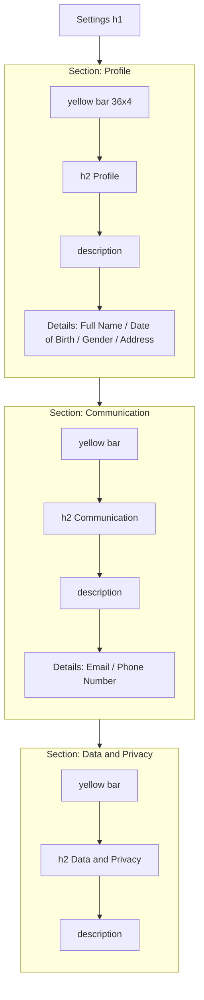
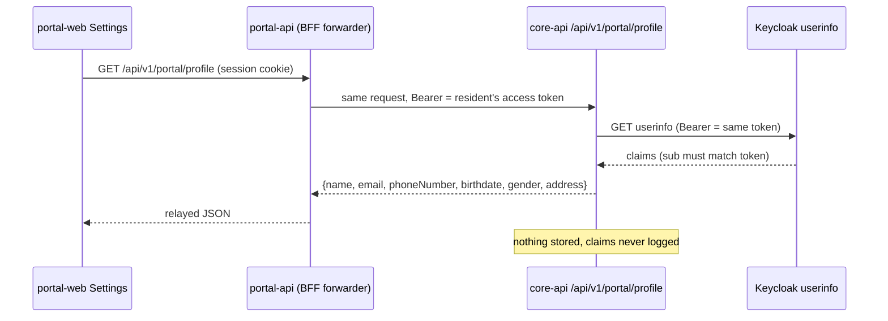

# Settings Profile and Communication Details - Plan

## Goal Capsule

- **Objective:** A signed-in resident opens Settings and sees their BC Services Card identity details and contact details. Each identity field the resident can change links to the official gov.bc.ca page where they change it.
- **Means:** Two new shared layout components in `@repo/design-system` (`Section`, `Details`), adopted by the portal settings page, fed by a live, unstored profile read in core-api (KTD1, KTD2).
- **Product authority:** This Product Contract. Editing contact details and real content for Data & Privacy are not active scope.
- **Execution profile:** Five units across `packages/design-system`, `apps/core-api` and `apps/portal-web`. U1, U2 and U4 are independent; U3 needs U4, and U5 needs U1, U2 and U3.
- **Stop conditions:** Stop and ask if implementing R17 or R19 would require storing a profile claim anywhere, or if the Settings `h1` cannot reach R18's type without overriding the design system globally.
- **Open blockers:** None.
- **Finishing:** `ce-work` implements and verifies; shipping follows the repo's normal PR flow.

---

## Product Contract

### Summary

Settings gets a reusable titled `Section` and a three-column `Details` list. Profile lists Full Name, Date of Birth, Gender and Address, each with its change link except Date of Birth. Communication lists Email and Phone Number. Profile values are read live on each visit and never stored.

### Problem Frame

`apps/portal-web/src/components/settings-page/index.tsx` renders three placeholder sections (Profile, Communication, Data & Privacy) with lorem-ipsum descriptions and no content. Residents can't see what the portal knows about them, and the page doesn't tell them where to correct their identity details. Those corrections happen through BC Services Card, not the portal.

### Key Decisions

- **Profile values are read live and never stored.** Date of birth and address never land in a session store or the database, which keeps PII retention to a minimum. Governs R17, R19. (session-settled: user-directed — chosen over snapshotting claims into the session at sign-in or persisting them on the core principal: less PII retained, at the cost of one request per visit)
- **The field is labelled "Gender".** It matches the BCSC `gender` claim and the gov.bc.ca `#gender` anchor. Governs R12. (session-settled: user-directed — chosen over "Sex")
- **Missing values keep their row and read "Not provided".** The layout stays stable and the resident sees the field exists. Governs R13. (session-settled: user-directed — chosen over hiding the row or leaving the value blank)
- **Unreleased claims fall back to "Not provided" rather than gating the release.** Governs R13. (session-settled: user-directed — chosen over making confirmed Keycloak claim release a ship gate: the fallback is acceptable until the mappers are added)
- **A failed profile load is contained to the sections that need it.** The rest of Settings still renders. Governs R14. (session-settled: user-approved — proposed in the scoping summary and confirmed)
- **Details rows stack on narrow screens.** Three columns don't fit at phone width. Governs R8. (session-settled: user-approved — proposed in the scoping summary and confirmed)
- **Communication rows have no third-column link.** The portal has nowhere to change email or phone yet. Governs R16. (session-settled: user-approved — proposed in the scoping summary and confirmed)

### Requirements

**Section component (`@repo/design-system`)**

- R1. `Section` renders a `section` element with an optional title (an `h2`), an optional description (a `p`) and optional children placed below them.
- R2. When a title is present, a 36px × 4px bar in the bcgov yellow brand colour sits at the section's top left, above the title.
- R3. The title is BC Sans Bold 20px with a 34px line height, and the description is BC Sans Regular 18px with a 30px line height.
- R4. When a title or description is present and children are present, a gap separates the heading block from the children. With no title and no description, children start at the top with no gap and no bar.
- R5. When a title is present, the section is labelled by its title for assistive technology.

**Details component (`@repo/design-system`)**

- R6. `Details` renders a description list (`dl`), one row per item: a `dt` label, a `dd` value and an optional second `dd` for supplementary content such as a link.
- R7. On wide screens the rows line up in three columns (label, value, extra), and every cell has generous padding.
- R8. At phone width each row stacks: label, then value, then extra.
- R9. A row without extra content still occupies its row correctly and leaves the third column empty.

**Settings page**

- R10. Profile, Communication and Data & Privacy each render through `Section` with their existing titles and their current placeholder descriptions. Data & Privacy has no children.
- R11. The Profile section contains a `Details` list with these rows, in order:

  | Label         | Value                                         | Extra                                                                                                                                          |
  | ------------- | --------------------------------------------- | ---------------------------------------------------------------------------------------------------------------------------------------------- |
  | Full Name     | resident's full name                          | external link to `https://www2.gov.bc.ca/gov/content/governments/government-id/bc-services-card/your-card/change-personal-information#name`    |
  | Date of Birth | long-form date, e.g. "January 5, 1980"        | none                                                                                                                                           |
  | Gender        | resident's gender                             | external link to `https://www2.gov.bc.ca/gov/content/governments/government-id/bc-services-card/your-card/change-personal-information#gender`  |
  | Address       | resident's address, one line per address line | external link to `https://www2.gov.bc.ca/gov/content/governments/government-id/bc-services-card/your-card/change-personal-information#address` |

- R12. The third row's label reads "Gender".
- R13. A row whose value is unavailable still renders and shows "Not provided" as its value. A Profile row keeps its change link.
- R14. If the profile values can't be loaded, the Profile and Communication sections each show a short error message in place of their list, and the rest of Settings still renders.
- R15. Change links read "Change" visibly, carry a per-field accessible name ("Change full name", "Change gender", "Change address"), open in a new tab, and are marked as external both visually and for assistive technology.
- R16. The Communication section contains a `Details` list with Email then Phone Number rows and no extra column content.
- R18. The page's "Settings" `h1` is BC Sans Bold 28px with a 42px line height.
- R20. While the profile values are loading, Profile and Communication show their title and description with a loading placeholder in place of their lists, and no row shows "Not provided" until the load has finished. The rest of Settings renders immediately.

**Data handling**

- R17. Date of birth, gender, address and phone number are fetched for the signed-in resident when Settings loads and are not written to the session, the database or browser storage. Full name and email keep their existing storage.
- R19. Sign-in never persists the date of birth, gender, address or phone claims. core-api already stores the userinfo claims it receives on the identity record, so that write must exclude these claims even after Keycloak starts releasing them.

### Layout

### Acceptance Examples

- AE1. **Covers R2, R4.** **Given** a `Section` with children but no title or description, **then** no yellow bar renders and the children start at the top with no gap.
- AE2. **Covers R2, R4.** **Given** a `Section` with a description and children but no title, **then** no bar renders, and a gap separates the description from the children.
- AE3. **Covers R13.** **Given** a resident whose token carries no phone number, **then** the Communication list still shows a Phone Number row reading "Not provided".
- AE4. **Covers R13, R11.** **Given** a resident with no address claim, **then** the Address row reads "Not provided" and still shows its change link.
- AE5. **Covers R14.** **Given** the profile request fails, **then** Profile and Communication each show an error message in place of their lists, and Data & Privacy and the page heading render normally.
- AE6. **Covers R8.** **Given** a phone-width viewport, **then** each Details row shows its label, value and link stacked vertically.

### Scope Boundaries

- Editing email, phone or any profile field in the portal is deferred.
- Content for the Data & Privacy section stays a placeholder.
- Real description copy for all three sections is deferred; their placeholder descriptions stay.
- Keycloak client mapper configuration is outside this repo and is not changed by this work.
- console-web doesn't adopt `Section` or `Details` in this work, though both live in the shared design system.

**Considered and not built**

- No backfill that strips profile claims from identity records already stored. Keycloak doesn't release these claims today, so no stored record should hold them; evidence of stored claims in any environment would change this call.
- No caching of the profile in core-api. Settings is a low-traffic page and one userinfo call per visit is the settled cost; measurable Keycloak load would change this call.

### Dependencies / Assumptions

- Assumption (unverified): the portal's Keycloak client releases `birthdate`, `gender`, `address` and `phone_number` through userinfo. Today the session holds only `name` and `email` (`packages/bff-core/src/session/session.types.ts`), and no code reads the other claims. If the claims aren't released, the affected rows show "Not provided" per R13 until the mappers are added.
- Assumption: when the mappers are added they release these claims to userinfo only, with "Add to userinfo" on and "Add to ID token" and "Add to access token" off, including the built-in `profile` scope's birthdate and gender mappers. portal-api's session keeps the user's tokens server-side, so a token carrying them would store them in the session, against R17 (see Risks).
- Assumption: `address` and `phone_number` reach userinfo only when the portal client's tokens carry the `address` and `phone` scopes. portal-api requests only `openid profile email` (`packages/auth/src/oidc-client.ts`), so those scopes must be default client scopes in Keycloak. Changing portal-api's requested scopes is out of scope. (session-settled: user-approved — chosen over having portal-api request the scopes: keeps claim release configured in Keycloak)
- The settings page is reachable only when signed in (`apps/portal-web/src/routes/_authenticated/settings.tsx`).

### Sources / Research

- `apps/portal-web/src/components/settings-page/index.tsx` and `settings-page.module.css`: the current local `SettingsSection` this replaces.
- `apps/portal-web/src/routes/_authenticated/settings.test.tsx`: existing test asserting the three section headings.
- `packages/bff-core/src/auth/core-api-login.ts`: core-api reads `name` and `email` from Keycloak userinfo at sign-in.
- `apps/core-api/src/auth/userinfo.client.ts`: existing userinfo client, called with the caller's own token and verified subject.
- `apps/core-api/src/principals/principals.service.ts`: `persistableClaims` strips only token claims before sign-in writes userinfo claims to the identity record (R19).
- `apps/core-api/src/auth/audience.guards.ts`: `PortalGuard` admits portal-client person tokens on `/api/v<N>/portal/*`; `apps/portal-api/src/bff/bff-options.ts` already forwards the `portal` audience.
- `node_modules/@bcgov/design-tokens` 5.1.0 `css/variables.css`: `--theme-primary-gold` (#fcba19), `--typography-bold-h5` (700 20px/34px), `--typography-regular-large-body` (400 18px/30.6px), `--layout-padding-*`, `--layout-margin-*`.

Product Contract preservation: restructured, no scope change: R20 moved from Data handling to Settings page; the three Deferred-to-Planning questions are resolved in KTD1, KTD4 and KTD6; one Key Decision added recording the user's choice not to gate release on Keycloak claims.

---

## Planning Contract

### Key Technical Decisions

- KTD1. **core-api owns the profile read through a new `GET /api/v1/portal/profile` route.** It calls Keycloak userinfo with the caller's token via the existing `UserinfoClient` and returns the six display fields, normalized. Access tokens don't reliably carry profile claims (the reason `UserinfoClient` exists), and core-api owns the rules per the three-apps architecture. portal-api's existing forwarder already relays `portal` routes, so the BFF doesn't change. Implements R17 (governed by the live-read Key Decision).
- KTD2. **Settings reads Full Name and Email from the same profile response, not the session.** One request gives all six rows one loading and one error state (R14, R20), and nothing new is stored (R17).
- KTD3. **userinfo failures map the way sign-in maps them.** A refused token is 401, and an unreachable or invalid userinfo is 503. Both are logged with `describeError` and never with claim values. portal-web treats any non-2xx as a failed load (R14).
- KTD4. **core-api normalizes, portal-web formats.** The route returns `birthdate` as the claim's `YYYY-MM-DD` string, `gender` as the raw claim, and `address` as an array of lines: the claim's `formatted` value split on newlines, else street address, locality and region, postal code, and country as lines, else `null`. portal-web formats the date as long-form `en-CA` in UTC so it never shifts a day. It maps `male`, `female` and `diverse` to "Male", "Female" and "Diverse", treats `unknown` or empty as missing (R13), and shows any other value as sent. A birthdate that isn't a full date is shown as sent.
- KTD5. **Sign-in strips profile claims next to the token claims.** `persistableClaims` also drops `birthdate`, `gender`, `address`, `phone_number` and `phone_number_verified` (R19). The list lives once, in a small core-api auth module both U3 and U4 import.
- KTD8. **core-api warns when a verified token carries profile claims.** Keycloak's built-in `profile`, `address` and `phone` mappers add their claims to the ID and access tokens by default, and portal-api keeps those tokens in the session, which would break R17 with no code change here. At sign-in and on the profile route, core-api logs a warning naming only the KTD5 claim keys found in the caller's verified access-token claims, never their values. This is the smallest tripwire that turns a silent R17 breach into a visible one.
- KTD6. **Styling uses bcgov tokens wherever one matches the spec exactly.** The bar uses `--theme-primary-gold`, the title `--typography-bold-h5`, and cell padding and gaps the `--layout-*` tokens. The description (18px/30px) and the Settings `h1` (28px/42px) have no exact token, so they set the BC Sans font, weight, size and line height explicitly. Stacking uses the 768px breakpoint the repo already uses.
- KTD7. **portal-web adopts console-web's FontAwesome setup for the external-link icon.** It sets `config.autoAddCss = false` and imports the stylesheet, so the first icon injects no `<style>` the edge CSP would block (AGENTS.md).

### High-Level Technical Design

### Risks

- **Mappers that put claims in tokens.** Keycloak's built-in profile, address and phone mappers add their claims to the ID and access tokens by default, so the tokens portal-api keeps in the session would carry them and break R17. Mitigation: the KTD8 warning detects it in core-api, and the Dependencies assumption names the mapper settings (userinfo on, ID and access token off) for whoever configures Keycloak.
- **The bcgov `Heading` may out-specify a page class.** Setting R18's type through a `className` on the design-system `Heading` may lose to the component's own styles. U5 verifies the computed style and falls back to a plain `h1` styled by the page's CSS module if the class doesn't win.
- **Fixed styles from new design-system components.** The loading and error states use the design system's `ProgressCircle` and `InlineAlert`. If either injects a fixed `<style>`, `apps/portal-web/src/csp-hashes.test.ts` fails and the hash goes into `caddy/Caddyfile` per AGENTS.md.

---

## Implementation Units

### U1. Section component

**Goal:** A shared `Section` in `@repo/design-system` that renders the titled, described block the settings page and later pages use.

**Requirements:** R1, R2, R3, R4, R5; AE1, AE2.

**Dependencies:** None.

**Files:**

- `packages/design-system/src/components/section/section.tsx` (create)
- `packages/design-system/src/components/section/section.module.css` (create)
- `packages/design-system/src/components/section/index.ts` (create)
- `packages/design-system/src/components/section/section.test.tsx` (create)
- `packages/design-system/src/components/components.test.ts` (add `section` to the `custom` map)

**Approach:**

1. Props: optional `title`, optional `description`, optional `children`, optional `className`. Render plain `h2` and `p` rather than the bcgov `Heading`/`Text`, so R3's type is set exactly by the module CSS.
2. When a title exists, label the section with it through `aria-labelledby` and a `useId` id, as `SettingsSection` does today.
3. Draw the bar as a pseudo-element on the heading block, rendered only when the title exists (KTD6).
4. Wrap title and description in a heading block. The section is a flex column whose gap applies only when both a heading block and children exist (R4), and child margins are reset as the current settings CSS does.

**Patterns to follow:** `packages/design-system/src/components/avatar/` (props interface with doc comments, CSS module, colocated test, `index.ts` re-export); `apps/portal-web/src/components/settings-page/index.tsx` for the labelled section.

**Test scenarios:**

- A section with title, description and children renders a `region` named by the title, an `h2` with the title, a `p` with the description, and the children after them.
- Covers AE1. A section with only children renders no `h2`, no bar element or class, and no gap wrapper.
- Covers AE2. A section with description and children but no title renders the `p` and children, has no accessible name, and has no bar.
- A section with a title and no children renders the heading block only.
- `className` is merged onto the `section` element.

**Verification:** The component tests pass. The package-exports and components tests list `section`. The built `styles.css` contains the section rules.

### U2. Details component

**Goal:** A shared `Details` description list with label, value and optional extra columns that stacks on phones.

**Requirements:** R6, R7, R8, R9; AE6.

**Dependencies:** None.

**Files:**

- `packages/design-system/src/components/details/details.tsx` (create)
- `packages/design-system/src/components/details/details.module.css` (create)
- `packages/design-system/src/components/details/index.ts` (create)
- `packages/design-system/src/components/details/details.test.tsx` (create)
- `packages/design-system/src/components/components.test.ts` (add `details` to the `custom` map)

**Approach:**

1. Props: `items`, each with a stable `id`, a `label`, a `value` (React node) and an optional `extra` (React node), plus optional `className` and an optional accessible label for the list.
2. Markup is a `dl` whose rows are `div` wrappers holding `dt`, `dd` and, only when `extra` exists, a second `dd`.
3. Each row is a three-column grid with the same column template, so the columns line up across rows. The extra `dd` always sits in column 3, so a missing extra leaves that column empty (R9). Every cell gets `--layout-padding-medium` padding, and `dd` margins are reset.
4. At `max-width: 768px` each row becomes one column (R8, KTD6).

**Patterns to follow:** `packages/design-system/src/components/avatar/`; the 768px media query in console-web's app shell CSS.

**Test scenarios:**

- Three items render one `dl`, three `dt` elements with the labels, and their value `dd` elements in order.
- An item with `extra` renders a second `dd` containing that node, and an item without it renders exactly one `dd`.
- An empty `items` array renders an empty `dl` without error.
- React node values (a multi-line address, a link) render unchanged inside their `dd`.
- Covers AE6. The stylesheet carries a 768px media query that turns rows into one column (asserted on the CSS module source, since jsdom doesn't lay out).

**Verification:** The component tests pass, the package builds, and the export tests list `details`.

### U3. core-api portal profile route

**Goal:** core-api answers `GET /api/v1/portal/profile` with the resident's live, normalized profile and stores nothing.

**Requirements:** R11, R13, R16, R17 (Key Decision "Profile values are read live and never stored"); KTD1, KTD3, KTD4, KTD8.

**Dependencies:** U4 (the shared profile-claim list and token warning).

**Files:**

- `apps/core-api/src/profile/profile.portal.controller.ts` (create)
- `apps/core-api/src/profile/profile.schemas.ts` (create: zod response schema)
- `apps/core-api/src/profile/profile-view.ts` (create: claims to response mapping)
- `apps/core-api/src/profile/profile.module.ts` (create)
- `apps/core-api/src/app.module.ts` (import the module)
- `apps/core-api/src/profile/profile.portal.controller.test.ts` (create)
- `apps/core-api/src/profile/profile-view.test.ts` (create)

**Approach:**

1. The controller is guarded by `PortalGuard`, takes `@CurrentCaller()`, and calls `UserinfoClient.profile(caller.token, caller.user)`.
2. Map `UserinfoError` exactly as `PrincipalsController.profile` does (KTD3). Log only `describeError(error)`, never the claims.
3. The view maps the raw userinfo claims to `{ name, email, phoneNumber, birthdate, gender, address }`. Each field is a non-empty string or `null`, and `address` is a non-empty string array or `null` (KTD4). Take `name` from the `name` claim, else `given_name` plus `family_name`, else `null`. Don't use `AuthUser.name`, whose fallback to username, email or subject would never read "Not provided" (R13).
4. Before calling userinfo, run U4's token-claim warning on `caller.user.claims` (KTD8).
5. Declare the response with `@ApiOkResponse({ standardSchema })` and the 401/403/503 responses, as `MeController` does.

**Patterns to follow:** `apps/core-api/src/me/me.controller.ts` (versioned route, guard, swagger decorators); `apps/core-api/src/principals/principals.controller.ts` (userinfo call and error mapping); `apps/core-api/src/feature-flags/feature-flags.shared.controller.test.ts` (test app, `t.idp` tokens).

**Test scenarios:**

- With userinfo returning name, email, `phone_number`, `birthdate`, `gender` and an `address.formatted` with two lines, a portal token gets 200 and every field normalized, with the address as two lines.
- With userinfo returning only `sub`, `name` and `email`, the response has `phoneNumber`, `birthdate`, `gender` and `address` all `null`.
- With userinfo returning only `sub`, `preferred_username` and `email`, `name` is `null`. With only `given_name` and `family_name`, `name` joins them.
- A portal token whose claims include `birthdate` produces one warning naming `birthdate`, and no log line contains the birthdate value.
- An address with no `formatted` value but with street, locality, region and postal code becomes lines in that order. An address object with only empty strings becomes `null`.
- A console-client token gets 403, a service-account token gets 403, and no token gets 401.
- userinfo down (`userinfoMode: 'down'`) gives 503. A refused token (`'reject'`) gives 401. A wrong subject (`'wrong-subject'`) gives 503.
- After a successful call, the `identities` and `principals` rows are unchanged: the route writes nothing.

**Verification:** The route tests pass, and the route appears in core-api's generated OpenAPI under the `portal` tag.

### U4. Keep profile claims out of sign-in storage

**Goal:** Sign-in never writes the KTD5 profile claims to the identity record, even once Keycloak releases them, and warns when a token already carries them.

**Requirements:** R17, R19 (Key Decision "Profile values are read live and never stored"); KTD5, KTD8.

**Dependencies:** None.

**Files:**

- `apps/core-api/src/auth/profile-claims.ts` (create: the KTD5 list and the KTD8 warning helper)
- `apps/core-api/src/auth/profile-claims.test.ts` (create)
- `apps/core-api/src/principals/principals.service.ts` (modify)
- `apps/core-api/src/principals/principals.controller.ts` (modify: run the warning at sign-in)
- `apps/core-api/src/principals/principals.service.test.ts` (modify)
- `apps/core-api/src/principals/principals.controller.test.ts` (modify)

**Approach:**

1. `profile-claims.ts` exports the KTD5 claim names and a helper that takes a logger and verified claims and logs one warning listing the keys present, never their values.
2. `persistableClaims` drops those names as well as `TOKEN_CLAIMS`, with a comment pointing at R19.
3. The sign-in route runs the helper on `caller.user.claims` before reading userinfo.

**Test scenarios:**

- The helper given claims with `birthdate` and `address` logs one warning naming both keys, and the log contains neither value. Given claims with none of them, it logs nothing.
- Sign-in with a portal token carrying `gender` logs the warning and still succeeds.
- `persistableClaims` given `birthdate`, `gender`, `address`, `phone_number`, `phone_number_verified`, `email` and a custom claim returns only `email` and the custom claim.
- An integration test signs in through `/internal/principals/login` with the fake IdP's userinfo profile carrying all four claims, then asserts the stored `identities.claims` has none of them and still has `email`.
- An existing sign-in test's stored claims stay the same when no profile claims are present.

**Verification:** The principals tests pass, and the new integration test fails if the exclusion is removed.

### U5. Settings page on Section and Details

**Goal:** Settings renders all three sections through `Section`, fills Profile and Communication from the live profile, and handles loading, error and missing values.

**Requirements:** R10, R11, R12, R13, R14, R15, R16, R18, R20; AE3, AE4, AE5; KTD2, KTD4, KTD7.

**Dependencies:** U1, U2, U3.

**Files:**

- `apps/portal-web/src/profile/api.ts` (create: fetch and validate the profile)
- `apps/portal-web/src/profile/use-profile.ts` (create: React Query hook)
- `apps/portal-web/src/profile/format.ts` (create: date and gender display, "Not provided")
- `apps/portal-web/src/profile/format.test.ts` (create)
- `apps/portal-web/src/components/settings-page/index.tsx` (modify)
- `apps/portal-web/src/components/settings-page/profile-details.tsx` (create)
- `apps/portal-web/src/components/settings-page/communication-details.tsx` (create)
- `apps/portal-web/src/components/settings-page/change-link.tsx` (create)
- `apps/portal-web/src/components/settings-page/settings-page.module.css` (modify: h1 type, drop the old section rules)
- `apps/portal-web/src/font-awesome.ts` (create), `apps/portal-web/src/main.tsx` and `apps/portal-web/src/test-setup.ts` (call it)
- `apps/portal-web/package.json` (add `@fortawesome/fontawesome-svg-core` from the catalog)
- `apps/portal-web/src/routes/_authenticated/settings.test.tsx` (modify)

**Approach:**

1. `api.ts` mirrors `auth/api.ts`. It fetches `/api/v1/portal/profile` with same-origin credentials, reads the body on non-2xx before throwing, and validates the shape with a type guard. `use-profile.ts` wraps it in `useQuery` with the in-memory cache only (R17) and `retry: false`, as `currentUserQueryOptions` does, so R14's error shows as soon as the request fails rather than after React Query's default retries.
2. `format.ts` holds the KTD4 rules and returns "Not provided" for any missing value (R13).
3. `ChangeLink` is the design-system `Link` with `href`, `target="_blank"`, `rel="noopener noreferrer"`, and visible text "Change". It also takes an `ariaLabel` such as "Change full name (opens in a new tab)" and an `iconRight` external-link icon from `@repo/design-system/icons` marked `aria-hidden` (R15).
4. `ProfileDetails` and `CommunicationDetails` each take the query state. While pending they render a `ProgressCircle` labelled for loading (R20). On error they render an `InlineAlert` with a short message (R14). On success they render `Details` with the R11 and R16 rows.
5. `SettingsPage` keeps the `Heading` level 1 and `Separator`, renders the three `Section`s with their current titles and descriptions (R10), and applies the R18 type to the `h1` (see Risks).

**Patterns to follow:** `apps/portal-web/src/auth/api.ts` and `use-current-user.ts`; `apps/console-web/src/font-awesome.ts`; the fetch stub in `settings.test.tsx`.

**Test scenarios:**

- With a full profile, Settings shows the h1, three `h2`s in order, and the Profile rows Full Name, Date of Birth, Gender and Address with values. Date of Birth reads "January 5, 1980" for `1980-01-05`, and Gender reads "Female" for `female`.
- Each Profile change link except Date of Birth has the gov.bc.ca href with its `#name`, `#gender` or `#address` anchor, `target="_blank"`, and an accessible name starting with "Change full name", "Change gender" or "Change address".
- Covers AE3. A profile with `phoneNumber: null` shows the Phone Number row reading "Not provided".
- Covers AE4. A profile with `address: null` shows the Address row reading "Not provided" with its change link present.
- Gender `unknown` shows "Not provided". An unrecognized gender value shows as sent. A birthdate of `1980` shows as sent.
- Covers AE5. A 503 from the profile endpoint shows an alert in Profile and in Communication, while the h1 and the Data & Privacy section render normally. The alerts appear after a single request, with no retries.
- While the profile request is pending, Profile and Communication show their titles, their descriptions and a loading indicator, and no "Not provided" text appears (R20).
- Data & Privacy renders its title and description with no list.
- The existing signed-out redirect test still passes.

**Verification:** portal-web tests pass, including `csp-hashes.test.ts`. In the running app (`https://sdg.localhost/settings`), the h1 computes to 28px/42px bold, the section bars show, and rows stack at phone width.

---

## Verification Contract

| Check                      | Command                                                                  | Applies to |
| -------------------------- | ------------------------------------------------------------------------ | ---------- |
| Unit and integration tests | `pnpm test` (or `pnpm --filter <pkg> test` while iterating)              | U1–U5      |
| Types                      | `pnpm typecheck`                                                         | U1–U5      |
| Lint                       | `pnpm lint`                                                              | U1–U5      |
| Formatting                 | `pnpm format:check`                                                      | U1–U5      |
| Library build and exports  | `pnpm --filter @repo/design-system build`                                | U1, U2     |
| Edge CSP hashes            | `apps/portal-web/src/csp-hashes.test.ts` (part of `pnpm test`)           | U5         |
| Visual check               | Local stack at `https://sdg.localhost/settings`, desktop and phone width | U5         |

---

## Definition of Done

- Every unit's test scenarios exist and pass, and `pnpm test`, `pnpm typecheck`, `pnpm lint` and `pnpm format:check` are clean.
- No file over 300 lines and no function over 50 lines (global standards).
- `GET /api/v1/portal/profile` writes nothing, and sign-in stores none of the KTD5 profile claims (tests in U3 and U4 prove both).
- No profile claim value appears in a log call, a session field or browser storage.
- Settings shows loading, error, full and missing-value states as R13, R14 and R20 describe, verified in the running app.
- The old local `SettingsSection` and its CSS are removed, and no experimental or abandoned code remains in the diff.
