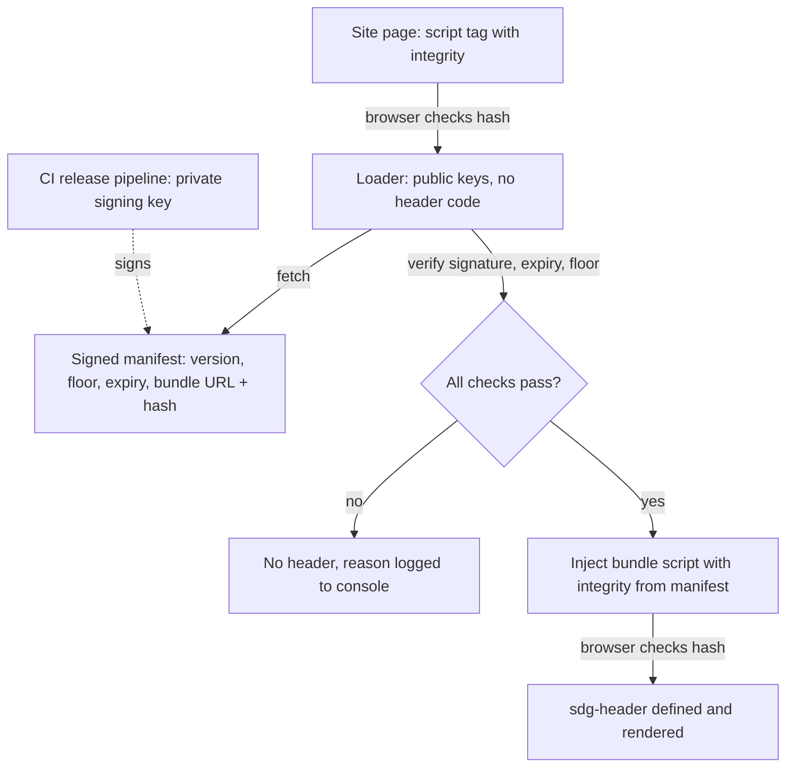
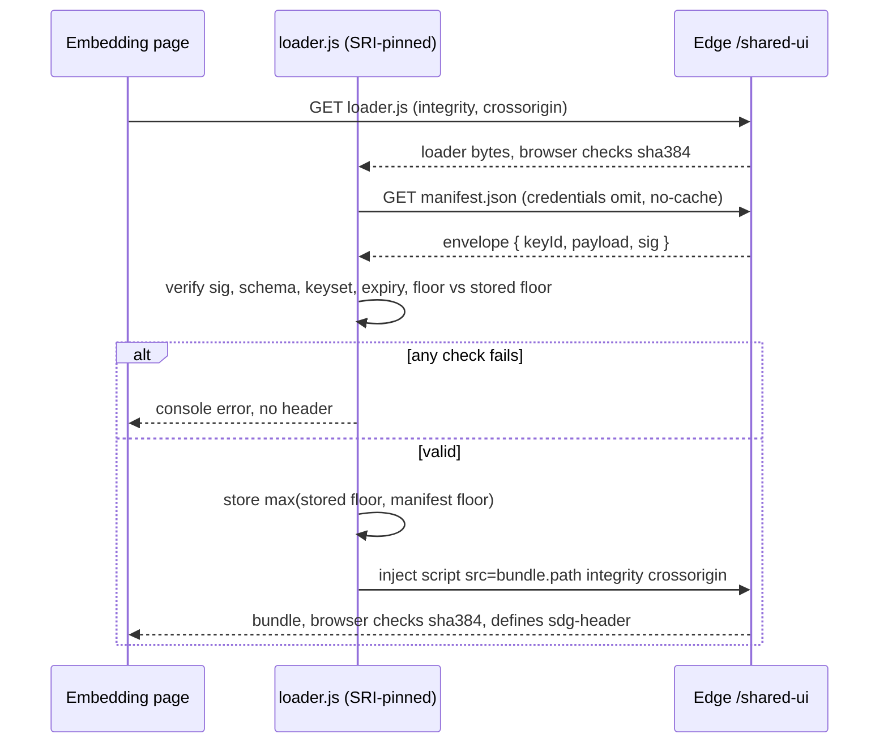
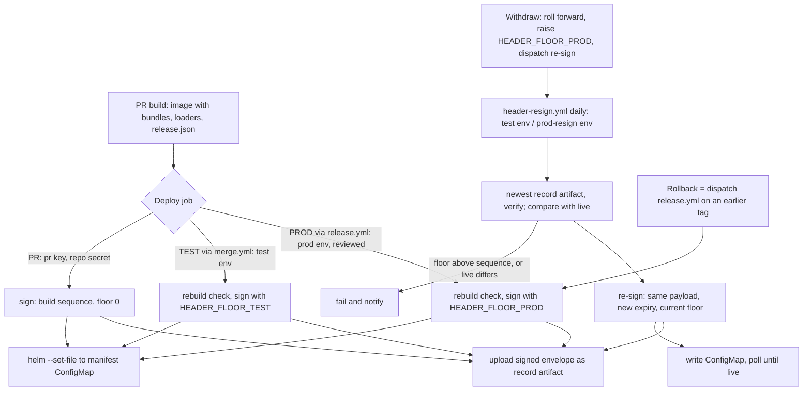

# Shared UI Header Integrity - Plan

## Goal Capsule

- **Objective:** Every site that embeds the SDG header can pin what it loads with Subresource Integrity, and only code released by this team's CI can run as the header on those sites, even if the edge or the `shared-ui` host is compromised. For sites whose own pages this edge serves (this repo's apps), a compromised edge stays out of reach of the guarantee, since it serves the page that carries the loader tag. Header releases and rollbacks still reach visitors on their next page load, with no change on the embedding site.
- **Means:** An SRI-pinned loader that never changes. It verifies a CI-signed release manifest and loads that release's immutable bundle with the manifest's hash as its `integrity` (R1, R5, R11).
- **Product authority:** This Product Contract wins on behavior. It amends the delivery model in `docs/plans/2026-11-17-1242-feat-shared-ui-header-plan.md`: the floating unsigned script URL is replaced, while one delivery path for every site, in-repo apps included, still holds.
- **Stop conditions:** Stop and ask if a requirement can only be met by giving a reviewer-free workflow a credential broader than writing the header manifest, by serving the header from a new hostname, or by changing a repository or organization setting directly (setup scripts are changed in code and previewed only).
- **Execution profile:** U1 → U2 → U3 → U4, then U5 → U6 → U7, then U8 → U9. Each unit leaves `pnpm typecheck`, `pnpm lint` and the touched packages' tests green.
- **Finishing:** One PR to `main` from a feature branch. Before the PR's first deploy, a person stores the `pr` signing secret. Before merge, a person applies U7's setup scripts with `--apply` (branch and tag policies and `prod-resign` first), then stores the TEST and PROD signing secrets and the floor variables, because every deploy signs and fails without its key. Deploys run through the existing PR → TEST → PROD workflows, never from a workstation.
- **Open blockers:** None.

---

## Product Contract

### Summary

Sites embed a small loader instead of the header script. The loader is pinned with `integrity` and never changes within a major. It fetches a release manifest signed by CI, checks the signature, refuses expired releases and releases below the remembered or manifest floor, then loads the release's immutable bundle with the bundle's hash as its `integrity`. The current unsigned always-latest URL stops being served.

### Problem Frame

The header runs with full page privileges on every site that embeds it. Today sites load it from a URL whose bytes change with every release (`/shared-ui/header/v1/sdg-header.js`, served `no-cache`). No `integrity` attribute is possible, and `packages/shared-ui/README.md` says so in its Trust section. A site therefore runs whatever the edge or the `shared-ui` container serves. If either is compromised, every embedding site runs the attacker's code. The security team will flag the missing integrity. Exact-build pinning would satisfy them but would end the property the header was built for: sites get fixes without redeploying.

### Key Decisions

- **Integrity means "released by this team's CI", not one exact build.** The guarantee an evergreen component can honestly give is that the bytes were signed by the release pipeline. Trust moves from the serving host to the signing key and CI. (session-settled: user-directed — chosen over exact-build pinning with automated version bumps and over offering both: the security team accepts signed releases, and pinning ends automatic releases.) Governs R5, R6, R8, R11.
- **The loader replaces the unsigned URL now.** No migration window and no parallel unsigned path, so no unprotected embed remains. (session-settled: user-directed — chosen over retiring the old URL on a deadline and over keeping both indefinitely.) Governs R2.
- **Replay is blocked per site by a per-visitor remembered floor, with a long manifest expiry bounding everyone else's exposure.** A floor carried only inside the manifest can be replayed together with the old manifest, so each visitor's browser remembers the highest floor it has seen on that site. For visitors with no remembered floor, the expiry limits how long a withdrawn release stays replayable (R16). (session-settled: user-directed — chosen over a remembered floor alone, which leaves first-time visitors exposed, over short-lived signatures, which make a stalled re-signing job remove the header within days, and over accepting the gap.) Governs R9, R10, R15.
- **The floor is raised only to withdraw a release.** Ordinary releases and rollbacks leave it unchanged, so rolling back to a release above the floor keeps working for visitors who have seen newer releases. Governs R10, R14.
- **A failed check means no header, never an unverified one.** The visitor sees the same reserved empty band as when the script cannot load, which sites already have to tolerate. Governs R12.
- **In-repo React apps load through the loader as well.** This keeps the one-delivery-path decision from the header plan: in-repo apps run exactly what external sites run. Governs R3.
- **The loader trusts a backup key alongside the primary.** Rotating away from a lost primary key then needs no change to embedding sites. A compromised key, primary or backup, stays trusted by the loader, so recovering from one needs a new loader, the same as losing both keys. Governs R7.

### Trust chain

### Requirements

**Embedding**

- R1. A site embeds the header with one loader script tag that carries `integrity` and `crossorigin`. Within a major, the loader's URL and bytes never change.
- R2. Once the loader ships, the unsigned always-latest header URL is no longer served, and the loader is the only supported way to embed the header.
- R3. The in-repo React wrapper (`SdgHeader` in `@repo/shared-ui/header/react`) loads the header through the loader.
- R4. The loader contains no header code, only what it needs to verify a release and load it.

**Signed releases**

- R5. Every release publishes a manifest naming its version, its immutable bundle URL, the bundle's hash, the minimum allowed version and an expiry. The manifest is signed by CI.
- R6. The signing private keys are never reachable from the edge, the `shared-ui` image or the cluster that serves them. Each environment's key is usable only by that environment's deploy workflow, the TEST key also by the scheduled re-signing workflow's TEST job, the PROD-trusted key only by the release workflow behind the protected `prod` environment and by a dedicated scheduled re-signing workflow that runs from `main` without a reviewer gate and can re-sign only the current release record (R15), and no PR workflow holds a key that a TEST or PROD loader trusts. The backup private key is held offline or under separate custody, is not available to routine release or re-signing jobs, and is used only to rotate.
- R7. The loader trusts a primary and a backup public key, and either one's valid signature is accepted.

**Verification in the browser**

- R8. The loader refuses a manifest whose signature does not verify against a trusted key.
- R9. The loader refuses a manifest past its expiry. Expiry is set around 90 days after signing.
- R10. The loader remembers, per visitor on each embedding site, the highest minimum version it has seen. It refuses a release below that remembered floor or below the manifest's own floor.
- R11. The loader loads the bundle with the manifest's hash as its `integrity`, so the browser refuses any other bytes.
- R12. When any check in R8–R11 fails, no header is defined. The page keeps the reserved empty band, and the loader logs the reason to the console.

**Releasing and operating**

- R13. A new release or a rollback reaches visitors on their next page load, with no change on the embedding site. A rollback serves the target release's bundle with a freshly signed manifest carrying a new expiry and the current floor, never the manifest built with that release.
- R14. The minimum version rises only when a release is deliberately withdrawn, for example after a security fix. Withdrawing the newest release is a roll-forward: the last good code is re-released under a version above the bad one and the floor is raised to it, because a rollback alone withdraws nothing.
- R15. Manifests are re-signed on a schedule well inside the expiry window, and a failed re-signing alerts the team long before any manifest expires. The re-signing job takes the version, bundle URL, bundle hash and floor only from CI's own record of the current release, or from the previous manifest after verifying its signature against a trusted key, never from content read back from the edge, the `shared-ui` image or the cluster.
- R16. The shared-ui README tells implementers how to embed the loader with `integrity`, which CSP allowances it needs (the portal host in both `script-src` and `connect-src`, since the loader fetches the manifest), what each failed check looks like to visitors, and what the integrity guarantee covers and does not cover. Its limits are: a compromised signing key needs a new loader; a withdrawn release stays replayable until its manifest expires (up to about 90 days) to any visitor with no remembered floor on that site, including first visits, private browsing, cleared or blocked storage and visitors arriving from other sites; and sites whose pages this edge serves have no protection from a compromised edge.

### Acceptance Examples

- AE1. **Covers R11, R12.** Given a compromised host serves a modified bundle at the manifest's bundle URL, when a visitor loads a site, then the browser refuses the bundle and no header appears.
- AE2. **Covers R8, R12.** Given a compromised host serves a manifest pointing at its own bundle, signed with a key the loader does not trust, when a visitor loads a site, then the loader refuses the manifest and no header appears.
- AE3. **Covers R10.** Given a visitor has seen a manifest with minimum version 1.4.0, when a compromised host replays an older validly signed manifest for release 1.3.2 with minimum 1.0.0, then the loader refuses it.
- AE4. **Covers R9, R10.** Given a first-time visitor with no remembered floor, when the host replays a validly signed manifest whose expiry has passed, then the loader refuses it.
- AE5. **Covers R13, R14.** Given release 1.6.0 is live with minimum 1.4.0 and the team rolls back to 1.5.0, when a visitor who loaded 1.6.0 returns, then 1.5.0 loads because it is above the floor.
- AE6. **Covers R10, R14.** Given 1.6.0 is withdrawn by re-releasing 1.5.0's code as 1.6.1 with minimum 1.6.1, when a compromised host replays the still-unexpired 1.6.0 manifest to a visitor who has seen 1.6.1 on that site, then the loader refuses it.
- AE7. **Covers R1.** Given a site's loader tag carries an `integrity` that does not match the served loader, when a visitor loads the site, then the browser refuses the loader and no header appears.

### Success Criteria

- The security team accepts the header's delivery: every header script on an embedding page carries `integrity`, and the trust model in R6 holds.
- Automated tests show each refusal case in AE1–AE4, AE6 and AE7 failing closed, and AE5 loading.

### Scope Boundaries

- **Deferred:** exact-build pinning (immutable versioned URLs with published hashes) for sites whose policy demands it.
- **Deferred:** moving to native signature-based SRI (`integrity` with a public key) once browsers support it widely. It would replace the loader's own verification.
- **Not in scope:** protecting against a compromised signing key or CI pipeline. That is the trust anchor this design moves to, not a threat it addresses.
- **Not in scope:** changes to the header's attributes, slots, events, look or reserved height.

### Dependencies / Assumptions

- No site outside this repo embeds the header yet. The header shipped on 2026-11-17, and replacing the URL now (R2) breaks any site that does until it changes its script tag.
- Embedding sites send `crossorigin` on the loader tag. The edge already answers `/shared-ui/*` with `Access-Control-Allow-Origin: *` and `Cross-Origin-Resource-Policy: cross-origin` (`apps/portal-web/caddy/Caddyfile`), which SRI on cross-origin scripts needs.
- Only the current release's bundle has to be served, since the manifest names one bundle. This keeps the header plan's decision not to store every published build.

### Outstanding Questions

**Deferred to Implementation**

- How the re-signer's ConfigMap write and Helm 4's server-side apply share field ownership (for example, writing with Helm's field manager, or forcing conflicts on upgrade). The outcome is fixed by U6's verification: a re-sign followed by a `helm upgrade` on the PR environment must succeed.

### Sources / Research

- `docs/plans/2026-11-17-1242-feat-shared-ui-header-plan.md`: the header's delivery decisions (one path for every site, floating major URLs, no stored builds).
- `packages/shared-ui/README.md`: Trust section and embedding steps that R16 rewrites.
- `packages/shared-ui/Caddyfile`: `no-cache` on `/header/*/sdg-header.js`.
- `packages/shared-ui/src/header/contract.ts`: `HEADER_MAJOR` and the breaking-change rule.
- `packages/shared-ui/src/header/react/sdg-header.tsx`: the React wrapper's same-origin script default.
- W3C Subresource Integrity: `integrity` on script elements, including ones injected dynamically.
- WICG signature-based SRI: shipped in Chromium M141 only; Gecko has no signal and WebKit's position is open, so it stays a future path (Scope Boundaries).

---

## Planning Contract

**Product Contract preservation:** changed: R6 — the TEST key is also usable by the scheduled re-signer's TEST job (approved after document review); R16 — adds the `connect-src` allowance implementers need because the loader fetches the manifest (confirmed in the planning summary). The Goal Capsule gains stop conditions, execution profile and finishing. The planning questions the brainstorm deferred are resolved below; one implementation detail stays open. Wherever the Product Contract says "minimum version" or "floor" (R5, R10, R14, AE3, AE5, AE6), the plan means the `sequence` value of KTD3, and `HEADER_FLOOR_TEST` and `HEADER_FLOOR_PROD` hold that number.

### Key Technical Decisions

- KTD1. **ECDSA P-256 with SHA-256, IEEE P1363 signatures.** CI signs with `node:crypto` (`dsaEncoding: 'ieee-p1363'`), and the loader verifies with `crypto.subtle`. Every browser in use has supported this for years, while Ed25519 arrived only in Safari 17, Firefox 129 and Chrome 137. (session-settled: user-approved — chosen over Ed25519: older browsers would lose the header.) Governs R8.
- KTD2. **A signed envelope over exact bytes.** `manifest.json` is `{ keyId, payload, sig }`, where `payload` is the base64url of the manifest bytes and the signature covers `"sdg-header-manifest-v1\n"` followed by those bytes. The loader decodes the payload only after the signature verifies and reads no unsigned field. The payload holds `schema`, `keyset`, `version` (display label), `sequence`, `floor`, `issuedAt`, `expires` and `bundle { path, integrity }`. `bundle.path` must be a content-hashed path under `/shared-ui/header/v1/bundles/`, resolved against the loader's own origin.
- KTD3. **Releases are ordered by a build sequence, not semver.** The build stamps `sequence` (build time in milliseconds) into `release.json`, and every signature of that build carries the same value. The floor is a sequence value. This orders TEST and PR deploys, which have no semver. A rollback to an older build above the floor loads for visitors who saw newer releases (AE5). Redeploying withdrawn code is refused, because its sequence stays below the floor (KTD8). Governs R10, R13, R14.
- KTD4. **The remembered floor lives in `localStorage` under `sdg-header:floor:<keyset>:v<major>`.** If storage throws or is empty, the loader uses the manifest floor alone and logs that it did. That is the exposure R16 documents. Governs R10.
- KTD5. **One committed loader per keyset, locked by hash.** The keysets are `pr`, `test`, `prod` and a local-only `dev`. Each has a primary and a backup public key committed under `packages/shared-ui/keys/`. The built loaders are committed under `packages/shared-ui/loaders/<keyset>/loader.js`, and the image copies those bytes rather than rebuilding them, so toolchain updates never change the served loader. Only an explicit `build:loaders` script regenerates them. That is a breaking change (R1), and `packages/shared-ui/loaders.lock.json` records each committed loader's sha384. The `shared-ui` Caddy serves `/header/v1/loader.js` from the keyset named by `HEADER_KEYSET`, so one promoted image serves every environment. The `dev` private key is committed and trusted only by the `dev` loader. Governs R1, R4, R7.
- KTD6. **The manifest reaches pods through a ConfigMap, and bundles ship in the image.** The deploy job signs, then passes the manifest to Helm with `--set-file`. The `shared-ui` chart renders it into a fixed-name ConfigMap, mounted as a directory outside `/srv` and never with `subPath`, so updates reach running pods. Caddy serves it at `/header/v1/manifest.json` with `no-cache`. Bundles are served `public, max-age=31536000, immutable`, and the loader `no-cache`. Images stay build-once and promote-unchanged. Governs R5, R13.
- KTD7. **Signing inputs come from CI-owned sources only.**
  - **New releases (TEST and PROD):** the signer reads `release.json` (bundle path, integrity, sequence) from the image being deployed. It then checks out the deployed commit, rebuilds the shared-ui CDN bundle, and refuses to sign unless the rebuilt bundle's sha384 equals `release.json`'s integrity. A PR workflow can overwrite a PR-number image tag, so the tag alone is not trusted.
  - **Record of each signature:** every signing run, deploy or re-sign, uploads its signed envelope as a workflow artifact for its environment.
  - **Re-signing:** the re-signer takes its input from the newest such artifact, verified against the keyset's public keys. An expired signature on that record is accepted, since it is CI's own record. It fetches the live manifest only to compare: when the live sequence differs from the record, it fails and notifies rather than re-signing edge content.

  Governs R6, R15.

- KTD8. **The floor is a repository variable.** `HEADER_FLOOR_TEST` and `HEADER_FLOOR_PROD` default to `0`. Only admins can change them, and every signer reads them. The signer refuses when the floor is above the sequence of the release being signed. That stops two things: a floor raised too early taking the header down everywhere, and withdrawn code being redeployed. Governs R14.
- KTD9. **A dedicated `prod-resign` environment re-signs unattended.** It has no reviewers and deploys from `main` only. It holds its own copy of the PROD signing key and an OpenShift token bound to a Role that can only get and patch the manifest ConfigMap. `test` gains a `main`-only branch policy and `prod` a `v*` tag rule, so PR workflows can't reach either key. The PR keyset's private key is a repository-level secret trusted only by the `pr` loader. The backup private keys are generated offline and kept out of GitHub. Branch policies restrict by branch, not by workflow file, so any workflow merged to `main` could reference `prod-resign`. The re-signer's restriction therefore depends on every commit to `main` being reviewed in its final form: the `main` ruleset requires approval of the last push and dismisses stale reviews (U7). Governs R6.
- KTD10. **Re-signing runs daily, outside working hours, in `.github/workflows/header-resign.yml`.** It has its own concurrency group. It exits with a notice, without patching, when a `Merge`-group workflow (merge, release, route-tls) is running or queued, so it never cancels a pending deploy. Expiry stays 90 days (R9) and is set by one value. It polls the public manifest for up to 3 minutes until the new `issuedAt` is live. Every PR and merge run's header checks also fetch the live TEST and PROD manifests and fail when either is within 30 days of expiry. That check doesn't run when the repository is inactive long enough for GitHub to disable schedules, an accepted risk (Risks). Governs R9, R15.
- KTD11. **In-repo apps read the loader's integrity from the edge.** The edge answers `/shared-ui/header/v1/loader.json` with `{ src, integrity }` from an env var the chart sets out of `loaders.lock.json`, following the `/telemetry.json` snippet pattern. It adds no trust, since the same edge serves those pages (Goal Capsule). It still keeps a compromised `shared-ui` pod from choosing the loader. Governs R3.
- KTD12. **The header stays on major v1.** The loader is served at `/shared-ui/header/v1/loader.js`, and the build stops emitting `/header/v1/sdg-header.js`. This rests on the assumption that no outside site embeds the header yet. Governs R2.
- KTD13. **Rollback dispatches the release workflow on an earlier tag, which re-signs.** `release.yml` gains `workflow_dispatch`, run with `--ref <tag>` and reading the tag from `github.ref_name`. It runs in the reviewed `prod` environment and signs that build with a fresh expiry and the current floor (KTD3, KTD8). A person never runs `helm rollback`. After the deploy workflow's own automatic Helm rollbacks (the `pending-*` recovery and `--rollback-on-failure`), the job re-signs the restored release from the previous signing record (KTD7) and patches it before ending. Releases cut before this feature can't be rolled back to. Withdrawal is: roll forward, raise the floor variable to the new build's sequence, then dispatch the re-signer. Governs R13, R14.
- KTD14. **The loader retries a failed bundle load once, after refetching the manifest.** During a rolling update the manifest and bundle requests can reach pods running different releases. Anything a retry can't cover is a few seconds of no header (R12). Governs R12, R13.

### High-Level Technical Design

Loader at page load (the prose in R8–R12 and KTD2–KTD4 and KTD14 is authoritative):

Signing paths (KTD6–KTD10, KTD13):

### Assumptions

- GitHub-hosted runners can pull GHCR images and run the container CLI to extract `release.json`, as other workflows already pull from GHCR.
- The repo stays active enough that scheduled workflows keep running (accepted risk in Risks).
- Two clean builds of the same commit with the locked toolchain produce byte-identical bundles. U3 tests this, and KTD7's rebuild check depends on it.

### Sequencing

U1–U4 build the package with no deployment change. U5–U7 wire the charts, workflows and settings. U8–U9 switch consumers, documentation and end-to-end tests. Nothing deploys until the PR opens. Its PR deploy is the first to exercise the `pr` keyset end to end.

---

## Implementation Units

### U1. Manifest envelope and crypto core

**Goal:** One shared definition of the signed manifest, with a browser-safe verifier and a Node-only signer.

**Requirements:** R5, R8, R9, R10; KTD1, KTD2, KTD3.

**Dependencies:** None.

**Files:**

- `packages/shared-ui/src/signing/manifest.ts` (payload type, schema validation, bundle-path rule)
- `packages/shared-ui/src/signing/envelope.ts` (encode and decode, domain-separation prefix)
- `packages/shared-ui/src/signing/verify.ts` (WebCrypto verify against a key list)
- `packages/shared-ui/src/signing/sign.ts` (`node:crypto` signer, never imported by browser entries)
- `packages/shared-ui/src/signing/signing.test.ts`

**Approach:**

- Verification returns a typed result: `ok` with the payload, or a reason (`bad-signature`, `unknown-key`, `malformed`, `wrong-keyset`, `expired`, `below-floor`, `bad-bundle-path`, `crypto-unavailable`). The loader logs that reason.
- Keys are raw P-256 public keys in JWK form, keyed by `keyId`.
- Tests run in the Node environment (`// @vitest-environment node`), because jsdom's WebCrypto support is not guaranteed.

**Patterns to follow:** `packages/auth/src/test-support/fake-idp.ts` for test key generation, and the `csp-hashes.test.ts` use of `node:crypto`.

**Test scenarios:**

- A manifest signed by the primary key verifies, and the decoded payload equals the input.
- A manifest signed by the backup key verifies.
- One flipped payload byte gives `bad-signature`.
- A `keyId` not in the key list gives `unknown-key`.
- A signature over the payload without the domain prefix gives `bad-signature`.
- A payload for keyset `test` verified as `prod` gives `wrong-keyset`.
- `expires` one millisecond in the past gives `expired`.
- A bundle path outside `/shared-ui/header/v1/bundles/`, or one with `..` or another origin, gives `bad-bundle-path`.
- Missing `crypto.subtle` gives `crypto-unavailable` and never throws.

**Verification:** The signing tests pass in Node, and no browser entry's import graph includes `sign.ts`.

### U2. Loader

**Goal:** The SRI-pinned loader that verifies the manifest, enforces the floor and expiry, and injects the bundle.

**Requirements:** R4, R8–R12, R14; KTD2, KTD4, KTD14. Covers AE1–AE6.

**Dependencies:** U1.

**Files:**

- `packages/shared-ui/src/loader/loader.ts` (flow: fetch, verify, floor, inject, retry once)
- `packages/shared-ui/src/loader/floor-store.ts` (guarded `localStorage` reads and writes)
- `packages/shared-ui/src/loader/cdn.ts` (IIFE entry, keys injected at build per keyset)
- `packages/shared-ui/src/loader/loader.test.ts`
- `packages/shared-ui/src/loader/floor-store.test.ts`

**Approach:**

1. Take the origin from the loader's own `document.currentScript.src`, and fetch `/shared-ui/header/v1/manifest.json` with `credentials: 'omit'` and `cache: 'no-cache'`.
2. Verify (U1), compare the sequence against `max(stored floor, manifest floor)`, then store the higher floor.
3. Inject the bundle with `integrity` and `crossOrigin = 'anonymous'`. On `error`, refetch the manifest and retry once (KTD14).
4. Skip all of this when `sdg-header` is already defined.
5. Log every failure with the `shared-ui:` prefix and never leave a rejection unhandled.

Inject `fetch`, storage and clock in tests.

**Patterns to follow:** `packages/shared-ui/src/header/react/load-script.ts` (logging and single-load guard) and `apps/portal-web/src/telemetry/index.ts` (injected `fetchFn`).

**Test scenarios:**

- A valid manifest injects one script whose `src` is the bundle path and whose `integrity` is the manifest's.
- Covers AE2. A manifest signed by an untrusted key injects nothing and logs `unknown-key` or `bad-signature`.
- Covers AE3. A stored floor of sequence 200 refuses a manifest with sequence 150, even when its own floor is 0.
- Covers AE4. With no stored floor, an expired manifest is refused.
- Covers AE5. Stored floor 100 and a manifest with sequence 300 and floor 100 loads. That is a rollback re-run, newly sequenced.
- Covers AE6. After a manifest with floor 250 has been seen, a replayed manifest with sequence 200 is refused.
- When storage throws on read and write, a valid manifest still loads and the fallback is logged.
- A manifest fetch that rejects or returns non-200 means no injection, an error is logged, and no unhandled rejection occurs.
- When the first bundle load fails and the refetched manifest names the same or a new bundle, exactly one retry is injected. A second failure means no further attempts.
- When `sdg-header` is already defined, nothing is fetched.
- Covers AE1. A bundle `error` from an integrity mismatch is retried once and then gives up (browser enforcement is proven in U9's end-to-end tests).

**Verification:** Loader tests pass, and the built loader IIFE contains no Preact or header code.

### U3. Build, keys and the shared-ui image

**Goal:** The build emits content-hashed bundles and `release.json`, loaders are committed per keyset, and the image serves them with the right caching and no unsigned header URL.

**Requirements:** R1, R2, R4, R5, R7, R11; KTD5, KTD6, KTD12.

**Dependencies:** U2.

**Files:**

- `packages/shared-ui/vite.config.ts` (bundle `entryFileNames` hashed under `header/v1/bundles/`; `release.json` emit with path, integrity and build sequence; a `loaders` mode used only by `build:loaders`)
- `packages/shared-ui/loaders/{pr,test,prod,dev}/loader.js` (committed loaders the image copies)
- `packages/shared-ui/src/header/contract.ts` and `contract.test.ts` (loader, manifest and loader-config paths replace `headerCdnPath()`)
- `packages/shared-ui/keys/{pr,test,prod,dev}.json` (public keys)
- `packages/shared-ui/keys/dev.private.json` (dev-only private key, labelled as such)
- `packages/shared-ui/loaders.lock.json`
- `packages/shared-ui/src/loader/lock.test.ts` (committed loaders match the lock and embed their keyset's public keys)
- `packages/shared-ui/src/loader/build-determinism.test.ts` (two clean builds emit byte-identical bundles)
- `packages/shared-ui/scripts/generate-keys.ts` (offline key-pair generator for operators)
- `packages/shared-ui/scripts/dev.ts` (serves the dev loader at `/header/v1/loader.js`, a dev manifest re-signed on each rebuild, and `/header/v1/loader.json`, so portal-web's Vite proxy works without the edge)
- `packages/shared-ui/Dockerfile`, `packages/shared-ui/Caddyfile`
- `packages/shared-ui/package.json` (build script, `build:loaders` script, `sideEffects`)

**Approach:**

- `release.json` goes outside `/srv`, so it is never served.
- The Dockerfile copies the committed `loaders/` tree into `/srv/header/v1/loaders/` unchanged.
- The Caddyfile rewrites `/header/v1/loader.js` to `loaders/{$HEADER_KEYSET}/loader.js`, which 404s when the variable is unset. It serves `/header/v1/manifest.json` from the ConfigMap directory outside `/srv` (KTD6) and sets the cache headers from KTD6.
- `generate-keys.ts` prints the public JWK for the repo and writes the private key to a file the operator moves into GitHub or offline storage. It never prints the private key.

**Patterns to follow:** The current CDN-mode IIFE build in `vite.config.ts`, the `preloadCss()` plugin for emitting extra files, and `scripts/dev.ts`'s `unhandledRejection` handler.

**Test scenarios:**

- Every keyset's committed loader matches its sha384 in `loaders.lock.json`, and embeds exactly the public keys in `keys/<keyset>.json`. Changing a key without regenerating the loader fails.
- U2's behaviour tests also pass against a loader freshly built from source (no byte comparison), so the committed loaders stay in step with the source.
- Two clean builds from the same commit produce byte-identical bundles, which KTD7's rebuild check depends on.
- `release.json` names a bundle path that exists in the build output, with the correct sha384 integrity and a numeric build sequence.
- The build output contains no `header/v1/sdg-header.js`.
- The contract test pins the loader, manifest and loader-config paths.
- `dev.ts` serves a loader, a manifest and a `loader.json` that together render the header through portal-web's Vite proxy.

**Verification:** `pnpm --filter @repo/shared-ui build` succeeds. The image serves the loader for the configured keyset, a bundle with `immutable` caching, and 404 for the old unsigned URL (checked by U9's smoke tests).

### U4. Signing CLI

**Goal:** One script that signs a new release or re-signs a live manifest, used by every workflow.

**Requirements:** R5, R6, R13, R14, R15; KTD3, KTD7, KTD8, KTD10.

**Dependencies:** U1, U3.

**Files:**

- `packages/shared-ui/scripts/sign-manifest.ts`
- `packages/shared-ui/scripts/sign-manifest.test.ts`

**Approach:**

- Two modes, with inputs from environment variables: the private key, keyset, floor and TTL in days (default 90).
  - `release`: reads a `release.json` path and a version label, and takes the build sequence from `release.json`.
  - `resign`: reads a previous signed envelope (the record artifact, KTD7), verifies it with the keyset's public keys while accepting an expired signature, and keeps its sequence, version and bundle. Given the live manifest URL, it fails when the live sequence differs from the record.
- Both refuse when the floor is above the sequence (KTD8). Both write the envelope to a file and print only non-secret fields.
- The script runs under Node type stripping (`.ts` imports, erasable syntax) and has an `unhandledRejection` handler.

**Test scenarios:**

- Release mode writes an envelope that U1 verifies, with sequence equal to `release.json`'s build sequence, the expiry 90 days after the injected clock, and the floor from input.
- Release mode refuses a `release.json` whose sequence is below the floor (redeploying withdrawn code), naming both values.
- Resign mode keeps sequence, version and bundle, and moves expiry and floor forward.
- Resign mode accepts an expired but validly signed record and re-signs it with a fresh expiry.
- Resign mode refuses a record whose signature fails, and writes nothing.
- Resign mode refuses a record from a different keyset.
- Resign mode fails when the live manifest's sequence differs from the record's (a validly signed older manifest served by the edge is never re-signed).
- Either mode exits non-zero when the floor is above the sequence, naming both values.
- A missing private key exits non-zero without echoing any environment value.

**Verification:** The tests pass, and running the script with the dev key produces a manifest the dev loader accepts.

### U5. Charts, edge and local stack

**Goal:** Pods serve the signed manifest and the right loader for their environment, and the edge serves the loader config for in-repo apps.

**Requirements:** R3, R5, R13; KTD5, KTD6, KTD11.

**Dependencies:** U3.

**Files:**

- `charts/shared-ui/templates/configmap.yaml` (new), `templates/deployment.yaml` (directory mount outside `/srv` with no `subPath`, `HEADER_KEYSET` env, checksum annotation), `values.yaml`, `tests/shared_ui_test.yaml`
- `charts/sdg/values.yaml`, `charts/sdg/values-{pr,test,prod}.yaml` (keyset per environment), `charts/sdg/tests/shared_ui_test.yaml`
- `charts/edge/templates/deployment.yaml` (`HEADER_LOADER_INTEGRITY` env), `charts/edge/tests/edge_test.yaml`
- `apps/portal-web/caddy/common.caddy` (`/shared-ui/header/v1/loader.json` snippet), `apps/portal-web/caddy/Caddyfile`, `apps/portal-web/caddy/Caddyfile.dev`
- `scripts/deploy-values.sh` (loader integrity from `loaders.lock.json` for the keyset, regex-checked)
- `compose.yaml` (`dev` keyset, dev manifest mount, edge env)

**Approach:**

- Without a manifest value, the chart renders an empty ConfigMap, so the header fails closed rather than erroring. A missing manifest means no header, which differs from the observability rule where missing config means "off".
- The `loader.json` handler sits before `handle_path /shared-ui/*`, so it is answered by the edge and never proxied.

**Patterns to follow:** `charts/portal-api/templates/configmap.yaml`, the `checksum/config` annotation in `charts/core-api/templates/deployment.yaml`, and `collect_on`/`collect_off` in `common.caddy`.

**Test scenarios:**

- The chart renders the ConfigMap with the given manifest and mounts it read-only as a directory outside `/srv`, with no `subPath`.
- The chart sets `HEADER_KEYSET` per environment values: `pr`, `test`, `prod`.
- A changed manifest changes the pod's checksum annotation.
- The edge chart sets `HEADER_LOADER_INTEGRITY` only when provided.
- `deploy-values.sh` rejects an integrity value that isn't `sha384-` base64.

**Verification:** `pnpm test:charts` passes. `compose.yaml` brings up a local stack where `https://sdg.localhost` shows the header through the dev loader.

### U6. Deploy and re-signing workflows

**Goal:** Every deploy signs its release with its environment's key, and a daily job keeps manifests fresh.

**Requirements:** R6, R9, R13, R15; KTD7, KTD8, KTD10, KTD13.

**Dependencies:** U4, U5.

**Files:**

- `.github/workflows/reusable-deploy.yml` (new `header_signing_key` secret input; extract `release.json` from the shared-ui image; for TEST and PROD, rebuild the bundle from the deployed commit and compare; sign; pass `--set-file`; upload the envelope as the record artifact; after either automatic Helm rollback path, re-sign the previous record and write it)
- `.github/workflows/pr-open.yml`, `merge.yml` (pass the key and floor)
- `.github/workflows/release.yml` (pass the key and floor; add `workflow_dispatch` for rollback, reading the tag from `github.ref_name` when there is no release event)
- `.github/workflows/header-resign.yml` (new: daily off-hours cron and `workflow_dispatch`; jobs for `test` and `prod-resign`; own concurrency group; skips with a notice while a `Merge`-group run is active; polls until live; failure notifier)
- `.github/workflows/reusable-tests.yml` (header checks: loader, manifest verifies with keyset keys, bundle `immutable`, old URL 404; fetch the live TEST and PROD manifests and fail at under 30 days left)

**Approach:**

- The re-signer writes the ConfigMap with `oc` using the narrow token (KTD9), then polls the public manifest for up to 3 minutes until the new `issuedAt` is live.
- Record artifacts are found with `gh run list` and `gh run download` for the newest successful signing run of that environment.
- Pin bcgov actions to release SHAs with a `# vX.Y.Z` comment (AGENTS.md).

**Patterns to follow:** The `reusable-deploy.yml` secret declaration and `deploy-values.sh` flow, and `cert-expiry.yml`'s `bcgov/actions/workflow-notifier`.

**Test expectation:** Workflow behavior is proven by the PR's own deploy (the `pr` keyset signs and the header checks pass) and by a manual `workflow_dispatch` of the re-signer against TEST after merge. Script logic is covered in U4.

**Verification:**

- On the PR's deploy, the header checks in `reusable-tests.yml` pass.
- On the PR environment, a re-sign followed by a second `helm upgrade` succeeds (the field-ownership question in Outstanding Questions).
- On TEST after merge, the re-signer dispatch succeeds and the manifest's `issuedAt` advances.
- A `release.yml` dispatch on a tag is the documented rollback, and it is exercised once against TEST's equivalent before the first PROD release.

### U7. Environments, RBAC and operator docs

**Goal:** Settings that make R6 true, captured in the setup scripts for a person to apply, plus the runbooks operators follow.

**Requirements:** R6, R13, R14; KTD8, KTD9, KTD13.

**Dependencies:** U6.

**Files:**

- `scripts/setup-environments.sh` (`test` main-only branch policy; `prod` `v*` tag rule; `prod-resign` environment; checks that the signing secrets and floor variables exist)
- `scripts/setup-github.sh` (`main` ruleset: `require_last_push_approval: true`, `dismiss_stale_reviews_on_push: true`)
- `scripts/setup-openshift.sh` (Role and RoleBinding: get and patch on the manifest ConfigMap only; a token for `prod-resign`)
- `DEVELOPER.md` (secrets and variables tables; key generation; key rotation)
- `docs/runbooks/shared-ui-header-signing.md` (setup order; rollback by `release.yml` dispatch on a tag; withdraw; re-sign by hand; never run `helm rollback` by hand; a re-sign skipped for an active deploy is covered by the next run; watching PROD manifest expiry outside GitHub Actions, for example an uptime check on `/shared-ui/header/v1/manifest.json`)

**Approach:** Agents only edit the scripts and run them without `--apply` (AGENTS.md Settings). The private keys are generated offline (U3's script) and stored by a person. The runbook orders setup so policies exist before keys: apply branch and tag policies, the `prod-resign` environment and the ruleset first, then store the signing secrets. The scripts check that secrets exist and never print them.

**Test expectation:** Run both setup scripts in preview mode and confirm the output lists the new policies, environment and Role with no `--apply`. No automated tests, since these are settings scripts.

**Verification:** The preview output matches KTD9, including the ruleset change. `DEVELOPER.md` lists every new secret and variable.

### U8. React wrapper through the loader

**Goal:** In-repo apps load the header through the same SRI-pinned loader external sites use.

**Requirements:** R3; KTD11.

**Dependencies:** U5.

**Files:**

- `packages/shared-ui/src/header/react/load-script.ts` (fetch `loader.json`, inject the loader with `integrity` and `crossorigin`)
- `packages/shared-ui/src/header/react/sdg-header.tsx` (the `src` prop becomes a `configUrl` override)
- `packages/shared-ui/src/header/react/index.ts`
- `packages/shared-ui/src/header/react/load-script.test.ts`, `sdg-header.test.tsx`

**Approach:** Keep the single-load guard and the `customElements.get` short-circuit (portal-web's jsdom setup relies on it). A failed `loader.json` fetch logs and shows no header.

**Test scenarios:**

- One loader script is injected with the `src` and `integrity` from `loader.json` and `crossorigin="anonymous"`, even under StrictMode's double effect.
- When `sdg-header` is already defined, nothing is fetched or injected.
- A `loader.json` 404 logs `shared-ui:` and injects nothing.
- A `loader.json` with a non-`sha384-` integrity value is refused.

**Verification:** The package tests and portal-web's unit tests pass unchanged apart from the new prop name.

### U9. README, end-to-end and smoke tests

**Goal:** Implementers get correct instructions, and every acceptance example is proven in a real browser.

**Requirements:** R1, R2, R12, R16; AE1–AE7.

**Dependencies:** U3, U8.

**Files:**

- `packages/shared-ui/README.md` (loader tag with per-environment `integrity`, both CSP allowances, failure behavior, the limits in R16)
- `packages/shared-ui/src/header/react/readme.test.ts` (README carries each keyset's integrity from `loaders.lock.json` and the loader URL)
- `apps/portal-web/e2e/external-site.ts`, `apps/portal-web/e2e/shared-header.spec.ts`, `apps/portal-web/e2e/header-integrity.spec.ts` (new)
- `apps/portal-web/playwright.config.ts` (web-server readiness URL becomes `/header/v1/manifest.json`)
- `scripts/images-smoke.sh`, `scripts/compose-smoke.sh`

**Approach:** Use the external-site harness's `page.route` to serve tampered bundles and manifests, and preset `localStorage` for floors. For AE1–AE6, the external page also loads the committed `dev` loader through `page.route`, with its `integrity` from `loaders.lock.json`, and its manifests are signed with the dev key through U4. Those cases are then judged on their own checks against local and deployed environments alike. AE7 and the happy path use the environment's real loader, with the integrity read from the edge's `loader.json`.

**Test scenarios:**

- Covers AE1. A route fulfils the bundle with altered bytes, and `sdg-header` stays undefined. The reserved band is present.
- Covers AE2. A manifest signed with a non-dev key leaves no header.
- Covers AE3. Preset a floor of 200, serve a validly signed manifest with sequence 150, and there is no header.
- Covers AE4. A validly signed expired manifest with no stored floor leaves no header.
- Covers AE5. Preset a floor of 100, serve sequence 300 with floor 100, and the header renders.
- Covers AE6. Load a manifest with floor 250, then serve sequence 200 on reload, and there is no header.
- Covers AE7. A loader tag with a wrong `integrity` leaves no header.
- The external site with correct integrity renders the header and passes the existing attribute, nav and logout checks.
- The smoke tests assert the loader and manifest headers, a bundle with `immutable`, and 404 for `/shared-ui/header/v1/sdg-header.js`.

**Verification:** `pnpm test:e2e`, `scripts/images-smoke.sh` and `scripts/compose-smoke.sh` pass.

---

## Verification Contract

| Gate             | Command                                                                         | Proves                                                         |
| ---------------- | ------------------------------------------------------------------------------- | -------------------------------------------------------------- |
| Types            | `pnpm typecheck`                                                                | All packages compile, including the scripts                    |
| Lint and format  | `pnpm lint`, `pnpm format:check`                                                | No new warnings                                                |
| Unit tests       | `pnpm test:all`                                                                 | U1–U4 and U8 scenarios                                         |
| Charts           | `pnpm test:charts`                                                              | U5 chart scenarios                                             |
| Browser          | `pnpm test:e2e`                                                                 | AE1–AE7 and the existing header specs                          |
| Images           | `scripts/images-smoke.sh`                                                       | Image headers, caching, old URL gone, all capabilities dropped |
| Local stack      | `scripts/compose-smoke.sh`                                                      | Dev loader and manifest through the edge                       |
| Settings preview | `scripts/setup-environments.sh`, `scripts/setup-openshift.sh` without `--apply` | KTD9 policies and Role listed                                  |
| PR deploy        | The PR's own deploy and `reusable-tests.yml` header checks                      | Signing in CI and the live manifest end to end                 |

## Definition of Done

- Every unit's verification holds and every gate above passes.
- No `sdg-header.js` at the floating path is built, served or referenced in docs or tests.
- The committed loaders, `loaders.lock.json`, the README's integrity values and the edge's `loader.json` agree for every keyset.
- No private key, apart from the labelled dev key, is in the repo, logs or workflow output.
- No abandoned approach or experimental code is left in the diff.
- Before merge, a person has applied U7's setup scripts (policies first) and stored the signing secrets and floor variables. After merge, the re-signer has run successfully against TEST.

---

## System-Wide Impact

- **External sites:** they change their script tag to the loader with `integrity` and `crossorigin`, and add the portal host to `connect-src` (R16). The pre-load CSS rule and the header's attributes, slots and events are unchanged.
- **Edge:** a new `loader.json` handler on the portal host. The `/shared-ui/*` CORS and CORP headers are unchanged. No new host or site block, so `csp-hashes.test.ts` is unaffected.
- **Deploy pipeline:** every deploy of every environment now signs a manifest, so a missing signing secret fails the deploy rather than shipping an unsigned header.
- **Settings and RBAC:** the new branch and tag policies also protect the existing `OC_TOKEN` secrets in `test` and `prod` from PR workflows, which they don't today.
- **portal-web:** loads the header the way external sites do, through `loader.json`. Its jsdom tests are unaffected because they define the element directly.

## Risks

| Risk                                                                                                                  | Mitigation                                                                                                                                           |
| --------------------------------------------------------------------------------------------------------------------- | ---------------------------------------------------------------------------------------------------------------------------------------------------- |
| Re-signing stops (secret expired, failures ignored) and manifests expire, so the header disappears everywhere         | Daily runs with a failure notifier; PR and merge runs check the live TEST and PROD manifests at 30 days left (KTD10); a re-sign-by-hand runbook (U7) |
| The repository goes quiet long enough for GitHub to disable schedules, so neither the re-signer nor the PR checks run | Accepted; the runbook recommends an uptime check on PROD's manifest outside GitHub Actions                                                           |
| The deploy workflow's automatic Helm rollback restores an old or expired manifest                                     | The deploy job re-signs the previous record and writes it after either rollback path (KTD13)                                                         |
| Someone runs `helm rollback` by hand                                                                                  | Runbook forbids it; the next daily re-sign fails on the sequence mismatch and notifies (KTD7)                                                        |
| Rolling back to a release cut before this feature                                                                     | Not possible; those releases have no signing step and serve the removed unsigned URL (KTD13)                                                         |
| A key leaks from GitHub                                                                                               | It is out of scope by design (Scope Boundaries); recovery is a new loader and new `integrity` for every site; key rotation steps documented in U7    |
| An outside site already embeds the old URL                                                                            | Assumption recorded; R2 makes it lose the header; confirm with the team before PROD                                                                  |
| Brief no-header during rolling deploys                                                                                | One retry (KTD14); the residual is seconds                                                                                                           |

## Alternatives Considered

- **A root-key tier (TUF-style) in the loader.** Two offline root keys endorse a rotatable online key, so a stolen CI key can be replaced without sites changing anything. Not built: compromised signing keys are out of scope, and it adds an offline key ceremony. Revisit if the security team asks for in-place recovery from a compromised key.
- **Vault Transit signing over GitHub environment secrets.** This would keep keys out of GitHub entirely. Not chosen because it is unknown whether GitHub runners can reach the OpenShift Vault. Revisit once the platform team confirms.
- **A single loader for every environment.** It can't tell environments apart reliably (PR hosts vary), so per-keyset loaders (KTD5) were chosen.

### Sources / Research (planning)

- Repo patterns: `packages/shared-ui/vite.config.ts`, `packages/shared-ui/Caddyfile`, `apps/portal-web/caddy/common.caddy` (`collect_*` snippets), `.github/workflows/reusable-deploy.yml`, `scripts/setup-environments.sh` (`test` created with no protection, `prod` reviewers), `charts/shared-ui/values.yaml` (RollingUpdate), `apps/portal-web/e2e/external-site.ts`.
- TUF specification (freeze and rollback attacks, timestamp lifetimes) shaped KTD3, KTD4, KTD10 and the root-tier alternative.
- WebCrypto algorithm support (Ed25519 in Safari 17, Firefox 129, Chrome 137) shaped KTD1.
- MDN `Integrity-Policy`: hosts that enforce it accept the loader and the bundle only with `integrity` and `crossorigin`, which KTD2 and U2 provide.
